# 美投Discord社群 · 期权讨论 — xx1what晓晓 期权知识库

> 来源: 美投Discord社群 #📈期权讨论 频道
> 专家: xx1what晓晓 (User ID 227642228858683392)
> 时间范围: 2026-06-01 至 2026-09-18（晓晓于 9/18 被移出社群）
> 共 354 个案例（已合并同话题连续解答；标注【重复提及】的案例表示晓晓声明此前已回答过）

---

## 目录（按月份）
- **2026-06**: 81 个案例
- **2026-07**: 120 个案例
- **2026-08**: 89 个案例
- **2026-09**: 64 个案例

---

## 案例 1
**时间**: 2026-06-10 17:54 UTC
**社群提问（背景）**:
- **[mikep7069]** 06-10 18:19: 为什么买末日期权 这个我记得和赌博没有区别 可以详细解释一下逻辑吗
- **[ciaokk8]** 06-10 18:30: 晓晓老师，我是纯期权交易者，这种猴市行情是不是不适合做期权卖方？这种行情下，有什么好的期权策略推荐嘛？
- **[ciaokk8]** 06-10 18:34: 我是说我是期权卖方，这种猴市让我很痛苦，我想咨询有没有其他好的期权策略

**晓晓解答**:
感谢美投的邀请

以后我将负责美股期权频频道的答疑

我会在每天盘前，发布信息整合，对昨日的复盘，以及对今日的展望。

谢谢大家的支持。

如果目前持有大量正股做多
风险的确非常大

期权保护效果会有限

如果真的想下决心保护
那卖1个月左右到期的 atm call 会比较好
这个是-0.5 delta，相当于杀跌割肉 50%仓位

如果持有少量正股做多
且可以承受更多的下方风险
可以考虑 纳指NQ或者QQQ的 0dte delta 0  做空方向断翅蝴蝶：
买1 delta 0.5 put
卖2 delta 0.3 put
买1 delta 0.1 put

选择明天到期，或者如果是上午入场的话，就选当日到期。

目前纳指下方风险巨大
3天内 竟然有2天出现 超过7sd 的跌幅
这个是历史上极为罕见的。
所以任何下方无上限风险的策略（包括持有正股，以及 持有 正股+卖call）都是风险极大的

从好的方向看
至少VXN现在已经被顶上去了所以市场也算是终于更尊重的定价未来的波动，所以目前高VXN的情况下 入场策略，的确相对于昨天，风险更低一些

'如果持有少量正股'
可以理解为，你可以接受 你持有的正股的下方风险。

那么如果把持有的正股看作为长线投资，那可以忽略它的涨跌盈亏。

如果这样
做期权策略的唯一目的就是最大化盈利的期望（忽略正股的仓位）

那么在目前环境下
任何无上限亏损的期权策略风险都巨大（就算现在是高vxn，每天纳指NQ 的expected move (1sd）已经高达 500点左右，但其实如果再给你来个 3sd 的下跌，无上限亏损当然期权策略，还是会出现大幅亏损（像 delta 0的 wide strangle，或者 1比2的 做空方向 put ratio： 买1 delta 0.5, 卖2 delta 0.25）

所以目前这个环境
还是会强烈推荐限制 亏损上限的策略
既 做空方向断翅蝴蝶

而断翅蝴蝶由于是 2买2卖
只有0dte 才能有显著的盈利效果：如果出现1sd 左右的跌幅，在 下午 1点至3点平仓，可以达到 策略最大盈利的50% - 75%
买2 卖2 的 delta 0 策略

跟 '买 末日期权' 不是一个概念

这种买2卖2 delta 0的策略

如果把 到期日拉长
相当于 4腿 的时间损耗都抵消
4腿互相拉扯：不管股价如何变动，4腿的净值 都不会改变 因为delta 0

只有 0dte 才能把 4腿之间的区别放大。股价出现你期望的move的时候，你才有盈利的空间

可以看出 这个 45天的 做空方向 断翅蝴蝶 组合

就算过了14天后，仅盈利了 1刀

与这个组合的最大盈利
（至35刀 相差甚远）
买2卖2 策略 不是期权卖方策略

答案是，我已经强调过了：
不要做 无上限亏损策略

而 卖单腿put 是典型的 无上限亏损策略

如果你到期日选的非常长
那现在已经浮亏过于严重，很难处理了
而如果我们拿0dte举例（图1）
假设我们现在这一刻入场 
左侧的 断翅蝴蝶
下方 宽度 9 刀

持有这个 24小时
假设明天这个时候 
QQQ跌了正好9刀
从697 跌到 688
正好是我们卖的 2个 688put的strike

那这个组合在24小时后的报价
就会很类似于 今天到期的 697put 上方9刀宽度的断翅蝴蝶 （图2）

我们可以看出，组合的价值 从 0.92 上涨到 5.49

24小时出现了 6倍的涨幅

但你的入场 debit费用仅为0.92
所以如果股价不出现 你期望的 9刀左右的跌幅
你任何时候止损离场你的亏损都非常低。

如果你觉得4腿赚500刀 太麻烦
这个策略更适合在 NQ 期货上
因为 NQ 期货 的金额是 QQQ 的 8倍左右
我们再考虑 2种情况
假设24小时后
qqq没涨没跌
依然在697

那么我们上面图1仓位的报价 过了24个小时 就会变成图3的报价
买入的697 put 依然atm
下方卖的2个 宽幅9刀的 688p 几乎归0
我们的组合 依然盈利，从0.92 上涨到 1.99 也是翻了2倍
（就算股价不跌，24小时后依然有盈利空间）

另一个情况
假设股价上涨 了5刀
我们图1买的697put 变成 5刀 otm
那我们图1的组合的报价 会是图4，0.48 左右
的确从0.92 到0.48 出现亏损
但是 这个亏损只有50% 左右

如果你选择提前止损，而不是等24小时，你的亏损会更低，甚至能 0亏损 平仓

**配图说明**:
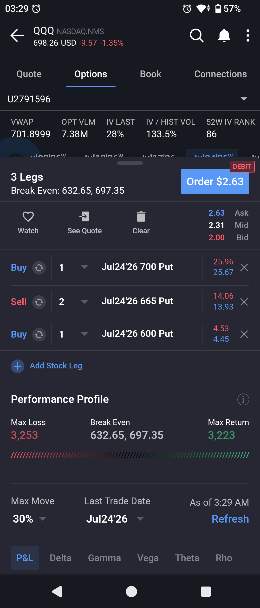
- 1514335897112547360_1514335896961421382.png: IBKR Mobile：QQQ 698.26(-1.35%)，IV 28%，52W IV Rank 86。3腿做空方向断翅蝴蝶（Jul24'26到期）：Buy 1 700Put@25.96 / Sell 2 665Put@14.06 / Buy 1 600Put@4.53，DEBIT Order $2.63，BE 632.65/697.35，Max Loss $3,253，Max Return $3,223。用来说明1:2:1断翅蝴蝶的构建与损益。
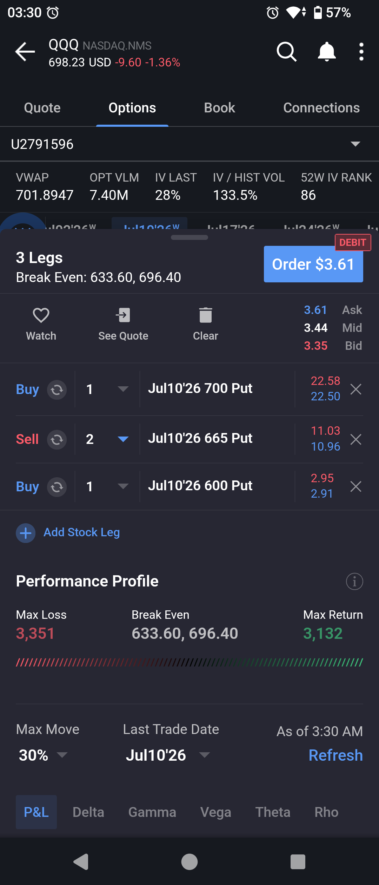
- 1514336111558918335_1514336111282098176.png: IBKR Mobile：QQQ 698.23(-1.36%)，IV 28%，52W IV Rank 86。同结构断翅蝴蝶但换到期日（Jul10'26）：Buy 1 700Put@22.58 / Sell 2 665Put@11.03 / Buy 1 600Put@2.95，Order $3.61，BE 633.60/696.40，Max Loss $3,351，Max Return $3,132。用于对比不同到期日下同一策略的成本与损益差异。
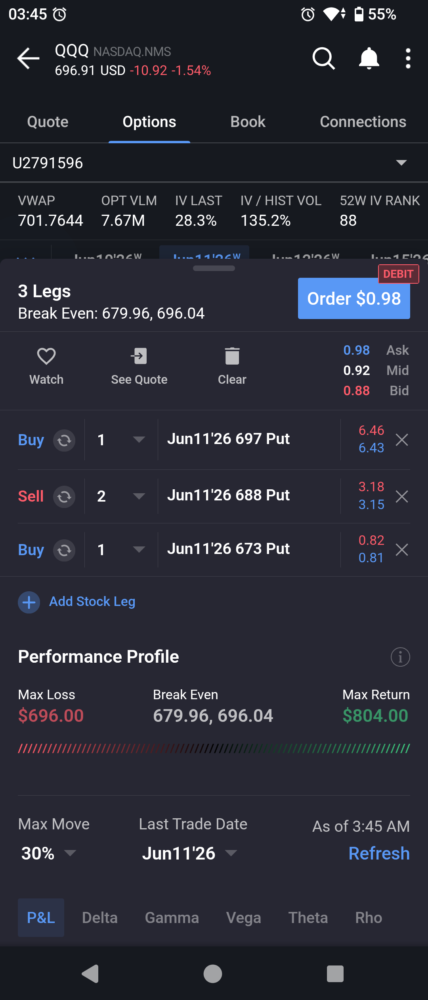
- 1514340327778160781_1514340327111000084.png: IBKR Mobile：QQQ 696.91(-1.54%)，IV 28.3%，IV Rank 88。0-1dte断翅蝴蝶（Jun11'26）：Buy 1 697Put@6.46 / Sell 2 688Put@3.18 / Buy 1 673Put@0.82，Order $0.98(Mid 0.92)，BE 679.96/696.04，Max Loss $696，Max Return $804。案例5图1：当日入场断翅蝴蝶实例。

- 1514340327778160781_1514340327501205604.png: IBKR Mobile：QQQ 696.44(-1.61%)，IV 28.4%，IV Rank 88。Jun10'26当日到期断翅蝴蝶：Buy 1 683Put@0.04 / Sell 2 697Put@2.10 / Buy 1 706Put@9.93，Order $5.83(Mid 5.49)，BE 693.64/700.36，Max Loss $1,064，Max Return $336。案例4图2：展示已越过卖卖区后的组合状态。

- 1514344810172121109_1514344809807089835.png: IBKR Mobile：QQQ 696.05(-1.66%)。Jun10'26当日到期断翅蝴蝶（图2）：Buy 1 697Put@2.24 / Sell 2 688Put@0.13 / Buy 1 675Put@0.02，Order $2.02(Mid 1.99)，BE 680.88/695.12，Max Loss $588，Max Return $712。案例5图2：QQQ跌9刀后组合价值模拟。
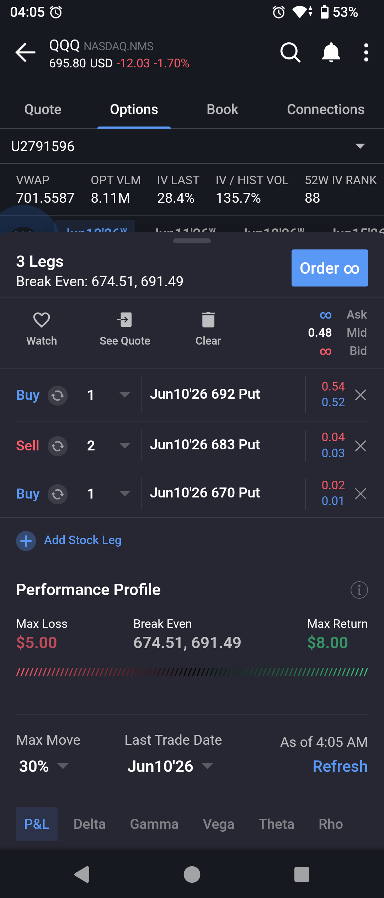
- 1514344810172121109_1514344810142765066.png: IBKR Mobile：QQQ 695.80(-1.70%)。Jun10'26当日到期断翅蝴蝶（图4）：Buy 1 692Put@0.54 / Sell 2 683Put@0.04 / Buy 1 670Put@0.02，Mid 0.48，BE 674.51/691.49，Max Loss $5，Max Return $8。案例5图4：股价上涨5刀后的组合报价(0.48)。

---

## 案例 2
**时间**: 2026-06-10 20:10 UTC
**社群提问（背景）**:
- **[mikep7069]** 06-10 18:19: 为什么买末日期权 这个我记得和赌博没有区别 可以详细解释一下逻辑吗
- **[ciaokk8]** 06-10 18:30: 晓晓老师，我是纯期权交易者，这种猴市行情是不是不适合做期权卖方？这种行情下，有什么好的期权策略推荐嘛？
- **[ciaokk8]** 06-10 18:34: 我是说我是期权卖方，这种猴市让我很痛苦，我想咨询有没有其他好的期权策略

**晓晓解答**:
最后，来解释最后一种情况，也是为何目前情况下，我极力推荐 亏损有上限的策略。

断翅蝴蝶的断翅，既是 下方买的最otm 的put，限制了下方风险
而如果我们不买下方put，策略就变成了比例差 put ratio
买1 delta 0.5
卖2 delta 0.25

这种净卖出的策略 很明显是下方风险无限的。因为是净卖，这种策略因为时间损耗很高，所以可以选择0dte，也可以在 高VXN 选到期日更长的 ，像 1-6周。
（特别提醒：在低VXN环境下 一定不要拉长时间，否则任何VXN 的上涨，都会使得卖的put极度膨胀，大幅增加浮亏）

其实，理论上讲
put ratio 是更有利可图的
因为 绝大部分时候，我们就说 90%以上的情况下，断翅蝴蝶里买的那个otm delta 0.1put 都是归零的，那还不如 不买。

逻辑是这样没错。
但是在现在的环境下，周五和周二都出现了纳指NQ 1sd 是 200点左右，却出现 7sd 的跌幅1400点以上。

市场上任何人 都没有预料到这个move
否则你直接闭眼买 atm straddle  持有一天就翻7倍了
（做市商 定价的 1sd 是 200点，所以那2天他们亏损很严重）

既然市场目前出现了定价错误，为了尊重市场，我们选择买delta 0.1 put，可以在未来如果真的再一次出现7sd 这种极端下跌的情况下，我们的下方风险可以被保护。而保护费就是 图1 里的 买 673 put  0.81

这也是这个策略 风险最大的地方：

如果股价上涨，亏损极其有限，最多只有 0.92，甚至小涨/横盘的情况下，还能有盈利。
如果股价下跌在1sd 左右，可以翻倍4-6倍，到 4-6刀左右

但是如果出现股价大幅下跌，假设股价跌 24刀, 3.5%，从697 跌到 673 ，现在673put atm
 
最大亏损是
翅膀两端的宽度差距
这里是 下方9刀，和再下方15刀，也就是6刀

在实战中，如果真的股价跌到673附近，你如果提前止损的话，亏损会在3-4刀左右，因为你的673put 在你止损的时候 还能卖出一些当天的时间价值，会是2-3刀左右。
再加上 入场的debit 0.92
实际亏损是在 4-5刀左右。

虽然情况不是很好，
但是如果选择做1比2 put ratio，
真的出现5%的跌幅的话，qqq跌35刀，
那么亏损就会到25刀左右

---

## 案例 3
**时间**: 2026-06-10 21:25 UTC
**社群提问（背景）**:
- **[99_62054]** 06-10 21:27: 一手57万，一般人真的玩不了🤣  / 晓晓老师的资本有点雄厚
- **[99_62054]** 06-10 21:32: 如果是纳斯达克指数，对于margin要求是不是太高了？
- **[weelium]** 06-10 21:34: 明白，谢谢 晓晓老师

**晓晓解答**:
总体来讲
断翅蝴蝶，以及任何多腿策略
都只适合于 流动性好 且 每手股价很高 的标的上

最适合的是：
纳指NQ期货，一手57w刀
QQQ 也还行，一手7w刀
其他科技股 如果股价在700左右 也勉强。

200股价左右的标的慎用：手续费/交易损耗，不值当。

其实不是这个逻辑

不能看 标的价值 来决定风险

风险来自于波动，也就是sd的高低

纳指平时波动就在1% 以内
所以一个 NQ 的 当日风险 也就5700刀 左右

但单支个股 单日波动10% 不少见
那 报价570刀的个股
单日风险也是 5700刀 左右
相反，如果用 QQQ
其实的确会觉得：
折腾4腿，花92刀 买 这玩意
就为了挣100刀 甚至500刀
太麻烦，不值得。

主要原因就是因为，纳指（NQ 也好 ， QQQ 也好）
波动都偏低
所以对应的风险也低

不

风险有上限的策略
margin要求 就是最大亏损

在 QQQ的例子上
最大亏损 是 6刀 * 100 = 600刀，这就是一个断翅蝴蝶的 margin要求。

而纳指NQ 是 QQQ的8倍

margin 就是8倍 4800刀
盈亏 都是8倍

你可以理解为
做1手 NQ就是做了8手 QQQ

---

## 案例 4
**时间**: 2026-06-11 01:33 UTC
**社群提问（背景）**:
- **[ckck0078]** 06-10 23:49: 请问一下如果杠杆率在1.05的期权有需要上对冲吗。还是直接硬抗?
- **[kaichicken4833]** 06-11 01:33: 这两天还有机会搞一把0dte 吗？感觉大势已定了，波动不会太大了😂
- **[cb0199]** 06-11 02:21: 谢谢晓晓老师，讲得好清楚。想问一下直接买大盘指数 45-60dte的put，不一定拿到到期，中间如果有像上周五一样的大跌的情况可提前关掉。在当前波动下行的环境，这是不是一个好的策略？

**晓晓解答**:
你如果要问我
我个人观点是 现在这个阶段不能持有任何大盘股（既，跟纳指有严重相关性的股票）

但是我个人观点 不代表你

你最好少点自信

现在夜盘 NQ 的 0dte sd 有500个点

意思就是 有人愿意花500买straddle
做市商也愿意以500卖

你这话说的，相当于就是 花500买straddle的人和机构，全是脑瘫

500个点 什么概念？
500/ 29000 差不多 1.7%

意思是 买straddle的人
纳指不波动1.7% 就是亏钱

换句话说
如果有人和机构，愿意付这个钱
就说明波动就算不会到 1.7%，也至少会 1.2% 起步

而绝大多数情况下
盘内的波动 会超过1.7%
而最终收盘，理论上讲会以 1.7% 作为锚定，作为一个正态分布
既，-1.7% 至 +1.7% 的概率是 68%

当然，实际上 并不是正态分布
因为这个市场很明显是不符合数学模型的
否则不可能3天里有2天能出现 7sd 的波动

举个例子，你买atm put，delta 是 0.5
你相当于是做空了 50正股

所以你需要承担 股价上涨带来的亏损

这不是你 '关不关掉'的问题
等股价涨起来后，你的put已经浮亏了。

所以这本质上就是赌方向
跟直接做空正股没有很大的区别：
股价跌了就赚，股价涨了就亏

---

## 案例 5
**时间**: 2026-06-11 04:58 UTC
**社群提问（背景）**:
- **[kaichicken4833]** 06-11 02:30: 谢谢指教，学到了🙏
- **[cynthia937829]** 06-11 04:56: 非常感谢晓晓老师的仔细解答，我是个刚入坑学习期权的小白，我想请问下： / 1.如果在亚洲时区操作断翅蝴蝶，是不是要提前平仓而不要等行权，因为股价可能落在卖put 以下位置就要接货了，第二天夜盘的情况就可能跌下去了。 / 2. 会不会买1个697put, 卖2个685put, 再买1个673的put，这个组合不会更好点，两边价格区间一致，最大亏损就是操作时期权费，但这个在提前平仓时会亏损大一些吗？ / 3. 我理解这个是赌波动的策略？那可以同时在call方向做一套吗？这样最大亏损是两个组合的期权费，但是一旦股价往一个方向波动较多就可以赚钱
- **[ali7442026]** 06-11 05:46: 你好，为什么是卖的2腿时间损耗更严重，第一腿ATM 不是时间损失最快吗？

**晓晓解答**:
1. 你如果不想凌晨闹钟起来操作
你可以设一个无脑 市价平仓单，时间设在2点10分 之类的
2. 不
你把 卖2 688
向下移到 卖2 685
有2个问题

先说，这个叫 （非断翅）蝴蝶
或者可以称之为 经典蝴蝶
两侧宽度是相等的

第一个问题：
你把卖的2个put向下移动后
put 的delta降低
因为你是卖put，所以你的正delta会降低，导致整体组合会变成，负delta ，估计 负 0.1这样吧

负delta 相当于是入场就有方向性
如果股价涨，你立刻亏钱
如果股价跌，你立刻赚钱

第二， 如果你觉得1 不是问题
那把put向下移动 最大的问题就是 卖2put 收入的credit 少了

导致整个组合变成了 负theta，既 有时间损耗的组合：

如果断翅蝴蝶 24小时后 股价不动，根据我们之前的例子，组合价值会翻倍
而如果是经典蝴蝶，24小时后股价不动，组合价值会下降50%左右

而这个原因的本质就是因为 入场的debit大幅上升了

现在你把 1 和 2，合在一起
你就可以看到问题了：
24小时后，股价 小涨

你被 delta 和 theta 双重暴击，组合亏损，且亏损额度 是 几乎整个 入场debit，估计 2.5刀 左右 ，是 断翅蝴蝶的 价格的2.5倍左右

其实说白了，
你如果做蝴蝶
你入场就是赌方向
那既然你赌错了方向，亏钱是天经地义的
3.
这个不是赌波动的策略
总体来讲 买2卖2
vega 是平衡的

iv上升和下降 对组合影响不大

这个策略主要是 时间损耗策略：
期望 过了12-24小时后
股价移动到你卖的strike附近，使得 你卖的2腿 被时间损耗更严重，相比于 你买的2腿，这个时间损耗的差距 来获得盈利

而因为 不同strike的时间损耗，在 长到期日 没有很大区别，所以 只有0dte的 断翅蝴蝶 才能有 这种 通过不同strike的 时间损耗差距 来形成盈利

因为股价是有会移动的
入场时候atm 的期权 时间损耗最大

但是随着股价移动，atm期权会改变

当股价移动到688
那就是卖的688 期权 时间损耗最大了
你如果觉得难理解
（因为theta是微积分的概念）

你可以做个极端的例子

假设你入场后
股价直接1分钟崩盘9刀 到 688

请问 你认为在这个情况下，这个组合是盈利还是亏损？
答案是 会大幅亏损

因为 atm的期权 的 extrinsic外在价值 是最高的，而你卖的2个688put extrinsic大幅膨胀，你出现大幅浮亏
（而时间损耗，就是在损耗外在价值）

继续这个例子，假设股价 在接下来的24个小时，一直横盘在 688 不动

那请问 现在相同的仓位，是不是该 大幅盈利？答案是，必须的！

那你是从 大幅亏损，24小时后 变成大幅盈利，你的盈利来源 来自于theta。

而期权定价的关键 是 即时性的：
在当下这一刻的股价，时间，iv，决定所有期权的价格。
既，你是从哪个路径 到达的这一刻，不影响定价：

不管是 股价1分钟崩盘 9刀然后横盘24小时

还是 股价 阴跌24小时 9刀

还是股价暴涨 暴跌暴涨 再暴跌，最后到达688

只要股价24小时后 在688
那你就会大幅盈利，而你的盈利来源 来自于 那一刻688 期权 的过去24小时的 时间损耗（不管到达的路径如何）

---

## 案例 6
**时间**: 2026-06-11 08:49 UTC
**社群提问（背景）**:
- **[ali7442026]** 06-11 06:04: 感谢，懂了
- **[ali7442026]** 06-11 06:09: 就是股价在移动，24小时后688变成atm了，那假设价格一直在697横盘呢
- **[ali7442026]** 06-11 06:20: 不好意思，前面有说过，刚才没看到

**晓晓解答**:
6月11日 纳指NQ早报

夜盘sd: 500 （极高）
(晚上6点的报价，第二天下午4点过期的末日straddle）
目前sd: 380 （极高）
盘前涨幅：1.3%
当日判断：中性
推荐策略：末日铁鹰 0.15 0.05 (call spread和put spread的 delta)

评论：
总体来讲，大盘处在极高位，长期看跌20%。但是在连续杀跌多日的情况下，必须短期看多。由于目前VXN极高，且有正常的指数put skew，与其于去博短期的单日空头回补暴涨，不如选择卖低位溢价极高的put，所以这里，与其于 选择买 atm call spread作为做多腿（形成 看多方向 断翅蝴蝶），更倾向 选择卖 deep otm put spread作为做多腿（形成 中性铁鹰）。
这个点位与VXN，没有短期赌方向的必要，无论赌涨还是赌跌。

---

## 案例 7
**时间**: 2026-06-11 13:59 UTC
**社群提问（背景）**:
- **[fy2165187809]** 06-11 14:06: 请问期权有推荐的券商吗
- **[cynthia937829]** 06-11 14:16: 作为小白最开始只会卖put, 现在知道错了😩
- **[cynthia937829]** 06-11 14:31: 我可以请教一下这个是哪个标第的期权呀？我没找到。QQQ不知道为啥真的权利金很少，就算是买8️⃣份也远达不到$34

**晓晓解答**:
可能你看的数据有延迟

你如果在IB 
直接搜NQ 可以看到 期权链

如果你在其他券商
你开通 期货期权 交易权限，应该也能看到

其实还好
上方 宽200
下方 宽300
入场delta 0

能拿37刀
IBKR
以你这个逻辑

那卖裸put 的 最大亏损 还是接近无限呢。。。

这里 37刀的收入
对应 200 和 300的宽度
已经很合理了
做多方向的断翅蝴蝶
并不是很好用

因为 做空方向断翅蝴蝶 利用put skew ，所以卖的put 价值稍高一些

做多方向，在指数上是没有call skew的

而综合高  VXN 
其实还是更推荐卖 deep otm put credit做多，而不是买 atm call debit spread 做多

但是 理论上 这2个 差别其实 并不是很大
你如果买一个 
delta 0.5 0.4 的 atm call spread
再配上 卖一个 
delta 0.15 0.05 的 call spread

形成 断翅蝴蝶

其实 短期来讲，盈亏会跟 铁鹰差不多

持有3小时后 才会有很明显的 收益差距（股价不同的走势，会导致 2个 策略收益不同）

其实 裸卖put 长到期日
在低iv 的情况下 是 风险极大的

这个之前已经讲过了
如果出现 股价暴跌 iv暴涨的情况

长到期日的 put会被双重暴击

而短到期的put，起码还能通过 到期日临近，导致theta的提高，来反制 iv 上升 带来的 extrinsic膨胀
（卖单腿call，不管covered 还是 naked，或者 strangle，都同理：低iv+长到期日，风险巨大）

纳指 期货NQ
NQ的multiplier 是 *20

所以报价是 37
拿到的钱 是 *20 = 740 刀

**配图说明**:
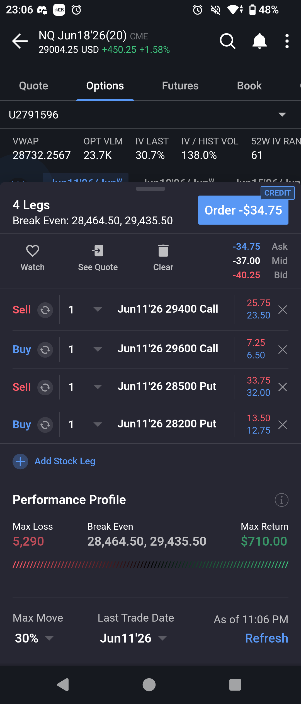
- 1514631947291332628_1514631947014504458.png: Webull（webull暗色App）：NQ 6月18'26期权组合页，4腿铁鹰：卖29400C/买29600C、卖28500P/买28200P（6/11到期），收credit -34.75，盈亏平衡28464.5/29435.5，最大亏损5290、最大收益710美元，说明铁鹰策略的盈亏结构（小盈利大概率、尾部亏损大）。

---

## 案例 8
**时间**: 2026-06-11 15:08 UTC
**社群提问（背景）**:
- **[cynthia937829]** 06-11 14:16: 作为小白最开始只会卖put, 现在知道错了😩
- **[cynthia937829]** 06-11 14:31: 我可以请教一下这个是哪个标第的期权呀？我没找到。QQQ不知道为啥真的权利金很少，就算是买8️⃣份也远达不到$34
- **[cynthia937829]** 06-11 15:05: 有一个尴尬的情况想请问下，我之前卖港股港交所put, 卖的$400这个月底到期，但现在股价$370了，我想以目前的价位买入，但我400的put可以怎么处理呢？ / 如果把这个put rollover 远一点，能降低一些成本，但始终还有再接货的风险。 / 如果我现在不以$370买，我怕会错过这个价格。如果放任月底到期以$400的价格接货，我又觉得成本太高。🥲

**晓晓解答**:
持有到期是最好的选择

以后卖put 要多注意

股价在到期前反弹上去 ，导致比错过抄底机会，是卖put的最大缺点之一

因为本质上，你在股价高位入场卖pur 正delta
所以你已经在高位入场做多了，股价跌下来后 你入场的成本依然保持在高位

---

## 案例 9【重复提及—此前已回答过】
**时间**: 2026-06-11 16:24 UTC
**社群提问（背景）**:
- **[uqnt.]** 06-11 16:33: 还是直接买put 比较好？
- **[kaichicken4833]** 06-11 16:35: 没怎么玩过期权，想问一般专门玩期权的年化收益，期望是多少？
- **[claire1101.]** 06-11 16:35: 一觉醒来晓晓老师回归了！感觉回到了2021年！泪目

**晓晓解答**:
偶尔会。

不盯盘 ，可以设 时间到，自动平仓

我在今天的早报已经说过了：
目前这个点位和 VXN
没有赌方向的必要
这个没法说

因为本质上 不管你做任何事
都是靠市场吃饭

市场符合你做的事，你就可以赚钱
不符合，就会亏钱，甚至可以非常快

---

## 案例 10
**时间**: 2026-06-11 18:15 UTC
**社群提问（背景）**:
- **[cb0199]** 06-11 17:51: 很大程度上要靠自己实操和时间积累吧。就算是对市场很了解，像今天trump又出来画K线，早晨对市场的判断不成立了，也是要承担一些亏损。短线交易的话，这种情况出现就是考验风控能力和止损的执行力了
- **[fy2165187809]** 06-11 18:37: 晓晓老师太有实力了
- **[fy2165187809]** 06-11 18:37: 顶级分析

**晓晓解答**:
你做的什么交易 需要止损？？

我早报写的是中性
且这个点位必须短期看多
且不能赌方向
如果早上做了这个交易
现在29400c 依然是 otm
继续持有到4点到期没有什么问题

如果股价接近29400
可以考虑止损平仓，或者展期到明天相同的 risk的 29400 29600 call spread
下方等过期后 4点01
可以再加一组
deep otm put spread

展期后，整个组合是负delta 有做空方向性。个人认为在暴涨后持有负delta没有什么问题
我本人在昨天4点收盘
做的铁鹰

当时股价更低一些
所以上方是卖 29150c 
已经展期到明天 相同risk的short call spread

如果你不愿意在这个位置承担 太高的做空方向性delta
可以考虑买更低一些的 call 使得spread变窄

但是 直接把delta止损清零，过于极端。这一次不一定是错误的，但我个人认为，长期这样 大幅调整delta（相当于是赌方向，这里是高位强行大幅追涨赌涨），是负期望。

其实这也是为什么做铁鹰要选deep otm 且足够窄，就算收益更低。

因为负期望，在游戏中，绝大部分是来自于犯错。
英文为make mistake
虽然听起来很generic，但事实着实是这样。

不管是
围棋，国际象棋，德州，立直麻将，还是这里的期权交易

世界上最优秀的玩家
并不是那些追寻 '理论最优解' 的人
而是那些追求consistency，保证自己几乎不犯一些严重的错误。

什么称之为 '严重的错误' ？
总体来讲，游戏中 严重的错误，不需要用高强度计算器AI 给算出来，而是 在一些职业玩家里（包括犯错的人自己），在冷静的复盘情况下 都可以比较容易的判断出：这个错误是错误。

既：
能比较容易被公认是错误的 错误，才是 严重的错误。

回到期权，我们并不是需要用高强计算器 去寻找 哪个策略 是 收益期望最优的，哪个策略可以收益最大化。

我们的目标应该是：
选择那些可以让我们更少犯错的策略

就像世界顶级玩家，比的是 谁犯错更少
要成为优秀的交易员，比的也是谁犯错更少

---

## 案例 11
**时间**: 2026-06-12 01:26 UTC
**社群提问（背景）**:
- **[fy2165187809]** 06-11 18:37: 晓晓老师太有实力了
- **[fy2165187809]** 06-11 18:37: 顶级分析
- **[cb0199]** 06-11 18:49: 我是周二下午的时候做的SPY的put debit spread 730/725明天到期，判断市场会跌，今天已经平了😅 要是那个时候有你在就好了。我一直以来做期权都是在赌方向的，看你这几天的分析有种醍醐灌顶的感觉

**晓晓解答**:
纳指NQ

夜盘sd: 
目前sd: 
盘前涨幅：
当日判断：
推荐策略：

评论：
总体来讲，大盘处在极高位，长期看跌20%。
6月11日 纳指NQ 晚报

夜盘sd: 450
目前sd: 450
盘前涨幅：0.1%
当日判断：看空
推荐策略：末日看空方向断翅蝴蝶
0.5 0.4 0.15 0.05 delta

评论：
总体来讲，大盘处在极高位，长期看跌20%。

昨天下午1点20左右，当日4点到期的sd 是 130点左右，股价在28700以下，
之后出现了极速的空头回补暴涨，最终到收盘涨到了29500附近差不多涨了800个点，既差不过6sd。这再一次验证了最近的市场是完全不符合数学模型，而这一波做市商再一次严重亏损。举个简单的例子，我卖的 29150c，本来报价3刀，如果持有到到期，最终内在价值会报价350刀，相当于最后2个半小时 这个call翻了100倍。而做市商卖了太多此类的call，所以他们为了止损，只能疯狂的在流动性缺乏的情况下大量买盘止损，买入正股/期货（也就是dynamic delta hedge，ddh）。什么意思？如果是一个正常的投资者，如果想买入QQQ做多纳指的话，为了让自己拿到更好的买入价格，一般会买一点，等一等，买一点再等一等。等的是什么？等的是流动性的回归，既，过一段时间又会有一些卖家出现，来承接买家的买单。而这种极速的拉升，很明显是卖家还没有来得及足够时间出现，而买家在市场上抢单任何卖单，导致流动性失衡：想买的机构（做市商）在不顾一切代价的止损。

这种涨幅，正常逻辑来讲是没有下方支撑的。当做市商大致已经止损完了，完成了ddh，如果日后股价下跌，他们没有意愿继续买入。的确，依然有可能会有散户/机构，去继续追涨，去继续short squeeze这些做市商，让他们继续追高止损。但客观来讲，这个点位和VXN 应该短期看空。

1. 可以持有少量负delta，如果要持有，建议以spread的形式，而不是空正股/期货
2. 可以做 末日做空方向的断翅蝴蝶0.5 0.4 0.15 0.05 delta
这里由于下方严重真空，所以参考sd非常高，这里下方下跌空间单日就可能有1000点，所以把下方的otm put spread移动到 deep otm 是 更稳妥的选择。
（选择 让自己更少犯错的策略）

---

## 案例 12
**时间**: 2026-06-14 01:41 UTC
**社群提问（背景）**:
- **[veneuro28589]** 06-12 18:00: 担心的是系统性回调，qqq里面芯片权重不低，自己要是从AI撤出来，qqq也是不好受的
- **[ionlyyolo]** 06-14 01:40: 我是小白 老师这个铁鹰是做的什么呀？
- **[ionlyyolo]** 06-14 01:42: 哪一个呢？好像好多选择

**晓晓解答**:
卖一个
下方out of money (otm) 的put spread
再卖一个
上方 otm 的 call spread

按照我说的delta进行选择

---

## 案例 13
**时间**: 2026-06-14 23:09 UTC
**社群提问（背景）**:
- **[haoxinwa]** 06-14 18:47: <@810570574551449670> 我已经购买期权课，请问怎么参加期权训练营？
- **[meitou_alex]** 06-14 18:48: 打开美投Pro，进入期权界面后，就可以看到期权训练营的tab
- **[haoxinwa]** 06-14 18:58: 请问期权训练营是以QA的形式吗？还是会有其他的视频和教学？

**晓晓解答**:
6月14日 纳指NQ 晚报

夜盘sd: 330
目前sd: 330
盘前涨幅：1.3%
当日判断：看空
推荐策略：做空方向断翅蝴蝶
0.5 0.4 0.15 0.05 delta

评论：
总体来讲，大盘处在极高位，长期看跌20%。

周末出现'利好'，期货开盘跳空高开。但sd依然居高不下，说明不可小视风险。

从叙事上讲，spaceX 与 伊朗谈判的催化剂都已过去。所以要谨防短期出现sell the news的情况发生。尤其是这种跳空高开，中间的缺口是没有成交量的支撑的。

要完成一个 '精彩的拍卖' ，最后一个成交，必须是闪亮的（像跳空高开），而不是平庸无奇的（像平开后震荡）。

---

## 案例 14
**时间**: 2026-06-15 01:14 UTC
**社群提问（背景）**:
- **[cynthia937829]** 06-15 00:51: 另外，我看新闻说美伊即将达成协议，这个新闻会不会影响今天看空的看法🫡
- **[suggestion098948]** 06-15 00:53: 请问这个怎么讲
- **[ionlyyolo]** 06-15 01:12: 你的券商盘前QQQ的期权有更新？

**晓晓解答**:
1. 是的
0dte 才能体现出 断翅蝴蝶的效果

2. delta 0
这样你入场后如果看错方向，你不会亏损。
看对方向 也不会盈利
（因为盈利来源是 theta，不是delta）
3. 你说的这些strike已经不准确了，因为股价已经变动了。NQ的期权是24小时更新的，但是QQQ必须要等开盘9点半才会更新。

如果很快跌到720，你没必要立刻平仓，因为一般都应该持有一阵，到下午2-3点平仓，或者直接等4点15过期。

---

## 案例 15
**时间**: 2026-06-15 09:50 UTC
**社群提问（背景）**:
- **[veneuro28589]** 06-15 08:25: 期权为什么要两边同时开仓呀
- **[uqnt.]** 06-15 09:49: <@227642228858683392> 晓晓老师，这是Futu NQ 0dte的报价， put 比 call高好多，是不是说明NQ下行压力大啊？谢谢

**晓晓解答**:
大盘指数 的 put skew
是正常的

下发put报价就是会更贵

---

## 案例 16
**时间**: 2026-06-15 10:59 UTC
**社群提问（背景）**:
- **[uqnt.]** 06-15 09:49: <@227642228858683392> 晓晓老师，这是Futu NQ 0dte的报价， put 比 call高好多，是不是说明NQ下行压力大啊？谢谢
- **[cynthia937829]** 06-15 09:51: 因为怕赌不对方向最终输多赢少，我本来以为只要到价就可以赚中间的实值差距，想着股票上下波动就两边都赚🤣
- **[uqnt.]** 06-15 09:58: 哦这样，前两天看没有差这么多呢，qqq的期权链也没有差这么多， call 17, put 26，期货指数和大盘etf差别好大啊

**晓晓解答**:
你看错了

期货NQ和 QQQ 
期权链报价是完全一样的
（否则就有套利空间）

---

## 案例 17
**时间**: 2026-06-15 13:37 UTC
**社群提问（背景）**:
- **[uqnt.]** 06-15 09:58: 哦这样，前两天看没有差这么多呢，qqq的期权链也没有差这么多， call 17, put 26，期货指数和大盘etf差别好大啊
- **[cynthia937829]** 06-15 13:36: 价格跳动得太快，很难构造0 delta，而且为啥我构造出来的都是要花钱买的😅并没有收入
- **[cynthia937829]** 06-15 13:41: 我好不容易构造了一个0.02 delta的，看上去要花36美才能买到手🤣

**晓晓解答**:
断翅蝴蝶 0delta 是debit

是
你应该尽量选整数strike
这样 流动性会好

---

## 案例 18
**时间**: 2026-06-15 18:58 UTC
**社群提问（背景）**:
- **[iambbb_]** 06-15 18:13: 卖call这腿就是牺牲了部分上行空间来降低总体策略的成本，到期前roll就可以不动正股，只是这条腿会有realized loss
- **[bajietalkshow]** 06-15 19:01: Risk Reversal Skew - MU。CME 对 skew / risk reversal 的定义非常接近实务用法：风险逆转通常比较相同绝对 Delta 或相同 moneyness 的 Put 和 Call 的隐含波动率差异。 /  / 你的图中纵轴是： /  / IV Diff=Put IV−Call IV /  / 现在整条曲线都在 0 以下，25 delta 附近 tooltip 显示： /  / Put IV−Call IV≈−5.34 vol pts /  / 这代表： /  / Call IV>Put IV /  / 这在单股票里很重要。传统美股指数或大盘 ETF 常见的…
- **[bajietalkshow]** 06-15 19:02: “绝对 IV 极高，但不是典型高溢价；市场正在为财报和 AI-memory 右尾重新定价，Call wing 明显拥挤，Put wing 相对便宜，卖波动率需要非常谨慎。”

**晓晓解答**:
你理解错误

你选择的每一条腿，都是有delta的
而你的组合里的每一条腿，delta都是负的。代表是做空/卖出。

既，你在入场每一条腿的那一刻，你就已经在那个股价，形式上，卖出了对应的正股。

举例，你的期权组合是 负0.5 delta ，那你就是形式上，在入场的价位卖出了50正股，所以这卖出的50正股 自然不会为你带来日后股价上涨的盈利。

而如果日后股价真的上涨，账面上，你那额外的50股 依然帮你获得了盈利。但是你组合的所有的腿的亏损，就是会（大约）抵消掉你那50股额外的盈利。

至于你如果在低位形式上 卖出了50股后，你却依然想要获得 那50股给你带来的涨幅，那你的盈利来源就必须换一个希腊字母。对于 正股+卖call 的组合来讲，在股价上涨后，你的盈利来源既变成了 时间损耗theta。

但是时间损耗theta不是让你白赚的。theta和gamma 一定是正负关系，而正theta 导致的负gamma 就会使得 股价越涨，你卖的call 负delta 会越来越负， 最终到负1，也就是跟正股 完全抵消（形式上 已被行权）。所以赚theta也要考虑对应的风险。

长话短说：
你如果在低位 入场了 负delta 的组合。那你就是形式上在低位割肉卖出了股票。那你形式上卖出的那一部分股票，不会在股价上涨时 为你带来盈利。

那说了这么多，我想你心里其实想问的就是：
在股价大跌后，怎么补救？

答案是：期权不是一个 get out of jail free card。
如果你没有提前做好仓位的控制，任何低位负delta的期权组合操作，都是形式上的低位割肉。

而如果我们评判这一波3天的暴涨，
任何持有卖call组合的亏损，都远远大于 买入put的组合的亏损。
这也是为什么我当时在低位推荐的是，使用
做空方向断翅蝴蝶
进行对冲，
而不是在低位卖covered call（形式上的低位割肉）

大盘 put skew
股票 call skew（热门股）

是常态

不要过度在意

那很明显 你用的AI 智商比较低

你去寻找100个热门股票
99个以上都是call skew 的

所以AI 应用 MU 的call skew 去编故事，是不合理的。已这个AI 的逻辑，这99个股票 都满足AI编的故事 

而 热门正股call skew的本质
就是 买call 的人 远远高于卖call的人
买call 可以一次买10个 几十个
但卖call 要持有100正股才能卖1个（已covered call 来讲）

而愿意承担裸卖call 的无上限风险的 人/机构，又少之又少。

所以做市商 被迫 在 太多人想买call的环境下，出来承接 当卖方，那 demand 远超过supply，那做市商 必然会把 call 的报价 订的偏高，自己才愿意去承担 无上限风险 去卖

6月15日 纳指NQ 晚报

夜盘sd: 280 （中等）
目前sd: 280
盘前涨幅：0
当日判断：看空
推荐策略：做空方向断翅蝴蝶
0.5 0.4 0.15 0.05 delta

评论：
总体来讲，大盘处在极高位，长期看跌20%。

今天股价大幅上涨，来到前高。还好VXN暂时还没有大幅回落，所以 做空方向断翅蝴蝶 依然可行。持有小负delta做空也可行。

在没有明显利空的情况下，以及各大事件已经过去，大致可以接受市场回到符合sd模型的常态，既：下方风险可控。

日本央行明日将会加息。理论上已经被price in。

---

## 案例 19
**时间**: 2026-06-15 20:02 UTC
**社群提问（背景）**:
- **[jackstom]** 06-15 20:54: 这个是事件触发
- **[jackstom]** 06-15 20:55: 不是？
- **[jackstom]** 06-15 20:55: 突发事件

**晓晓解答**:
从sd 的角度定义

从3月30号 到6月3号

这2个月的涨幅
是超过4个sd的

很多月期权call，都能翻20多倍，是非常罕见的。

虽然我很想说：
目前市场不符合数学模型

但是这种 '这次不一样' 的言论，往往还是不太可靠的。

sd 就是 atm straddle 的报价

数学模型上是 正态分布的标准差

选择的到期日越长
标准差就越高

虽说 市场有 肥尾巴 相比于正态分布是真的
但是超过4sd的涨幅
依然是 非常罕见的情况
因为 正常定价是 下方有暴跌风险，所以指数put skew，上方暴涨风险极小，所以otm call的价格 比 otm put 低很多。

之所以call的价格低
所以才导致了 月期权的call 都能翻20倍。

其实把3月30到6月3 的那波涨幅
跟最近3天的涨幅比较
是很明显的缩影：

1. 指数必然是put skew
2. 出现 远超sd的涨幅
3. 上方call 翻几十倍

换句话说，
从理论上讲，在高VXN 的环境下，卖上方call 是 可以互补的，既：
如果股价上涨给卖call带来亏损，VXN也应该对应的下跌，给卖call带来盈利。

但在不管是 3月30
还是最近3天
这个逻辑都完全行不通

因为只要涨 就一定会暴涨到远超过sd 所预测的数值，导致任何卖call的都亏损严重
我们就拿 今天到期的 QQQ 741c 举例
3天前 他收盘在 0.11

从正常角度来讲，这个期权 大概率归零

但就算不归零，亏损也应该很有限，因为出现大幅暴涨的概率低。做市商也是 price in 了这一点，所以才把这个call 报价设在 0.11

但是当暴涨出现的时候，今天收在了 3刀
差不多翻了25倍

这样的例子 比比皆是
所以楼上的群友才会质疑 低位卖call 的亏损为何会如此严重

你的理解是错误的

事件是 市场上所有人都知道的
做市商也知道
所以可以用信息去定价期权

而周五夜盘的 sd 是380
今天纳指涨了900多

也是远超sd的
而周五 已经完全不能算是突发事件了

因为当时新闻头条已经非常多了
唯一不可控的
是 周四 下午1点40左右
特朗普的推文

但那个推文就促使市场涨了6sd
我当天也记载了

所以在那之后
市场上所有人都获得了信息
理论上讲 做市商就应该正确的定价sd

但事实却是 本应低概率的暴涨事件，却屡屡发生
要不 我们就这么说

假设周五你有小道消息
很确定谈判很顺利

上面那张 741c 周五收盘的报价 也就只有0.15

你也无法说服你自己去买这个call

因为 做市商定价的是：

1. 很有可能 谈判利好
2. 在谈判利好的情况下，很可能涨
3. 在涨得情况下，很可能涨380点左右

事实却是涨了900多点
这个本来应该 盈利非常困难的call，反而是收益非常的大

**配图说明**:
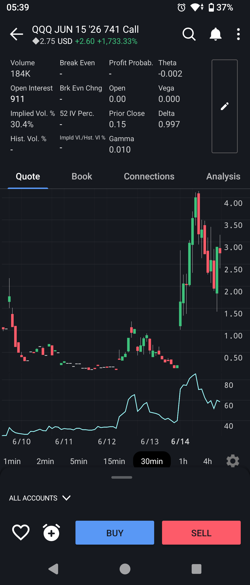
- 1516180416623546368_1516180416279609344.png: 手机端期权交易App（深色界面，风格类似Tastytrade/IBKR移动版）的单个期权合约行情页：QQQ JUN 15 '26 741 Call（2026年6月15日到期、行权价741的QQQ深度实值看涨期权），现价2.75美元，当日+2.60（+1733.33%）。关键指标：Volume 184K、Open Interest 911、Implied Vol. 30.4%、Delta 0.997、Gamma 0.010、Theta -0.002、Vega 0.000、Prior Close 0.15。下方为30分钟K线图（6/10-6/14），显示价格从约0.30暴涨至4.00附近后回落至3美元左右。作用：以delta≈1的深度实值期权为例，说明其价格随正股线性变动、时间价值（Vega/Theta）接近于零的特性，用真实数据佐证回答中关于实值期权替代正股的论述。

---

## 案例 20
**时间**: 2026-06-16 07:16 UTC
**社群提问（背景）**:
- **[jackstom]** 06-15 20:55: 不是？
- **[jackstom]** 06-15 20:55: 突发事件
- **[loopy_s]** 06-15 22:05: 讲的真细，牛逼👍 👍 👍

**晓晓解答**:
6月15日 纳指NQ 早报

夜盘sd: 280 （中等）
目前sd: 250
盘前涨幅：0
当日判断：看空
推荐策略：做空方向断翅蝴蝶
0.5 0.4 0.15 0.05 delta

评论：
总体来讲，大盘处在极高位，长期看跌20%。

今天股价大幅上涨，来到前高。还好VXN暂时还没有大幅回落，所以 做空方向断翅蝴蝶 依然可行。持有小负delta做空也可行。

在没有明显利空的情况下，以及各大事件已经过去，大致可以接受市场回到符合sd模型的常态，既：下方风险可控。

日本央行明日将会加息。理论上已经被price in。

日本加息0.25%，符合预期。
讲话被市场理解为鸽派。
决议后日经直线拉升至7w点
美日汇率 也反弹，依然保持在160上方。

之前日本央行的说辞是，要痛击投机者 来投机做空日元（借日元来卖，然后购买其他资产）
但是以现在的情况，看起来日本央行认为光靠慢慢加息，就能足够稳住汇率了。如果日股美股韩股 年收益率持续保持在高位，在日本央行没有决心护汇率率的情况下，看起来是能接受阴跌的结果。

也许，日本央行认为 各国股市的收益率会下降，使得套利交易收益率降低，从而来稳住汇率。但是为了面子，日本央行不想因为加息过快，导致 各国股市崩盘 被当做借口。（像24年8月那样）

但先有鸡还是先有蛋，对汇率的结果会是一样的。

---

## 案例 21
**时间**: 2026-06-16 09:08 UTC
**社群提问（背景）**:
- **[jackstom]** 06-15 20:55: 突发事件
- **[loopy_s]** 06-15 22:05: 讲的真细，牛逼👍 👍 👍
- **[forxin5854]** 06-16 08:09: 請教一下，你長期看跌納指20%？長期的時間範圍是多長？美投看漲標普年底8200，你的意見年底標普會是多少？ 謝謝

**晓晓解答**:
年底 太短了吧
长线投资，哪有以半年作为单位的

我觉得，不用我说，大家心里都应该清楚未来 纳指 肯定有回调。只不过大小不好说，时间也不好说。

其实与其于说纳指
我想大家最近已经发现，过去3年的M7，已经在今年underperform了很多。而纳指作为一个指数，很明显是DRAM 推上去的。

作为传统周期性行业，这次市场 想跟你说：
'这次不一样，AI对存储需求无限，扩张产能永远赶不上需求'

有没有可能是相同一波人，
去年底跟你说：
'这次不一样，AI对白银需求无限'
导致白银3个月从40涨到115现在跌回65

从基本面的角度讲，公司的股价，是对公司未来盈利的折现。未来的盈利，不是今年，不是明年，是未来100年甚至几百年。而今年明年的盈利预期好，在周期性行业，当然是不能成为未来盈利也会很高的佐证。所以，在周期性行业，不能纯粹靠今年的盈利，来决定公司的股价与估值。

当然，也许 '这次不一样'。

---

## 案例 22
**时间**: 2026-06-16 11:23 UTC
**社群提问（背景）**:
- **[forxin5854]** 06-16 10:54: 我想請教你的「長期看跌」是多少年？三年？五年？十年？我假設是十年，意思是說十年後納指大約是21300點，比現在的26600點低？ /  / 還是你的意思十年後納指會比現在的26600點高，但這個上升的「過程」當中會出現20%的回調？如果是這個意思，那沒什麼好討論的，大家都知道幾乎必然會發生。 /  / 納指跟白銀的類比未必合適。白銀就是白銀，納指是科技股的集合體。納指不是靜態，它本身會按市值汰弱留強，是動態。DRAM能把納指推上去而M7沒怎動，說明納指可以受到其他個體推進，即使將來M7不行，也可能有新的M7推高納指。 /  / 我認為AI是科技奇點，對科技有結構性的昇華，所以納指十年後會比現在…
- **[forxin5854]** 06-16 11:41: 這是討論區吧？我就事論事，也沒對你不禮貌。對你的觀點有質疑，希望釐清你的觀點，你覺得是杠？我沒逼你一定要回答年底是多少，有是最好，年底驗證。沒有也沒事，但至少定義你的長期20%看跌吧？什麼時候，多少點？ /  / 你說長期跌20%，沒給大概的實數，沒給時間。完全缺乏可證偽性，虛的像風水師，怎樣都可以自圓其說。 /  / 如果將來納指跌了，你可以說看中了。如果納指升了但回調（依家高於今天），你也可以說看吧，回調20%了（用升高後的基數來說的20%）。 /  / 算了，既然不能理性討論，那就免談。祝晚安。
- **[ionlyyolo]** 06-16 11:50: “长期看跌20%”的意思是时间拉长了看会有20%回调的风险 我的理解

**晓晓解答**:
第一，我没有义务跟你杠

第二，你说的纳指是纳指综合，这个是很难交易的品种。绝大多数人买纳指100，QQQ或者NQ。纳指综合里有太多太多垃圾小盘股，导致这个股指的走势非常的不干净，有时被纳指100引导，有时被罗素2000引导。

而这个侧面说明你的底层逻辑就有问题：
你说你相信纳指可以靠各个其他个体推进，但是事实是，你根本不认识纳指综合里面的几千只垃圾小盘股，而这些垃圾小盘股过去几年几乎全是趴着，你怎么得到你的信仰？你大致只能看到几个权重稍大点的权重股对指数影响稍大，然后你就盲目的对几千只垃圾小盘股形成了信仰。这是毫无逻辑可言的。

你如果心里的信仰是纳指的核心大盘股，你看的却是纳指综合，那是很明显的认知偏差了。

第三，关于纳指100 长期下跌20%，是非常合理的评估。我之前也说的很明确了，大家心里都知道纳指一定会回调，只是不知道大小以及时间。在这个背景下，你强迫要求我对年底做预测，是，除了为了抬杠而抬杠，是完全没有任何意义的。

也许你更关心的是，在纳指回调20%之后，它是会 反弹 还是继续横盘

第四，关于美投君给的预测
我这里不想点名任何人/分析师/机构。我只谈一下业内的情况：
总体来讲，给出一个市场叙事所能接受的 in-line的期望，是非常容易的。因为你如果期望对了，那你跟市场上绝大多数分析师都对了。而你如果期望错了，那你市场上绝大多数分析师都错了，而错了之后，大家一起改变/下调 期望，也没有什么严重的问题。

换句话说，市场上 超过90%的 分析师/机构，给 大盘 与股票，都给出的是买入评级，目标价高于目前的价格。而你并不会因为这帮大部队 都给出看涨期望，就闭着眼睛什么股票都买，因为你心里应该明白：分析师/机构 给出多少期望，他们只是嘴上说说。而你自己投的，是你自己的真金白银。他们说错了不需要付出代价，但你跟着他们错了，你会有代价。所以你才会认真斟酌该投哪个，投多少，何时投。

而当股价真的下跌的时候，分析师/机构 再集体下调目标价，也是非常合理非常常见的。换句话说，分析师/机构 给的评级和目标价，对你的投资决策，并不应该有很大的影响。

你说话极其不负责任；
'虚的像风水师'

这个是你所谓的 '礼貌'？

我说的跌20%，就是以现在的价格回调20%，计入通胀/利率。

为何计入通胀？因为投资都必须是以 无风险收益作为 锚 进行对比。

如果 每年通胀5% 利率5%，4年后通胀了20%，而纳指价格如果维持了不变，那这就是纳指 下跌了20%。因为你如果持有现金，你赚的20%无风险收益（理论上抵消了通胀）

而如果 下个月，纳指跌了20%，那在忽略1个月内的通胀的情况下，这个也算 纳指下跌了20%。

不管是第一种情况 还是 第二种情况，这都叫回调。
回调 英文是 correction，在 correct 什么？correct股票的估值。

股价理论上 应该反应 公司未来的盈利。当这2者 出现 严重差异，导致高股价 严重高估了 实际未来的盈利，那理论上就应该 correct这个差异，也就是股价下跌。

而我上面解释的关于 DRAM 的 对未来盈利的高估，就是 长期 跌20%的 底层逻辑。

我们无法预测何时会回调，但我说的一切，是完全可以证伪的：

你拿一条
指数增长的曲线，设年利率为5%
与未来 几年纳指的走势

如果纳指的曲线，低于 指数增长 曲线，低了20%，那就说明纳指回调了20%。

既：
你认为我说的
'缺乏可证伪性，虚的像风水师'
这是因为你的个人偏见，
还是由于你对'证伪'的认知不足？

---

## 案例 23
**时间**: 2026-06-16 12:48 UTC
**社群提问（背景）**:
- **[forxin5854]** 06-16 11:41: 這是討論區吧？我就事論事，也沒對你不禮貌。對你的觀點有質疑，希望釐清你的觀點，你覺得是杠？我沒逼你一定要回答年底是多少，有是最好，年底驗證。沒有也沒事，但至少定義你的長期20%看跌吧？什麼時候，多少點？ /  / 你說長期跌20%，沒給大概的實數，沒給時間。完全缺乏可證偽性，虛的像風水師，怎樣都可以自圓其說。 /  / 如果將來納指跌了，你可以說看中了。如果納指升了但回調（依家高於今天），你也可以說看吧，回調20%了（用升高後的基數來說的20%）。 /  / 算了，既然不能理性討論，那就免談。祝晚安。
- **[ionlyyolo]** 06-16 11:50: “长期看跌20%”的意思是时间拉长了看会有20%回调的风险 我的理解
- **[willsun314]** 06-16 12:33: 20% 这个数字是怎么来的，可以请教一下推演过程或者逻辑吗？

**晓晓解答**:
既然是整数，就说明不可能是计算出来的。
因为如果拿数学模型计算出来，不可能得到整数的

20% 是一个合理的数字，因为是市场的心理防线
作为熊市的定义

而从qqq的角度来讲
回调20%
是到 600

就是今年1月 2月的价格。
当时伊朗没开打，DRAM 也没有大幅上涨

---

## 案例 24
**时间**: 2026-06-16 23:57 UTC
**社群提问（背景）**:
- **[99_62054]** 06-16 21:28: 能说说为什么会出现上涨衰竭吗？如何判断出来的？
- **[veneuro28589]** 06-16 21:55: 交易员开始减仓，今天阻力位745都没能破，反而今天跌破了第二个支撑位，我是这样判断的
- **[ionlyyolo]** 06-17 00:16: 老師的0.5 0.4 0.15 0.05是怎麽選出來的？

**晓晓解答**:
6月17日 纳指NQ晚报

夜盘sd: 385（中等）
目前sd: 385
盘前涨幅：0
当日判断：看空
推荐策略：做空方向断翅蝴蝶
0.5 0.4 0.15 0.05 delta

评论：
总体来讲，大盘处在极高位，长期看跌20%。

客观来讲，今天出现了阴包阳的走势。但根据目前的sd，无法看到单日极端暴跌的情况出现（以之前的逻辑，关键事件已经过去）。所以继续保持短期下方风险可控的看法。

注意此周是季度期权结算日，俗称四巫日。也许周三周四会出现波动，但385是偏高的sd可以理解为已经把波动price in。

我欣赏你的交易逻辑

你是，高数量买单腿期权，偏向追趋势。自己为自己的时间损耗买单，换来正gamma的加速度，我觉得是可以的。 

这里我会推荐你交易纳指NQ的期权，几个优势如下：
1. 我看你喜欢高数量买单腿期权，而期权以手计手续费，一般价格是在 1刀/手。所以你如果换到一个底层价值更高的产品，像NQ是 QQQ的8倍，你可以节约起码70%的手续费/交易损耗。

2. NQ 是24小时交易的。对于追逐趋势的你来讲，亚盘时间段的盈利机会，或者周日晚上开盘的盈利机会，应该是会给你更多施展的空间。

3. 这一点其实是选NQ最重要的原因，但也许对购买单腿的你来讲，影响不大：
NQ 是准点结算
QQQ 是滞后结算
这个很重要，所以我仔细讲一下。

正常来讲，当日到期的期权，是以下午4点纳指收盘价进行结算。这个流程，理论上讲很干净：
如果你买了call，股价超过strike你就默认4点买入正股
如果没超过就4点过期作废
反之亦然（如果你卖了call）

纳指NQ期权就是这样结算的，你4点就会，拿到正股或期权作废。

但QQQ期权是滞后结算。
4点的股价，只是一个'系统默认结算价'，而实际QQQ的期权可以交易到4点15，且实际买家要求行权（覆盖系统以 4点默认结算价 自动行权与否），可以起码到5点半。
然后你需要等到第二天早上，才能实际确认是否被行权。这也就是我说的'滞后结算'。

对于经常买单腿的你来，且你每次都会全额手续费在收盘前平仓，这个结算差异，对提前平仓单腿期权交易，没有影响，因为你不会持有到4点去等自动行权。

但是很常见的期权策略是1比1的vertical spread，拥有最大盈利与亏损。

就拿买入call spread 举例
假设昨天我买了NQ
30500 30550 的call spread
收盘前最后2分钟极力拉升，冲到30560以上。以NQ的准点结算模式，4点你就会立刻自动行权30500call买入NQ，自动被行权30550call卖出NQ，得到最大收益50刀。这50刀会4点01分进入你的账户，你的所有仓位都会消失（不会有残余的期权，或者正股）。
（实际上NQ的一手是20股，每股股价3w多刀，所以这里入账的是 50 * 20 = 1000刀）

反观QQQ，假设我买了743call，卖了 743.5call。同样的，收盘前2分钟，股价极度拉升超过743.7。
因为你买的call是itm，系统默认自动行权，你会在第二天早上以743买入QQQ正股。
但是你卖出的call，因为是滞后结算，你的对家（买call的）是可以在5点半之前决定 放弃行权！！！
为何要放弃行权？因为很明显盘后5点前 QQQ跌到了743以下，买家以更高strike743.5 行权call是 亏的，情愿让买的call归零。
而你作为 743.5call的卖方，并不会知道你的对家买方是否行权，既：你是否可以在第二天早上以743.5 卖出 你刚刚以743买入的QQQ正股。
对于昨天这种走势，我可以很明确的告诉你，99%以上的概率，你卖的743.5call不会被行权，你如果持有这个spread超过4点15未平仓，你第二天早上会莫名其妙多出来100 QQQ正股，成本在743买入的。如果当时盘前股价在743，你还能立刻卖出，勉强不亏多少。但如果盘前已经出现下跌，你的正股就会出现大额浮亏（之后这个正股怎么处理，当然是你自己决定）

根据比较这2点，我们可以看出，NQ是直接干净的赚了50刀，而QQQ是不仅没赚到 本应赚的50刀，甚至根据第二天的股价，可能还会加深亏损。

得到的结论是：如果交易QQQ期权，为了谨防这样的情况出现，除了在deep itm 或 otm 的情况，可以把spread放到过期（获得最大化盈利），在其他情况 是极其推荐提前平仓的。

但提前平仓就会有第二个问题：手续费，交易损耗bid ask，以及 最大盈利的差距
平仓一个 宽度为0.5 的QQQ 期权，需要交纳 2刀手续费，bid  ask损耗 起码1刀，且你无法以 0.5的价格平仓，因为你卖的call始终还会残留一些时间价值（对应买家可以 至多5点半决定是否行权），所以你差不多只能以0.46左右的价格平仓。
既你如果提前平仓，你最终到手的钱，只有 46刀-2刀 手续费 = 44刀。
如果你每手spread 都额外为了平仓亏6刀，那随着你手数变多，会大幅影响你的盈利空间。

综上，交易QQQ spread一定要谨慎。条件允许的话，选择NQ期权交易，是更优的选择。如果你的券商不允许，推荐拿一笔钱小资金开通IBKR，一劳永逸。

附录：
任何股票的期权，都跟QQQ有相同的'滞后结算'的问题。但是好在绝大多数股票只有周五到期的期权，而周五盘后一般波动都不大

**配图说明**:
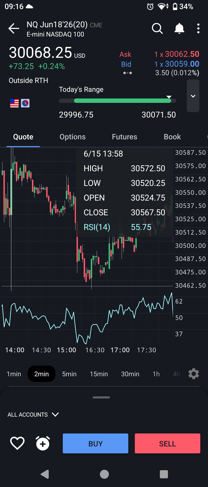
- 1516602698198155264_1516602697707556865.png: Webull：NQ 6月18'26期货（E-mini NASDAQ 100）报价30068.25（+0.24%），盘外RTH，当日区间29996.75-30071.50，2分钟K线，6/15 13:58高点30572.50、RSI 55.75，展示NQ盘面支撑/阻力位置，辅助0.5/0.4/0.15/0.05 delta选择讨论。
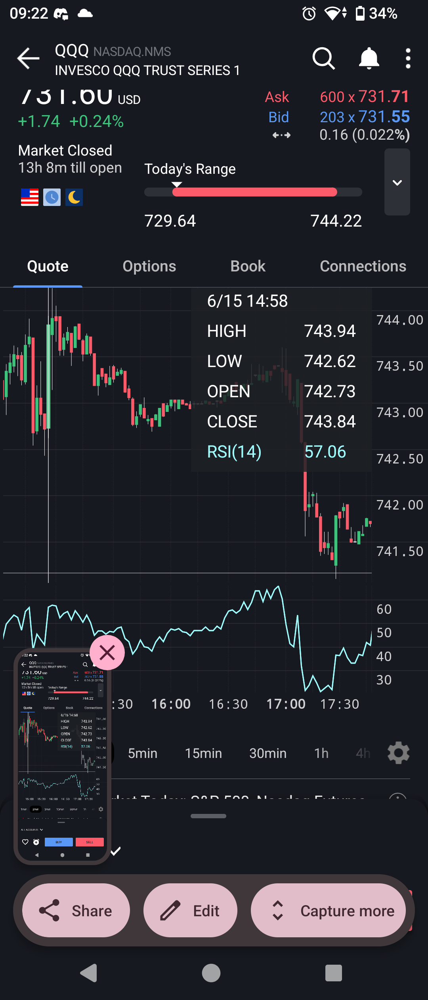
- 1516602698198155264_1516602697996959815.png: 手机行情App：QQQ 731.00(+0.24%)分时图，5分钟K线+RSI(14)57.06，显示6/15收盘后742-744区间波动，当日Range 729.64-744.22。case 48中用于对比NQ与QQQ行情差异。

---

## 案例 25
**时间**: 2026-06-17 03:34 UTC
**社群提问（背景）**:
- **[99_62054]** 06-16 21:28: 能说说为什么会出现上涨衰竭吗？如何判断出来的？
- **[veneuro28589]** 06-16 21:55: 交易员开始减仓，今天阻力位745都没能破，反而今天跌破了第二个支撑位，我是这样判断的
- **[ionlyyolo]** 06-17 00:16: 老師的0.5 0.4 0.15 0.05是怎麽選出來的？

**晓晓解答**:
其实，具体
除了必须开 atm put之外
另外3腿怎么取，差别不是非常的大。

你只要最后组成 总delta0就行了。

为何要总delta0？因为为了避免 股价上涨导致你亏损的情况。这个组合是 很弱的看空结构，主要靠时间损耗盈利，而不是 靠赌方向盈利

举个例子
你也可以选
0.5 0.3 0.3 0.1
或者
0.5 0.35 0.2 0.05

---

## 案例 26
**时间**: 2026-06-17 10:58 UTC
**社群提问（背景）**:
- **[cynthia937829]** 06-17 10:52: 辛苦晓晓老师的详细分享🙏 请问下， / 1. 如果按照您刚举的例子，在期权结算的时候，我两个期权同时行权对冲的话，我账户需要有60w本金来做先买货再卖货的动作吗？ / 2. 我用富途我看不到做NQ期权组合选项，我得单独买不同的腿去形成策略，得换成IBKR才行？ / 3. 我看NQ每天的成交量不大，买卖磨损会不会比较多？ / 4. NQ一股3W，如果做一手做Spread卡在中间，没那么60w多钱接货，券商會幫我直接平倉call？
- **[cynthia937829]** 06-17 11:12: 请问这个是NQ吗？我在IBKR找不到这个，也找不到其他类似的😩
- **[cynthia937829]** 06-17 11:16: IBKR真的难用🥲 我昨晚研究了好一会儿，说我没有期权报价的实时数据权，搞半天也开不了，我再去研究下💪

**晓晓解答**:
1. 如果是 deep otm/itm 的情况 不需要。但如果是near atm的情况，你需要考虑 最后10秒钟，股价可能会波动，导致卖的call 变成otm，只有你买的itm的call会自动行权，最后你会直接持有一个NQ期货，价值60w刀，你立刻market order卖出即可。但这个过程，是需要 5w刀 保证金 来持有这一个NQ期货的。如果你账户里没有5w刀空余的保证金，IBKR会提前检测到这个风险，差不多 3点40后，会按照多接近atm的程度，强平你买的call spread
2. 其实futu的 成交价是很糟糕的: payment for order flow。所以非常不建议在futu交易期权。
IBKR 没有 PFOF，所以能给你市场最优的成交价
3. 你看错了
NQ 的期权成交量巨大，
期权成交量比他更大的
差不多只有
标普产品：
SPY (etf)，SPX(指数），ES（期货）
纳指产品：
QQQ (etf)
4. 不止是 NQ
你做任何产品的spread

如果在到期前半小时，你没有对应的足够保证金接货，都会被券商强平的。

是这个
什么叫 搜不到？
你用的 IBKR是第三方合作的版本？

需要开通 期权报价的
需要先开通交易权限：
期货 ，以及 期货期权
开通报价，如果你只交易NQ
你只需要开通 CME level 1

在 market data permission 里找到 CME 即可
只要每个月交易 20刀手续费，订阅费是免费的
其实
你在 NQ页面
点左上角 那个 钟表符号
他就会引导你去 购买 实时报价的页面

**配图说明**:
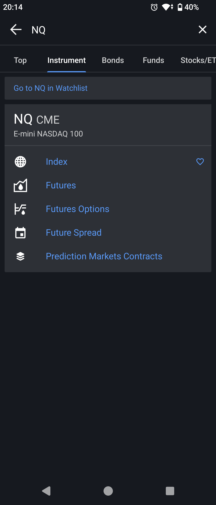
- 1516762885362290849_1516762885139861524.png: IBKR Mobile搜索页：输入NQ，Instrument标签下显示 NQ CME「E-mini NASDAQ 100」，可进入 Index/Futures/Futures Options/Future Spread 等入口，用于说明在IBKR中能找到NQ期货期权（对应富途搜不到的提问）。

---

## 案例 27
**时间**: 2026-06-17 19:56 UTC
**社群提问（背景）**:
- **[matthewhhe]** 06-17 20:04: 哈哈哈哈哈
- **[matthewhhe]** 06-17 20:04: 以为是底 结果还有地下室
- **[pandaontrip]** 06-17 20:04: 暗无天日

**晓晓解答**:
今天的晚报篇幅比较长，我会分批整合不同的角度

6月17 纳指NQ 晚报 1：
回顾收盘前最后2小时

这里我们用QQQ，因为期权成交量更大，可以更好的标记历史价格

美东2点44分，QQQ触顶735左右(p1)
当时的sd 是在4.4 左右(p2 p3)
但是收盘却从735跌到721，跌了14刀，超过3sd

而当这种极端跌幅再一次莫名其妙的出现的时候，我需要再一次评估我之前的观点，关于 '由于各大事件已经过去，暂时看不到下方暴跌的风险'

当然，配合这种莫名其妙的暴跌，必然就会涌现各种otm期权翻几十倍的场景，这里举例末日725put (p4)
2点44左右附近 报价在 0.22左右，最低甚至在3点10分左右 报价在0.18，
收盘报价 intrinsic内在价值4刀，差不多翻了20倍。

我想再一次重申，这种极端的暴涨暴跌行情屡屡出现，是不符合数学模型的。做市商愿意在2点44分以4.4 卖出这个straddle，或者以 0.2 卖出725p，他们是以当下最优的信息，给出的报价。他们愿意承接这样的交易，也是为了给他们自己赚钱，因为数学模型是,在'正常'的市场里，就算我们把正态分布 变成尾巴更肥fat tail，暴跌超过3sd的概率不应该超过 1.5%。而当暴涨暴跌真的出现的时候，做市商只能默认认亏止损，砸盘卖出。对于他们来讲，这些亏钱的事件，是小概率，可以用其他时间段他们的盈利来覆盖掉。而当这种小概率事件频频发生的时候，整个逻辑就坏了：
他们没有兴趣给买725put的赌徒 支付20倍的赔偿，更不愿意现在这样 频频支付。

所以，现在核心问题是，
为何最近的市场，频繁出现极端行情？

这个问题，我无法完整的回答。因为就算世界上最优秀的做市商，也在用真金白银为他们的错误定价买单

但以我的理解，理由差不多是这样的：
回顾最近 第一次极端行情，是上上周五6月5号，NQ开盘时sd 只有210左右，而当天在没有任何明显利空的情况下，却跌了7sd 超过1600点。

我个人的见解是这样的：
大部分最近这段时间 买股票（尤其是热门股DRAM）的 人/机构/算法，都知道这个涨幅不可持续，随时都可能出现 无法预测大小的回调。但是如果当下买入 或 当下继续持仓，在2分钟，2小时，2天后，能有大概率随着momentum趋势盈利，那就不需要考虑 股票估值：只要能短时间内浮盈就行了。

而当变盘行情出现的时候，我只需要比其他人跑的更快就行了。

目前 自动化量化算法交易，大部分都是以这个逻辑在进行交易。他们不在乎股票估值，他们只在乎短期的浮盈。所以他们在变盘的周五，不顾一切代价卖出，想比别人跑得快。

那现在问题来了。如果股价本应该对应公司未来几十年的盈利，但市场上超过90%的成交量都来自于不在乎股价估值的 算法交易，那到底是谁在捍卫 资本市场的底层逻辑？

很多人认为炒山寨币就是赌博，因为山寨币没有实质的基本面，更多是一个击鼓传花的游戏，买入的唯一目的，就是追逐趋势浮盈后，比别人跑得快就行。

那现在的美股市场，尤其是热门股DRAM，如果超过90%的成交量都来自于 与 炒山寨币 相同逻辑 的算法交易 ，那么当算法交易决定要跑的比别人快的时候，我们如何才能判断何为合理的股价？

答案是：
我们根本无法以当下股价的成交价，来判断公司的估值。因为以当下股价成交买入的算法交易，他们根本就不在乎当下股价是否符合公司的估值。他们只在乎几小时后 他们是否可以浮盈。而我们如果错误的误解了 他们的交易逻辑，把他们所制造出来的成交价，对等 为
'市场所公认的 此公司合理估值'
那我们会出现严重的认知偏差

长话短说：
现在的资本市场已经坏了，无法根据 有效市场理论，买家和卖家公平的在市场上竞价，来为公司给出一个合理的估值。

而当市场上算法交易制造出来的成交价，高于合理的估值的时候，这个被称之为高估或泡沫。而当算法交易决定要比其他人跑得快的时候，就是泡沫'破裂' 的时候。

而近期频繁出现的极端行情，正是在验证，算法交易不顾一切的买入和卖出，是因为他们本身就不在乎股价的估值。

观点：
总体来讲，大盘处在极高位，长期看跌20%。
6月17 纳指NQ 晚报2：
回顾美联储会议

那还是有一个核心问题没有解决，就是：
如果真的近期 股价极端暴涨暴跌 比往常更容易出现，那具体有没有一些理由，可以解释，为何某一天会出现极端行外，而其他天却没有出现？

6月5号上上周五的暴跌，传言是为了给SPCX腾出资金
上周一超跌后反弹900多点
上周二跌7个sd再弹回4个sd
上周三再触底回周二低点
上周四是最后2个半小时因为特朗普的推文上涨6sd
这周一是因为伊朗协议上涨900多点
周二回吐周一盘内所有涨幅
周三因美联储讲话再次跌3sd

很明显，并不是每个极端的涨跌，都有明显的事件或新闻驱动

而今天，有一个任何人都无法忽略的事件，就是美联储。

具体他本人说了什么，并不是很重要。重要的是市场如何解读他说了什么。
根据CME Fedwatch（p1），深蓝色代表讲话后概率，浅蓝色代表讲话前概率。

我们可以看出 大体来讲，取一个平均值的话：
在讲话前，和讲话后
市场对明年1月的利率期望，增加了0.25%左右。

本质上，这并不是非常大的改变，所以也不应该对股价估值造成大幅影响。但上述我们已经说了，当下算法交易所制造的股价成交价，并不能 对照合理的股价。所以就算股票的估值，并没有因为利率预期上升所大幅改变，光靠算法交易决定要比别人跑得快，股价就会莫名其妙的出现3sd 的跌幅。

此现象，俗称'催化剂'：
实际发生了什么根本不重要，
重要的是算法交易检测到事件发生，就可以此作为理由，要比别人跑的快。因为他们本身就不在乎公司的估值。

观点：
总体来讲，大盘处在极高位，长期看跌20%。

**配图说明**:
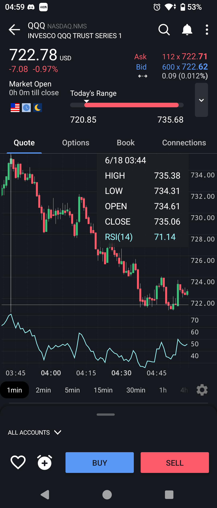
- 1516906263836102736_1516906262351052830.png: Webull：QQQ报价722.78（-0.97%），当日区间720.85-735.68，1分钟K线，6/18 03:44处高点735.38、RSI(14)71.14后转跌，标记当日尾盘顶部p1，说明QQQ从735暴跌至721超3sd的行情起点。
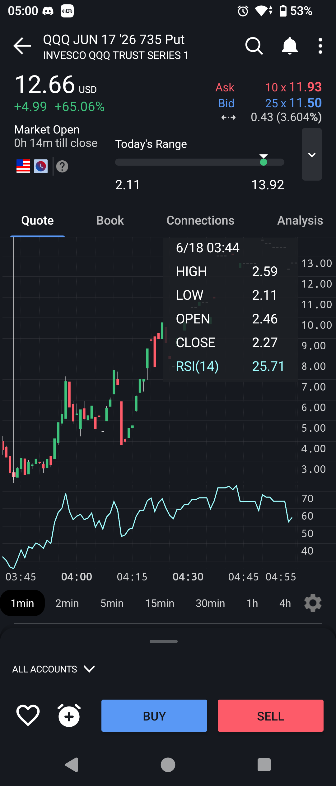
- 1516906263836102736_1516906262699442256.png: Webull：QQQ 6月17'26到期735 Put报价12.66（+65.06%），卖11.93/买11.50，当日区间2.11-13.92，1分钟K线自2元附近飙升至12以上，展示末日put在大跌中暴涨约20倍，说明3sd暴跌下otm期权极端收益。
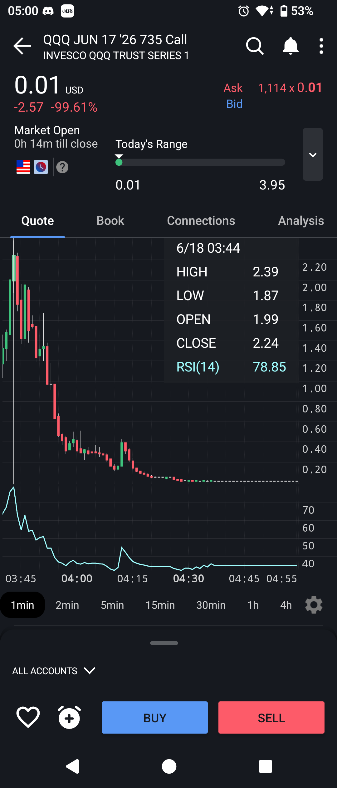
- 1516906263836102736_1516906263022141540.png: Webull：QQQ 6月17'26到期735 Call报价0.01（-99.61%），卖方挂单1114张@0.01，当日区间0.01-3.95，1分钟K线从约2.4暴跌归零，与735 put暴涨对照，说明尾盘暴跌中call末日归零的极端行情。
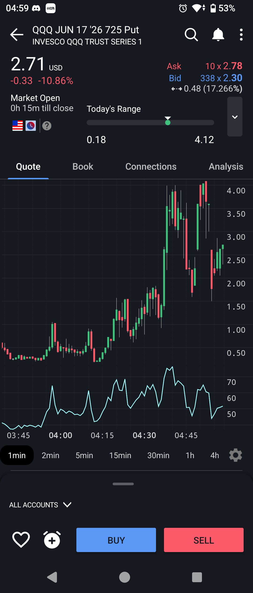
- 1516906263836102736_1516906263500554240.png: Webull：QQQ 6月17'26 725 Put报价2.71（-10.86%），卖2.78/买2.30，价差0.48(17.3%)，当日区间0.18-4.12，1分钟K线自0.2涨至4后回落至约2.7，即晚报中725p从0.18-0.22翻约20倍的末日put实例（p4）。
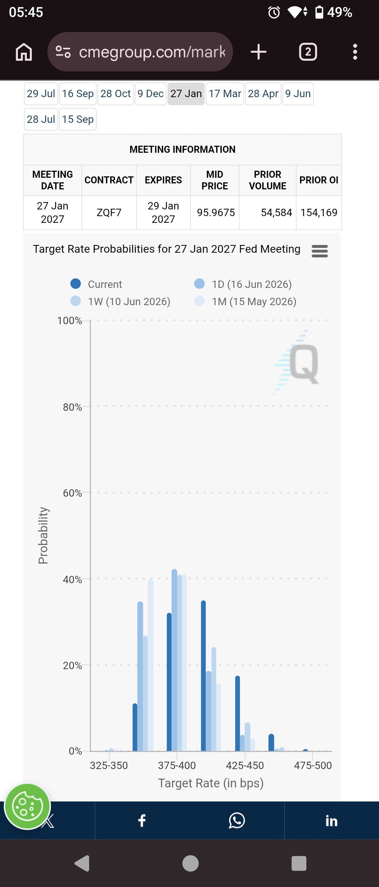
- 1516911469646581800_1516911469424410817.png: CME FedWatch网页（cmegroup.com）：2027年1月27日FOMC会议利率目标概率，合约ZQF7到期2027-1-29，中间价95.9675，前量54584、前持仓154169，柱状图显示325-500bps各目标利率概率分布，用于说明用利率期货期权推市场概率。

---

## 案例 28
**时间**: 2026-06-17 21:29 UTC
**社群提问（背景）**:
- **[cb.wu5573]** 06-17 21:36: 解析得很棒，谢谢晓晓老师！ /  / 所以如果按照我的理解，现在反而是一个值得跟随做市商报价继续做卖方的时候？因为实际上现在的价格已经priced in 了一部分这种不合理算法在里面，因此最终的回报能cover上潜在的不合理的价格波动。
- **[cb.wu5573]** 06-17 21:38: 明白！
- **[cb.wu5573]** 06-17 22:16: 还是像请问一下晓晓老师。现在的市场环境，如果做长期的otm call和put作为抵御上限亏损的保护，而继续做中短期的卖方，是不是也可以？

**晓晓解答**:
6月17日 纳指NQ 晚报3：

夜盘sd: 260（至开盘9点半）（极高）
夜盘sd: 360（至收盘4点）（中等）
目前sd: 相同
盘前涨幅：0
当日判断：中性
推荐策略：看空方向铁鹰
0.5 0.4 call spread
0.15 0.05 put spread

评论：
总体来讲，大盘处在极高位，长期看跌20%。

在连续2天下跌，且刚刚经历了3sd的下跌后，短期无法继续看空。但是在这个点位要赌方向性反弹，也无法推荐。

在无法短期看空的情况下，为了给自己更多盈利空间，且降低上方风险，这里选择卖出 atm call 形成spread。这样就算股价横盘不下跌（因为我们短期无法看空）的情况下，我们依然可以盈利。但是我们依然承认有可能出现暴跌，所以我们选择卖deep otm put spread。

值得注意的是，因为明天是四巫日，NQ有开盘到期的期权，也有收盘到期的期权。而由于今天收盘前出现了3sd的跌幅，夜盘sd至9点半，竟然出现了非常罕见的260点。
正常来讲，工作日的夜盘的波动是相对较小的，横盘都很常见，平时也就差不多100点左右。

而今天做市商报价的260点，说明做市商认为今天亚盘会有极大的波动。而由于最近极端行情频频发生，而且我们必须敬重市场的报价，所以明天开盘出现520点左右的暴涨暴跌，都是完全可能的，我们需要做好心理准备。

但是夜盘/亚盘 由于总体来讲 流动性/成交量 远低于美股，所以夜盘的极端波动并不一定会引导美股开盘后的走势。恰恰相反，配合这种极高的夜盘sd，如果真的出现流动性枯竭的单边行情，反而更容易开盘后流动性回归出现反转。所以要为此保持警惕。

不。

逻辑是这样的。

当你扔硬币，每次都扔出反面，是否认为你该退出这个游戏？答案是 不是。

做市商 没有因为 频繁的大亏，就退出这个游戏。
相反，他们选择把VXN维持在高位，要求市场支付更高额的入场费去赌大波动。

也就是说，在他们眼里，过去的亏损已经是沉没成本
但现在他们有更大的信心可以通过高报价，把之前的亏损赚回来。

做市商的逻辑没有问题

所以与其于选择不尊重对市场的报价，而退出这个市场，甚至选择跟做市商对赌，

我们依然应该选择相信做市商的报价，继续选择做正期望的交易。
因为 现在是 收盘时间，美东5点-6点

夜盘开盘后，bid ask 会缩小到 3.5左右
开盘后 bid ask 会缩小到2左右

在现在这个环境下，还是强烈推荐 有上限亏损的策略

因为 谁也无法保证 何时又会莫名其妙出现 7sd 的跌幅

最后呢，为了跟大家保持'同频'，并且 put my money where my mouth is

我自己也做了一些QQQ的组合

我昨天入场的是 看空方向末日铁鹰，是 有小负delta的。因为我提及过，现在这个环境下可以持有小负delta做空

组合是
卖 730 740 call spread $5
卖 725 715 put spread $1.3

保证金需求 $10宽度 - $6.3 收入 = $3.1 , *100 = 310刀

今天在下午3点28分 以 $1.1 的价格平仓。盈利$5.2 * 100，减去 7刀 交易手续费，盈利为 513刀。

客观来讲，我运气是很好的。
因为我平仓后，股价就加速暴跌，最终如果我持有组合到过期，我需要支付内在价值 $4 才能平仓，那我的利润就被严重损耗了。

这也就是我昨天提到的
做QQQ的spread，由于QQQ（以及任何股票期权）都是滞后结算，所以在near atm的情况下，一定要提前平仓。

这种 错开到期日的 diagonal spread

风险是极大的
尤其是 到期日差距极高的情况下

因为你根本无法保证 你不同的到期日

你是买/卖 在iv的低点
还是买/卖 在iv的高点

而客观来讲
在高iv环境下，买远期期权是大忌
因为日后如果iv崩塌，但股价不出现 极端的暴涨暴跌行情，那 买的远期期权的 外在价值降低（由于iv的降低）会远超 卖的短期期权的 外在价值降低

其实 说白了，
大家都知道基础逻辑：
低iv 买 期权 更有利
高iv 卖 期权 更有利

而iv 对远期期权 影响巨大
相反 近期期权更多是被theta和gamma 影响

因此，如果是低iv环境下
买远期卖近期 这样的diagonal spread是可行的

而在高iv环境下，无法推荐 拉长时间的此类操作。
对于我来说，如果在高iv环境下我需要做diagonal，我最多只愿意承担 1-2天的 到期日差距 带来的iv风险

**配图说明**:
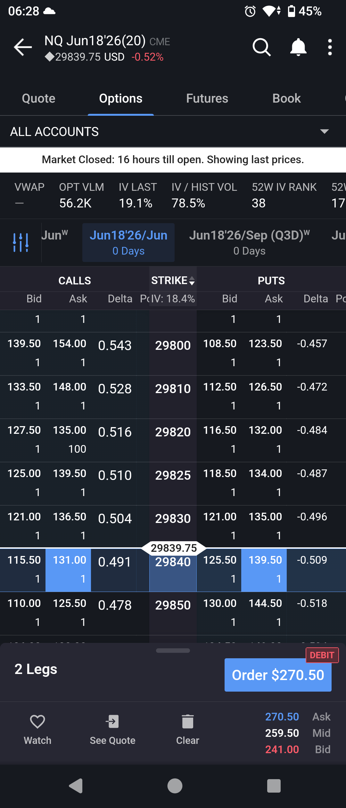
- 1516917781008748554_1516917780362952899.png: IBKR Mobile：NQ Jun18'26期权链（ATM 29839.75，IV 18.4%），选中29840C（delta 0.491，卖115.50/买131.00）与29840P（-0.509，买125.50/卖139.50）2腿组合，Order $270.50（Mid 259.50），展示atm附近0.5 delta行权价及买卖价差，用于搭建看空铁鹰的第一腿。
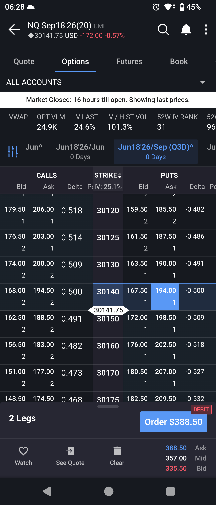
- 1516917781008748554_1516917780707016734.png: IBKR Mobile：NQ Sep18'26期权链（ATM 30141.75，P/C IV 25.1%，IV Rank 31），选中30140C（delta 0.500，卖168.00/买194.50）与30140P（-0.500，买167.50/卖194.00），2腿组合Order $388.50（Mid 357.00），展示9月远月atm期权及更宽价差，用于对比不同到期日的流动性。
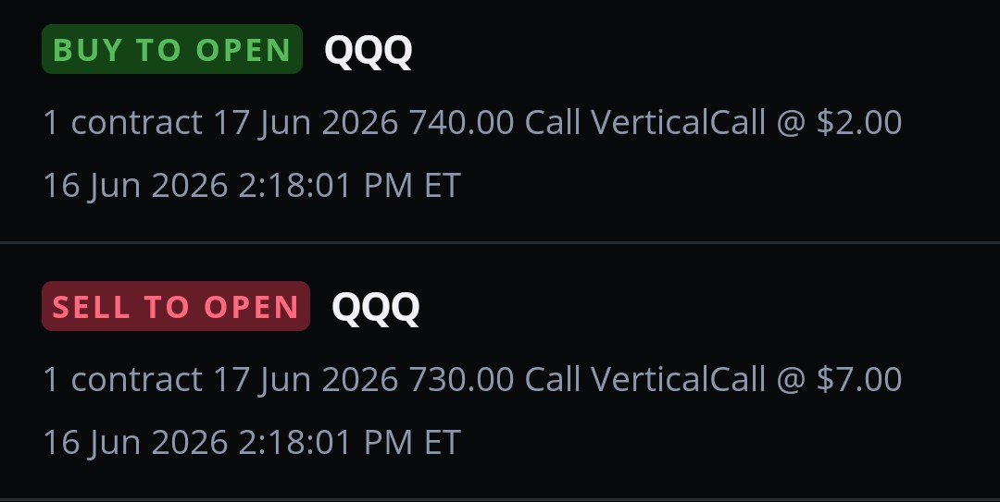
- 1516928879200047205_1516928878327631923.png: Discord/交易信号平台的深色界面截图，两条QQQ期权开仓信号：绿色BUY TO OPEN标签，买入1张2026年6月17日到期QQQ 740 Call（VerticalCall）@$2.00；红色SELL TO OPEN标签，卖出1张2026年6月17日QQQ 730 Call（VerticalCall）@$7.00，时间均为16 Jun 2026 2:18:01 PM ET。构成730/740看涨价差（bull call spread，净支出为负即净收入贷方）。该截图是回答该笔期权交易策略问题（价差结构、开仓价格与时间）的核心依据。
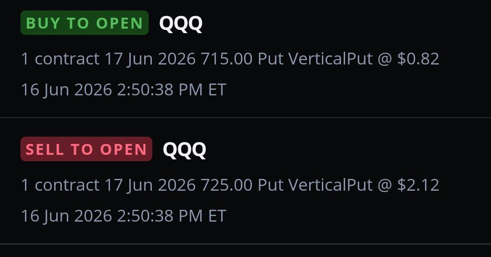
- 1516928879200047205_1516928878625689610.png: 同一Discord/交易信号平台截图，两条QQQ看跌期权开仓信号：绿色BUY TO OPEN，买入1张2026年6月17日QQQ 715 Put（VerticalPut）@$0.82；红色SELL TO OPEN，卖出1张2026年6月17日QQQ 725 Put（VerticalPut）@$2.12，时间均为16 Jun 2026 2:50:38 PM ET。构成715/725看跌价差（bear put spread，净支出$1.30）。与前一图的开仓信号配合，用于说明账户同时建立的看涨与看跌期权策略细节。
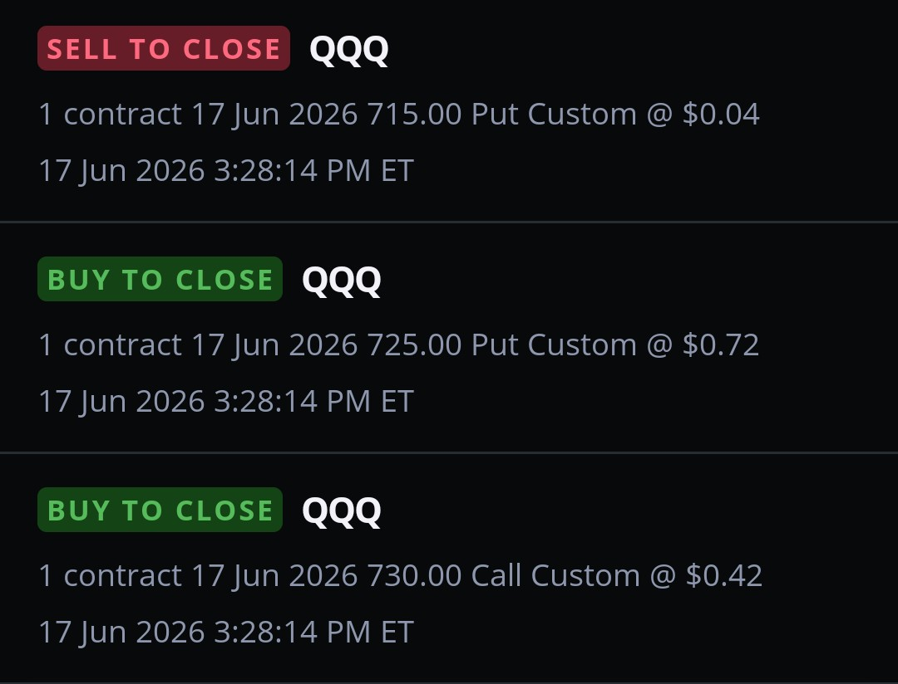
- 1516928879200047205_1516928878973685770.png: 同一Discord/交易信号平台截图，三条QQQ期权平仓信号（17 Jun 2026 3:28:14 PM ET）：红色SELL TO CLOSE，卖出1张2026年6月17日QQQ 715 Put Custom@$0.04；绿色BUY TO CLOSE，买回1张QQQ 725 Put Custom@$0.72；绿色BUY TO CLOSE，买回1张QQQ 730 Call Custom@$0.42。用于说明次日到期日的平仓价格，是计算该组价差交易最终盈亏（如715/725 put spread平仓收$0.68）的关键数据。

---

## 案例 29
**时间**: 2026-06-18 00:15 UTC
**社群提问（背景）**:
- **[veneuro28589]** 06-17 23:53: 其实我觉得，像这些宏观经济和逻辑，完全可以在美股观点分享频道里面去发，这个美股期权频道我们可以作为期权点位分享，多多讨论一下期权，而不是一进来就看到长篇大论的一堆宏观，  这只是我的个人观点和建议
- **[ionlyyolo]** 06-18 00:22: 完全不能同意
- **[ionlyyolo]** 06-18 00:25: 我其實沒有看到什麽和期權交易無關的宏觀經濟和邏輯 也不知道期權點位是什麽意思 可以麻煩解釋一下嗎？

**晓晓解答**:
6月17日 纳指NQ 晚报4：

夜盘sd: 260（至开盘9点半）（极高）
夜盘sd: 360（至收盘4点）（中等）
目前sd: 220（至开盘9点半）（很高）
目前sd: 335（至收盘4点）（中等）
盘前涨幅：1.4% 400点 
当日判断：看空
推荐策略：看空方向铁鹰
0.5 0.4 call spread
0.15 0.05 put spread

评论：
在夜盘sd （至开盘9点半）260点的情况下，夜盘已经上涨400个点，非常极端的单边扎空行情。而目前sd依然有高220（至开盘9点半），所以完全有可能盘前继续单边上涨，开盘在高位结算期货/期权。

日经和韩股 双双开盘创历史新高
美元日元继续上涨至 160.7，逼近上次日本央行干预的161点位

当然，我们要强调 日韩股市 成交量远不及美股，所以这也许是做多机构在自救的一种方法：
通过夜盘/亚盘 缺乏流动性的情况下，离谱的拉高期货。撑到9点半结算 期货/期权后，再把 之前拉高所买入的多头仓位，在开盘后高流动性环境下卖出。所以明天开盘要谨防开盘后 高开立刻崩盘的走势。
这里要记录一下
比QQQ（以及股票期权）更离谱的一种结算方式

除了 股票/etf 期权是 以4点收盘价 滞后结算

以及 期货期权 以 正常4点准点结算，或 季度到期的期货期权 以开盘9点半准点结算

还有 第三种期权：指数期权
SPX 以及 NDX
其中从成交量来讲，SPX指数期权，是 所有期权产品中最高的，因为 1手SPX 是 10手SPY。

而 季度指数期权，有一个很离谱的结算方式：

最后交易结束是之前一天4点15
但是结算价格却是以第二天9点半的开盘价结算，且是强迫性自动现金结算，没有类似 QQQ那样 '买方可滞后行权'之类的操作。

而从4点到第二天9点半，不管持有 买方还是卖方 指数期权，相当于就是在赌马。因为在这个过程中，你不可以交易，你只能等9点半开奖。

第二天早上，根据9点半开盘的价格
你账户会划进来一笔钱，或者划出去一笔钱，对应的金额就是，你如果（假象情况下）在9点半 平仓你的期权仓位，你应获得的盈亏（这个称之为 现金结算）。

而这就导致多方和空方有极大的操作空间。因为在这一天是买定离手的一天，所以为了让自己手上的期权仓位，9点半能结算到好价格，经常出现极其异端的走势，像目前这样的夜盘离谱单边拉升。

---

## 案例 30
**时间**: 2026-06-18 12:58 UTC
**社群提问（背景）**:
- **[jdinan4125]** 06-18 13:40: 被说中了，晓晓老师真牛逼
- **[jdinan4125]** 06-18 13:40: 💯
- **[jdinan4125]** 06-18 13:50: 请问晓晓老师，如果用你前面说的断翅蝴蝶的策略，可否用在个股，但通过call来构建呢？是不是逻辑上也能有edge盈利？

**晓晓解答**:
荒唐至极
NQ夜盘sd 260（至早上9点半）
盘前竟然能涨520点
而且还有半小时到开盘
现在 到4点的sd只有240
过了这半小时，一定会再崩塌一次，估计到时候开盘就200以下了。

相当于，绝大部分人都只在 开盘的时候交易
但是真正股价的波动却绝大部分人在夜盘，这些 算法交易在表演

荒唐至极

开盘 高开 立刻崩盘

跟我说的情况一样

算法根本不在乎 公司的估值
他们只在乎 赚眼前的那点钱

有效市场？
市场上买家卖家公平竞价来决定 公司被公认的价值？

虽然我的背景不是fundamental analysis，所以我不吃巴菲特那一套，
但是我至少是尊重有效市场理论的

而这种 只为了 赚钱，毫不在乎 公司估值的 股价操纵

真的令人发指

你的意思是
做多方向的断翅蝴蝶

是的，逻辑上 是有 盈利空间的
edge与否不好说，但是能满足投资者的投资需求 是事实：
下跌几乎不亏
上涨会赚
暴涨会亏
这里要格外注意最后一个情况

现在这个市场 很明显是坏了
你完全无法做空个股
（这也就是，为什么，热门股call skew都极其严重）

---

## 案例 31【重复提及—此前已回答过】
**时间**: 2026-06-18 14:44 UTC
**社群提问（背景）**:
- **[jdinan4125]** 06-18 13:40: 💯
- **[jdinan4125]** 06-18 13:50: 请问晓晓老师，如果用你前面说的断翅蝴蝶的策略，可否用在个股，但通过call来构建呢？是不是逻辑上也能有edge盈利？
- **[jdinan4125]** 06-18 14:41: 谢谢回答。想再追问一下，那比如说做spacex的call断翅蝴蝶，会不会有很高的盈利空间？我看它call skew相当高，IV也夸张。然后如果害怕暴涨会亏的话，我们把最上方的call放低一点，是不是就解决问题了

**晓晓解答**:
这个我已经解释过了。

你把断翅蝴蝶 变成 经典蝴蝶

会使得组合有delta方向性
而当股价往反方向住的时候，你会亏损对应delta的额度

---

## 案例 32
**时间**: 2026-06-18 18:23 UTC
**社群提问（背景）**:
- **[jdinan4125]** 06-18 13:50: 请问晓晓老师，如果用你前面说的断翅蝴蝶的策略，可否用在个股，但通过call来构建呢？是不是逻辑上也能有edge盈利？
- **[jdinan4125]** 06-18 14:41: 谢谢回答。想再追问一下，那比如说做spacex的call断翅蝴蝶，会不会有很高的盈利空间？我看它call skew相当高，IV也夸张。然后如果害怕暴涨会亏的话，我们把最上方的call放低一点，是不是就解决问题了
- **[meitou_alex]** 06-18 14:49: 🎁 **美投618，期权大促来了！** /  / 今天是6月18日，美投期权课618优惠正在火热进行中，这是美投期权课上线以来折扣力度最大的一次！ / 活动时间：6月11日-6月22日（美东时间）https://www.jdbinvesting.com/meitouquan/video-series/OTP /  / 美投期权课最大的特点是专业、易懂、重实战。上线 5 年来不断打磨精进，已经帮助数千名学员安心积累起超额收益，好评如潮 🙌  / 课程针对不同基础的投资者，设计了初/中/高三个等级，由浅入深，带你从 0 基础小白一路成长为能系统交易期权的成熟投资者。 /  / @everyone …

**晓晓解答**:
美元兑日元

在日本深夜，出现大幅拉升 161.8，突破今年3月的前高，接近历史前高161.9，空头大面积爆仓

此点位非常有可能遇到日本央行的保护措施，导致美日大跌
上次3月的保护措施，就是在
1. 美联储决议后
2. 美日恶意暴涨

美日下跌，是一定会对全球股市造成抛压的。
你需要把这个风险考虑进去

如果你想对冲一下风险，且有闲着的美金的话，可以现在 卖出美金 买入日元

在IBKR 搜 USD.JPY
选 sell
建议选market order
手续费2刀左右，按次收费
建议单次交易3w美金以上

---

## 案例 33
**时间**: 2026-06-18 23:05 UTC
**社群提问（背景）**:
- **[jdinan4125]** 06-18 13:50: 请问晓晓老师，如果用你前面说的断翅蝴蝶的策略，可否用在个股，但通过call来构建呢？是不是逻辑上也能有edge盈利？
- **[jdinan4125]** 06-18 14:41: 谢谢回答。想再追问一下，那比如说做spacex的call断翅蝴蝶，会不会有很高的盈利空间？我看它call skew相当高，IV也夸张。然后如果害怕暴涨会亏的话，我们把最上方的call放低一点，是不是就解决问题了
- **[meitou_alex]** 06-18 14:49: 🎁 **美投618，期权大促来了！** /  / 今天是6月18日，美投期权课618优惠正在火热进行中，这是美投期权课上线以来折扣力度最大的一次！ / 活动时间：6月11日-6月22日（美东时间）https://www.jdbinvesting.com/meitouquan/video-series/OTP /  / 美投期权课最大的特点是专业、易懂、重实战。上线 5 年来不断打磨精进，已经帮助数千名学员安心积累起超额收益，好评如潮 🙌  / 课程针对不同基础的投资者，设计了初/中/高三个等级，由浅入深，带你从 0 基础小白一路成长为能系统交易期权的成熟投资者。 /  / @everyone …

**晓晓解答**:
我是08分，发的推文
30分 日本央行就出手干预了

可以看到 美日1分钟 内极速崩盘，这就是 往常干预的迹象

假设你卖空美元3w 在161.8
然后你挂一个limit buy 在161

那么这波 你就盈利了
0.8 * 30000 = 24000 日元
约 150美金

**配图说明**:
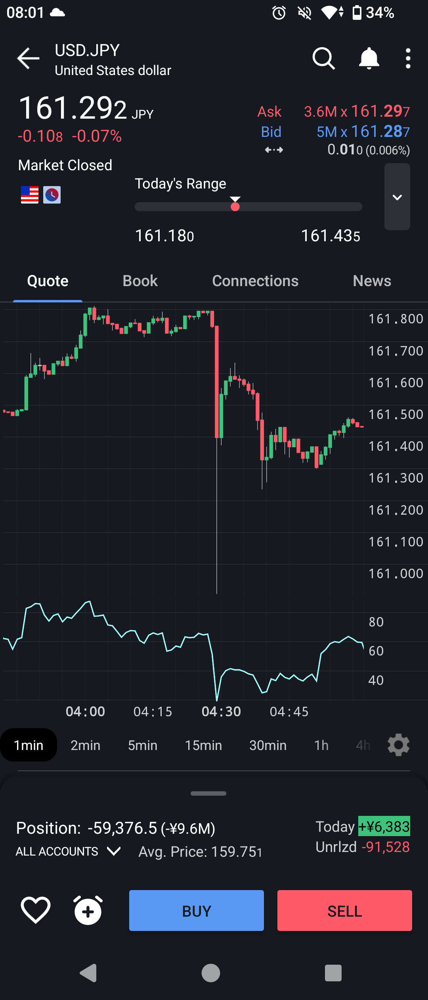
- 1517304341311000879_1517304341105606769.png: 手机外汇行情/交易App截图（约540x1260竖屏），显示USD/JPY（USD.JPY）行情：最新价约161.292，日内高点约161.4附近，低点约161.1；1分钟K线图在04:30左右出现长下影线急跌（闪崩后快速回升）。下方持仓区域显示美元兑日元空头持仓约-59,376.5，开仓均价159.751，当日盈亏约+¥6,383，未实现盈亏约-91,528。该截图用于说明该笔空单在日元急贬背景下的浮亏状态与盘中价格异常波动。

---

## 案例 34
**时间**: 2026-06-19 01:20 UTC
**社群提问（背景）**:
- **[jdinan4125]** 06-18 13:50: 请问晓晓老师，如果用你前面说的断翅蝴蝶的策略，可否用在个股，但通过call来构建呢？是不是逻辑上也能有edge盈利？
- **[jdinan4125]** 06-18 14:41: 谢谢回答。想再追问一下，那比如说做spacex的call断翅蝴蝶，会不会有很高的盈利空间？我看它call skew相当高，IV也夸张。然后如果害怕暴涨会亏的话，我们把最上方的call放低一点，是不是就解决问题了
- **[meitou_alex]** 06-18 14:49: 🎁 **美投618，期权大促来了！** /  / 今天是6月18日，美投期权课618优惠正在火热进行中，这是美投期权课上线以来折扣力度最大的一次！ / 活动时间：6月11日-6月22日（美东时间）https://www.jdbinvesting.com/meitouquan/video-series/OTP /  / 美投期权课最大的特点是专业、易懂、重实战。上线 5 年来不断打磨精进，已经帮助数千名学员安心积累起超额收益，好评如潮 🙌  / 课程针对不同基础的投资者，设计了初/中/高三个等级，由浅入深，带你从 0 基础小白一路成长为能系统交易期权的成熟投资者。 /  / @everyone …

**晓晓解答**:
美日
我是看跌至160以下
这个日本凌晨4点半深夜干预，很明显是小动作。

如果真的来大动作干预
目标肯定是把美日维持在160附近

暂时不敢想3月 砸到155

**配图说明**:

- 1517338198672412733_1517338198399778987.png: 金十数据App新闻快讯手机截图（约540x1260竖屏），时间戳为06-19 08:39:49 星期五，内容为日本财务大臣（及相关官员）就外汇市场发表讲话：警告汇率过度波动不可取，若有必要将对投机性交易采取果断行动（坚决应对）。该截图作为基本面新闻依据，用于解释当日美元兑日元波动/干预风险，与case 69的USD.JPY持仓截图相互印证，回答为何空单浮亏及汇率政策风险。

---

## 案例 35
**时间**: 2026-06-19 04:58 UTC
**社群提问（背景）**:
- **[jdinan4125]** 06-18 14:41: 谢谢回答。想再追问一下，那比如说做spacex的call断翅蝴蝶，会不会有很高的盈利空间？我看它call skew相当高，IV也夸张。然后如果害怕暴涨会亏的话，我们把最上方的call放低一点，是不是就解决问题了
- **[meitou_alex]** 06-18 14:49: 🎁 **美投618，期权大促来了！** /  / 今天是6月18日，美投期权课618优惠正在火热进行中，这是美投期权课上线以来折扣力度最大的一次！ / 活动时间：6月11日-6月22日（美东时间）https://www.jdbinvesting.com/meitouquan/video-series/OTP /  / 美投期权课最大的特点是专业、易懂、重实战。上线 5 年来不断打磨精进，已经帮助数千名学员安心积累起超额收益，好评如潮 🙌  / 课程针对不同基础的投资者，设计了初/中/高三个等级，由浅入深，带你从 0 基础小白一路成长为能系统交易期权的成熟投资者。 /  / @everyone …
- **[jackstom]** 06-19 01:50: 。

**晓晓解答**:
6月18日 纳指NQ 晚报

夜盘sd: 385
目前sd: 385
盘前跌幅：-250点 -0.8%
当日判断：看空
推荐策略：做空方向断翅蝴蝶 末日
0.5 0.4 0.15 0.05

评论：
总体来讲，大盘处在极高位，长期看跌20%。

昨天美东下午3点，日本凌晨4点，美日汇率 创出新高161.8，接近历史新高161.9
这个点位，日本央行干预的概率极大。而以我过往观察的经验，日本央行一般干预的时间线是这样的：

1. 需要名义正确
不管市场已经定价了什么，日本央行，必须等新闻真的出来了，才会准备开始动作。

目前这个条件满足：
日本汇率决议 和 美国汇率决议 都刚过去

2. 需要恶意暴涨
碾死美元多头（日元空头）

与其于说 日本央行 是在保护汇率，其实他们更把 投机资金视作为敌人。他们可以允许日元慢慢贬值，但是不可允许（外来）资金，在自己货币贬值的过程中大赚一笔差价。所以当美日出现恶意暴涨的时候，日本央行才会出手。

目前满足这个条件：
2天内，经历日本利率决议和美国利率决议，美日从160快速上涨到161.8

3. 需要内部商量
这个是最玄学的地方

过去的每次利率干预，导致美日跳崖式暴跌之前，都会有莫名其妙，速度比较快的阴跌行情。

虽然我无法完全解释这个，但以我的理解是，毕竟干预需要使用大量外汇（美元），所以日本央行内部需要商量一下开个会，可能开个一天时间，来决定此次干预的额度以及目标价。而在开这个会的时候，给我的感觉就是小道消息已经走漏了，很多人/机构 就已经在抢跑做空日元了。但是因为没有很明显的新闻，出现的结果是美日的莫名其妙的阴跌一阵，反弹无力。而等这一波过去后，就会出现莫名其妙的 崩盘式暴跌：日本央行甩卖美元

参考4月30号
日本时间下午4点，美日从160.6 ，一小时内 阴跌到 159.8，之后因为没有实质性新闻，买家又反弹回了160.1

之后的的3小时
美日就经历了 3-4次 深针式 崩盘：每次 买家都会在海底 把价格买上来，横盘一段时间，之后又来一次深针

4. 干预时间：
这个是最重要的
自从24年8月，日本央行就不想为世界股价暴跌 背锅

所以干预的时间，一定是在 日本收盘后，美股开盘前
也就是日本时间 3点 至10点半，美东时间 凌晨4点至9点半。

而且一定是在当天商量完之后所进行，因此一定是在工作日，而不会是在周末。且极大概率不会在休假日（本周五）

所以以上述4点估算
最可能出现美日 暴跌的时间，应该是美东时间周一凌晨4点至9点半。
而如果真的出现美日暴跌，一定会触发 carry trade 的被动unwind 或爆仓，导致 NQ 夜盘跟着下挫。而因为这种下挫是在无流动性的情况下，所以有可能会很深，直到开盘再反弹。

也许正应这个原因，美股期货目前夜盘 -0.8%，日韩股都出现了高开跳水的行情。

**配图说明**:
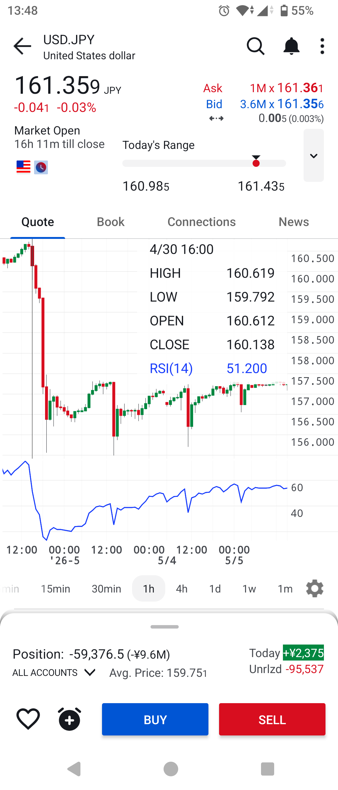
- 1517393237311229994_1517393237470478376.png: 同一手机外汇交易App的USD/JPY（USD.JPY）截图（约540x1260竖屏），显示最新价约161.359，附1小时K线图及RSI等技术指标，价格较前图继续上行。下方持仓显示同一笔美元兑日元空头约-59,376.5，均价159.751，当日盈亏约+¥2,375，未实现盈亏约-95,537（浮亏进一步扩大）。该截图用于展示日本财务大臣干预警告发出后汇率不跌反涨、空单亏损扩大的行情证据。

---

## 案例 36
**时间**: 2026-06-19 18:04 UTC
**社群提问（背景）**:
- **[fifehdeyx47]** 06-19 14:40: 老师为什么我的搜不出来呢 我有开forex的trading permission， gpt说是app的bug
- **[dannyteo1]** 06-19 17:51: 能搜到，不过显示可以CFD或者CASH

**晓晓解答**:
第一个，USD 
点开

会有 一大堆USD 的 的 对象货币

其中一个是 USD.JPY
选 cash的

---

## 案例 37
**时间**: 2026-06-19 20:05 UTC
**社群提问（背景）**:
- **[fifehdeyx47]** 06-19 18:29: 是这个吗？ 我的显示的是 USD.JPY CFD
- **[fifehdeyx47]** 06-19 20:11: 点了后直接到了这个页面  我是不是缺了permission

**晓晓解答**:
不是
这个图，你点forex会出现什么

点forex
就到了

forex trading permission 吗？
那你去看看你有没有

---

## 案例 38
**时间**: 2026-06-19 21:49 UTC
**社群提问（背景）**:
- **[fifehdeyx47]** 06-19 20:11: 点了后直接到了这个页面  我是不是缺了permission
- **[fifehdeyx47]** 06-19 21:41: 这个permission也是有的 纳闷了😅

**晓晓解答**:
要不这样
你在你的portfolio页面
右上角 选择 convert

以convert currency页面
找到日元 直接换
<@726462853564858369>

---

## 案例 39
**时间**: 2026-06-20 08:56 UTC
**社群提问（背景）**:
- **[fifehdeyx47]** 06-19 22:08: 好👍 谢谢老师
- **[m00pey]** 06-20 05:39: 近期 有什么space x 的期权组合推荐吗

**晓晓解答**:
第一个问题你需要问自己：
你愿不愿意承担方向性delta风险？

如果愿意，那你就需要问自己，你为何不直接买股票或者卖空股票，却选择期权操作？

期权不是万能的
有时候最简单的 反而是最有效的
occam's razor

第二个问题，如果你确定你想要方向性风险，你是否想额外承担iv改变的风险。这个问题的答案一方面会根据目前的iv高低有关，另一方面也会跟你的风险偏好有关。

第三个问题，你是希望你的风险性delta风险，是呈现加速的，还是减速的。

而第一个问题，如果你回答 你不愿意承担方向性delta风险

那 做空方向断翅蝴蝶 是 可行的。

因为现在任何其他delta 0的策略 都不太合适：
第一，你不太愿意承担 上方风险，所以 卖上方call spread的潜在亏损很高，因为现在市场依然比较火热。
第二：目前市场波动异常大，所以你应该做 有上限亏损策略。
满足这2个条件的策略，只有 下发put spread能形成的组合，而比较合理的只有
做空方向断翅蝴蝶

---

## 案例 40
**时间**: 2026-06-20 21:30 UTC
**社群提问（背景）**:
- **[jdinan4125]** 06-20 16:00: 好严谨的思考过程，阅读的过程真的是一种享受
- **[jdinan4125]** 06-20 16:00: 晓晓老师，请问如果我做put spread，然后通过正股来把delta调整到0，这个策略ok吗？
- **[jdinan4125]** 06-20 16:01: 这样的话我可以少做两条腿，我就是想不太明白，这是不是和断翅蝴蝶的逻辑差不多？

**晓晓解答**:
差的比较多。

你如果做末日put spread，那么时间损耗 还是比较大的。如果20小时后 股价涨了，正股的盈利无法抵消put spread的亏损

而如果选择买长期put spread
那么本质上 theta gamma都很低：
长期的put spread 跟做空正股几乎没有区别。

所以你持有这个组合2个星期 ，也看不见 盈利或亏损

（长期的 delta0断翅蝴蝶 同理，持有很久也看不到 盈利或亏损）

---

## 案例 41
**时间**: 2026-06-21 02:21 UTC
**社群提问（背景）**:
- **[jdinan4125]** 06-21 02:28: 能睡着觉
- **[jdinan4125]** 06-21 02:28: 晓晓老师平时会做strangle吗
- **[jdinan4125]** 06-21 02:29: 但这只是最近的市场环境吧，之前市场比较好的时候呢？做看多策略？

**晓晓解答**:
不。

在有限亏损的策略中
几乎都是以1比1spread组建的

长期的1比1spread
没有theta和gamma的
如果你再加上delta 0

那么你入场这个的目的 非常不直观：
不管股价怎么走，不管时间怎么推移
你的盈亏都保持在0左右

这很明显不是非常的合理。

delta0 策略，如果组建成 无上限亏损策略，那就有非常多的选择，到期日窗口，也可以 根据iv的改变 而改变：

iv越高，越倾向 卖更远期的30-45天
iv越低，越倾向 卖近期的0-5天

现在这个环境，卖wide strangle，风险还是偏大。
不是不行

但你要做好 暴跌后接盘做多的准备
或者暴涨后接盘做空的准备

现在，，做市商把VXN拉得很高
就是要你 为了睡觉，支付premium
平时，不，因为我是看空的

我只做看空方向策略

wide strangle 是 中性的

不太好评判。

QQQ 从23年的250涨到现在750
3年半 翻了3倍

难评判

---

## 案例 42
**时间**: 2026-06-21 08:09 UTC
**社群提问（背景）**:
- **[jdinan4125]** 06-21 02:29: 但这只是最近的市场环境吧，之前市场比较好的时候呢？做看多策略？
- **[jdinan4125]** 06-21 02:31: 哦哦我没有在想市场。我想问在之前你观点没有看空的时候，一般比较喜欢做什么策略呢？也是断翅蝴蝶吗？
- **[wangying124]** 06-21 03:13: 有没有什么好用的期权技术工具，想做个海鸥，但是不知分别买多少才能保护正股

**晓晓解答**:
我一般喜欢
做空10股正股 + 卖deep otm put delta 0.1

但客观来讲
如果我上上周五 这么玩

我卖的put会翻20倍以上

---

## 案例 43
**时间**: 2026-06-21 22:21 UTC
**社群提问（背景）**:
- **[jdinan4125]** 06-21 02:31: 哦哦我没有在想市场。我想问在之前你观点没有看空的时候，一般比较喜欢做什么策略呢？也是断翅蝴蝶吗？
- **[wangying124]** 06-21 03:13: 有没有什么好用的期权技术工具，想做个海鸥，但是不知分别买多少才能保护正股
- **[willsun314]** 06-21 08:12: 厉害了。。

**晓晓解答**:
6月21 纳指NQ 晚报

夜盘sd: 385
目前sd: 330
盘前跌幅：-0.7%
当日判断：看空
推荐策略：做空方向断翅蝴蝶 末日
0.5 0.4 0.15 0.05

评论：
总体来讲，大盘处在极高位，长期看跌20%。

接上回晚报，
今天美股开盘前，
美元兑日元很可能出现日本央行干预暴跌。

可以考虑提前布局卖出美元买入日元

在 IBKR
右上角3个点
选convert
进入 convert currency页面
currency i have 选 美元
currency I want 选 日元

交易手续费 2刀/次
建议单次交易3w美元以上

---

## 案例 44
**时间**: 2026-06-21 23:39 UTC
**社群提问（背景）**:
- **[wangying124]** 06-21 03:13: 有没有什么好用的期权技术工具，想做个海鸥，但是不知分别买多少才能保护正股
- **[willsun314]** 06-21 08:12: 厉害了。。
- **[jdinan4125]** 06-21 23:13: 哈哈是因为这个put的IV比较高，利润空间比较大吗？

**晓晓解答**:
因为 指数有put skew

otm put 可以卖出更高的价格
除非你有税率考虑
否则最好少折腾

你不管
买put，买put spread，卖call
这些都是 负delta仓位

相当于就是在卖正股

如果日后涨了，期权组合浮亏会让你很难受
如果日后跌了，你正股照样会亏 你剩余对应的delta值。

所以你除了消耗手续费以及bid ask交易损耗，本质上你跟直接卖出正股没有什么区别。

你如果想赚theta时间损耗，那是另一码事。但theta不是给你白赚的，对应的负gamma 在上涨时你盈利更少，下跌时亏损更多

---

## 案例 45
**时间**: 2026-06-22 01:06 UTC
**社群提问（背景）**:
- **[jdinan4125]** 06-22 01:56: 认赌服输
- **[jdinan4125]** 06-22 02:01: 我理解老师的意思是不是 长期做下去还是能盈利 因为有put skew / 尽管偶尔亏一次大的 这种无法避免 / 但感觉还是好难做啊 就像老师说的 一开始就注定愿意接货了 那么做这种otm put总是心里感觉毛毛的
- **[jdinan4125]** 06-22 02:04: 😥

**晓晓解答**:
7sd 波动
救不了的

我那天 是 有上限亏损策略的 断翅蝴蝶

直接最大亏损了

如果 卖方 几乎每次都能赚
那买方 不就都是脑瘫？

正确的理解方法是

因为是 有上限亏损
没有亏更多倍 就已经赚了

某些行情 就是买方该盈利的

你的意思是

假设你 在上上周五 那天
你卖了一个 deep otm put

然后 市场在 sd = 200的情况下
从开盘到收盘跌了1400个点

那么 开盘买straddle的人 盈利了 7倍

你作为卖方，自然应该 为他的盈利买单

实际上没有什么好的调整方法
因为你卖put的那一刻，你就已经注定愿意接货了

不好说

如果这种 远超sd 的波动频频出现

给你连续暴跌几天，你账户可以直接腰斩

相当于是

极端引发 更极端：

做市场 亏钱很多
他们不顾一切代价止损
制造出更极端的行情
然后导致亏的更多
恶性循环

去年4月的行情就是这样的

不过好处是
当时其实VXN 非常的高
所以反而卖方并没有亏很多

现在的情况是
因为 VXN 不是非常的高
所以 任何高波动，都会让卖方亏很多

---

## 案例 46
**时间**: 2026-06-22 02:06 UTC
**社群提问（背景）**:
- **[jdinan4125]** 06-22 02:08: 😂 接下来困难的就是 不知道什么时候才叫对卖方不利的环境了 哈哈哈😵‍💫  / 现在有老师告诉我们还好说 要我自己判断的时候就一头雾水
- **[jdinan4125]** 06-22 02:09: 这里面有什么trick吗 看VXN？
- **[jdinan4125]** 06-22 02:11: 感谢老师，我看到了！多问一句，请问单日sd我们自己可以怎么看呢？

**晓晓解答**:
现在这个环境 就做有上限亏损 就行了

VXN 是 30天 的 纳指iv

他不能完全概括 单日iv

单日iv 还是要每天看 单日sd

我每天都在早报里更新

NQ的 末日atm straddle报价

---

## 案例 47
**时间**: 2026-06-22 03:47 UTC
**社群提问（背景）**:
- **[jdinan4125]** 06-22 02:14: 尤其谢谢老师这么专业和耐心的回答 ❤️
- **[dannyteo1]** 06-22 03:46: 老师，想问一下，这是相较于大盘策略，对应个股，是否能使用这个策略？我目前就使用 wheel strat 而已，想着可以怎么优化资金使用率。
- **[dannyteo1]** 06-22 03:52: 那就直接使用 空10+sell put delta 0.1？ 我是否也可以直接反过来开？ 买10股， sell call delta 0.1？

**晓晓解答**:
wheel的本质
是 卖otm put

那你在没有做空对应正股的情况下

你下风险 是更大的

总体来讲，是非常糟糕的策略

我没这么说
自己看多还是看空
可以自己决定

如果不想看多或者看空

那我目前只能推荐
看空方向断翅蝴蝶

---

## 案例 48
**时间**: 2026-06-22 14:30 UTC
**社群提问（背景）**:
- **[dannyteo1]** 06-22 03:46: 老师，想问一下，这是相较于大盘策略，对应个股，是否能使用这个策略？我目前就使用 wheel strat 而已，想着可以怎么优化资金使用率。
- **[dannyteo1]** 06-22 03:52: 那就直接使用 空10+sell put delta 0.1？ 我是否也可以直接反过来开？ 买10股， sell call delta 0.1？
- **[dannyteo1]** 06-22 03:58: 明白，那我还是做看空断翅蝴蝶，现在市场看不懂，还是做大盘好了。

**晓晓解答**:
美日 出现了干预
但由于今天日经大涨2% 再创历史新高
所以美日今天在亚盘就是单边上涨突破历史新高，从161.25 至 161.90

之后日本深夜干预，力度不足，最低砸到 161.20，现在已反弹至 161.70

预计在 亚盘时间段会有更强的干预

**配图说明**:
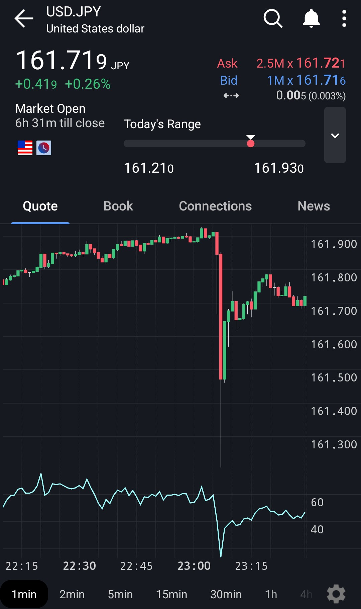
- 1518624446854725643_1518624446649208832.png: IBKR Mobile：USD.JPY报价161.719（+0.26%），当日区间161.210-161.930，1分钟K线显示亚盘单边上涨至161.90附近后，23:00出现一根长下影急跌至161.25再反弹（RSI骤降至40下方），展示日本央行干预时点的瞬时砸盘形态，用于说明干预对行情的影响。

---

## 案例 49
**时间**: 2026-06-22 23:06 UTC
**社群提问（背景）**:
- **[dannyteo1]** 06-22 03:52: 那就直接使用 空10+sell put delta 0.1？ 我是否也可以直接反过来开？ 买10股， sell call delta 0.1？
- **[dannyteo1]** 06-22 03:58: 明白，那我还是做看空断翅蝴蝶，现在市场看不懂，还是做大盘好了。
- **[jiananliu57]** 06-22 16:16: @everyone **美投期权618优惠仅剩 1️⃣ 天！** /  / ✅ 美投期权课最大的特点是专业、易懂、重实战。 / ✅ 美投君和团队全程陪伴，及时答疑解惑，实时分享真实的实战期权交易，让期权不再是纸上谈兵。 / ✅ 课程针对不同基础的投资者，设计了初/中/高三个等级，由浅入深。 / ✅ 上线 5 年来不断打磨精进，已经帮助数千名学员安心积累起超额收益，好评如潮。 /  / 💎 为回馈老用户，美投 Pro 和 PRO+ 会员享有额外100美元优惠！ / <@&1496968807950844087> <@&1496968916705214575>  /  / 投资自己，永远是最好的投…

**晓晓解答**:
6月22 纳指NQ 晚报

夜盘sd: 300（偏高）
目前sd: 300
盘前跌幅：-0.2%
当日判断：看空
推荐策略：做空方向断翅蝴蝶 末日
0.5 0.4 0.15 0.05

评论：
总体来讲，大盘处在极高位，长期看跌20%。

在日本半夜，美东交易时段，美元兑日元 出现了小幅干预，1分钟 从 161.90 跌至 161.20，之后 最低跌至161.07后反弹至161.60左右。

总体来讲，依旧期望在日股美股的非交易阶段，出现更大幅的干预，下方目标160。

更新一下今天的操作

今天开盘 卖空了美元，在161.893,止盈设在了161.01，以及160.01

做了 NQ的
末日铁鹰diagonal，小负delta

diagonal的意思是2个spread错开了到期日，下方选择今天末日，上方选择了明天（错开了1天的到期日）。之后再细讲原因。

这个组合是小负delta的，约-0.2 左右

今天运气是不错的，下方的put spread 今天没有被突破，归0，盈利14 * 20 = 280刀。
上方的call spread吃到跌幅以及1天的时间损耗，浮盈1900刀，准备继续持有到明天。

已经说过目前这个市场可以持有小负delta，
所以在愿意持有delta的情况下，策略就会变得更灵活。我这里先回答几个大家可能有的问题：

1. 为何我自己成天在推荐 末日 做空方向断翅蝴蝶，我为何自己在做 末日铁鹰？

第一，我们先要确认，本质上根据put call parity，这2个策略是对等关系：既，购买一个put spread做空，与卖出一个call spread做空，在strike和到期日相同的情况下，是完全对等的盈亏。（做多方向call/put spread同理，是对等的）

而做空方向断翅蝴蝶 以及 铁鹰，都包含 卖一个下方put spread 做多方向（是对冲单），

做空方向断翅蝴蝶 会买一个上方put spread 做空
铁鹰 会卖一个call spread做空。

所以本质上，这2个策略是一样的。

2. 那既然这2个策略的本质上是一样的，为何要有2个不同的名字？

答案是：流动性
总体来讲，我们应该避免去交易 itm 的期权，尤其是 delta 0.7以上的期权，因为流动性更差，导致成交价会更差。

所以，如果我想买 做空方向断翅蝴蝶 里的put spread  0.5 0.4 delta ，是 买atm put以及卖 otm put。如果 反过来我想卖call spread,那delta就会变成 0.6 0.5，是卖 itm call，买atm call （相同的2个strike）。这里很明显 为了避开itm 我们应该选择买put spread，就形成了 做空方向断翅蝴蝶。

相反，如果我（由于各种原因）决定我买的put spread 想要是 delta 0.6 0.5，既 买itm put，卖atm put。那在这个时候，我们就应该为了避开itm，选择 卖call spread 0.5 0.4，既卖 atm call，买otm call（相同的2个strike）。这就形成了 铁鹰。

那第三种情况就是
我想买put spread 0.6 0.4 delta，如果 换成call spread 还是会是 0.6 0.4 delta，那本质上没有什么很明显的区别，所以选任意一侧都可以。

综上，

当我们口头提及 做空方向断翅蝴蝶 的时候，我们一般是认为 买的put spread是 在 0.5 0.4 附近的。既，我们期望股价往下跌一点，才能接近策略组合的最大盈利区域。（相反，如果股价涨，因为是买的put，所以不会亏很多）

而当我们口头提及铁鹰的时候，我们一般是认为卖的call spread 是 0.5 0.4 附近，所以就算股价不跌，我们也已经在组合的最大盈利区域。（相反如果股价涨，亏损会高于 （做空方向断翅蝴蝶里）买 稍微靠下 的 put spread。）

3. 这里为何选择diagonal 错开1天的到期日？

短期我是看空的。所以我期望的 持有更久的负delta做空，既 '不想踏空跌幅'。

所以如果我做了 相同到期日的末日铁鹰，在今天的情况下两侧都归零，所以我的确盈利最大化。但是如果今天当天就出现暴跌，我的上方call spread 的盈利无法弥补 下方put spread的亏损，会导致 总盈利下降，甚至在暴跌的情况下，出现 '看对方向 却亏钱'的情况。

而如果我做的是到期日 明天的 call spread，因为是atm spread，所以 theta和gamma都会较低。所以不管股价如何波动，我都会有 约 -0.25 delta 跟在我的组合里，来保护我的downside。
而当卖的末日下方put spread 归零后，我就会只剩下来一个做空方向的上方call spread，之后我可以以市场环境 再做出合适的调整：

今天，我是在 4点收盘后 又做了一个 做空方向断翅蝴蝶diagonal，卖了 deep otm 的 明天到期的put spread（与 剩下的明天到期的call spread形成铁鹰），以及买了一个第三天到期的put spread delta 0.5 0.4。

（交易这样的4腿策略，还是推荐 NQ，因为是QQQ的8倍：节省手续费交易损耗）

**配图说明**:
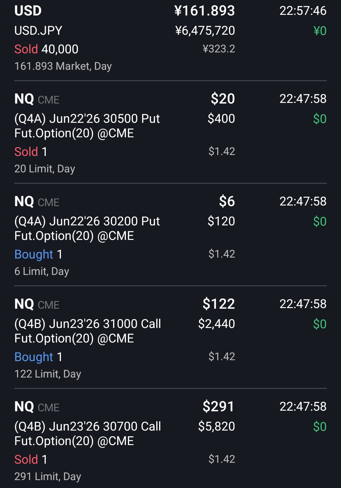
- 1518762100472811530_1518762099948650558.png: IBKR Mobile成交列表：USD.JPY卖空40000@161.893（¥647.5万）；NQ末日铁鹰diagonal：卖Jun22'26 30500P@20 Limit($400)、买Jun22'26 30200P@6($120)、买Jun23'26 31000C@122($2440)、卖Jun23'26 30700C@291($5820)，错开到期日的4腿组合，展示实盘下单明细。
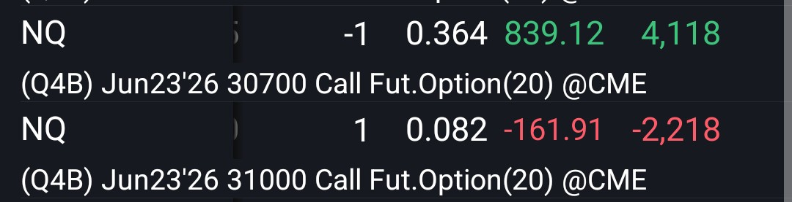
- 1518762100472811530_1518762100195852480.png: IBKR Mobile持仓盈亏页：NQ Jun23'26 30700C 卖1张 delta 0.364 浮盈+4,118；Jun23'26 31000C 买1张 delta 0.082 浮亏-2,218，即铁鹰diagonal上方call spread两腿的实时盈亏，说明卖call spread端吃到跌幅+时间损耗的浮盈。

---

## 案例 50
**时间**: 2026-06-23 05:21 UTC
**社群提问（背景）**:
- **[dannyteo1]** 06-22 03:52: 那就直接使用 空10+sell put delta 0.1？ 我是否也可以直接反过来开？ 买10股， sell call delta 0.1？
- **[dannyteo1]** 06-22 03:58: 明白，那我还是做看空断翅蝴蝶，现在市场看不懂，还是做大盘好了。
- **[jiananliu57]** 06-22 16:16: @everyone **美投期权618优惠仅剩 1️⃣ 天！** /  / ✅ 美投期权课最大的特点是专业、易懂、重实战。 / ✅ 美投君和团队全程陪伴，及时答疑解惑，实时分享真实的实战期权交易，让期权不再是纸上谈兵。 / ✅ 课程针对不同基础的投资者，设计了初/中/高三个等级，由浅入深。 / ✅ 上线 5 年来不断打磨精进，已经帮助数千名学员安心积累起超额收益，好评如潮。 /  / 💎 为回馈老用户，美投 Pro 和 PRO+ 会员享有额外100美元优惠！ / <@&1496968807950844087> <@&1496968916705214575>  /  / 投资自己，永远是最好的投…

**晓晓解答**:
6月22 纳指NQ 夜报

夜盘sd: 300（偏高）
目前sd: 350（很高）
盘前跌幅：-430点，-1.4%
当日判断：看空
推荐策略：做空方向断翅蝴蝶 末日
0.5 0.4 0.15 0.05

评论：
总体来讲，大盘处在极高位，长期看跌20%。

很明显，极端行情 在夜盘再次出现。在sd为300的情况下，夜盘却已经跌了接近1.5个sd，而由于恐慌上升（sd上升），完全可能在这个点位，再往下跌350点，那总共就跌了780个点，就是超过 2.5 sd

这里很明显可以看出为何我说，现在一定要卖deep otm put spread，给自己更多下方空间

我收盘卖的 30000put末日
本来delta只有0.1
现在NQ 到了30225
已经浮亏严重

如果卖任何 更高strike的put
我现在已经非常难受了：我就承受不住这个单位的任何深跌，我就要考虑止损调整仓位了。而我止损调整仓位后，股价如果反弹，我就被收割了。这就是一个 典型的错误：
跌的时候 杀跌止损
涨得时候 追涨止损

目前来讲，我卖的put 还有200多个点的空间
虽然浮亏严重
但是我可以继续持有到开盘，再考虑如何调整。这里我就通过我入场时的组合选择，避免了让我自己犯错的可能。
所以说这个市场 现在是坏的
在sd300的情况下
他就可以给你夜盘 莫名其妙的跌 525点

然后sd 还反涨到 370

---

## 案例 51
**时间**: 2026-06-23 07:08 UTC
**社群提问（背景）**:
- **[vincentky296612]** 06-23 07:00: 美投管理員你們好 /  / 2023年就已經買了美投的期權課程,內容很全面，也獲益良多 / 這三年也實踐了很多不同的期權策略。 /  / 不過隨着操作經驗變多，發現有些在市場上常常聽到的重要指標，市面上的討論好像都有點零散。因為我相信大部份人，包括美投交易分享玩期權多數是開 1 到 2 個月的短中期倉位，覺得這種短期的技術和資金流向指標，對風險控制真的非常有參考價值。 / 所以想來向團隊「許願」敲碗一下，看看未來有沒有機會做幾支影片，幫大家深度科普一下： /  Gamma Exposure (GEX) 還有期權牆：這到底該怎麼解讀、怎麼運用在實戰中？ /  Gamma Squeeze（伽馬擠壓…
- **[vincentky296612]** 06-23 07:12: 那可以理解成，其實做市商對於市場的影響其實沒有大家想的那麼大嗎？
- **[vincentky296612]** 06-23 07:24: 明白了，難怪總感覺市場越來越投機化

**晓晓解答**:
如果真的 能通过GEX
来在市场上获得alpha
那市场早就预判了你的预判

所以就不存在你获得alpha的空间

Gamma squeeze 的概念 本质是一个 悖论

因为任何期权交易
有买方就有卖方

当做市商卖出call后
他们会买入正股 推动股价上涨

但是本质上推动股价上涨的，是继续 砸钱 上百倍杠杆 买短期call的投资者，而不是 做市商自己把股价越买越高。

如果那些买了call的投资者 不卖出call，股价就不会下跌。
而如果那些买了call的投资者卖出call，做市商对应卖出正股，导致股价更低，导致更多高杠杆买了call的 卖出call，最后形成 多头踩踏的情况：
今天SPCX -15% 就是经典的例子

这不是做市商 导致的暴跌
本质上 是之前买了call的投资者 在大量卖出call

与其于说 是 做市商的影响 大不大

你应该说的是

期权交易者 百倍杠杆 的 交易call 或put

对市场影响大不大？

答案是 非常非常大！！

约80%的 正股交易，来自于 期权交易盘
俗称
tail wags the dog

这里
dog 代表 正股市场
tail 代表 衍生品市场

正常来讲 是 狗控制尾巴怎么摇

但是由于近几年期权的普及
整个美股市场 都是被 衍生品市场交易 所控制的

做市商 只是 一个传话人
并不应该背锅

好的，市场再一次暴揍了我一顿
sd 300，凌晨4点盘前还没开，就已经跌 700个点了

我先止损了：
买 30000put （向下roll 到）
卖 29000put

然后卖出 第二天到期的 atm put spread，把操作 总delta 调整到0：
卖30000put
买29830put

---

## 案例 52
**时间**: 2026-06-23 14:00 UTC
**社群提问（背景）**:
- **[vincentky296612]** 06-23 07:00: 美投管理員你們好 /  / 2023年就已經買了美投的期權課程,內容很全面，也獲益良多 / 這三年也實踐了很多不同的期權策略。 /  / 不過隨着操作經驗變多，發現有些在市場上常常聽到的重要指標，市面上的討論好像都有點零散。因為我相信大部份人，包括美投交易分享玩期權多數是開 1 到 2 個月的短中期倉位，覺得這種短期的技術和資金流向指標，對風險控制真的非常有參考價值。 / 所以想來向團隊「許願」敲碗一下，看看未來有沒有機會做幾支影片，幫大家深度科普一下： /  Gamma Exposure (GEX) 還有期權牆：這到底該怎麼解讀、怎麼運用在實戰中？ /  Gamma Squeeze（伽馬擠壓…
- **[vincentky296612]** 06-23 07:12: 那可以理解成，其實做市商對於市場的影響其實沒有大家想的那麼大嗎？
- **[vincentky296612]** 06-23 07:24: 明白了，難怪總感覺市場越來越投機化

**晓晓解答**:
6月22 纳指NQ 早报

夜盘sd: 300
目前sd: 280
目前跌幅：-780 -2.55%
当日判断：看多
推荐策略：铁鹰

评论：
总体来讲，大盘处在极高位，长期看跌20%。

今天由于日韩的崩盘，纳指竟然低开3sd -900点以上。在如此极端的行情下，只能被迫短期看多。

客观来讲，现在iv偏高

所以如果想lock in 更长期的iv，今天也许是好机会。

可以考虑1-2周到期的铁鹰：
上方call： 0.5 0.35 delta
下方put：0.25 0.1 delta

---

## 案例 53
**时间**: 2026-06-23 22:26 UTC
**社群提问（背景）**:
- **[vincentky296612]** 06-23 07:00: 美投管理員你們好 /  / 2023年就已經買了美投的期權課程,內容很全面，也獲益良多 / 這三年也實踐了很多不同的期權策略。 /  / 不過隨着操作經驗變多，發現有些在市場上常常聽到的重要指標，市面上的討論好像都有點零散。因為我相信大部份人，包括美投交易分享玩期權多數是開 1 到 2 個月的短中期倉位，覺得這種短期的技術和資金流向指標，對風險控制真的非常有參考價值。 / 所以想來向團隊「許願」敲碗一下，看看未來有沒有機會做幾支影片，幫大家深度科普一下： /  Gamma Exposure (GEX) 還有期權牆：這到底該怎麼解讀、怎麼運用在實戰中？ /  Gamma Squeeze（伽馬擠壓…
- **[vincentky296612]** 06-23 07:12: 那可以理解成，其實做市商對於市場的影響其實沒有大家想的那麼大嗎？
- **[vincentky296612]** 06-23 07:24: 明白了，難怪總感覺市場越來越投機化

**晓晓解答**:
6月22 纳指NQ 晚报

夜盘sd: 420（很高）
目前sd: 420
盘前涨幅：+130
当日判断：看多
推荐策略：铁鹰

评论：
总体来讲，大盘处在极高位，长期看跌20%。

昨天是极其荒唐的一天。在没有任何实际新闻的情况下，由于日韩股市崩溃，导致 NQ开盘前就是-3sd。低流动性市场的日韩股，却能完全主导高流动性市场的美股。这种情况，按道理说开盘流动性回归就应该立刻重新定价。事实的确是从 开盘29700 反弹回了30000，对应的开盘时sd 是 300左右的情况下比较合理。但收盘出现了DRAM多头踩踏爆仓的情况，所以最后2个半小时，在sd只剩100左右的情况下，再一次出现3sd 的跌幅从29900杀到29600。

再一次重申，最近的市场完全不符合数学模型。极端波动总是频繁出现，所以裸卖一定要谨慎。

在这种荒唐的杀跌后，短期必须看多。介于VXN冲高，到期日可以选在 末日 至 2周之间。

可以卖otm put spread 获得正delta：0.3 0.1

或者可以做 正delta的铁鹰：
call spread 0.5 0.4
put spread 0.3 0.1

---

## 案例 54
**时间**: 2026-06-24 15:56 UTC
**社群提问（背景）**:
- **[vincentky296612]** 06-23 07:24: 明白了，難怪總感覺市場越來越投機化
- **[cynthia937829]** 06-24 14:36: 跟着晓晓老师操作一下，明后天如果IV下降就平仓🙏
- **[weelium]** 06-24 15:46: 请教晓晓老师， 为什么 put spread 不放在 0.5 0.3 ？ ATM 流动性 和 IV 较高 ？

**晓晓解答**:
给自己  下方空间

---

## 案例 55
**时间**: 2026-06-24 20:15 UTC
**社群提问（背景）**:
- **[vincentky296612]** 06-23 07:24: 明白了，難怪總感覺市場越來越投機化
- **[cynthia937829]** 06-24 14:36: 跟着晓晓老师操作一下，明后天如果IV下降就平仓🙏
- **[weelium]** 06-24 15:46: 请教晓晓老师， 为什么 put spread 不放在 0.5 0.3 ？ ATM 流动性 和 IV 较高 ？

**晓晓解答**:
做多 做多 做多。。。

我需要赶紧溜了

我只是短期做多。。。
6月24 纳指NQ 晚报

夜盘sd: 420
目前sd: 420
盘前涨幅：N/A （由于盘后重要财报，波动巨大，无参考价值）
当日判断：看空
推荐策略：做空方向断翅蝴蝶
0.5 0.4 0.15 0.05

评论：
总体来讲，大盘处在极高位，长期看跌20%。

经历了2天 极度的恐慌杀跌，盘后出现了做市商的风险释放，既：太多买了put的人，收盘前 第二天的sd高达500多，导致做市商卖出了太多正股进行对冲，推低股价。

在这个情况下，只要财报不蹦/纳指股价不蹦，下方put的delta 由于vanna（iv的降低/事件的过去）会大幅跳崖，导致做市商需要被动买入正股，推高股价。

由于空头已经大部分 被动 在盘后被碾死（买的put随着股价上涨iv下降，接近归0），所以上涨动能枯竭，在高位继续看跌。
既然正好有这个机会，我就解释一下我刚刚的操作。

1. 我知道我必须看空
2. 我手里目前持有大量正delta
3. 赌方向总体来讲没有正期望

第三点展开说：
意思是，大幅改变手中持有的delta无疑于就是赌方向。
举个例子，我如果在29900卖出delta，本质上，我就是在做空纳指，如果纳指跌了，我就赚了。如果纳指涨了，我就'踏空'了涨幅，这个算亏损。

这就是常说的：
不要尝试着猜顶 或者 猜底。

你如果频繁的 大幅改变手里的delta，这就是在猜顶和猜底，总体来讲是非常没有正期望的。

至于某些交易员 执意认为这个可行（频繁的低买高卖）我个人保持怀疑态度。

所以我几乎所有交易，都会选择delta 0 的操作。就是因为我不认为我可以做到 猜顶 或 猜底。

那么上方我这里是做了一个 做空方向断翅蝴蝶

买 29700 c
卖 29600 p

卖 29400 c
买 29275 p

由于 put call parity（买put spread 对等于 卖call spread）
所以 这里卖的call spread
卖 29400c
买 29700c，
完全可以理解为

是买了对应的put spread
卖 29400p
买 29700p

既，我们可以把 上面4行的 c 换成p，是对等的，我们得到：

买 29700 p
卖 29600 p

卖 29400 p
买 29275 p

而这就很明显是经典的
做空方向断翅蝴蝶

那为什么我选择了 非要卖call spread 而且是itm的，而不是买put spread呢？

答案很显而易见，因为 我之前已经持有了对应的 long call spread。与其于开新的put仓位，也许直接把已有的仓位平仓，会来的更实在一些。这样可以避免日后如果还需要平仓的手续费和交易损耗。

这个技巧在实战中非常有用：交易新组合的时候，尽量把其中的一部分腿，设为自己已经持有的仓位，进行平仓。来避免没有必要的交易损耗。

这个例子，是运用了put call parity，达到了平仓的目的。

另外一点，需要强调的是：
dont worry about where it came from
worry about where it's going

这句话的意思是，你不应该考虑你的仓位是怎么来的，你的成本是多少。

你只应该考虑 在这一刻，你的仓位是否会给你未来带来盈亏。

所以我这里不考虑我的仓位是怎么来的。我只考虑现在我该怎样做才能最大化我的利润期望。

根据put call parity
我相当于是持有了 3个 末日 otm put spread

delta 在 0.3 0.15 左右吧

那这个总体来讲持有的话 是符合我的投资目标的

因为我期望要做空，
而持有卖了的otm put spread，是负charm 的，既 如果股价不大幅波动，这个仓位会归零，导致正的delta 变成0delta，而这相当于就是做空了股价。

因为如果你有 其他的仓位 是负delta，本来 跟这个spread的正delta ，之间的净delta为0。但如果这个正delta的仓位 归零/消失，那你就会剩下 负delta的仓位。

因此，持有卖了的otm put spread是做空方向的
（虽然他本身是 正delta，但他的charm = d delta / dt是负的）

因为我想做空，所以我期望 我持有的3个otm put spread
能归零的同时，我再慢慢加上新的 做空仓位
（首选 做空方向断翅蝴蝶）

**配图说明**:
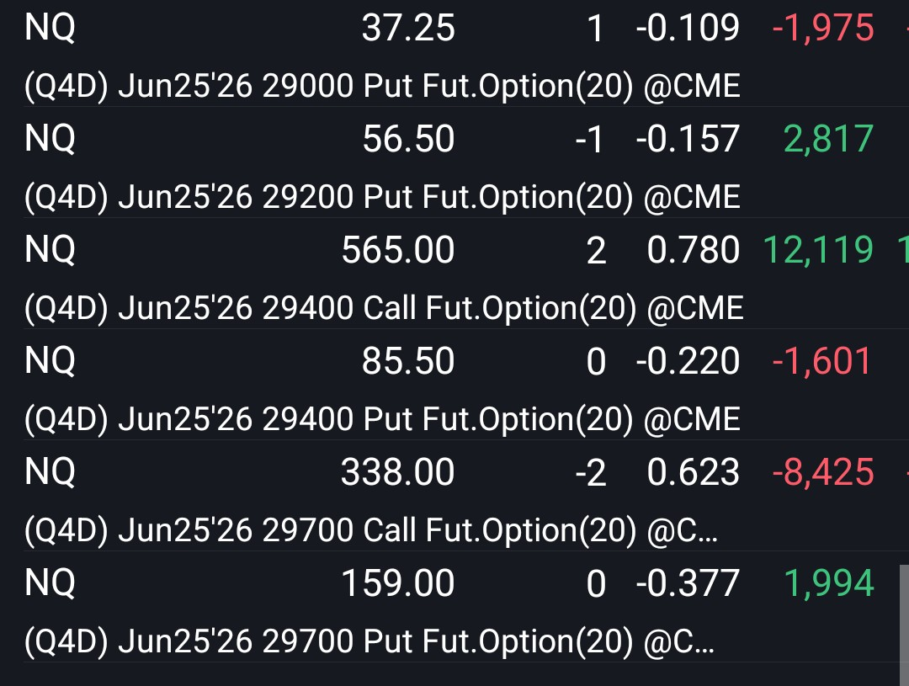
- 1519435713672777859_1519435713463189574.png: IBKR Mobile持仓盈亏页：NQ Jun25'26期权6腿——买29000P@37.25(-0.109)亏1,975、卖29200P@56.50(-0.157)赚2,817、买29400C@565(0.780)赚12,119、卖29400P@85.50(-0.220)亏1,601、卖29700C@338(0.623)亏8,425、卖29700P@159(-0.377)赚1,994，展示做空方向断翅蝴蝶各腿实时损益。
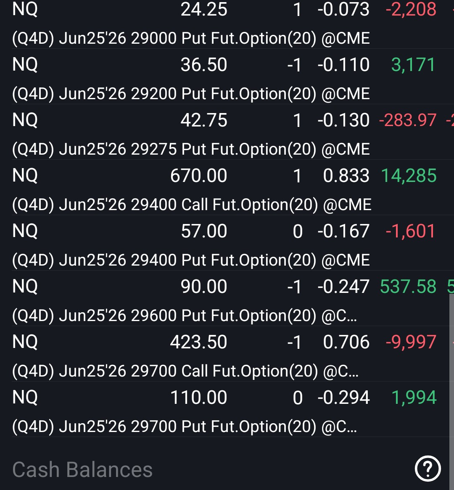
- 1519445035777527818_1519445035546968284.png: IBKR Mobile持仓盈亏页（更新版）：NQ Jun25'26 8腿——29000P亏2,208、卖29200P赚3,171、买29275P@42.75(-0.130)亏284、买29400C@670(0.833)赚14,285、卖29400P@57(-0.167)亏1,601、卖29600P@90(-0.247)赚538、卖29700C@423.50(0.706)亏9,997、卖29700P@110(-0.294)赚1,994，展示断翅蝴蝶加腿后的整体损益变化。

---

## 案例 56
**时间**: 2026-06-24 22:50 UTC
**社群提问（背景）**:
- **[cynthia937829]** 06-24 14:36: 跟着晓晓老师操作一下，明后天如果IV下降就平仓🙏
- **[weelium]** 06-24 15:46: 请教晓晓老师， 为什么 put spread 不放在 0.5 0.3 ？ ATM 流动性 和 IV 较高 ？
- **[zash0328]** 06-24 22:50: 请问晓晓是谁？

**晓晓解答**:
美投 邀请来的 期权专家

---

## 案例 57
**时间**: 2026-06-25 05:32 UTC
**社群提问（背景）**:
- **[emilytan123]** 06-25 05:26: 请问投投君： 我买入COVER CALL   SMH 2027 12/17  $655, 目前市场价已经接近650， 这将如何处理，如果 BUY TO CLOSE ，PREMIUM 亏损$ 15000，应该如何处理？不希望再ROLL
- **[emilytan123]** 06-25 05:45: 感谢你回复。 当时买超过6-9个月的权利金可观，所以选择了，但是低估SMH 股价提升。 我希望做多，可以每次大跌时ROLL 高行权价， 时间不变？ 另外我有ASTX , WDCX SP 2026/12 年底，也是大跌，如何 处理？
- **[emilytan123]** 06-25 05:54: 请问90天后，我加入期权课程后，还有DISCORD 美投专属的内容权限包括简报，观点分享吗？ 请问目前你们TEAM 有多少人呢？

**晓晓解答**:
27年12月17

先不说 怎么处理

你需要了结 期权流动性，随着到期日增长，流动性是越来越差的

既 买卖bid ask的差距

所以，你现在卖的这个call
非常不好处理，因为你如果交易他，你成交价就会直接亏损  1.0 * 100 = 100刀左右

你如果不在乎这100刀，那我也没法反驳。只能推荐你以后不要交易 到期日超过 90天的期权。

至于你的仓位本身，是做多仓位。
你如果不想做多了，你就把 正股和call 一起平仓

你如果又想保护住正股的收益，又不想call 亏损，你只能等到明年末 把正股以655 卖出。

当然这个是假设 股价不会大跌。

如果股价大跌
你的正股浮盈会 大幅下降，call 的浮亏也会跟着下降，但正股的亏损是更大的，差不多大1倍。如果你不在乎正股亏损，那我也无法反驳。

最好的选择就是 不要动了

同时赚取
高额权利金 以及 股价涨幅

是不可能的

你赚的每一块权利金的钱
都对应了你持有正股的下方风险，以及你放弃的上方盈利空间

我不方便回答

等别人来回答

---

## 案例 58
**时间**: 2026-06-25 09:59 UTC
**社群提问（背景）**:
- **[emilytan123]** 06-25 05:55: OK
- **[jjjjjjb18]** 06-25 09:02: <@805915579168587796> 下次提前说一声 😹悄悄关注好几天了 还以为是热心观众 原来是专家
- **[jjjjjjb18]** 06-25 09:03: <@227642228858683392> 晓晓老师，我是刚买期权课的大学生，我刚开始学习期权，本金也很少的情况下，又想练练手，有什么推荐吗？

**晓晓解答**:
无法回答

什么叫'练手' ？
你是说 虚拟账号吗？

---

## 案例 59
**时间**: 2026-06-25 13:17 UTC
**社群提问（背景）**:
- **[jackstom]** 06-25 12:11: 用虚拟账户比较好练手
- **[jackstom]** 06-25 12:13: 期权虽然说是低成本的投资方式，只是资金利用率的方面，如果是风险方面，那可以是正股的好几倍
- **[jackstom]** 06-25 12:14: sell call，sell put 可以说亏损无上限

**晓晓解答**:
6月25 纳指NQ 早报

夜盘sd: 420
目前sd: 315
盘前涨幅：N/A （由于盘后重要财报，波动巨大，无参考价值）
当日判断：看空
推荐策略：做空方向断翅蝴蝶
0.5 0.4 0.15 0.05

评论：
总体来讲，大盘处在极高位，长期看跌20%。

经历了2天 极度的恐慌杀跌，盘后出现了做市商的风险释放，既：太多买了put的人，收盘前 第二天的sd高达500多，导致做市商卖出了太多正股进行对冲，推低股价。

在这个情况下，只要财报不蹦/纳指股价不蹦，下方put的delta 由于vanna（iv的降低/事件的过去）会大幅跳崖，导致做市商需要被动买入正股，推高股价。

由于空头已经大部分 被动 在盘后被碾死（买的put随着股价上涨iv下降，接近归0），所以上涨动能枯竭，在高位继续看跌。

---

## 案例 60
**时间**: 2026-06-25 14:54 UTC
**社群提问（背景）**:
- **[cynthia937829]** 06-25 13:40: 昨天操作了一下做7月2日到期的QQQ铁鹰策略，我卖718 call，买726call, 卖695put ，买660put, 今天夜盘看到美股大涨，好怕一开盘就发现自己期权亏损了，结果开盘发现居然还赚了一点，好神奇。股价，波动率，时间的相互作用好复杂。🥲
- **[cynthia937829]** 06-25 13:41: 我当时卖了900，现在750左右，我应该什么时候平仓呢？用盈利来看还是用时间来看？
- **[jiananliu57]** 06-25 14:41: 90天后美投PRO+试用到期后，Discord权限也会到期，您还可以看到美股期权这个频道，但其他频道（简报/观点分享等）就看不到了。购买Pro或PRO+可以重新获得discord权限，也可以直接订阅美投discord社群。

**晓晓解答**:
这个组合目前应该是负delta

你愿意做空 就继续持有
不愿意做空，那就比较难处理，可以选择立刻平仓，但毕竟可惜 交易手续费

---

## 案例 61
**时间**: 2026-06-25 20:35 UTC
**社群提问（背景）**:
- **[cynthia937829]** 06-25 13:41: 我当时卖了900，现在750左右，我应该什么时候平仓呢？用盈利来看还是用时间来看？
- **[jiananliu57]** 06-25 14:41: 90天后美投PRO+试用到期后，Discord权限也会到期，您还可以看到美股期权这个频道，但其他频道（简报/观点分享等）就看不到了。购买Pro或PRO+可以重新获得discord权限，也可以直接订阅美投discord社群。
- **[jjjjjjb18]** 06-25 20:35: 好的 谢谢老师们

**晓晓解答**:
6月25 纳指NQ 晚报

夜盘sd: 400（很高）
目前sd: 400
盘前涨幅：0
当日判断：看空
推荐策略：卖atm call 形成spread，或，
包含deep otm put spread的 负delta铁鹰
延长到期日 1-3周

评论：
总体来讲，大盘处在极高位，长期看跌20%。

今天的走势有多离谱，我不说你都明白吧。

开盘sd 是 300
在没有任何明显新闻的情况下
20分钟 直接跌3sd
苹果-5%，M7 全军覆没

我人都傻了：
现在市场已经这么不遵循数学模型了吗？
一个末日put，可以从2刀多 翻50倍 到135刀！！

收盘
苹果依然 -6%，M7全军覆没
但SNDK +24%，硬是把纳指托了起来

美股有句话：
when they come for the generals...
意思是，当卖压已经扩散到核心蓝筹股的时候，说明投资者对市场已经完全失去信心

很久没有看到如此离谱的盘面。如果这走势是合理的，那说明以后整个经济体都会围绕着卖内存条，所谓的'硅基消费' 碾压 '碳基消费'：我们碳基生命的需求，已经远远赶不上硅基生命的需求了。

总体来讲呢，做空纳指是肯定的。可以持有小负delta。

今天开盘的move着实把我整蒙了。我现在无法再推荐去卖末日otm put spread，更别提卖otm 裸put。

如果市场着实已经不遵循数学模型了，那随时市场都能莫名其妙跌3sd 甚至更多，那你卖的otm put 随时就可以翻几十倍。

既，就算指数的otm本质上 是因为put skew 更值钱，所以 你可以卖的更远otm，但依然拿到比较高的收益。但在今天开盘的那种行情下，任何理论上'比较高的收益' 都是无用之谈。

所以如果愿意持有负delta
拉长到期日，选择卖atm call spread也许反而是更合理的操作。

回顾一下，光这周的离谱走势：
周一盘前就已经跌3sd了
周二下午1点半 在sd剩100的情况下，又跌3sd
周三开盘20分钟就跌3sd

回顾历史，单日超过3sd的跌幅 应该出现频率小于2%。而如果真的现在iv隐含波动远小于实际波动，那期权的价格随时都可以上天，对卖方风险极大。

**配图说明**:
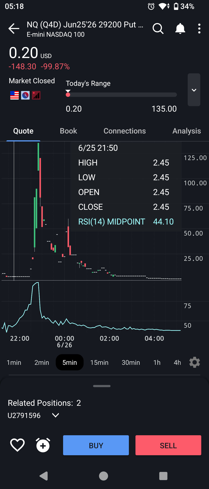
- 1519803299992309782_1519803299736322050.png: 手机行情软件显示NQ 6月25日到期的29200 Put报价0.20美元，日内暴跌99.87%，K线图上方弹窗显示高低开收均为2.45、RSI中值44.10，页面含买卖按钮及2个相关持仓。

---

## 案例 62
**时间**: 2026-06-26 01:11 UTC
**社群提问（背景）**:
- **[jjjjjjb18]** 06-25 20:35: 好的 谢谢老师们
- **[kl09738]** 06-25 22:43: 找下管理员，我新会员，至今没进入到听讲期权课．急急！
- **[infernity5995]** 06-25 23:32: 您好，给您私信了，麻烦您查看一下

**晓晓解答**:
目前我持有
下周五到期的 NQ铁鹰
call spread 0.5 0.15
put spread 0.12 0.05

总体来讲，非常的懵

目前完全无法相信sd对当日的波动预测。

现在只能接受，随时都可以莫名其妙的跌3sd。如果拉长到期日和strike距离，可以对此有一些防御性。

幸好目前 VXN 在高位
所以 拉长到期日的风险较低：

既，如果你在低IV环境入场 长到期日的卖方策略，如果日后 IV上涨，这些长到期日的期权价值会大幅上升，导致卖方浮亏严重

---

## 案例 63
**时间**: 2026-06-26 02:28 UTC
**社群提问（背景）**:
- **[infernity5995]** 06-25 23:32: 您好，给您私信了，麻烦您查看一下
- **[mikep7069]** 06-26 02:18: 铁鹦是做什么的？
- **[mikep7069]** 06-26 02:18: 能否解释一下这个策略的目的和逻辑

**晓晓解答**:
铁鹰

根据delta的不同，到期日不同，strike不同

可以组出 完全不同的目的

但核心观念是：
1. 净卖出，可以赚取时间损耗
在高iv环境下可选长到期日
在低iv环境下可选末日到期

2. 有上限亏损

适合目前这种经常莫名其妙 暴涨暴跌的市场。

在不暴涨暴跌的情况下，收益可观。在暴涨暴跌出现的时候，风险可控。

操作是：
卖一组call spread 做空
卖一组put spread 做多

在指数上，一般倾向选择
卖包含atm call 的call spread来控制上方风险
卖包含otm put （delta 0.1 - 0.3）的put spread来利用指数的put skew。

根据自己选择的spread中买的2条腿的 远近，即可决定策略的净delta，既方向性。

举例，在正常情况下
做一个中性的铁鹰，一般会选择delta为
call spread 0.5 0.3 
put spread 0.3 0.1

但是在目前环境下，倾向选择 卖 delta 0.1 - 0.15 左右的deep otm put

这就会导致买的put只能在 delta 0.05 左右，那整体的做多强度就很弱。

那么如果选择中性，可能容易在暴涨行情下受伤。

我个人看空纳指，所以我call
 spread 方向做
0.5 0.2 就可以得到 

call spread 上-0.3 delta
put spread 上 0.1 delta
净delta为 -0.2 做空方向的 负delta铁鹰

这种铁鹰 由于是负delta
跌了立刻盈利
涨了立刻亏损

随着时间推移 有赚时间损耗
股价暴涨暴跌 风险可控

6月25 纳指NQ 晚报2

夜盘sd: 400（很高）
目前sd: 475
盘前涨幅：-475  -1.6%
当日判断：看空；
     在目前点位中性，坚决不可杀跌负delta
推荐策略：卖atm call 形成spread，或，
包含deep otm put spread的 负delta铁鹰
延长到期日 1-3周

评论：
总体来讲，大盘处在极高位，长期看跌20%。
 
盘前纳指大幅下跌 -475点，又是荒唐至极的行情。
可见我的推荐是多么的重要：
1. 不能卖 裸otm put
2. 不能卖 末日otm put spread 
(deep otm 都不行，因为在现在这个市场，数学上的deep，市场直接分分钟给你击穿）
3. 愿意持有负delta做空的话，持有长时间到期的 atm call spread。这样的 gamma 相对较低，在跌幅行情中可以多吃到跌幅。相比之下，短期的call spread由于gamma极高，股价跌一点后就接近归零了，吃不到后续的跌幅。

敬重市场
不要自作聪明

我个人2次把持有的卖call向下roll，的同时，在sd上涨（高iv）的环境下，在股价低位卖出deep otm put spread，以保持delta0的 调整。但坚决不敢做末日！！选择了下周一和下周五到期，配合 下周五到期的call spread

另外，今天很可能出现日本央行干预。有意做多日元，应该尽快下单。选择convert currency，currency i want: japanese yen
currency i have: USD

**配图说明**:
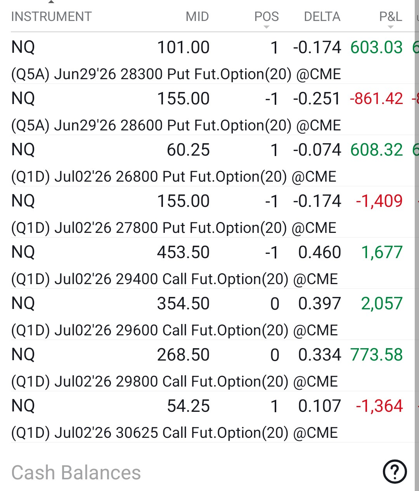
- 1519902029793726616_1519902029479280773.png: 手机交易软件NQ期货行情页，Sep18'26合约报29283，跌447.75点约1.49%，显示K线先跌后企稳反弹，下方附量能指标，页面含买卖按钮和相关持仓6项。

---

## 案例 64
**时间**: 2026-06-26 03:41 UTC
**社群提问（背景）**:
- **[fy2165187809]** 06-26 04:23: 今天这个夜盘下跌请问是什么逻辑啊
- **[matthewhhe]** 06-26 04:23: 亞洲股市都在跌
- **[fy2165187809]** 06-26 04:26: 我希望能理解这个价格变动的逻辑，我觉得您之前说的MU盘前下跌就很有逻辑性，做市商回补，受益匪浅

**晓晓解答**:
买期权 长期到期的call
跟借钱 3倍刚刚买正股 没有区别

懂了吗？
好的

不。
买正股意思是 无上限当然看涨
买长期到我的call 意思是无上限的看涨

SNDK 昨天涨24%
才是 毫无逻辑

逻辑就是 SNDK 昨天涨太多了

涨太多，就该回调

带下来纳指，很正常。

开盘的时候，完全可能反弹。

---

## 案例 65
**时间**: 2026-06-26 04:44 UTC
**社群提问（背景）**:
- **[matthewhhe]** 06-26 04:23: 亞洲股市都在跌
- **[fy2165187809]** 06-26 04:26: 我希望能理解这个价格变动的逻辑，我觉得您之前说的MU盘前下跌就很有逻辑性，做市商回补，受益匪浅
- **[fy2165187809]** 06-26 04:41: 带下来是什么意思，感觉有点玄啊

**晓晓解答**:
SNDK 是纳指成分股

他跌，纳指的一部分就在跌

如果其他纳指成分股 跟着跌（芯片，存储）

那纳指会跌更多

---

## 案例 66
**时间**: 2026-06-26 08:24 UTC
**社群提问（背景）**:
- **[fy2165187809]** 06-26 04:41: 带下来是什么意思，感觉有点玄啊
- **[fy2165187809]** 06-26 04:45: 原来如此，感谢
- **[jjjjjjb18]** 06-26 08:22: 晓晓老师，我刚刚学到期权的基本作用，您目前的这些期权都是为了获取现金流收入，这么理解对的吗？

**晓晓解答**:
错。

盈利 就是 盈利。
亏损 就是 亏损。

没有现金流这个概念。

---

## 案例 67
**时间**: 2026-06-26 11:35 UTC
**社群提问（背景）**:
- **[kevinyuan419]** 06-26 11:59: 谢谢老师，哪是不是不停的roll，还是给自己设定一个开仓和关仓的时间哪？不好意思问题太多，有点乱，希望老师不要介意。
- **[kevinyuan419]** 06-26 12:11: 谢谢老师，让我消化一下。😀
- **[kevinyuan419]** 06-26 12:25: 不好意思没有说明白，看跌做两个short call spread组合形成short call bwb, 同理看涨做两个short put spread组成short put bwb, 老师的意思是不是看涨做两个long call spread组成long cal bwb?谢谢

**晓晓解答**:
总体来讲，尤其是对新手来说

在没有对目前情况深度思考前，不要尝试着做复杂的操作，否则很可能出现你意料之外的事情。

我的意思是，
如果我想要做一个比较复杂的操作，我需要思考的有很多，其中包括
股价各种变动的可能，iv各种变动的可能，以及极端情况下我该如何做防御。

因为当行情真的出现的时候，很可能是迅速的。你如果没有提前思考清楚不同情况的应对措施，很可能 在没有思考清楚的情况下做出错误的决定。

而我之前就强调过了：
我们并不是需要做 收益期望最高 或者 收益最大化 的策略

我们需要做的是 最小化 我们犯错

因此，当做的操作越复杂，需要思考的未来情况就会更多。而为了避免复杂的操作，尽量选择更简单的操作，是我推荐新手的选择。

那么，回到你的问题
在roll 的时候，会保留现有的到期日吗？
答案是大部分情况下是。

因为这样 组合会更'僵硬'，在未来不同的情况下，期权组合的盈亏都更可控。

而做单纯的 diagonal spread
尤其是 reverse diagonal，既

买入 近期到期的期权
卖出 远期到期的期权

这种复杂操作，变量非常非常大，因为 就算只隔1天，以及你维持delta不变，其他的theta gamma iv 的 情况都完全不同。所以非常容易出现组合的盈亏 出现你未设想到的情况，严重偏离你的预期。

尽量要避免这样的操作。

第一个问题，我已经解释过了
参考这一偏

这2者 是一样的只是为了流动性
会倾向选 交易otm的那一侧
如果你实际的问题是

你是更倾向
买put spread 0.5 0.3
还是
卖call spread 0.5 0.3

那么很明显
前者 是 正gamma 负theta, on entry
后者 点 负gamma 正theta, on entry

但说实话，如果你到期日拉长，像下周五到期
那期待 gamma 和theta 都非常接近0，那么其实2者真的没有太大的差别

而如果你想问的再深一点：
何时他们有差别？
那必然就是到期日临近，最临近的当然是0dte 的情况

而在0dte的情况下

如果是 想组 delta 0的策略
那一定要 选 买put spread（既 做空方向断翅蝴蝶）

因为 你对应的做多的那2腿（卖的 otm put spread）是 极高负gamma下方风险的，所以你非常需要买 atm put spread 的正gamma来抵消掉一部分 下方卖put spread的负gamma 风险。

而如果你选择 末日铁鹰 delta0
那的确你的theta 会非常的高
但是负gamma风险也被最大化了。我并不是说这样操作难赚钱，而我是说 这样操作更容易犯错。

相比之下，如果你组 负delta 的 4腿组合
那本质上，你的下方风险就大幅降低了。因为虽然 是卖的otm put负gamma极高，但如果股价下跌，你是先把 负delta的钱赚到口袋里，然后再考虑负gamma给你带来的 问题。那其实，钱都已经赚到了的话，那其实 其他问题 都不是什么大问题 。

所以这个情况下
做空方向断翅蝴蝶 和 铁鹰
都可以
第二个问题：
我不止盈，我不止损

因为大部分人平时说的 '止盈/止损' 操作，必然是 带delta的操作，且delta可能会非常的高。

举个例子，一个人买call后，股价涨了，之后此人止盈，卖出call，这就很明显是 极高负delta操作，本质是就是在 做空股价/猜顶。

而我一直认为 猜顶/猜底 的操作，长期来讲是 没有正收益的

我遵循的是 投资里最重要的概念：
dont worry about where it's from
only worry about where it's going

大致来讲
意思是，市场不会在乎 你的仓位成本是多少，已经 盈利/亏损 了多少。

所以你的决策，应该是根据：
当下这个仓位，是否在未来能给你正收益期望。

如果有，那就应该留着
如果没有，那就应该立刻处理。

给几个经典的例子：
假设我卖了一个 裸otm put
然后股价横盘了好久
我已经盈利了 我的80%的 credit received

我可以很明确的告诉你，我几乎100%的情况下，都会持有这个put 到到期归0。
因为 如果我真的已经盈利 80% credit received，  那就说明这个put应该 是 deep otm 且 delta 极小。
所以就算日后股价出现暴跌，假设 10%的情况下，我依然可以尝试着补救，保护我的盈利。
而在其他90%的情况下，这个put归零，我就赚了最后20% credit received。从 风险收益比来讲，最后的20% 的 风险是最低的，收益却是最高的，所以是最最该留住的仓位，到 到期归0

第三个问题

流动性问题永远存在
itm期权 流动性就一定会更差

第四个问题
如果你想看涨，也要分 你是想做delta0 看涨策略，还是正delta看涨策略。

而在我的认知里
如果看涨，可以做上方call bwb
如果看跌，可以做下方put bwb

跟你说的是反的，所以我不理解你的问题
当策略的 期望从正EV
变成 questionable EV 的情况下

就需要调整了。

虽然情况过多，我这里就以我现在这个仓位举例子。

为什么我要不停的把我卖的call 往下roll？

因为总体来讲，在指数上持有 
卖 otm call，delta 在 -0.3左右 是负EV 的。
因为 指数是put skew，call的价值很低。如果股价下跌，你卖的call赚不了多少钱。但股价上涨，你肯定亏不少。

所以为了避免这种情况，如果手上有持有 卖的otm call，要尽快处理：roll 到 atm call  或者 直接平仓，换成新的形态

那因为roll本质上是 卖call spread，且是 在 股价下跌之后，

所以为了避免杀跌，最好 做另外的操作来平衡掉delta

很奇怪

任何 蝴蝶/铁鹰 的组合
最大盈利都是在
股价在到期日 非常接近你卖的strike 附近

而根据你的描述：
你看跌 做2个 short call spread？？
你这个怎么组？
而且 蝴蝶/铁鹰 是 一个 spread 是做多方向，一个spread 是做空方向。

你做2个 short call spread，我不理解你的意思
一般来讲
看涨，做 call bwb
把 short strike 放到上方

如果股价真的上涨 到你 卖的strike附近，then you get paid to be right

看跌，做 put bwb
把 short strike 放到下方
同理

---

## 案例 68
**时间**: 2026-06-26 19:51 UTC
**社群提问（背景）**:
- **[kevinyuan419]** 06-26 12:47: 谢谢老师，是不是要调整这条腿的delta来维持整个组合的delta 为初始值或接近初始值。
- **[kl09738]** 06-26 17:07: 找下平台管理员！！！
- **[infernity5995]** 06-26 17:16: 您好，我已经私信您了，麻烦您查看一下

**晓晓解答**:
一般不做  非delta0 的 调整。

除非着实无法接受目前的delta

如果到期日远一些
一般 delta不会跟on entry的，差很多
6月26 纳指NQ 晚报

夜盘周末sd: 445（很高）
（至周一到期的sd）

下周五sd：875
（其实周五休市，但我们依然称之为周五，意思是周末前的到期日）

盘前涨幅：0
当日判断：看空
推荐策略：做空方向断翅蝴蝶
0.5 0.4 0.15 0.05
到期日选择 1-3周

评论：
总体来讲，大盘处在极高位，长期看跌20%。

今天 存储暴跌，M7暴涨
经典的回调

昨天SNDK一天涨24%
不需要我多说，都知道这个多离谱。

目前这个点位杀跌负delta不是非常的合适。如果昨天没有入场负delta，现在很难推荐杀跌。

避开 卖末日otm put spread。庆幸 VXN依然在高位。

---

## 案例 69
**时间**: 2026-06-27 01:11 UTC
**社群提问（背景）**:
- **[kl09738]** 06-26 17:07: 找下平台管理员！！！
- **[infernity5995]** 06-26 17:16: 您好，我已经私信您了，麻烦您查看一下
- **[kevinyuan419]** 06-27 00:02: 谢谢老师

**晓晓解答**:
复盘一下今天的操作

美东下午4点10分盘后
股价29800
入场 卖 call spread
29800 30625

之前提到过如果要卖call spread，一定要卖atm call，或者itm call。（实际上如果卖itm call的call spread话，形状就是2个strike差不多 对称于股价两侧，举个例子 delta 0.6 0.4。这种spread是跟买put spread 对等的，而且是0gamma 0theta ,on entry. 而买put spread 当然也是可以的）

我这里选择了卖 atm call spread，是有正theta时间损耗的。是因为VXN在高位。如果出现横盘，VXN会下跌，所以 卖正theta 仓位可以吃到时间损耗和iv的下降。但其实说实话，在到期日拉长到下周五的情况下，其实不管是 0.5 0.3 ,   0.6 0.4 ,  0.7 0.5
的call spread，其实都差不多

我这里选择的其实是 0.5 0.2 的call spread，给我自己稍微多一点负delta。所以我是-0.3 delta on entry

那么选择了下周五，也是因为我之前提到，最近市场非常不尊重sd，所以为了避免再一波莫名其妙的暴跌把自己带走，这里选择了稍长的到期日。这样如果股价真的出现暴跌，长到期日的 spread 的负gamma 会远小于 末日，所以我可以吃到更多跌幅，且有更多的调整空间

我这里刻意没有选择 on entry额外卖一个 deep otm put，进行做多方向的对冲，形成铁鹰，因为我不想被突如其来的暴跌打飞。但我也知道，铁鹰的收益是更高的，尤其是在现在高VXN 的环境下。风险与收益共存，所以要找对时机去入场。

而这也就是我之前提到的：
在做复杂操作之前，我就需要提前预料到未来：股价，iv，极端情况 
可能出现的不同情况

我这里已经预料到 可能会出现 莫名其妙的暴跌，这样的极端行情，配合iv暴涨，所以我 on entry就没有卖otm put spread，这样就保护了自己的下方风险。

相反，我on entry就已经确定，如果这种暴跌极端行情出现，配合iv的上升，我一定要 'sell into strength' ，既 我那时候 一定要 前后逻辑一致，纪律性执行计划。不能拖泥带水，因为你可以看出这波极端下跌iv上涨，一共也就持续了2小时，从美东晚上9点至11点，错过了就是错过了。

所以在美东晚上 8点55分
股价在 29650
我选择卖铁鹰 delta 0
call 29800 29600 （向下roll）
put 27800 26800
下周五到期

你可以看出这个铁鹰是极度不平衡的，下方宽非常多，且非常deep otm。这就是为了能大幅吃到高iv，日后的 高时间损耗。客观来讲我们可以看出，经过这一天，NQ股价美东下午5点，收盘在上29283，相比于入场股价29650 跌了 470点左右，但卖的这个otm put spread虽然是做多方向，但是 盈亏却是 0。我靠选择 spread 的：入场时机，strike，到期日，一个做多仓位完全抵御了470个点的跌幅

其实这就是期权交易的核心：
期权交易靠的不是赌方向。
因为如果真的想赌方向，直接买卖正股delta就行了

期权的本质，就是有除了delta之外，一整套其他希腊字母能影响你的盈亏。你要正确的选择利用所有的希腊字母，来影响你的盈亏。
并不是说 用delta赚钱丢人，而是说 如果要做包含delta的策略，在盈利的时候，尝试把总盈利 的 30-50% 来自于delta，其他 的 70 - 50%盈利来自于其他的希腊字母

我们这里就拿今天举例。我入场时的确做了包含 delta -0.3的策略

假设我选择 纯粹赌方向，去卖空 3个 MNQ 期货，获得 纯 -0.3 delta，无任何其他希腊字母

那么今天，我运气不错赌对了方向，我的盈亏会是
(29800 - 29283) * 2  * 3
= 3102
 
*2 是 因为1手MNQ 是 2股纳指
而 1手 NQ 是 20股 纳指

所以交易 3手 MNQ，相当于就是交易了 0.3 手 NQ，也就是 0.3 delta

而实际我今天的总盈亏是 4895

所以我靠delta获得的盈利
是我今天总盈利的 60%左右。
而客观来讲，那是因为今天是比较极端的 赌对方向的行情，所以delta盈利的比例稍高

但是如果把盈利在下午3点45，股价在更高29550去分析的话，delta的盈利会降低，所以占总盈利的估计40%左右，而其他希腊就会占总盈利的60%左右

之后我在美东晚上9点半，股价29415的时候，配合iv继续上涨做了第二个铁鹰delta0，达到现在的形态

**配图说明**:
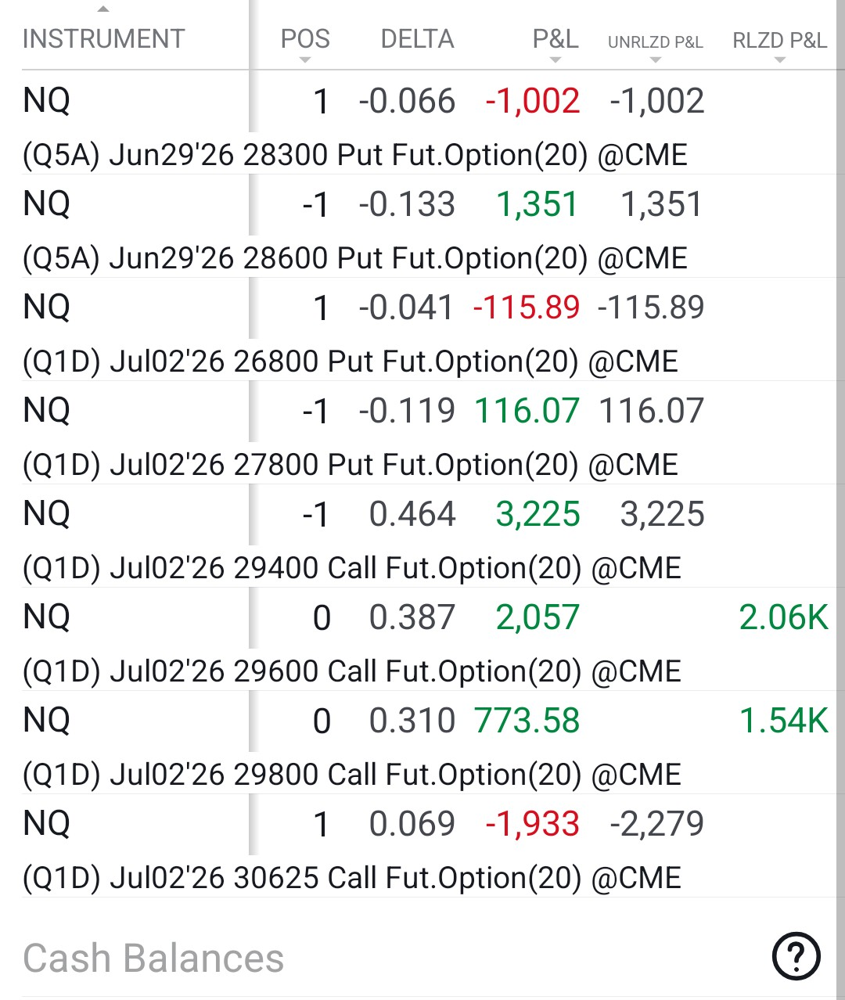
- 1520235186824941652_1520235185826828358.png: IBKR持仓列表：多条NQ期货期权，含6月26到期28300/28600及7月2到期26800/27800 Put对、29400/29625/29800/30625 Call，显示POS、delta与各自盈亏红绿数字。
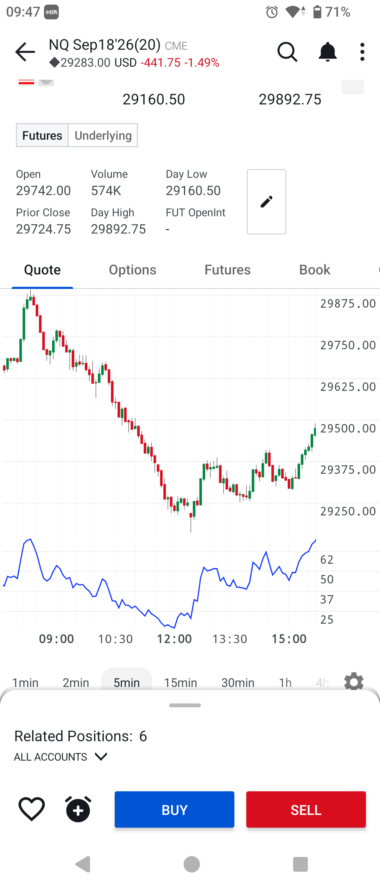
- 1520235186824941652_1520235186250579978.png: IBKR持仓明细页：NQ期权组合含6月29与7月2到期Put与Call多条腿，各腿POS、DELTA及已实现未实现盈亏，如29400 Call盈利3225、30625 Call亏损1933。

---

## 案例 70
**时间**: 2026-06-27 08:30 UTC
**社群提问（背景）**:
- **[wilson888.]** 06-27 08:08: TSMG抄了个低位呀
- **[wangying124]** 06-27 08:11: 我在国内，长鑫和苹果已经在谈了
- **[wangying124]** 06-27 08:11: 周一存储绝对暴跌

**晓晓解答**:
一个put对应100股 SMH价值6w

而你持有700股 TQQQ，价值 5w刀，对应 QQQ价值15w刀

一手对应 价值6w 的put
是无法对冲价值15w刀的仓位的

其实，最好对冲的方法是减仓，而不是做更复杂的期权策略。

因为期权要获得好的效果，不是一张单腿put就能完成的

---

## 案例 71
**时间**: 2026-06-27 23:10 UTC
**社群提问（背景）**:
- **[wangying124]** 06-27 08:11: 我在国内，长鑫和苹果已经在谈了
- **[wangying124]** 06-27 08:11: 周一存储绝对暴跌
- **[aura00627]** 06-27 14:21: 8

**晓晓解答**:

---

## 案例 72
**时间**: 2026-06-29 02:42 UTC
**社群提问（背景）**:
- **[jjjjjjb18]** 06-29 03:14: <@227642228858683392> 晓晓老师 这个图这么画是对的吗？
- **[rickkwlau]** 06-29 03:23: 是否QQQ 嘅option ?
- **[rickkwlau]** 06-29 03:27: 一般操作建議用邊隻? / 我真的不太懂, sorry問題有點多

**晓晓解答**:
6月28 纳指NQ 晚报

夜盘周末至周一sd: 445（很高）
目前周一sd：370（很高）
下周五sd：875
（其实周五休市，但我们依然称之为周五，意思是周末前的到期日）

盘前涨幅：150  +0.5%
当日判断：看空
推荐策略：做空方向断翅蝴蝶
0.5 0.4 0.15 0.05
到期日选择 1-3周

评论：
总体来讲，大盘处在极高位，长期看跌20%。

盘前波动非常的大，sd没有显著的下降，说明 从现在到开盘，以及开盘后，很可能会出现大幅波动。

这个位置依然不推荐杀跌delta。庆幸VXN在高位，组长到期日的做空方向断翅蝴蝶依然可行。

买 delta 0.5 put
卖 delta 0.4 put

卖 delta 0.15 put
买 delta 0.05 put

选到期日为下周五

错的

我说的策略一定是小debit入场

所以 如果股价上涨，一定是小亏，不可能是小赚

总体来讲
组delta 0 的 断翅蝴蝶，不可能是 credit入场的

如果想要股价涨 依然能盈利，（既入场拿credit），那必须是正delta策略，才能吃到涨幅，那么下方的put spread 卖的更宽，或更高。不管前者还是后者，如果这么操作下方风险都大幅上升了

可以

用 纳指期货期权 NQ
会更节约手续费和交易损耗
而且24小时都能交易

---

## 案例 73
**时间**: 2026-06-29 03:56 UTC
**社群提问（背景）**:
- **[kaomoo0314]** 06-29 03:55: 说美国政府同意 吗 而且苹果用不是核心高端 货 mu
- **[cynthia937829]** 06-29 04:44: 晓晓老师，我换成标普500期货来做这个，是不是也差不多？
- **[cynthia937829]** 06-29 04:52: 那有类似NQ的其他期货推荐吗？因为NQ操作一次太贵了, 我刚才试了您推荐的组合，显示需要55美debit, 那就是需要支付1100美元来买入这个期权组合？

**晓晓解答**:
芯片本身 没有任何 盗取信息的风险
那个列表本身，也只是限制 国防去 购买
从未限制私企去购买

苹果如果今天去购买，也不犯法

但苹果之所以要谈，是因为
希望不要苹果买了之后，某些 政客突然翻脸

不一定哦

因为 标普里面 板块太多，走势太杂

尤其是最近，跟纳指完全不同步

就拿周五举例

纳指100 跌了 -1.3% 左右
但纳指综合 只跌了 -0.24%左右

因为 纳指100 走的更 '纯粹'，里面的高市值成分股跌，那纳指100就跌

但纳指综合（以及标普），有很多 小市直，以及其他板块的股票，而他们的走势 很容易跟 高市值科技 走反方向

就拿上周举例

总体来讲，金融板块 医疗板块，是涨得很好的

而纳指100
几乎全部是因为 周二韩国 那波暴跌，所直接拉下来的。

所以最近 纳指100和标普
分化很严重

如果要泡沫破裂
也一定纳指100 领先

是的

没有了呢

如果你承受不起 1100美元
那你就选QQQ

NQ 是 QQQ的8倍

所以你的 入场debit 以及你的盈亏，都会 除以8

另外，可能你没明白
这个1100美元
不是说你花出去就没了

你如果是2周后到期
那你再任何时间段平仓
你几乎都能拿回 约等于1100美元的成本

而在最极端情况下，股价暴涨非常多，你也可以拿回一半左右

从另一个层面讲
你选的这个组合
delta 是0 ，theta 是正的

所以短期来讲，没有任何理由会认为 股价波动会导致你亏钱，反而 很可能股价横盘几天，你靠你的正theta还能赚一点
就以这个组合为例
delta 是 0.00 ，可以理解为delta 0 了

theta 是 178

理论上 股价横盘一天有178美元的盈利

入场debit 是 47.5 mid price
那我个人会认为，2天内 如果平仓，价格依然会是在 47.5 附近

**配图说明**:
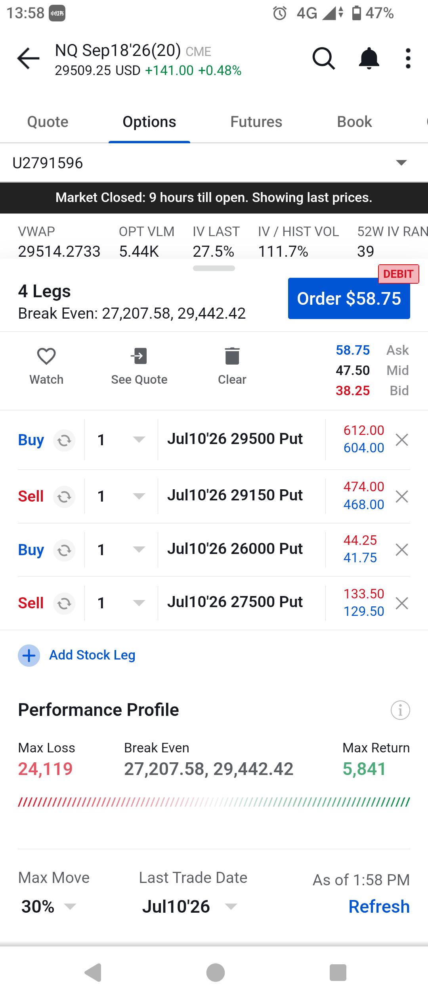
- 1521017078063304786_1521017077333233706.png: IBKR移动端NQ期权四腿组合单：买Jul10'26 29500/26000 Put、卖29150/27500 Put，Order $58.75 Debit，盈亏平衡27207/29442，最大亏损24119、最大收益5841。
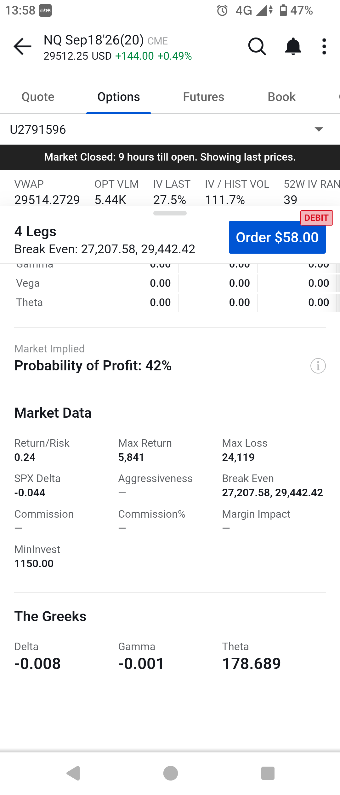
- 1521017078063304786_1521017077945729127.png: IBKR组合分析页：同一NQ四腿蝶式订单，市场隐含胜率42%，Return/Risk 0.24，SPX Delta -0.044，Delta -0.008、Gamma -0.001、Theta 178.689，最低投入1150美元。

---

## 案例 74
**时间**: 2026-06-29 05:09 UTC
**社群提问（背景）**:
- **[cynthia937829]** 06-29 04:44: 晓晓老师，我换成标普500期货来做这个，是不是也差不多？
- **[cynthia937829]** 06-29 04:52: 那有类似NQ的其他期货推荐吗？因为NQ操作一次太贵了, 我刚才试了您推荐的组合，显示需要55美debit, 那就是需要支付1100美元来买入这个期权组合？
- **[cynthia937829]** 06-29 05:08: 所以晓晓老师会挂单47.5还是会用进取点的价格买入？ / 我理解这个策略最主要就是短期不要暴跌超过0.15 delta对应的strike, 不暴跌应该都是不亏或者赚钱是吧？

**晓晓解答**:
挂单 的技巧
那肯定是

先按mid price
往下 调2格
下单，没成交
往上挑一格 modify 下单
没成交

重复这个操作，直到成交

短期不暴跌 就不会亏大钱
大概率在 47.5 附近 磨2天

除非出现小幅下跌，那 利润直接就会出现，估计 50% 左右吧

---

## 案例 75
**时间**: 2026-06-29 07:28 UTC
**社群提问（背景）**:
- **[cynthia937829]** 06-29 04:52: 那有类似NQ的其他期货推荐吗？因为NQ操作一次太贵了, 我刚才试了您推荐的组合，显示需要55美debit, 那就是需要支付1100美元来买入这个期权组合？
- **[cynthia937829]** 06-29 05:08: 所以晓晓老师会挂单47.5还是会用进取点的价格买入？ / 我理解这个策略最主要就是短期不要暴跌超过0.15 delta对应的strike, 不暴跌应该都是不亏或者赚钱是吧？
- **[rickkwlau]** 06-29 07:26: 之後點處理？等到期？

**晓晓解答**:
如果股价在 2个 卖的put strike之间
的确可以等过期

至于提前平仓的话，没有什么正确答案。你如果觉得你赚够了，你随时都可以提前平仓

一般来讲，如果是2周后到期的，一般都会起码持有3天 再考虑何时平仓

---

## 案例 76
**时间**: 2026-06-29 08:29 UTC
**社群提问（背景）**:
- **[cynthia937829]** 06-29 09:05: 晓晓老师，我已经错过了你这个组合是0 delta 的时候，我现再构建一样的组合delta 是-0.2。那我现在需要重新找一个Delta为零的组合还是继续抄你作业，因为我不知道市场环境算不算有改变。
- **[cynthia937829]** 06-29 09:19: 明白，因为现在都还是处于看空状态，所以说只要不是股价跌的太多，都是可以入场做 做空 方向断翅蝴蝶的是吧？

**晓晓解答**:
你需要 4腿 一起下单

IBKR

你需要选 9月到期的期货
而不是这个index

搜索 NQ
点开 NQ 后
会有很多个选项
第二个future 是期货
点进去 选 9月的期货

然后再点开期权链 就可以交易

期货 和 期货期权
都需要打开 交易权限

你一定要自己即时调整哦！

因为股价随时变动
delta 也会跟着随时变动

我给的delta目标 只是 约等于的目标

只要你大致保持类似的结构
自己组出来delta 0
就都是可以的

是的
因为你组的是delta0
任何时候入场 都没有很明显的 优劣

**配图说明**:
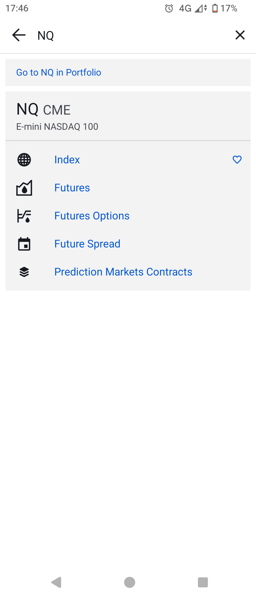
- 1521074331218612234_1521074330963021894.png: IBKR移动端搜索NQ的结果页，显示NQ CME即E-mini NASDAQ 100，列表含Index、Futures、Futures Options、Future Spread等入口，用于选择期货合约再开期权链。

---

## 案例 77
**时间**: 2026-06-29 09:38 UTC
**社群提问（背景）**:
- **[cynthia937829]** 06-29 09:19: 明白，因为现在都还是处于看空状态，所以说只要不是股价跌的太多，都是可以入场做 做空 方向断翅蝴蝶的是吧？
- **[rickkwlau]** 06-29 09:38: 係咪唔夠錢？

**晓晓解答**:
这里显示的
你差了 差不多 8000美金的保证金
5w6 港币 是
另外
你这个delta 是比较正的

最好还是取到 0.0几几 比较好
如果你保证金不够的话
你可以 把put spread 往上移一点

移到 delta 0.2 和 0.1
这样下方风险会稍微大一点
但是保证金需求会少一些

---

## 案例 78
**时间**: 2026-06-29 14:12 UTC
**社群提问（背景）**:
- **[rickkwlau]** 06-29 09:38: 係咪唔夠錢？
- **[rickkwlau]** 06-29 13:07: 想問你地做嘅交易，保證金是多小？

**晓晓解答**:
差不多的

---

## 案例 79
**时间**: 2026-06-29 15:25 UTC
**社群提问（背景）**:
- **[rickkwlau]** 06-29 09:38: 係咪唔夠錢？
- **[rickkwlau]** 06-29 13:07: 想問你地做嘅交易，保證金是多小？
- **[rickkwlau]** 06-29 14:13: 大約20000美金？

**晓晓解答**:
根据你下方卖的宽度 ，决定 保证金的额度

---

## 案例 80
**时间**: 2026-06-30 00:20 UTC
**社群提问（背景）**:
- **[rickkwlau]** 06-29 14:13: 大約20000美金？
- **[rickkwlau]** 06-30 00:23: 想問sd 係咩？
- **[rickkwlau]** 06-30 00:29: 想問一個半小時內漲450點sd 遮係點？ / 不是sd 3已經是1%？

**晓晓解答**:
6月29 纳指NQ 晚报

夜盘sd: 325（偏高）
目前sd：325

盘前涨幅：0
当日判断：看空
推荐策略：做空方向断翅蝴蝶
0.5 0.4 0.15 0.05
到期日选择 1-3周

评论：
总体来讲，大盘处在极高位，长期看跌20%。

今天又是荒唐的一天。
周日美东晚上6点开盘，sd在400左右。1个半小时 就涨450点。

美东早上9点半开盘后，又是一波极速下杀450点。接着在sd只剩250的情况下，却又暴涨750点，出现3sd的涨幅。

现在市场是完全不尊重sd。卖方一定要格外谨慎。

standard deviation
数学模型内，股价走势的分布，约为一个正态分布，宽度为sd。

sd越高，说明股价预期的波动越高。正常来讲，出现超过3sd的波动的概率小于1%，但现在此类事件频频出现。

在期权链 选择一个到期日，观测atm straddle价格（at call 和atm put 价格 之和）可以得到从 当下 到 到期日 的sd

美东周日 晚上6点至7点半
期权价格随时都在变，sd也随时都在变。
总体来讲，随着时间推移，sd会越来越低，最后在到期的那一刻归0

---

## 案例 81
**时间**: 2026-06-30 22:23 UTC
**社群提问（背景）**:
- **[rickkwlau]** 06-30 00:23: 想問sd 係咩？
- **[rickkwlau]** 06-30 00:29: 想問一個半小時內漲450點sd 遮係點？ / 不是sd 3已經是1%？
- **[rickkwlau]** 06-30 13:58: 每日都升，同我地預期唔一樣

**晓晓解答**:
6月29 纳指NQ 晚报

夜盘sd: 285
目前sd：285

盘前涨幅：0
当日判断：看空
推荐策略：做空方向断翅蝴蝶
可持有负delta
到期日选择 1-3周

评论：
总体来讲，大盘处在极高位，长期看跌20%。

9点半看盘在30000点，sd在230左右。开盘后直线拉升，最终涨了600点，约2.5 sd。

这种极端行情，持续发生，的确是很难解释。目前市场上唯一的解释是前半年机构为了让半年度报表好看，所以就追涨买入涨了很多的股票。所以SNDK今天又莫名其妙涨了10%。

VXN今天大幅下降，导致下方风险升高。在大涨2天后必须看空，所以可持有负delta

---

## 案例 82
**时间**: 2026-07-01 13:39 UTC
**社群提问（背景）**:
- **[rickkwlau]** 06-30 00:29: 想問一個半小時內漲450點sd 遮係點？ / 不是sd 3已經是1%？
- **[rickkwlau]** 06-30 13:58: 每日都升，同我地預期唔一樣
- **[rickkwlau]** 07-01 13:39: 負delta代表咩？

**晓晓解答**:
代表
股价如果跌了，立刻盈利

---

## 案例 83
**时间**: 2026-07-02 00:33 UTC
**社群提问（背景）**:
- **[cynthia937829]** 07-02 00:40: 晓晓老师太棒了👏我3天前抄了作业操作了QQQ期权，拿了3天了，不晓得今天要不要平仓，一手微赚50刀
- **[rickkwlau]** 07-02 00:42: QQQ保證金是否小一點？
- **[rickkwlau]** 07-02 00:43: NQ為何盈利會*8？

**晓晓解答**:
7月1 纳指NQ 晚报

从今天起，为了更方便让大家抄作业，我会把每天我推荐的策略以截图的形式展示出来。这样，就算大家不完全理解期权策略的所有细节，想抄作业的话也是会很方便的。如果你抄了作业，我也会随时在这里指导你日后的操作，所以你可以放心抄。盘面报价可能与我当时截图时有些出入，如果第二张图的delta值偏离 0.0 过多，请联系我，我帮你调整新的组合。最后，我推荐在IBKR交易 纳指NQ的指数期货期权。

夜盘sd: 335 （偏高）
目前sd：335

盘前跌幅：-40  -0.15%
当日判断：看空
推荐策略：做空方向断翅蝴蝶
0.5 0.4 0.15 0.05
到期日选择 1-3周

评论：
总体来讲，大盘处在极高位，长期看跌20%。

在大跌的一天后，无法推荐杀跌负delta。但是delta0的断翅蝴蝶依然是推荐的。

这其实就是交易 QQQ 的问题

你赚了50

但是 你入场就损耗了 约8刀
你出场还要损耗 约8刀

所以交易损耗太大了

而如果你做 NQ指数期货期权

你的盈利 *8
那么你损耗的 16刀 - 20刀 就没有那么痛了

介于你个人的情况
因为交易损耗过大
我更期望多持有一段时间，才值得 这个交易损耗

是的
NQ 是 QQQ的8倍左右

但是你可以试试我今天 发的截图
这个保证金应该少一些

一手 NQ的价值
约是 QQQ 的8倍仓位

盈亏 和 保证金，都会 *8

但交易损耗 不会 *8

**配图说明**:

- 1522037478880448683_1522037478339514500.png: IBKR手机端NQ Sep18'26四腿Put蝶式订单：买30000/28000 Put、卖28700/29800 Put，Jul10'26到期，Order $32.00 Debit，盈亏平衡28531/29688，最大损失10616、最大收益3371。
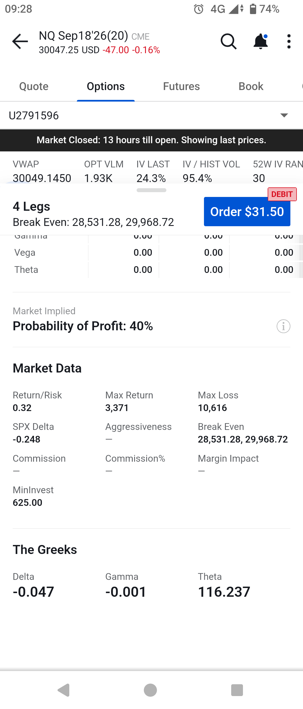
- 1522037478880448683_1522037478641369239.png: IBKR组合分析页：同一四腿蝶式订单$31.50 Debit，市场隐含胜率40%，Return/Risk 0.32，SPX Delta -0.248，希腊字母Delta -0.047、Gamma -0.001、Theta 116.237，最小投入625美元。

---

## 案例 84
**时间**: 2026-07-02 13:14 UTC
**社群提问（背景）**:
- **[dannyteo1]** 07-02 05:56: 可以在manage columns 那增加delta
- **[cynthia937829]** 07-02 11:19: 终于找到了，请问是选择这个一级吗？还是一级二级都选？
- **[rickkwlau]** 07-02 14:02: 咁用一級還是二級

**晓晓解答**:
右上角 选 edit column

把 last 最后价删掉

前3列  选 bid ask delta 以及 position仓位
交易NQ 必须买这个

免费的

1级

---

## 案例 85
**时间**: 2026-07-02 16:08 UTC
**社群提问（背景）**:
- **[rickkwlau]** 07-02 14:02: 咁用一級還是二級
- **[rickkwlau]** 07-02 14:03: Space X 係咪14日入S&P500? / 會有順風車坐？
- **[cynthia937829]** 07-02 16:07: 二级我也订购了，不过问题不大，只要超过20刀佣金就行

**晓晓解答**:
每个20 只能免1个
你订2个 就需要40

---

## 案例 86
**时间**: 2026-07-02 19:32 UTC
**社群提问（背景）**:
- **[henry888__]** 07-02 18:55: QQQ 期权目前没有 Edit Columns 这个选项，这是 TWS/IBKR 对股票、ETF 期权和期货期权界面的区别，不是你设置的问题。NQ 期权支持自定义列，QQQ 期权目前不支持
- **[uqnt.]** 07-02 18:59: 多谢

**晓晓解答**:
能不能不要复制 人工智障 

我的天呐

这个回复是有多么的智障啊

我脑子都快裂开了
我脑子裂开的太严重
我都不知道该怎么继续喷这个回复有多么智障了

先直接上图 解决问题
（第二张图，注意左上 发光的按键）
7月2 纳指NQ 晚报

从今天起，为了更方便让大家抄作业，我会把每天我推荐的策略以截图的形式展示出来。这样，就算大家不完全理解期权策略的所有细节，想抄作业的话也是会很方便的。如果你抄了作业，我也会随时在这里指导你日后的操作，所以你可以放心抄。盘面报价可能与我当时截图时有些出入，如果第二张图的delta值偏离 0.0 过多，请联系我，我帮你调整新的组合。最后，我推荐在IBKR交易 纳指NQ的指数期货期权。

夜盘sd:  410（偏高）
目前sd：410

盘前跌幅：未收盘
当日判断：中性
推荐策略：做空方向断翅蝴蝶
0.5 0.4 0.15 0.05
到期日选择 1-3周

评论：
总体来讲，大盘处在极高位，长期看跌20%。

在大跌的两天后，无法推荐杀跌负delta。但是delta0的断翅蝴蝶依然是推荐的。

我以为今天应该是成交量比较低的一天，但 ES 已经 200万手 成交量了，比一般的平淡日子多一倍。

我本想说是因为过节前导致 流动性不足，导致的恐慌爆仓的盘面。但是成交量如此高，我也不好乱说。

很明显 ES 和 NQ 的 分歧是非常非常大

甚至，连 ，M7 和 DRAM 作为 纳指100 内部结构，都分歧如此之大

**配图说明**:
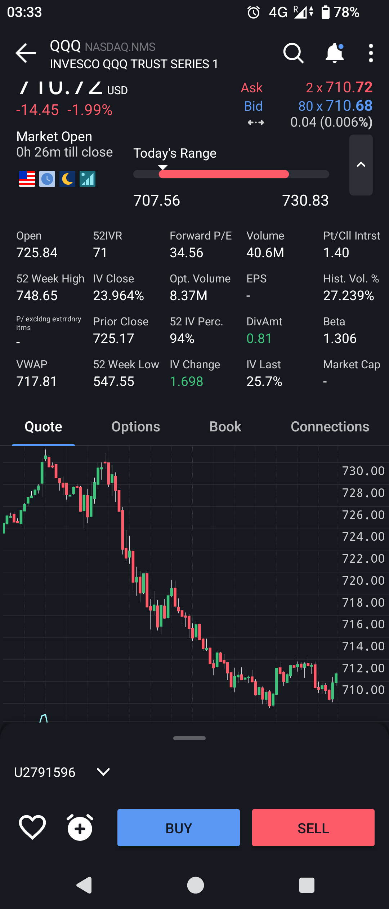
- 1522324842056122548_1522324840659288144.png: IBKR手机端QQQ行情页：报710.72美元，跌14.45约1.99%，日内区间707.56-730.83，期权量8.37M、52周IV Rank 71，K线显示当日冲高后持续下行。
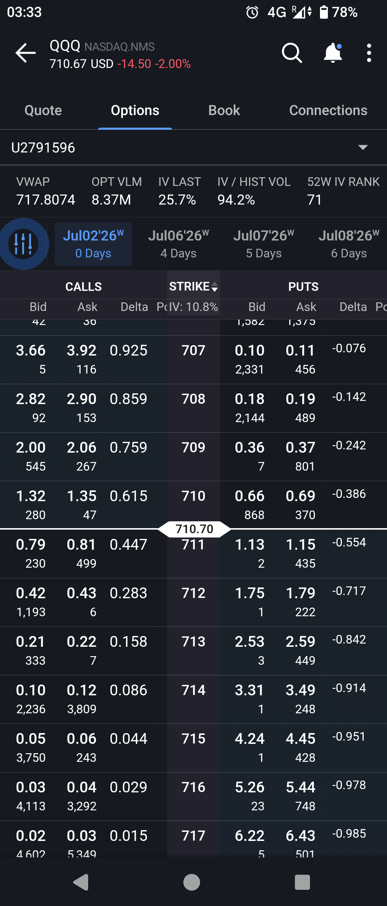
- 1522324842056122548_1522324841125122298.png: IBKR手机端QQQ期权链：Jul02'26周期权，行权价707-717，Calls与Puts的Bid/Ask/Delta并排，正股710.70，IV Last 25.7%，近月W当日到期0天。
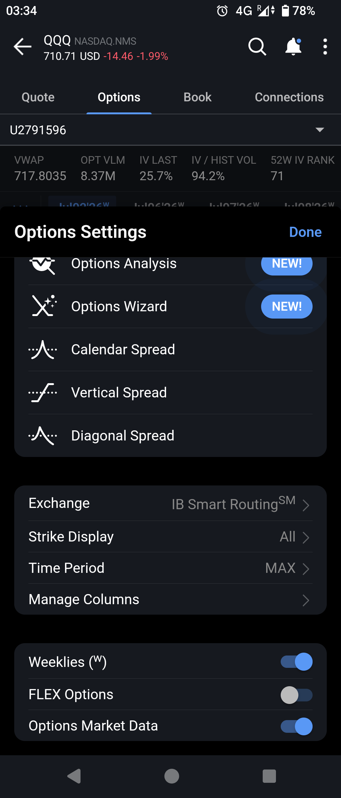
- 1522324842056122548_1522324841452142732.png: IBKR手机端QQQ的Options Settings菜单：含Options Analysis、Options Wizard、Calendar/Vertical/Diagonal Spread入口及Exchange、Strike Display、Manage Columns、Weeklies等设置项。
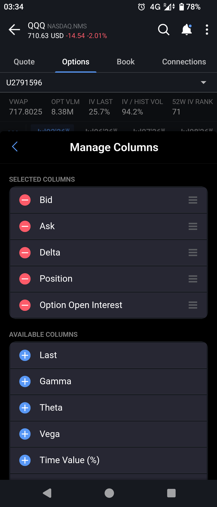
- 1522324842056122548_1522324841787818096.png: IBKR手机端NQ Sep18'26四腿Put蝶式订单$23.75 Debit：买29450/27750、卖29300/28200 Put，盈亏平衡28074/29426，最大损失6480、最大收益2513，IV 25.3%。
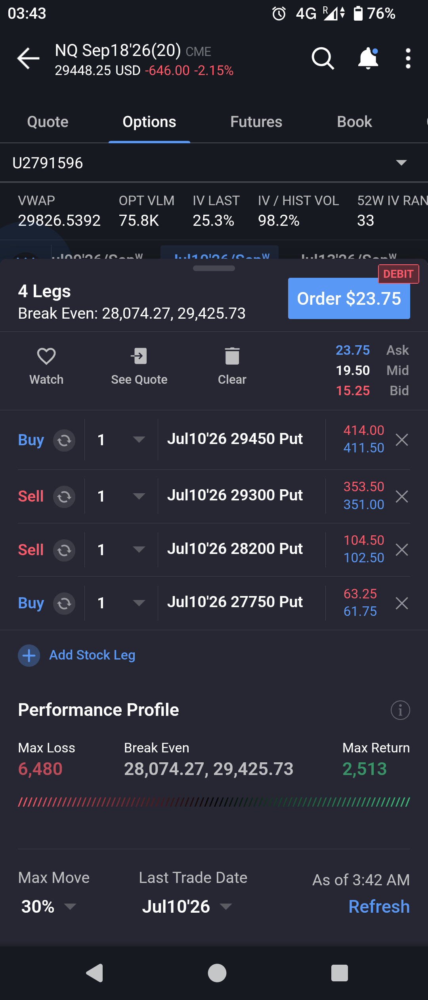
- 1522326849957400676_1522326849076723802.png: IBKR组合分析页：同一蝶式订单$24.50 Debit，市场隐含胜率40%，Return/Risk 0.39，SPX Delta -0.005，Delta -0.001、Theta 94.838，最小投入485美元，正股29446.75。
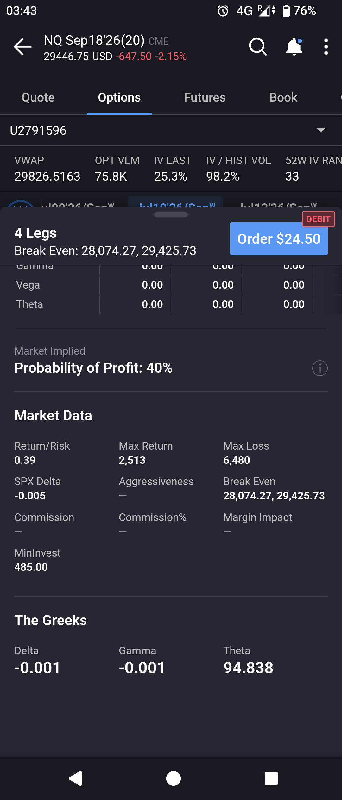
- 1522326849957400676_1522326849571782907.png: IBKR手机端QQQ期权链Jul02'26到期：行权价697-722，正股710.70，Calls与Puts的Bid/Ask、量及Delta并排显示，IV Last 25.7%，平值附近价差较宽。

---

## 案例 87
**时间**: 2026-07-03 05:56 UTC
**社群提问（背景）**:
- **[uqnt.]** 07-02 18:59: 多谢
- **[cynthia937829]** 07-03 05:47: 晓晓老师，我炒了这个作业，你会发每次作业的答案吗？就是什么时候平仓比较好。
- **[fifehdeyx47]** 07-03 06:34: 老师 资金量小做mnq可以不？ 就是感觉bid ask好宽

**晓晓解答**:
不会。你如果想跟进你手里的仓位，你要单独问我。

不可以，MNQ 流动性非常差 的同时，一手价值 6w 比 QQQ还少，导致 交易损耗高很多

---

## 案例 88
**时间**: 2026-07-04 00:52 UTC
**社群提问（背景）**:
- **[cynthia937829]** 07-03 05:47: 晓晓老师，我炒了这个作业，你会发每次作业的答案吗？就是什么时候平仓比较好。
- **[fifehdeyx47]** 07-03 06:34: 老师 资金量小做mnq可以不？ 就是感觉bid ask好宽
- **[real_hang]** 07-03 16:30: 请问下晓晓老师大盘在极高位这个观点是根据什么得出来的呢

**晓晓解答**:
4月起，涨幅过大

---

## 案例 89
**时间**: 2026-07-06 02:44 UTC
**社群提问（背景）**:
- **[cynthia937829]** 07-03 05:47: 晓晓老师，我炒了这个作业，你会发每次作业的答案吗？就是什么时候平仓比较好。
- **[fifehdeyx47]** 07-03 06:34: 老师 资金量小做mnq可以不？ 就是感觉bid ask好宽
- **[real_hang]** 07-03 16:30: 请问下晓晓老师大盘在极高位这个观点是根据什么得出来的呢

**晓晓解答**:
7月5 纳指NQ 晚报

从今天起，为了更方便让大家抄作业，我会把每天我推荐的策略以截图的形式展示出来。这样，就算大家不完全理解期权策略的所有细节，想抄作业的话也是会很方便的。如果你抄了作业，我也会随时在这里指导你日后的操作，所以你可以放心抄。盘面报价可能与我当时截图时有些出入，如果第二张图的delta值偏离 0.0 过多，请联系我，我帮你调整新的组合。最后，我推荐在IBKR交易 纳指NQ的指数期货期权。

夜盘sd:  410（偏高）
目前sd：310

盘前涨幅：180  + 0.6%
当日判断：看空
推荐策略：做空方向断翅蝴蝶
0.5 0.4 0.15 0.05
到期日选择 1-3周

评论：
总体来讲，大盘处在极高位，长期看跌20%。

在大跌的后，无法推荐杀跌负delta。但是delta0的断翅蝴蝶依然是推荐的。

总体来讲，周四 周五 周日的走势非常的失真。我依然更偏向相信流动性不足，导致做市商为了DDH (dynamic delta hedge）自己手上卖出的期权仓位，所以追涨杀跌，制造极大的单边波动。

保持delta 0 有上限亏损的结构，可以让你从容应对 如此大的振幅。当波动几日后，找机会平仓即可盈利。

目前sd的确已经降了不少，但依然偏高。到今日收盘出现大涨大跌 ±2% 的情况依然需要谨防。

**配图说明**:
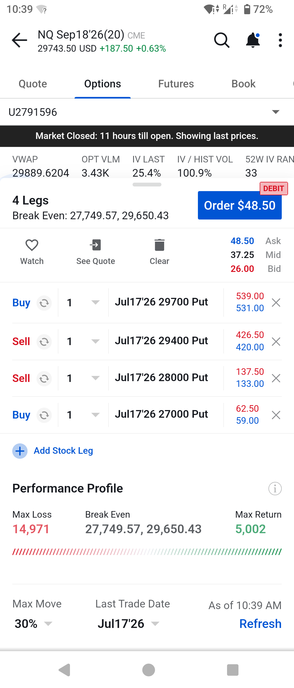
- 1523520038878056458_1523520038370541720.png: IBKR手机端NQ Sep18'26四腿Put蝶式订单$48.50 Debit：买29700/27000、卖29400/28000 Put，Jul17'26到期，盈亏平衡27750/29650，最大损失14971、最大收益5002。
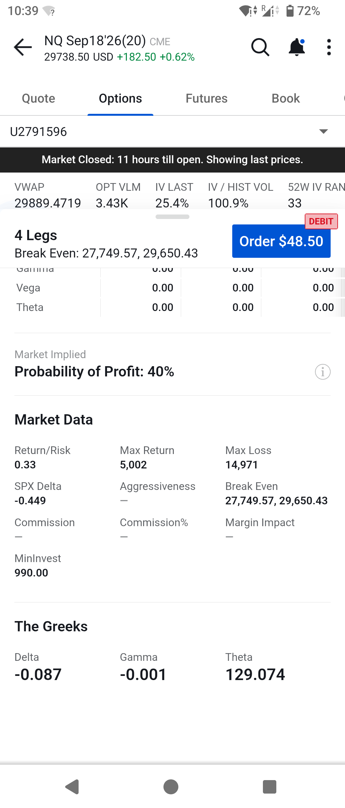
- 1523520038878056458_1523520038664011938.png: NQ期权四腿组合截图:报29738.50,4腿借方单$48.50,盈亏平衡27749/29650,最大盈利5002、最大亏损14971,SPX Delta -0.449,胜率40%,Theta 129,对应做空方向断翅蝴蝶。

---

## 案例 90
**时间**: 2026-07-06 06:03 UTC
**社群提问（背景）**:
- **[cynthia937829]** 07-06 06:05: 我说为啥感觉成交的人很少🤣
- **[cynthia937829]** 07-06 06:09: 出来的好像是同一个呀
- **[york5375]** 07-06 06:10: <@227642228858683392> 晓老师，我看您交易NQ期货期权很久了，想问问美股NQ ES期货期权的流动性，在亚洲白天时间流动性如何？也就是美东的夜盘时间

**晓晓解答**:
目前 无法推荐 下单 非delta0的策略
所以你需要调整一下 strike

这路 -0.19 已经偏离 0.0 很多了
另外一点就是
你需要选择 NQ期货之后
再选择期权链
你这个图 左上角 没开盘，说明你选的不是期货

除了在 美东周日晚上6点开盘的几个小时，会比较差，其他 亚盘时间段，都是流动性足够好的

当然，美东开盘时段是最好的

在极端行情下，会失去流动性
也许是同一个
我推荐你开盘后再交易，那时候流动性更好

---

## 案例 91
**时间**: 2026-07-06 07:51 UTC
**社群提问（背景）**:
- **[rickkwlau]** 07-06 07:53: 不是賺了2300hkd?
- **[feelfox]** 07-06 08:23: TSLA这种所有均线几乎黏在一起的情况大家怎么看，接下来是不是会有大的行情？
- **[feelfox]** 07-06 08:28: 晓晓老师，结合量能 RSI看会好一些么？目前是不是还是观望为好，不适合建仓。

**晓晓解答**:
亏损平仓？

但是以目前的NQ价格 这个仓位没什么大危险

😅
哦哦哦

技术分析
如果 光看均线，没有好效果

我个人认为，赌短期方向，长期来讲是无利可图的

如果你真的想要一个回答
可能 IVR 是 一个 比较勉强能接受的指标：

当IVR在 低于20的情况下，买1-3月 长到期的期权，也许有利

---

## 案例 92
**时间**: 2026-07-06 09:34 UTC
**社群提问（背景）**:
- **[feelfox]** 07-06 08:28: 晓晓老师，结合量能 RSI看会好一些么？目前是不是还是观望为好，不适合建仓。
- **[feelfox]** 07-06 08:34: 我理解了，感谢！
- **[jjjjjjb18]** 07-06 09:32: 有没有推荐能做cc的个股，晓晓老师，我刚学，想做一个cc的策略。

**晓晓解答**:
你 持有的任何正股

直接卖一个 1个月后 到期的
strike约等于股价的call

就行了

---

## 案例 93
**时间**: 2026-07-06 11:49 UTC
**社群提问（背景）**:
- **[kevinyuan419]** 07-06 12:24: 谢谢老师
- **[kevinyuan419]** 07-06 12:30: 晓晓老师，是否可以解释一下周四，周五和周日的走势非常的失真是怎样判断的？谢谢
- **[kevinyuan419]** 07-06 12:46: 您的意思是因为流动性不足，造成了做市商手上持有了太多的负gamma，对股价的冲击就是追涨杀跌？

**晓晓解答**:
有正股就别折腾了

这种低股价的股票 不适合 复杂的多腿策略
（700刀的 QQQ都非常不适合，谈何其他票）

别折腾，意思就是
简单卖call就行了
自己确定自己能接受的delta值

theta 和 gamma 是对手

随着到期日临近，你的theta越来越高，但是gamma风险也越来越大。所以 何时平仓，没有最好的答案。

我个人会倾向的是：
1. 确认股价在 你的2个short strike 之内。
如果不在，那你需要考虑 到期前3天左右平仓，否则最后1天的gamma风险过大。

2. 如果第一个条件满足，那你就需要确认 你目前组合的delta，并且比较这个delta是否符合你今天对市场的方向判断（或者是否符合我早报里 对当天市场的判断）。如果符合可以继续持有。如果不相符，那你需要考虑提前平仓。

举个例子，你入场bwb后，股价大幅下跌，bwb变成正delta。我的早报说短期要看多，那你觉得持有正delta暂时没有问题。之后股价横盘了几天，我的早报说短期要看空，但你的组合依然是正delta（但时间损耗已经让你赚了一点了），那在这个时候，你应该考虑平仓了。因为如果这个时候，突然来个大暴跌，会直接把你的组合 从盈利打到深亏损：我的早报已经警告你风险了。

3. 如果 第一条 第二条都满足
那持有到到期，都没有任何问题。

在没有明显的严重利好 也严重利空的情况下

股价能 大幅暴跌 又 大幅反弹
就像市场上精神分裂一样

如果股价真的值那个高价，为什么突然市场就认为不值了？然后市场又突然觉得值高价了？

与其于说 是市场觉得值不值
更多是因为流动性不足，导致 想卖的 做市商，找不到买家，越砸越低。想买的做市商，找不到卖家，越买越高

流动性不足
所以追涨杀跌的幅度 异常的大

---

## 案例 94
**时间**: 2026-07-06 13:15 UTC
**社群提问（背景）**:
- **[kevinyuan419]** 07-06 12:46: 您的意思是因为流动性不足，造成了做市商手上持有了太多的负gamma，对股价的冲击就是追涨杀跌？
- **[kevinyuan419]** 07-06 12:47: 明白了，谢谢
- **[cynthia937829]** 07-06 13:15: 晓晓老师，如果我想通过卖put接货，这样是不是可行，就是put那边不做spread，只做卖put

**晓晓解答**:
不

---

## 案例 95
**时间**: 2026-07-06 15:35 UTC
**社群提问（背景）**:
- **[real_hang]** 07-06 14:15: 晓晓老师能具体讲解一下指数位置高低的判断方法吗？纳斯达克指数曾经在互联网泡沫末期440天变3.6倍，疫情和关税后反弹也是暴涨。虽然4月起涨得多，但是怎么能知道接下来是继续涨还是有个10%以上回调呢
- **[cynthia937829]** 07-06 14:21: 晓晓老师 我根据你前期的指导 我做了这个判断图  请看看是不是这个意思
- **[ivanliv13916]** 07-06 15:34: 请问如何加入会员

**晓晓解答**:
无法做短期预测
🤣
从教条主义的角度来讲，没啥毛病

---

## 案例 96
**时间**: 2026-07-07 05:26 UTC
**社群提问（背景）**:
- **[cynthia937829]** 07-06 23:23: 小白需要来点规则😅
- **[hoennkiseki]** 07-07 00:53: <:catthink:1035539905109037137> 教條主義 某種意義上來說也是 紀律性的一部分
- **[cynthia937829]** 07-07 05:01: 晓晓老师，今天有作业可以抄吗❤️

**晓晓解答**:
7月6 纳指NQ 晚报

从今天起，为了更方便让大家抄作业，我会把每天我推荐的策略以截图的形式展示出来。这样，就算大家不完全理解期权策略的所有细节，想抄作业的话也是会很方便的。如果你抄了作业，我也会随时在这里指导你日后的操作，所以你可以放心抄。盘面报价可能与我当时截图时有些出入，如果第二张图的delta值偏离 0.0 过多，请联系我，我帮你调整新的组合。最后，我推荐在IBKR交易 纳指NQ的指数期货期权。

夜盘sd:  260（偏低）
目前sd：260

盘前跌幅：-340  -1.35%
当日判断：看空
推荐策略：做空方向断翅蝴蝶
0.5 0.4 0.15 0.05
到期日选择 1-3周

评论：
总体来讲，大盘处在极高位，长期看跌20%。

在大跌的后，无法推荐杀跌负delta。但是delta0的断翅蝴蝶依然是推荐的。

夜盘出现了加速下杀，由于没有流动性，单边幅度非常大。

**配图说明**:

- 1523923140500127774_1523923139975708794.png: NQ期权四腿断翅蝴蝶挂单:NQ报29577.50跌1.21%,买29500/27300 Put卖29300/28000 Put,7月17到期,借方$35.75,盈亏平衡27834/29466,最大亏损10674、最大盈利3311。
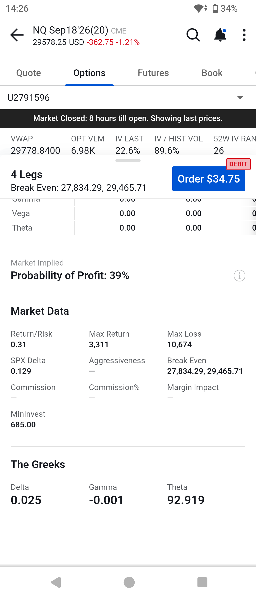
- 1523923140500127774_1523923140277833738.png: 同一NQ四腿组合的希腊字母页:借方$34.75,SPX Delta 0.129、组合Delta 0.025接近零,Gamma -0.001,Theta 92.9,胜率39%,最大盈利3311、最大亏损10674,盈亏平衡27834/29466。

---

## 案例 97
**时间**: 2026-07-07 14:47 UTC
**社群提问（背景）**:
- **[cynthia937829]** 07-07 11:28: 晓晓老师，我组合了一样的，成本还更低一些，会不会现在入场也可以，尽管delta带一点方向
- **[cynthia937829]** 07-07 11:30: 我看现在ATM的IV是24.5%，感觉偏高但是不算很高，可能出现开盘大跌方向对了，但IV快速上升而亏钱吗？
- **[cynthia937829]** 07-07 14:53: 我挂单25刀成交买到的，感觉delta没差多少，价格还相差挺远😂 是theta在作怪吗？应该不会几个小时影响这么多吧

**晓晓解答**:
净买卖 为0，不需要 担心 iv
0.029 足够接近 0.0

价格波动 很正常
7月6 纳指NQ 午报

从今天起，为了更方便让大家抄作业，我会把每天我推荐的策略以截图的形式展示出来。这样，就算大家不完全理解期权策略的所有细节，想抄作业的话也是会很方便的。如果你抄了作业，我也会随时在这里指导你日后的操作，所以你可以放心抄。盘面报价可能与我当时截图时有些出入，如果第二张图的delta值偏离 0.0 过多，请联系我，我帮你调整新的组合。最后，我推荐在IBKR交易 纳指NQ的指数期货期权。

末日sd:  260（偏低）
目前sd：160

目前跌幅：-640 -2.15%
当日判断：看多
推荐策略：铁鹰
0.5 0.4 0.15 0.05
到期日选择 1-3周

评论：
总体来讲，大盘处在极高位，长期看跌20%。

今天又是突如其来的3sd下跌
sd260
能跌700多

可见 现在这个环境
必须给自己空间
且不能卖末日，一波带走

在大跌后，必须短期看多。

**配图说明**:

- 1524071888312209469_1524071887557234819.png: NQ四腿铁鹰组合:NQ报29304.75跌2.13%,卖29300 Call买29500 Call买27000 Put卖27750 Put,7月17到期,贷方$157.25,盈亏平衡27593/29457,最大亏损11855、最大盈利3130。
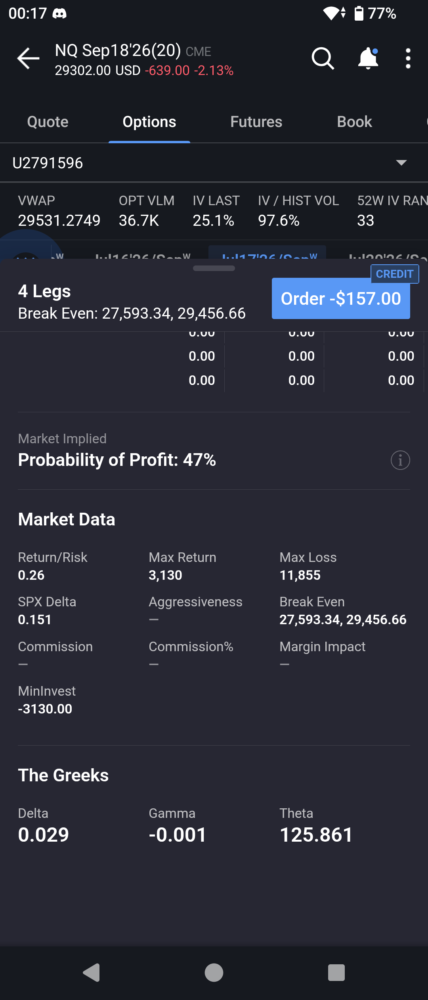
- 1524071888312209469_1524071888022798589.png: 该铁鹰组合的市场数据页:贷方$157,SPX Delta 0.151、组合Delta 0.029接近零,Gamma -0.001,Theta 125.9,胜率47%,Return/Risk 0.26,盈亏平衡27593/29457,最小投入-3130。

---

## 案例 98
**时间**: 2026-07-07 22:19 UTC
**社群提问（背景）**:
- **[cynthia937829]** 07-07 11:30: 我看现在ATM的IV是24.5%，感觉偏高但是不算很高，可能出现开盘大跌方向对了，但IV快速上升而亏钱吗？
- **[cynthia937829]** 07-07 14:53: 我挂单25刀成交买到的，感觉delta没差多少，价格还相差挺远😂 是theta在作怪吗？应该不会几个小时影响这么多吧
- **[aura00627]** 07-07 15:47: <@227642228858683392> 请问一下那之前有做看空的断翅蝴蝶是不是要出掉了阿？

**晓晓解答**:
你有做的话，我给你看看

---

## 案例 99
**时间**: 2026-07-07 23:28 UTC
**社群提问（背景）**:
- **[rickkwlau]** 07-07 23:55: 唔係咁樣睇咩？
- **[fifehdeyx47]** 07-07 23:56: 哥们讲话我是真看不懂😂
- **[rickkwlau]** 07-08 00:04: 購買後版面會不一樣？

**晓晓解答**:
你的仓位应该是正delta才对

你需要在portfolio 的 edit column
也把 delta那一列打开

delta是随着 股价和时间变动的

因为 NQ 一手 是 20股

所以你要拿这个数
除以20
才能得到 0到1之间的delta值

而 1/20 =0.05

所以 更快的 脑力计算
是你直接 * 5
就可以得到 0至100之间的delta值

像在这里
你 * 5 得到7.5 左右

说明你目前的delta值是 0.075
小幅做多
你这个到期日还早

你没必要现在这么慌

等你的下方put 28000 接近了，你可以再慌

27850很远
暂时没有什么问题

我还是推荐在portfolio页面看
0至1 之间的delta数值

因为 NQ 一手是20股
所以的确 来回倒腾 /20 或者 * 5 ，容易看晕

你需要购买 期货实时报价

在 NQ 主页面
左上角
一个小的 钟表 的按键

你点那个会引导你去买 NQ 的 level 1 实时报价
夜盘sd：330

免费的，你不用交钱的

买了之后 你的报价会是 实时的
目前黄色长方形 说明是延迟15分钟

---

## 案例 100
**时间**: 2026-07-08 00:35 UTC
**社群提问（背景）**:
- **[cynthia937829]** 07-08 00:49: 晓晓老师，现在ATM是29500，我参考你的delta建议重新组合了一个，delta略微负数，这样可以吗？
- **[cynthia937829]** 07-08 00:54: 确实差距挺大，我就挂买单比较高的位置，能买就买，不能买就算了。当然中间NQ的价格和delta都会变动，应该不影响太多吧？
- **[cynthia937829]** 07-08 01:00: 其实这一点我一直不太明白，我的组合是收钱的，如果我挂单在高位成交我可以收更多钱。那和我用中间价入场并持有相比，我不应该赚了更多？卖出断翅膀蝴蝶同理？

**晓晓解答**:
黄色长方形 是 延迟报价
你如果买了
可能需要等一会 才能更新
点左上角的 黄色 钟表
进行购买（不要钱）

最下面这个 NQ
level 1 一级

就要这一个就行了

是的

可以

但是，现在晚上流动性不是非常好
你确定要现在入吗？
成交价可能会亏5-10美金
你就看near atm 期权的bid ask
就行了

差距4 就是比较差

差距2-3 就是比较好

这里29800 差距是6
算是很差了

一般不推荐 挂单在高位

因为如果你之后成交了，那很可能是因为 股价出现了大幅波动。那么 那一刻你的组合 可能就不是delta0了

举个例子，股价大涨，你的组合delta 变负。因为股价涨太多，你成交了。入场就已经 delta -0.05 左右。然后股价继续涨 你继续亏。

并非

你收的钱更多
但那是因为 股价更高了，你卖出的call spread 价值更高了。

因为call spread 的比重比put spread更高了，所以你入场是负delta

如果日后股价跌了，你的确会赚更多，但你的盈利的一大部分来自于你入场时的delta。

而delta 是 赌方向，双刃剑

如果你入场后 股价继续涨，你就会亏更多。原因是因为 本来call spread 和put spread 应该平衡到delta0，而因为你入场负delta，股价上涨时，put spread 的盈利 无法抵消 更高比重的call spread 亏损，导致你整个组合 会在 股价上涨时亏钱

换句话说，如果股价涨了，
你需要跟着把put spread 得strike上调，才能保持平衡。如果拿上涨前的put spread strike 的组合 成交，那 就会不平衡 出现负delta

---

## 案例 101
**时间**: 2026-07-08 08:44 UTC
**社群提问（背景）**:
- **[cynthia937829]** 07-08 00:54: 确实差距挺大，我就挂买单比较高的位置，能买就买，不能买就算了。当然中间NQ的价格和delta都会变动，应该不影响太多吧？
- **[cynthia937829]** 07-08 01:00: 其实这一点我一直不太明白，我的组合是收钱的，如果我挂单在高位成交我可以收更多钱。那和我用中间价入场并持有相比，我不应该赚了更多？卖出断翅膀蝴蝶同理？
- **[cynthia937829]** 07-08 09:10: 目前NQ的价格在两个short strike之间，发现亏更多了🥲，所以要keep在中间到期才会赚钱，但是没到期都是亏钱的？

**晓晓解答**:
夜盘sd330

NQ盘前开盘已经跌了550点了

你是卖28000put？

---

## 案例 102
**时间**: 2026-07-09 00:07 UTC
**社群提问（背景）**:
- **[mikep7069]** 07-08 14:53: 为什么同时put和call spread一起做呀？
- **[mikep7069]** 07-08 14:54: 感觉不赚钱呀
- **[dannyteo1]** 07-08 18:50: 风险控制，IC/bwb是有限亏损。

**晓晓解答**:
7月8 纳指NQ 晚报

从今天起，为了更方便让大家抄作业，我会把每天我推荐的策略以截图的形式展示出来。这样，就算大家不完全理解期权策略的所有细节，想抄作业的话也是会很方便的。如果你抄了作业，我也会随时在这里指导你日后的操作，所以你可以放心抄。盘面报价可能与我当时截图时有些出入，如果第二张图的delta值偏离 0.0 过多，请联系我，我帮你调整新的组合。最后，我推荐在IBKR交易 纳指NQ的指数期货期权。

夜盘sd:  310（偏高）
目前sd：310

目前涨幅：65  0.2%
当日判断：看空
推荐策略：做空方向断翅蝴蝶
0.5 0.4 0.15 0.05
到期日选择 1-3周

评论：
总体来讲，大盘处在极高位，长期看跌20%。

大跌700点后 又反弹500多点，很明显这种走势，在日内会被期权买家牵着鼻子走。选择更长到期日的有上限亏损策略，可以有效避免被极端波动而受伤。

在中午，sd只剩100多的情况下，还能反弹500点，后续必须看空。

**配图说明**:
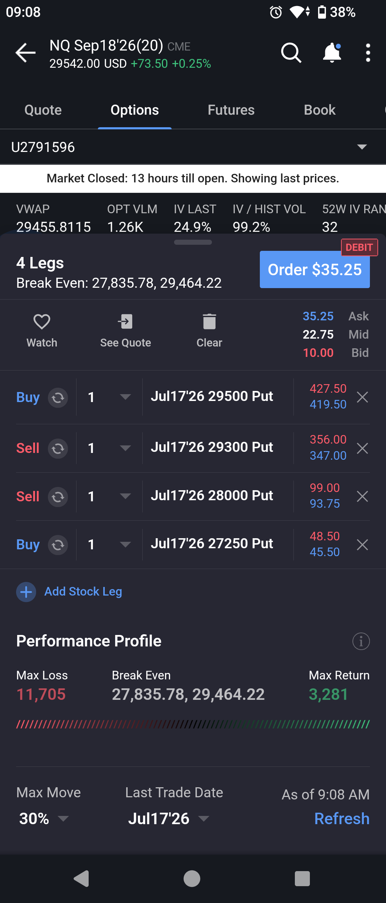
- 1524567923212156979_1524567922666635314.png: NQ四腿断翅蝴蝶挂单:NQ报29542涨0.25%,买29500/27250 Put卖29300/28000 Put,7月17到期,借方$35.25,盈亏平衡27836/29464,最大亏损11705、最大盈利3281。
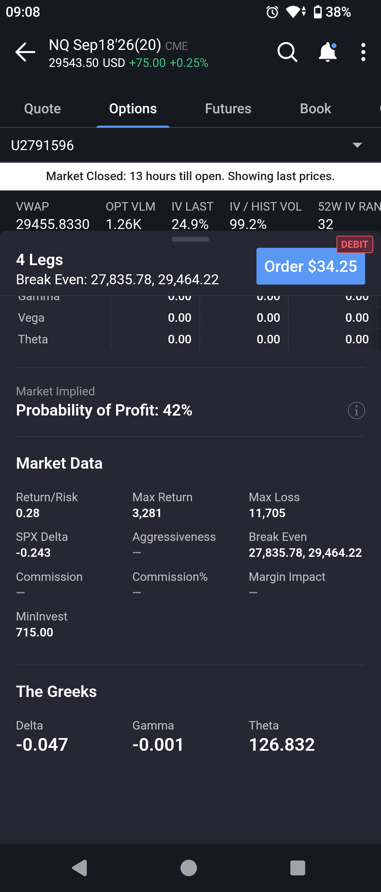
- 1524567923212156979_1524567922918428793.png: 该组合希腊字母页:借方$34.25,SPX Delta -0.243、组合Delta -0.047小幅做空,Gamma -0.001,Theta 126.8,胜率42%,Return/Risk 0.28,最大盈利3281、最大亏损11705。

---

## 案例 103
**时间**: 2026-07-09 15:07 UTC
**社群提问（背景）**:
- **[cynthia937829]** 07-09 15:34: 晓晓老师，我记得你好像说过开新仓的时候最好把之前的仓的腿做一些重合，这样后续需要平仓的交易费和摩擦可以减少。 / 但这种情况相当于把两个仓融合到一起了，不会看应该什么时候平仓哪一个了😅，4腿变3腿或者2腿不会失衡更严重吗？ / 还是我记错了🤔
- **[cynthia937829]** 07-09 15:45: 因为我们一直在做的是0delta的组合，我想清晰一点，我做些假设： /  / 7月6日 做了4腿的做空断翅蝴蝶，代号A / 7月8日 我打算做同一到期日的4腿的做空断翅蝴蝶，代号B。 /  / 这种时候，以下哪一点需要注意或者重要顺序是什么？ / 1，尽量重合腿，减少开仓的整体腿的数量  / 2，新开的仓需要是0 delta / 3. 新旧仓组合起来应该是0 Delta，如果A当前的delta是-0.2，那我B组合最好是0.2开仓？ / 4，如果需要满足3，那入场时必要要调整0.5，0.4，0.15，0.05的组合细节了。 / 🙏
- **[cynthia937829]** 07-09 16:03: 我把4腿变8腿，又再把组合变成了0delta，就可以更从容应对股价的波动了😀  /  / 不过这会太advance吗？我还是小白，4条腿的时候都不知道股价，时间，IV对他们的影响 /  / 经常看到NQ变动，期权组合的盈利和亏钱都不知道哪里来的🤣

**晓晓解答**:
你这个算很好了

3分腿的bidask 每个腿之和

这里差10，说明每个腿就2.5

在这个情况下，成交一定不会超过0.25的误差
以 mid -0.5 开始 price discover慢慢往上调

要成交的话，在流动性好的环境下
每隔2-5秒调一次：
push the order through

不会
观测目前组合的delta即可 看出是否失衡（是否需要调整delta

4. 该调整就调整

能接受现在的delta，就 选delta0入场

不能接受，就调整组合，来 降低目前的delta。而因为新入场组合有delta，那么 就有 股价 择时  低买高卖的问题了

我从来没有说过
要把 组合 重置 成delta0
接受市场波动 来给你带来的delta
是期权交易的一部分

就像买单腿call 的人
是正gamma
股价上涨 delta会变得越来越高

买call的人 会接受更高的 delta 让他们吃到更多涨幅，而不是 不停的调整/重置

---

## 案例 104
**时间**: 2026-07-10 00:12 UTC
**社群提问（背景）**:
- **[cynthia937829]** 07-09 15:34: 晓晓老师，我记得你好像说过开新仓的时候最好把之前的仓的腿做一些重合，这样后续需要平仓的交易费和摩擦可以减少。 / 但这种情况相当于把两个仓融合到一起了，不会看应该什么时候平仓哪一个了😅，4腿变3腿或者2腿不会失衡更严重吗？ / 还是我记错了🤔
- **[cynthia937829]** 07-09 15:45: 因为我们一直在做的是0delta的组合，我想清晰一点，我做些假设： /  / 7月6日 做了4腿的做空断翅蝴蝶，代号A / 7月8日 我打算做同一到期日的4腿的做空断翅蝴蝶，代号B。 /  / 这种时候，以下哪一点需要注意或者重要顺序是什么？ / 1，尽量重合腿，减少开仓的整体腿的数量  / 2，新开的仓需要是0 delta / 3. 新旧仓组合起来应该是0 Delta，如果A当前的delta是-0.2，那我B组合最好是0.2开仓？ / 4，如果需要满足3，那入场时必要要调整0.5，0.4，0.15，0.05的组合细节了。 / 🙏
- **[cynthia937829]** 07-09 16:03: 我把4腿变8腿，又再把组合变成了0delta，就可以更从容应对股价的波动了😀  /  / 不过这会太advance吗？我还是小白，4条腿的时候都不知道股价，时间，IV对他们的影响 /  / 经常看到NQ变动，期权组合的盈利和亏钱都不知道哪里来的🤣

**晓晓解答**:
7月9 纳指NQ 晚报

从今天起，为了更方便让大家抄作业，我会把每天我推荐的策略以截图的形式展示出来。这样，就算大家不完全理解期权策略的所有细节，想抄作业的话也是会很方便的。如果你抄了作业，我也会随时在这里指导你日后的操作，所以你可以放心抄。盘面报价可能与我当时截图时有些出入，如果第二张图的delta值偏离 0.0 过多，请联系我，我帮你调整新的组合。最后，我推荐在IBKR交易 纳指NQ的指数期货期权。

夜盘sd:  300（偏高）
目前sd：300

目前跌幅：-65  -0.2%
当日判断：看空
推荐策略：做空方向断翅蝴蝶
0.5 0.4 0.15 0.05
到期日选择 1-3周

评论：
总体来讲，大盘处在极高位，长期看跌20%。

在sd只有300的情况下，一天时间能反弹1000点。如此频繁出现极端波动，着实是荒唐至极。只能说，要选择接受市场最近的行情，选择正确的应对方法：
拉长到期日
有上限亏损策略
不做末日

在如此极端的涨幅后，只能看空

**配图说明**:
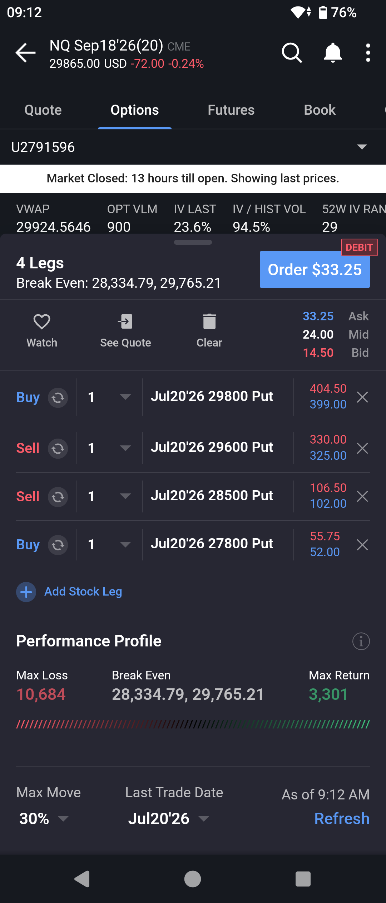
- 1524931263901990966_1524931263457398884.png: NQ四腿断翅蝴蝶:NQ报29865跌0.24%,买29800/27800 Put卖29600/28500 Put,7月20到期,借方$33.25,盈亏平衡28335/29765,最大亏损10684、最大盈利3301。
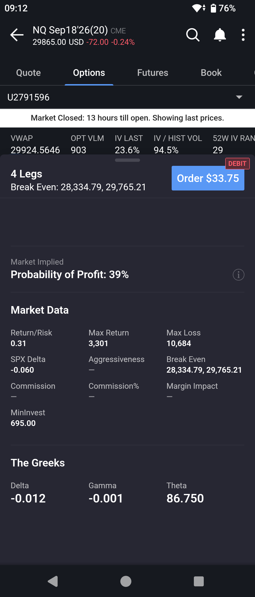
- 1524931263901990966_1524931263822037022.png: 该组合希腊字母页:借方$33.75,SPX Delta -0.060、组合Delta -0.012接近零,Gamma -0.001,Theta 86.75,胜率39%,Return/Risk 0.31,最大亏损10684、最小投入695。

---

## 案例 105
**时间**: 2026-07-11 07:18 UTC
**社群提问（背景）**:
- **[cynthia937829]** 07-09 15:45: 因为我们一直在做的是0delta的组合，我想清晰一点，我做些假设： /  / 7月6日 做了4腿的做空断翅蝴蝶，代号A / 7月8日 我打算做同一到期日的4腿的做空断翅蝴蝶，代号B。 /  / 这种时候，以下哪一点需要注意或者重要顺序是什么？ / 1，尽量重合腿，减少开仓的整体腿的数量  / 2，新开的仓需要是0 delta / 3. 新旧仓组合起来应该是0 Delta，如果A当前的delta是-0.2，那我B组合最好是0.2开仓？ / 4，如果需要满足3，那入场时必要要调整0.5，0.4，0.15，0.05的组合细节了。 / 🙏
- **[cynthia937829]** 07-09 16:03: 我把4腿变8腿，又再把组合变成了0delta，就可以更从容应对股价的波动了😀  /  / 不过这会太advance吗？我还是小白，4条腿的时候都不知道股价，时间，IV对他们的影响 /  / 经常看到NQ变动，期权组合的盈利和亏钱都不知道哪里来的🤣
- **[aura00627]** 07-11 07:12: <@227642228858683392> 请教一下，现在还持有你之前7/6推荐的铁鹰，我做的是7/17到期。现在已经涨超29500，但是亏损还很小。通常这种情况下是不是建议再等个两天。感谢～

**晓晓解答**:
现在这个组合，应该是 负delta 约 -0.1，所以是做空仓位。

我是推荐在暴涨后，保持做空的仓位。但如果你想止损一部分 也没有问题，止损的方法就是：
平仓下方的put spread，然后卖一个 新的更高位的put spread。这个4腿组合，把总delta 控制在 正 0.05左右，这样你就止损了一部分你现在持有的负delta。

举个简单的例子，就是图中的组合。

当然，很明显 坏处就是，你如果现在高位追涨 0.05 delta，那如果日后股价下跌，你的盈利 必然会降低

**配图说明**:
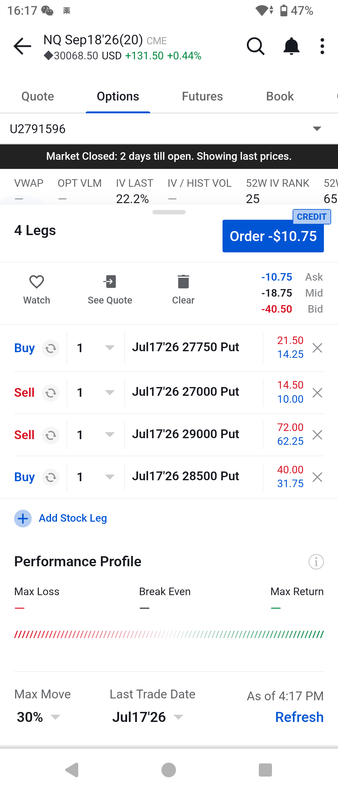
- 1525400870957875310_1525400870479466658.png: NQ四腿展期组合挂单:NQ报30068.50涨0.44%,买27750/27000 Put卖29000/28500 Put,7月17到期,贷方$10.75,IV 22.2%,Performance Profile显示Max Loss/Break Even/Max Return待刷新。
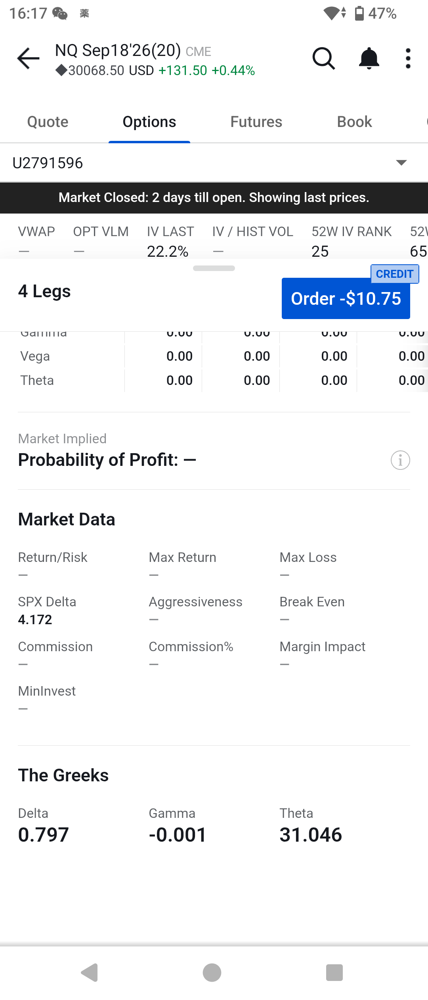
- 1525400870957875310_1525400870735450132.png: 该贷方$10.75组合的市场数据页:SPX Delta 4.172、组合Delta 0.797偏正,Gamma -0.001,Theta 31.046,胜率与盈亏数据未显示(Market Closed状态),IV 22.2%。

---

## 案例 106
**时间**: 2026-07-13 09:56 UTC
**社群提问（背景）**:
- **[aura00627]** 07-11 07:12: <@227642228858683392> 请教一下，现在还持有你之前7/6推荐的铁鹰，我做的是7/17到期。现在已经涨超29500，但是亏损还很小。通常这种情况下是不是建议再等个两天。感谢～
- **[aura00627]** 07-11 10:55: <@227642228858683392> 感谢指导～
- **[michael1491491]** 07-13 03:48: 👋

**晓晓解答**:
7月13 纳指NQ 早报

从今天起，为了更方便让大家抄作业，我会把每天我推荐的策略以截图的形式展示出来。这样，就算大家不完全理解期权策略的所有细节，想抄作业的话也是会很方便的。如果你抄了作业，我也会随时在这里指导你日后的操作，所以你可以放心抄。盘面报价可能与我当时截图时有些出入，如果第二张图的delta值偏离 0.0 过多，请联系我，我帮你调整新的组合。最后，我推荐在IBKR交易 纳指NQ的指数期货期权。

夜盘sd:  230（偏高）
目前sd：230

目前跌幅：-275  -0.9%
当日判断：看空
推荐策略：做空方向断翅蝴蝶
0.5 0.4 0.15 0.05
到期日选择 1-3周

评论：
总体来讲，大盘处在极高位，长期看跌20%。

盘前出现了大幅下跌。保持看跌姿态。

如果有本周到期的 put spread，可以考虑：
保持相同strike，展期到下周一。

这个4腿操作一般是 正0.05delta左右，适合在股价下跌的时候入场成交。

而至于 下方剩下的otm put spread，可以等过期。且 在股价下跌时，找好股价低的机会，卖一个新的 delta 0.15 0.1 左右的put spread 下周一到期。

**配图说明**:

- 1526165470376628366_1526165469910794322.png: NQ四腿断翅蝴蝶:NQ报29758.75跌0.91%,买29700/27200 Put卖29500/28000 Put,7月24到期,借方$36,盈亏平衡27836/29664,最大亏损12704、最大盈利3275。

- 1526165470376628366_1526165470305194084.png: 该组合希腊字母页:借方$36,SPX Delta -0.429、组合Delta -0.084做空,Gamma -0.001,Theta 95.337,胜率42%,Return/Risk 0.26,最小投入720,盈亏平衡27836/29664。

---

## 案例 107
**时间**: 2026-07-13 12:13 UTC
**社群提问（背景）**:
- **[kevinyuan419]** 07-13 12:52: 0.5的额外delta是roll 了上方put spread 到下周五后的delta，这样的话整个组合的delta就变为了大概0.6了，delta 是0.03
- **[kevinyuan419]** 07-13 12:54: 明白了，谢谢
- **[kevinyuan419]** 07-13 12:55: 刚才老师说如果价格到了两个short put legs之间，就要处理了，能不能具体说一下处理的方法？谢谢

**晓晓解答**:
如果把put spread
roll到下周一
这个4腿操作 总delta 是 0.015
那可以接受

你也可以roll到下周三或者下周五，那样4腿操作的delta 可以高一些

看你多想 '抄底'低买
就拿 本周五到期的 29500 29300 put spread 举例好了

如果roll这个到 下周五
这个4腿操作的delta 是 
0.534 * 5 / 100 = 0.026 左右

相当于是小幅抄底
在盘前下跌的情况下，我觉得这种操作没任何毛病

如果你想抄底多一点，你可以把spread roll的稍微窄一些

不过 还是要注意 上方 和 下方的delta 平衡

抄底太多delta的话，如果日后股价崩盘，你会从盈利变成亏损 甚至深度亏损

现在是 正0.1

如果 股价还没有跌到2个 short put strike 区间内，那不用担心

如果 已经跌破 第一个short put strike
那就要该开始担心，要考虑开始处理了
另外，你小数点写错了

你应该在 portfolio 打开delta
delta 应该是 0 - 1 之间的数

不应该 大幅改变 从 0.1 到0.6
这个页面 最下面出现的delta值
是已经乘了 NQ 的 x20 multiplier

所以这个页面的delta 是可以在 0 - 20 之间的

平时讨论delta
还是应该控制在 0 - 1 之间

那如果是 0.1 是 x20 之后的

那么 0.1 /20 = 0.005
这个足够接近0 可以忽略不计了
因为 delta 本质上 应该理解成一个 百分比%

delta 0.5 就是 50% 做多强度
经典例子就是 卖atm put

如果 股价上涨，可以盈利正常持有正股的一半
但如果 股价下跌，可以亏损 正常持有正股的一半

如果你现在组合是 delta 0
那你完全没必要折腾

短期来讲
股价怎么涨跌，都不会影响你的盈亏

在没有任何理由认为 股价会短期内出现暴涨暴跌的行情，那你啥都不动，赚当下的时间损耗，是合理的操作

最简单的方法，依然是把买的put spread 展期

如果不想抄底，可以组delta 0 的展期，会导致 新到期日的put spread 更宽

如果想小幅抄底，保持相同strike没问题

展期可以选择 下周一，周三 周五
差别不是非常的大

一般来说，跌到第一个 short put strike就该处理了

放着不管的话，碰到暴跌会 大幅亏损

**配图说明**:

- 1526201421379276884_1526201421165498478.png: NQ日历式四腿(put spread展期):NQ报29720.25跌1.04%,卖Jul17 29500/29300 Put再买Jul24 29500/29300 Put,借方$16.50,盈亏平衡29432/30613,最大亏损2425、最大盈利1254。

- 1526201421379276884_1526201421538791484.png: 该展期组合希腊字母页:借方$18,组合Delta 0.534(小幅抄底),Gamma -0.001,Theta 38.615,胜率51%,Return/Risk 0.52,最大盈利1254、最大亏损2425,最小投入350。

---

## 案例 108
**时间**: 2026-07-13 17:44 UTC
**社群提问（背景）**:
- **[cynthia937829]** 07-13 14:40: 晓晓老师，这个指的是任何的断翅蝴蝶组合跌到第一个short put strike?  /  / 我组合购买4天了，20号到期，我第一个short put strike 是29750，目前delta 0.001.  /  / 我现在是不是应该啥也不用干，就吃时间值？
- **[cynthia937829]** 07-13 14:44: 晓晓老师，市场已经跌了一会儿了，我现在再进去买来得及吗？现在跌了1.34%了。
- **[kevinyuan419]** 07-13 16:46: 晓晓老师，nq的持续下跌导致我的bwb组合为正0.6delta，并跌倒了上方short put下，我根据老师的指导，维持相同的strike到下周五，四腿操作的到正0.6delta，roll完后，整个diagonal BWB的组合是正1.2 delta, 这个新的组合在持续下跌后不是造成了比老的组合更大的亏损吗？请指教，谢谢。

**晓晓解答**:
主要问题在于

我是长期看空 长期做空

如果不展期，那在我的 上方spread被击穿，到期后，我就没有仓位了。而我为了长期持有做空的仓位，所以需要在被击穿的时候展期。

如果你不想长期做空，甚至 你想 抄底的话，那你的思路可以跟我的不一样。你继续持有到到期归零，也没有任何问题。
你如果不想抄底，你就组delta 0的展期，展期到下周五

在这个操作下，你的上方 spread 会变得更宽

举个例子，像
29500 29700本周五到期的spread
要delta 0 去展期到周五

会变成
29500 29800

其他本周五到期的上方spread，都可以以相同思路展期

**配图说明**:

- 1526284330631168061_1526284329955754084.png: NQ四腿展期组合(credit):NQ报29505.75跌1.75%,买Jul17 29500 Put卖29700 Put,卖Jul24 29500 Call买29800 Call,贷方$246.50,盈亏平衡28590/29615/30400,最大亏损2008、最大盈利1483。

- 1526284330631168061_1526284330429845565.png: IBKR移动端NQ Sep18'26四腿组合风险指标页：CREDIT单-$246，盈亏平衡28590/29615/30400三点，盈利概率43%，Return/Risk 0.74，最大赚1483、亏2008，Delta 0.092、Theta -32.99，最小投入-4940。

---

## 案例 109
**时间**: 2026-07-13 19:06 UTC
**社群提问（背景）**:
- **[kevinyuan419]** 07-13 19:52: 为什么是0.05delta?可以更高或更低吗？
- **[kevinyuan419]** 07-13 19:57: 如果抄底后的股价继续跌，是否还是调整上方put spread？但是delta逐渐减少。
- **[kevinyuan419]** 07-13 20:01: 再调整的话是不是到期时间就不变了，只是调整strike?

**晓晓解答**:
大跌之后，去抄底

这个逻辑，哪里有问题？？？

你想抄底 你就抄，组delta 0.05左右的 4腿展期

你不想抄 就组delta 0的 4腿展期

介于 0.05离0不远
其实，差距不会非常非常大

不是不是

我的意思是：
'在大跌后，你短线，小幅抄底，过几天就处理'

这个逻辑是没有问题的
毕竟这些期权都1-2周到期，

做不到 '抄底后 长期持有' 这个概念

我并没有说 我短期看涨

我今天收盘的晚报 的当日判断依然是看空的

但这并不影响我 当日可以选择 在大跌后 小幅抄底。

你如果很难理解，我可以给你个简单的例子：

你别管我当日看跌还是看空，

在大跌后
是不是iv高了，是✅ 
配合指数的put skew，是不是otm put更贵了，是✅ 
那我现在去卖一个deep otm put（裸 或 spread），是不是昨天没有什么价值的东西，今天却能卖出比较可观的价值了，是✅ 
假设我选择卖2天后到期的，并且股价的确2天内下跌了，但我卖的因为是 deep otm，所以最后依然归零了，那我是不是赚钱了，是✅ 

长话短说，就是
赚钱不一定要靠赌方向

大跌后，小幅抄底，是没有任何问题的。你如果正delta已经很高的，你可以选择不抄，但这并不改变 大跌后抄底 是正期望。

不。指数是put skew
所以
应该多持有 当前股价下方strike的 short call 或 short put
（因为他们更'显著的' 贵，所以你 收益期望 更高）

尽量少持有 当前股价上方strike的 short call 或 short put
（因为他们更'显著的'便宜，所以你 收益期望 更低）

所以 当跌穿第一个short strike的时候，就应该考虑调整了。

你可以理解为：

你坚持持有 现在变的很贵了的 short otm put，就已经 满足正期望的条件了。

所以如果要抄底
与其于调整已经 很优化的下方spread，更应该调整 并非很优化的上方spread

所以如果想要在大跌后抄底 0.05左右的delta，一般的操作：
要不就是 展期上方spread，
要不就是 卖新的下方spread

但后者 是增加下方风险的，所以新手慎用，但的确收益期望是更高的。
在上方spread在已经被击穿的情况下，肯定 调整他的优先级更高。

一般不推荐更高
也不推荐更低

无法再更低了，太接近0，盈利效果不显著，反而 交易损耗 就太高了

不推荐更高，
别看 0.1只是比 0.05 多了 0.05，实际上 0.1是 0.05的2倍
盈亏 就会是2倍

我一般一个抄底操作，会选0.04左右。不过 我炒的 比较频繁，我是 越跌越抄，每多跌一点，像跌200点，就再抄一点，所以我把我每次抄的额度 降低一点，可以让我 抄的次数更多 更灵活

到了一定程度，你的正delta过高，导致你无法再接受继续抄底。那就只能delta0 调整上方了

（不过，你无法接受继续抄底，并不改变 大跌后抄底 依然是正期望）

上方 每次调整 都应该 增长时间

因为在大跌的情况下，VXN 理应升高，所以你应该在高iv环境下， 锁定到期日更长的 高iv 外在价值

而这锁定的 更高的 外在价值，也是在保护你的下方风险

---

## 案例 110
**时间**: 2026-07-13 20:33 UTC
**社群提问（背景）**:
- **[kevinyuan419]** 07-13 20:01: 再调整的话是不是到期时间就不变了，只是调整strike?
- **[kevinyuan419]** 07-13 20:10: 理解了，谢谢
- **[kevinyuan419]** 07-13 20:15: 还有个疑问，应为上方put spread 是买入，高vxn代表买入价格高，为什么会有抄底的效果那。

**晓晓解答**:
根据 put call parity
买入 put spread 对等 卖出call spread

当买入的 put spread 被击穿后，本质上 已经变成了 卖出atm call，买入otm call的  ，short call spread

在这个情况下，拉长short atm call的到期日，是在 锁定高iv的 外在价值

---

## 案例 111
**时间**: 2026-07-14 00:09 UTC
**社群提问（背景）**:
- **[kevinyuan419]** 07-13 20:10: 理解了，谢谢
- **[kevinyuan419]** 07-13 20:15: 还有个疑问，应为上方put spread 是买入，高vxn代表买入价格高，为什么会有抄底的效果那。
- **[kevinyuan419]** 07-13 21:01: 谢谢老师

**晓晓解答**:
7月13 纳指NQ 晚报

从今天起，为了更方便让大家抄作业，我会把每天我推荐的策略以截图的形式展示出来。这样，就算大家不完全理解期权策略的所有细节，想抄作业的话也是会很方便的。如果你抄了作业，我也会随时在这里指导你日后的操作，所以你可以放心抄。盘面报价可能与我当时截图时有些出入，如果第二张图的delta值偏离 0.0 过多，请联系我，我帮你调整新的组合。最后，我推荐在IBKR交易 纳指NQ的指数期货期权。

夜盘sd:  365（偏高）
目前sd：365

目前跌幅：-120 -0.4%
当日判断：看空
推荐策略：做空方向断翅蝴蝶
0.5 0.4 0.15 0.05
到期日选择 1-3周

评论：
总体来讲，大盘处在极高位，长期看跌20%。

半导体/存储 又一次出现大幅下跌，经典的sell the news：在海力士美股ADR周五高位接盘后，韩股周一大幅出货，带崩周一的美股。

爆仓盘很可能会继续一天，所以很难看到短期大幅反弹。但是大跌后，用期权小幅抄底，是非常合理的正期望操作。

**配图说明**:

- 1526380181298614364_1526380181218918470.png: IBKR移动端NQ Sep18'26期权页，四腿DEBIT单$31.50：买29300卖29100、买27000卖27700的Jul24'26 Put，盈亏平衡27532/29268，最大亏10629、最大赚3356，做空方向断翅蝴蝶。

- 1526380181298614364_1526380181512785931.png: 同上NQ四腿DEBIT组合指标页，Order $32.50：盈利概率40%，Return/Risk 0.32，最大赚3356、亏10629，SPX Delta 0.091，Delta 0.018、Theta 100.374，最小投入640美元。

---

## 案例 112
**时间**: 2026-07-15 04:32 UTC
**社群提问（背景）**:
- **[kevinyuan419]** 07-13 20:15: 还有个疑问，应为上方put spread 是买入，高vxn代表买入价格高，为什么会有抄底的效果那。
- **[kevinyuan419]** 07-13 21:01: 谢谢老师
- **[a_rich_cat]** 07-15 04:31: 请教晓晓老师，我刚加入美投社群，先学习下您的期权策略。看起来应该是两组纳指的Put Spread，选了29.3K-29.1K和27.7-27.0两个Spread？但有两个地方还请您帮忙解答： / 我没找到这个NQ对应的标的，是对应“NQmain 纳斯达克100指数期货主连 (2609)”是吗？ / 另外就是，您做这两个Spread的交易逻辑是……？是因为7月13日的时候，纳指有下跌，所以趁下跌Put端有IV溢价卖两组Spread，等纳指反弹IV溢价平复对吗？

**晓晓解答**:
无法推荐在 futu 交易 NQ 的期权

断翅蝴蝶，希望的是股价向下走一些。事实是 股价暴涨，但这个情况下 不会有什么亏损，也就是 策略本身的目的

---

## 案例 113
**时间**: 2026-07-15 05:47 UTC
**社群提问（背景）**:
- **[a_rich_cat]** 07-15 05:50: 多谢晓晓老师，断翅蝴蝶我还完全不了解，我先自己研究下收益曲线。有不明白的地方再问您。 /  / 还是问一嘴，您用的是哪个平台交易呢？盈透吗？我用富途只是看盘而已哈。因为在富途上查NQ能查出一堆标的，您方便的话，告诉下具体标的，我再对照看看。
- **[a_rich_cat]** 07-15 05:51: 好哒，多谢！
- **[cynthia937829]** 07-15 05:51: 晓晓老师，现在这个时间点买入会有流动性不足的问题吗？ / 另外，断翅蝴蝶目的是希望股价往下走，但是就算暴涨也不会有什么亏损的内在逻辑是啥呀？🙏

**晓晓解答**:
7月14 纳指NQ 晚报

从今天起，为了更方便让大家抄作业，我会把每天我推荐的策略以截图的形式展示出来。这样，就算大家不完全理解期权策略的所有细节，想抄作业的话也是会很方便的。如果你抄了作业，我也会随时在这里指导你日后的操作，所以你可以放心抄。盘面报价可能与我当时截图时有些出入，如果第二张图的delta值偏离 0.0 过多，请联系我，我帮你调整新的组合。最后，我推荐在IBKR交易 纳指NQ的指数期货期权。

夜盘sd:  245（中等）
目前sd：245

目前涨幅： 200 0.67%
当日判断：看空
推荐策略：做空方向断翅蝴蝶
0.5 0.4 0.15 0.05
到期日选择 1-3周

评论：
总体来讲，大盘处在极高位，长期看跌20%。

大盘在单日sd 300点的情况下，反弹了700个点。海力士虽然还没开期权，但单日涨幅30%，从150涨到195，是多么的离谱。

在如此大的涨幅后，只能维持看跌形态

在盈透 
搜索 NQ
选 期货future 9月
就可以到 NQ主页面

你想现在入场可以入场

问题不是非常的大

一般来说，周一盘前的流动性很差

周中的夜盘流动性不是离谱的差
上涨不会亏钱的逻辑是
下方的spread 宽度 远高于 上方spread 的宽度

所以 股价上涨时，下方spread 可以弥补上方spread的亏损

**配图说明**:

- 1526827556605661276_1526827556232237106.png: IBKR移动端NQ Sep18'26期权页，四腿DEBIT单$31.00：买30000卖29800、卖28700买28000的Jul24'26 Put，盈亏平衡28531/29969，最大亏10600、最大赚3386，做空方向断翅蝴蝶。

- 1526827556605661276_1526827556676829224.png: 同上NQ四腿DEBIT组合指标页，Order $31.00：盈利概率41%，Return/Risk 0.32，最大赚3386、亏10600，SPX Delta 0.339，Delta 0.065、Theta 113.801，最小投入610美元。

---

## 案例 114
**时间**: 2026-07-15 12:12 UTC
**社群提问（背景）**:
- **[cynthia937829]** 07-15 12:30: 我最近抄了作业几次作业，懵懵懂懂也赚到钱了，还是得多研究。 /  / 我发现组合进场之后设定比如75%的盈利和50%的止损应该会比较容易赚钱或者早点赚钱。 /  / 如果等价格到两个short put strike之间并赌到期也维持的话，我觉得风险还挺高。毕竟跌穿第一个strike的时候就觉得跌穿第二个也很容易。🤣
- **[cynthia937829]** 07-15 12:33: 所以初步还是要看方向，看多就做看多方向断翅蝴蝶，看跌就做看跌方向断翅蝴蝶 /  / 看方向就是为了给自己组合胜算增加几率
- **[cynthia937829]** 07-15 12:46: 晓晓老师，我进场之后立即就设75%的止盈和50%的止损，这个处理方法合理吗？ /  / 还是我应该先放三天再来做设置？或者我的比例要再调整一下？

**晓晓解答**:
差不多

并不能这么说

上涨不怎么亏，是防御机制。

如果是在看涨的时候，选择做 做空方向断翅蝴蝶，着实不符合常理

我没有推荐过 看多方向的断翅蝴蝶

之所以 看空方向断翅蝴蝶 在指数上效果好
是因为指数有put skew
所以卖的2个otm put 相对更贵，可以更好的抵御 大幅的上涨或下跌。

而 做多方向断翅蝴蝶，是卖2个 上方otm call，但卖上方otm call 一般来讲 都是负期望，因为 put skew 导致 上方call价格很低。暴涨暴跌的时候 保护性差许多。

总体来讲呢，应该避免卖 指数的otm call，以及 包含这一腿的 组合

要卖的话也要卖 atm call

我不推荐 平仓式的
止盈和止损

这样操作的话，很容易把账户清零

参考 海力士从 180跌到昨天 150 又涨回195再今天跌回180

你止损的位置，永远是最差的位置

在有上限亏损的策略上，就不应该有止损的操作

---

## 案例 115
**时间**: 2026-07-15 14:12 UTC
**社群提问（背景）**:
- **[cynthia937829]** 07-15 12:46: 晓晓老师，我进场之后立即就设75%的止盈和50%的止损，这个处理方法合理吗？ /  / 还是我应该先放三天再来做设置？或者我的比例要再调整一下？
- **[cynthia937829]** 07-15 13:02: 那就先严格按照这个执行🫡
- **[cynthia937829]** 07-15 14:09: 晓晓老师，我想问一下，theta 是每个小时在流失的吗？还是一天结算一次？

**晓晓解答**:
每秒在流失

在 bid ask 的 波动中 每秒流失

具体可以观测 末日sd

会有在市场紧张的情况下
末日sd持续 几十分钟不降

也会有市场突然泄气的情况下
几十分钟内 末日sd骤降

末日sd 的theta最敏感
但是末日sd的降低，会导致 所有 近期到期日的sd 都有不同程度的降低（否则就会有套利空间）

---

## 案例 116
**时间**: 2026-07-15 16:32 UTC
**社群提问（背景）**:
- **[cynthia937829]** 07-15 14:09: 晓晓老师，我想问一下，theta 是每个小时在流失的吗？还是一天结算一次？
- **[ynllzxf]** 07-15 16:30: 晓晓老师你好，从来没有做过期权，现在股票大跌，需要如何操作
- **[ynllzxf]** 07-15 16:33: 如何止损

**晓晓解答**:
期权不是免死金牌。
在已经持有仓位做多的情况下，如果股价已经下跌，账户净值下降是不可避免的。

止损 持有的股票仓位
只有 在股价低位 卖出股票

期权 可以对股价的下跌进行保护，但那必须是在 股价下跌之前进行保护。在股价下跌后，账户净值已经下降，期权无法挽回已经下降的净值。

---

## 案例 117
**时间**: 2026-07-15 23:40 UTC
**社群提问（背景）**:
- **[ynllzxf]** 07-15 16:30: 晓晓老师你好，从来没有做过期权，现在股票大跌，需要如何操作
- **[ynllzxf]** 07-15 16:33: 如何止损
- **[keven921109488]** 07-15 23:36: 想問老師，如果像是TEM這種目前還沒開始盈利，且期待以後爆發的公司，買個遠期OTM call的風險收益比，是不是比持有正股好？

**晓晓解答**:
任何时候，都无法推荐买单腿call

---

## 案例 118
**时间**: 2026-07-16 06:34 UTC
**社群提问（背景）**:
- **[ynllzxf]** 07-15 16:30: 晓晓老师你好，从来没有做过期权，现在股票大跌，需要如何操作
- **[ynllzxf]** 07-15 16:33: 如何止损
- **[keven921109488]** 07-15 23:36: 想問老師，如果像是TEM這種目前還沒開始盈利，且期待以後爆發的公司，買個遠期OTM call的風險收益比，是不是比持有正股好？

**晓晓解答**:
7月16 纳指NQ 早报

从今天起，为了更方便让大家抄作业，我会把每天我推荐的策略以截图的形式展示出来。这样，就算大家不完全理解期权策略的所有细节，想抄作业的话也是会很方便的。如果你抄了作业，我也会随时在这里指导你日后的操作，所以你可以放心抄。盘面报价可能与我当时截图时有些出入，如果第二张图的delta值偏离 0.0 过多，请联系我，我帮你调整新的组合。最后，我推荐在IBKR交易 纳指NQ的指数期货期权。

夜盘sd:  260（中等）
目前sd：260

目前涨幅： 0
当日判断：看空
推荐策略：做空方向断翅蝴蝶
0.5 0.4 0.15 0.05
到期日选择 1-3周

评论：
总体来讲，大盘处在极高位，长期看跌20%。

存储昨天出现大幅下跌，但M7出现极其不自然的反弹，普遍涨幅3-4%。在没有明显新闻推动的情况下，短期严重超买。

保持看空纳指。

**配图说明**:

- 1527201678309195836_1527201677734707260.png: IBKR移动端NQ Sep18'26期权页，四腿DEBIT单$37.00：买29600卖29400、买27000卖27700的Jul31'26 Put，盈亏平衡27538/29562，最大亏10744、最大赚3233，做空方向断翅蝴蝶。

- 1527201678309195836_1527201678082838558.png: 同上NQ四腿DEBIT组合指标页，Order $38.00：盈利概率41%，Return/Risk 0.30，最大赚3233、亏10744，SPX Delta -0.130，Delta -0.025、Theta 69.802，最小投入760美元。

---

## 案例 119
**时间**: 2026-07-16 07:50 UTC
**社群提问（背景）**:
- **[jjjjjjb18]** 07-16 08:06: 20.25
- **[jjjjjjb18]** 07-16 08:06: 对的吗
- **[cynthia937829]** 07-16 08:09: 做市商的算法也是24小时运作的是吧？ /  / 好奇问下，期权是个零和游戏，我们赚钱了就是做市商亏了吗？ / 还是其他买卖期权的散户亏了？ / 又或者做市商亏了期权到赚了股票对冲的部分？

**晓晓解答**:
现在流动性 不是非常的好
我建议
先填入bid
也就是15
然后下单
做市商看到你下单后，会给你报 更新的报价
然后呢
你可以再 在 限价右边的 小箭头
选 mid 中间价（bid ask 的中间价），再减去 0.25
接着选 修改订单 买入

做市商 = 电脑算法

以后 如果bid ask 很宽

就是 宽度超过 5刀
你可以先挂个 bid

看看做市商最新的报价
然后再 mid - 0.25
这个不对了
因为 现在股价改变了
所以你这个相同组合 已经delta偏离 0.0 很远了

而且
另外一点是
你组错了

你选了27400
你应该选27700
才能组出 0.0 delta的组合

不是
你选错腿了
现在可以入这个

你进去，看看bid ask 多少
先选bid 下单

然后再 修改至 mid -0.25 下单

下单未成交，就再加0.25 下单
直到成交为止

客观来讲
你的确可以说，你赚了钱，就是有人亏了钱

但亏钱的
在普通行情下是期权买方
在极端暴涨暴跌的行情下是做市商卖方

**配图说明**:

- 1527223413393850459_1527223413167362158.png: IBKR移动端NQ Sep18'26期权页，四腿DEBIT单$30.75：买29500卖29300、买27000卖27700的Jul31'26 Put，盈亏平衡27530/29470，最大亏10589、最大赚3388，做空方向断翅蝴蝶。

---

## 案例 120
**时间**: 2026-07-16 09:53 UTC
**社群提问（背景）**:
- **[wangying124]** 07-16 09:54: 让后我要平的时候，是挂限价单还是市价单。我好几次都没平好
- **[wangying124]** 07-16 09:56: 好的明白了
- **[wangying124]** 07-16 09:56: 谢谢老师

**晓晓解答**:
是的
是比较稳妥的做多方向策略

你要平仓的时候
你需要挂限价单，挂在 bid ask 的中间 + 0.02
然后，不停的修改你的订单限价：降低 你的限价 0.01 每次

直到成交为止

那个 ISRG 好像 期权价格偏高

那你需要把初始挂的限价单
变成
bid ask 中间 + 0.3 甚至更多
才可以保险一点，不拿到过于差劲的成交价

其实另一点就是
看 ISRG期权的报价 根本没有精确到 小数点第二位，说明这个标的的期权流动性不太好。所以其实是 不建议 交易这个标的的期权的

---

## 案例 121
**时间**: 2026-07-16 11:01 UTC
**社群提问（背景）**:
- **[wangying124]** 07-16 10:59: 我买入挂市价单影响大吗？
- **[wangying124]** 07-16 11:01: 奈飞的流动性性还可以
- **[wangying124]** 07-16 11:01: 谢谢哈老师的解惑

**晓晓解答**:
不好说
可能有点影响，不确定多大
因为具体要看这个标的 流动性有多好

是的
你可以看出他标价到 小数点后2位

---

## 案例 122
**时间**: 2026-07-16 19:40 UTC
**社群提问（背景）**:
- **[wangying124]** 07-16 10:59: 我买入挂市价单影响大吗？
- **[wangying124]** 07-16 11:01: 奈飞的流动性性还可以
- **[wangying124]** 07-16 11:01: 谢谢哈老师的解惑

**晓晓解答**:
7月16 纳指NQ 晚报

从今天起，为了更方便让大家抄作业，我会把每天我推荐的策略以截图的形式展示出来。这样，就算大家不完全理解期权策略的所有细节，想抄作业的话也是会很方便的。如果你抄了作业，我也会随时在这里指导你日后的操作，所以你可以放心抄。盘面报价可能与我当时截图时有些出入，如果第二张图的delta值偏离 0.0 过多，请联系我，我帮你调整新的组合。最后，我推荐在IBKR交易 纳指NQ的指数期货期权。

夜盘sd:  350（偏高）
目前sd：350

目前涨幅： 0
当日判断：中性
推荐策略：铁鹰
0.5 0.4 0.15 0.05
到期日选择 1-3周

评论：
总体来讲，大盘处在极高位，长期看跌20%。

出现大幅下跌。
如果已经持有了4腿仓位，今天很可能第一个short strike已经被击穿。推荐调整为：
买回上方spread
卖出比你目前到期日多1周的atm call spread
卖atm call， 买 otm call

可以把 这个roll组合
总delta 选择在 0.04 左右

举个例子

**配图说明**:

- 1527399481346363502_1527399480851173538.png: IBKR移动端NQ Sep18'26期权页，四腿CREDIT单-$203.50：买29300卖29500 Jul24'26 Put，卖29200买29400 Jul31'26 Call，盈亏平衡27007/29416，最大亏2137、赚1556，铁鹰组合。

- 1527399481346363502_1527399481107157072.png: 同上NQ四腿CREDIT铁鹰指标页：盈利概率42%，Return/Risk 0.73，最大赚1556、亏2137，SPX Delta 2.591，Delta 0.516、Theta -31.895，MinInvest -4050。

---

## 案例 123
**时间**: 2026-07-17 00:38 UTC
**社群提问（背景）**:
- **[cynthia937829]** 07-17 01:01: 做错就认，能及时止损失也可以
- **[cynthia937829]** 07-17 01:09: 请看下我27号的combo，刚击穿第一个put strike，我roll 长一周上方spread 维持正delta，剩下的spread 也是正delta ，那股价持续下跌会扩大亏损？ /  / 如果我剩下的27号的put strike还是被击穿了那依旧保留非常大的风险。
- **[cynthia937829]** 07-17 01:22: 谢谢～

**晓晓解答**:
是的
但是 NQ 股价跌到29000
你的上方short strike 却是29800

你没有提前处理上方spread
虽然我之前多次提醒在 击穿上方strike的时候就该处理了

处理上方spread
是为了更好的 吃到跌幅，来保护下方spread可能出现的亏损

但是从你的上方strike被击穿
到现在，已经跌了800个点了。如果正确的做保护，下方spread正常来讲是不需要动的

但是在现在这个情况下，你失去了800个点 保护自己的机会。现在short strike28700 已经非常接近现价 29000了

所以现在 下方风险着实是很大了。你的整体4腿仓位，现在delta也是非常的正，是强势做多形态。
的确，如果说：
你愿意在这个点位强势做多
那么你逻辑和仓位 表里如一，就没有任何的问题

如果日后几天出现横盘 或者 小幅上涨，你的盈利会比较显著
目前是 
2.2 * 5 / 100 = 0.11 delta

其实也不能说是强势做多
算是小幅做多吧
由于你的 正delta已经过多
我现在无法推荐你再 继续抄底正delta

你可以调整一下你的7月31的call 组合，使得roll的总delta 接近0.0
这个调整，虽然晚了800点，但 也许，晚到 总比 不到好

你早就知道 击穿第二个short strike 你难以承受损失
那你就应该提前为此做好保护

否则当风险真的暴露的时候，想保护已经来不及了

至于是否平仓
你如果现在平仓，是
杀跌股价割肉出局，并且还是在 IV 非常高的情况下，买入期权

这很明显是 双层 负期望

你之前问 期权是不是零和游戏，有人赚钱 那谁在亏钱

答案就是：
做负期望的人 在亏钱

客观来讲
这么操作
账户清零速度很快的
因为 股价波动是不可避免的

而绝大多数 股价波动

都是
波动了之后，再反抽
反抽后，风险会消失，期权组合也会盈利

而你如果总是在
波动最末端止损

那你的交易就会变成：

入场 -> 出现大波动 -> 止损

但实际正确的操作是
入场 -> 出现大波动 -> 接受大多数大波动会有反抽，所以继续持有 -> （大部分情况下）反抽 -> （大部分情况下）盈利

27号的组合，现在不是你需要担心的问题
客观来讲，现在做这个roll
可以接受
我这里已经提及到的

卖指数的 otm call
总体来讲是负期望

所以当NQ 昨天跌到29500左右的时候
你的 上方 卖的29800 已经是 比较显著的otm，负期望了

所以当时就应该尽早处理掉了。像roll 到 atm call spread 卖 29500c

这样就能更好的防御 接下来的500点跌幅

对于我个人来讲
跌破第一个strike超过100点，我就会考虑调整了

跌破300个点的 上方short strike是要立刻调整了

给你参考一下我今天的2次roll

今天我是持有着
29400 short strike 8月7号到期
开始的一天

当股价跌到29250 附近的时候
我就向后展期了一周，把short strike移动到了 29250

之后股价跌到29100
我就又向后展期了一周，把short strike移动到了29100

这个都是我之前提到过的 稳定操作

我之后在盘后 29000的时候 又入场抄底了
做多方向的deep otm put spread 8月21
与我新roll到对的 call spread 形成 到期日相同的铁鹰

我选择盘后入场抄底
不代表我短期看多

这个我也解释过了

就算我短期看空
也不影响我 在股价大跌后，VXN大涨后，入场卖 deep otm put 抄底，因为这个是正期望。就算日后股价继续下跌，我抄底的仓位依然能盈利（你观测到是 26500 short strike）

**配图说明**:

- 1527477672534610100_1527477672320565248.png: NQ Sep18'26四腿DEBIT指标页，Order $10.50：盈利概率49%，Return/Risk 0.37，最大赚3797、亏10192，SPX Delta 11.157，Delta 2.194、Theta 187.985，MinInvest 200，强正delta形态。

- 1527484222074257499_1527484221151776858.png: NQ Sep18'26期权页，四腿CREDIT单-$23.00：买29800卖30000 Jul24'26 Put，卖29000买29250 Jul31'26 Put，盈亏平衡28448/29929，最大亏2403、赚1499。

- 1527484222074257499_1527484221675802746.png: 同上NQ四腿CREDIT组合指标页，Order -$23.00：盈利概率46%，Return/Risk 0.62，最大赚1499、亏2403，SPX Delta -0.461，Delta -0.092、Theta 38.281，MinInvest -808。

- 1527487821147930674_1527487820933894224.png: IBKR移动端NQ期权已过期持仓页，两条Jul16'26到期合约：29000 Put与28850 Put Fut.Option(20)@CME各Expired 1，结算价$0，展示deep otm put spread到期归零结果。

---

## 案例 124
**时间**: 2026-07-17 04:36 UTC
**社群提问（背景）**:
- **[cynthia937829]** 07-17 01:01: 做错就认，能及时止损失也可以
- **[cynthia937829]** 07-17 01:09: 请看下我27号的combo，刚击穿第一个put strike，我roll 长一周上方spread 维持正delta，剩下的spread 也是正delta ，那股价持续下跌会扩大亏损？ /  / 如果我剩下的27号的put strike还是被击穿了那依旧保留非常大的风险。
- **[cynthia937829]** 07-17 01:22: 谢谢～

**晓晓解答**:
客观来讲，我今天运气很好
我之前一天，在大跌的时候，入场去卖了2天后到期的deep otm put spread
short strike 在 29000

因为是NQ，这个是昨天下午4点收盘 准时结算（不像QQQ会有延迟结算）
当时股价下跌了很多，但正好保持在了 29000上方，所以这个组合我最大化盈利到期。

但收盘后，NQ加速下跌，现在已经跌到了28800。如果这个期权多一天到期日，我就是最大亏损了。

这也就是我之前说的：
就算我短期看空，也不影响我在大跌后，入场抄底 卖短期的 deep otm put

因为就算股价继续下跌，我也有盈利的机会

**配图说明**:

- 1527534549821689956_1527534549637009539.png: IBKR移动端NQ期权已过期持仓页，Jul16'26 29000/28850 Put Fut.Option(20)@CME两条腿Expired，结算$0，验证29000上方结算、spread最大化盈利到期。

---

## 案例 125
**时间**: 2026-07-17 06:00 UTC
**社群提问（背景）**:
- **[cynthia937829]** 07-17 01:09: 请看下我27号的combo，刚击穿第一个put strike，我roll 长一周上方spread 维持正delta，剩下的spread 也是正delta ，那股价持续下跌会扩大亏损？ /  / 如果我剩下的27号的put strike还是被击穿了那依旧保留非常大的风险。
- **[cynthia937829]** 07-17 01:22: 谢谢～
- **[cynthia937829]** 07-17 06:00: 晓晓老师，我选择8月3日的期权都没有delta是为什么呀？需要开什么权限先吗

**晓晓解答**:
8月3 可能是今天刚出的期权到期日

不推荐选这个，流动性不好
就选周五到期的就行了

---

## 案例 126
**时间**: 2026-07-17 08:31 UTC
**社群提问（背景）**:
- **[cynthia937829]** 07-17 01:09: 请看下我27号的combo，刚击穿第一个put strike，我roll 长一周上方spread 维持正delta，剩下的spread 也是正delta ，那股价持续下跌会扩大亏损？ /  / 如果我剩下的27号的put strike还是被击穿了那依旧保留非常大的风险。
- **[cynthia937829]** 07-17 01:22: 谢谢～
- **[cynthia937829]** 07-17 06:00: 晓晓老师，我选择8月3日的期权都没有delta是为什么呀？需要开什么权限先吗

**晓晓解答**:
7月17 纳指NQ 晚报

从今天起，为了更方便让大家抄作业，我会把每天我推荐的策略以截图的形式展示出来。这样，就算大家不完全理解期权策略的所有细节，想抄作业的话也是会很方便的。如果你抄了作业，我也会随时在这里指导你日后的操作，所以你可以放心抄。盘面报价可能与我当时截图时有些出入，如果第二张图的delta值偏离 0.0 过多，请联系我，我帮你调整新的组合。最后，我推荐在IBKR交易 纳指NQ的指数期货期权。

夜盘sd:  350（偏高）
目前sd：350

目前跌幅： -600  -2%
当日判断：看多
推荐策略：铁鹰
0.5 0.4 0.15 0.05
到期日选择 1-3周

评论：
总体来讲，大盘处在极高位，长期看跌20%。

夜盘出现大幅下跌。
只能短期看多。

只要没有1周内到期的期权，依然有机会可以爬回来。
纪律性的把上方spread 向后roll 到atm，可以选择delta 0 的roll

建议选择 8月21 或者9月18 为到期日
卖atm call 配otm call

**配图说明**:

- 1527593915929202749_1527593915409236059.png: IBKR移动端NQ Sep18'26期权页，四腿CREDIT单-$524：买29200卖29500 Jul27'26 Put，卖28600买29250 Sep18'26 Call，盈亏平衡27489/29381/30950，最大亏3283、赚4527，铁鹰。

- 1527593915929202749_1527593915673219124.png: 纳指NQ期权 Iron Condor 铁鹰组合截图：卖出虚值call与put、买入更外侧保护腿，权利金组合0.5/0.4/0.15/0.05，到期日1-3周。注意：图像细节未能清晰识别，描述基于对话上下文。

---

## 案例 127
**时间**: 2026-07-17 10:58 UTC
**社群提问（背景）**:
- **[cynthia937829]** 07-17 06:00: 晓晓老师，我选择8月3日的期权都没有delta是为什么呀？需要开什么权限先吗
- **[cynthia937829]** 07-17 10:57: 晓晓老师，这个roll上去的call需要多久后处理呢？2个月的时间非常有机会涨回去击穿整个call spread
- **[cynthia937829]** 07-17 11:09: 我已经操作了24号的了，但我发现我好像操作错方向了🤣被自己蠢哭了 /  / 等发现的时候又跌了一大截，我得好好复盘下怎么解救

**晓晓解答**:
涨超也亏不了多少钱的。

因为你平仓你的近期的 上方spread已经盈利一波了
等你近期的下方put过期后，又能盈利一波

然后你再卖个 9月到期的put spread，又能收入大笔credit

总而言之：你连后天的行情都没法预测，你就不用去考虑2个月后会发生什么了。只要盯着当下的 delta 就够了
另外
你的情况 有点特殊
因为你有2组

为了节省手续费
如果上方2个spread 都已经otm
还不如 2个一起平仓
roll到一个 9月的 atm call spread
（6腿 delta 平衡为 0.0）

以后呢
最好不要 开2组

这本质上是没有意义的

我之前就说过
如果要操作，要尽可能的把其中的一部分腿 跟之前的 组合的腿重合，从而节省手续费

换句话说
与其于你下单新的人第二组
正确的操作应该是把原有的spread 变得更宽

其实，如果事后诸葛亮的话，
你如果按照我这么说的操作

你早就把你的short strike29800 平仓了，变成了29500 的short strike

而你本身就是会持有一组
宽度 很大的 断翅蝴蝶

在这波下跌中，你也不会受伤这么多

---

## 案例 128
**时间**: 2026-07-17 12:18 UTC
**社群提问（背景）**:
- **[kevinyuan419]** 07-17 12:36: 是不是现有的8月14号的short call spread 现在先不管了
- **[kevinyuan419]** 07-17 12:53: 调整后是+27750p, -28650p, +28800c, -28990c,现在的delta 0.66，对不对？
- **[kevinyuan419]** 07-17 13:07: 我组出来的是-0.177delta, 我是不是需要把short call 28990往上roll啊

**晓晓解答**:
你把你目前的strike跟我说一下
到期日 是 今天 末日，是吗？

着实，我无法推荐持有末日的spread。在大波动情况下，末日spread很容易受伤，而最近很明显大波动异常的多

我一直是推荐
在第一个short strike 被击穿的时候，需要把上方spread 往后roll 一星期。这样才能规避 短期到期日 的风险

打错了吧
是 29100 29600 call spread？

我建议直接开始止损
这个delta已经 0.5 了
非常的危险
这个组合debit 是 88.75 左右
之前说
上方short strike 被击穿时 要把上方spread 向后roll

但下方spread是不能允许被击穿的，否则下方风险非常的大。末日和短到期日的情况下风险更是非常的高。

这里必须一直把第二个short strike控制在atm 附近，所以这里选择购入蝴蝶，强行把 第二个short strike向下roll，达到止损的效果

对差不多
以后写清楚 c 或 p 在后面

会是
-28700 27750 put spread
28800 -28900 call spread

你现在这个call spread 没有任何问题

到期日远，是atm，非常完美了。在高iv环境下，持有这个非常完美了
今天只需要把你这个末日put 给 大致的救回来就行了

总体救的思路 就是：
在不暴露太多下方风险的情况下
把你目前put spread 持有的 0.6 delta

逐步分成
末日的 0.2-0.3 
以及周一的 0.3-0.4

今天想一天处理掉这么高的delta，是不现实的。除非碰到救命反弹
股价右下跌了40个点
做这个吧
保持 下方的short strike 在atm 附近 就还有救。

如果被深度击穿就没救了

你不用在乎调整后 的形状是什么样的
你只需要组出delta0的蝴蝶

把你的 short put 向下roll到atm，就行了

在你选中了 short put roll到的atm目标后，delta0的蝴蝶就只有唯一的一个组合

具体你何时操作，atm strike就会小小不同。另外不需要精准的在atm，约等于股价的整数strike都可以。整数strike流动性好

是，把short  call往上移

**配图说明**:

- 1527652214414377092_1527652213844082869.png: NQ期权链截图，展示short put spread 27750/28800当日到期、short call spread 28600/29100，8月14日到期，delta已达0.5，组合debit约88.75，风险极高需止损。注意：图像细节未能清晰识别，描述基于对话上下文。

- 1527652214414377092_1527652214263517285.png: NQ期权蝴蝶买入截图：买入蝴蝶以将第二个short strike强行向下roll至ATM附近，实现下方spread止损保护，避免末日期权被深度击穿。注意：图像细节未能清晰识别，描述基于对话上下文。

- 1527656392129908919_1527656391668404355.png: NQ期权组合调整截图：远月ATM call spread保持不动（8月14日到期），末日put spread -28800/+27750需将0.6 delta拆分为末日0.2-0.3与周一0.3-0.4两部分。注意：图像细节未能清晰识别，描述基于对话上下文。

- 1527656392129908919_1527656392150876331.png: NQ期权调整方案截图：将short put spread调整为+28800/+27750/-28700/-28900组合，保持下方short strike在ATM附近以控制下行风险，股价当日已下跌40点。注意：图像细节未能清晰识别，描述基于对话上下文。

---

## 案例 129
**时间**: 2026-07-17 13:20 UTC
**社群提问（背景）**:
- **[kevinyuan419]** 07-17 13:18: 我调整到了29350，-0.06delta，我是不是可以理解这个调整即把short put 调到了atm，又把greeks损失降到了最低。
- **[kevinyuan419]** 07-17 13:24: 我的long put spread 是-0.25delta, long 28880是0.2delta, 所以就到了short 29350 -0.015delta
- **[kevinyuan419]** 07-17 13:31: 刚才是0.2，现在是0.251

**晓晓解答**:
怎么会是29350 这么高？
就算你向下止损200个点
把28800 roll 到28600

你买的call spread 
也应该是 28800 29050

28880c 不可能是 0.2 delta
而且你本身就不应该买 28880c

因为我叫你买蝴蝶，不是断翅蝴蝶

买的strike 是 2个吻合的
你应该买的2个strike 都在28800

如果你已经roll完了
那就暂时先这样
先等2-3小时
让 下方short put损耗一下，再根据股价决定下一步

**配图说明**:

- 1527666413995560990_1527666413509283841.png: NQ期权链截图：用户将组合调整至29350、delta -0.06，被指出价格过高——向下止损200点把28800 roll到28600后，买call spread应为28800/29050。注意：图像细节未能清晰识别，描述基于对话上下文。

- 1527666413995560990_1527666413765005413.png: NQ期权组合greeks页面截图：显示调整后delta -0.06的call spread持仓，用户确认理解该调整既把short put调到ATM又将greeks损失降到最低。注意：图像细节未能清晰识别，描述基于对话上下文。

- 1527667716322889869_1527667716104917205.png: NQ期权持仓截图：long put spread delta -0.25、long 28880 call delta 0.2、short 29350 call delta -0.015；被指出买错行权价，蝴蝶双腿都应在28800而非断翅蝴蝶。注意：图像细节未能清晰识别，描述基于对话上下文。

---

## 案例 130
**时间**: 2026-07-17 14:24 UTC
**社群提问（背景）**:
- **[kevinyuan419]** 07-17 13:24: 我的long put spread 是-0.25delta, long 28880是0.2delta, 所以就到了short 29350 -0.015delta
- **[kevinyuan419]** 07-17 13:31: 刚才是0.2，现在是0.251
- **[kevinyuan419]** 07-17 13:34: 我roll晕了😅

**晓晓解答**:
股价到了你买的call附近
如果股价一直横在这附近不动，末日call的损耗会非常大。

所以如果2-3小时后，你买的call依然 atm 附近

你就把他 向上roll 100个点左右
然后买入周一到期的call spread
买入的call strike 与 末日卖的call strike 接近相同

然后自己组出 delta 0

举例，假设你买入的是 末日28880 call

我们今天的总目标呢，就是让下方的short put，和上方的long call，一起归零

但是如果long call 在atm 附近，那最后几个小时，时间损耗会非常的大。所以才选择把 买的atm call ，向上roll。为了控制vega风险，选择买入下一天的atm call spread，组成delta0

**配图说明**:

- 1527682333610610819_1527682333023404102.png: NQ期权roll调整截图：末日28880 call已回到ATM附近（delta约0.251），建议若2-3小时后仍横盘则向上roll约100点，并买入周一到期call spread组成delta 0以控制时间损耗。注意：图像细节未能清晰识别，描述基于对话上下文。

- 1527682333610610819_1527682333359079444.png: NQ期权组合盈亏分析截图：目标让下方short put与上方long call一起归零，通过向上roll买入的ATM call并买入次日ATM call spread对冲vega风险。注意：图像细节未能清晰识别，描述基于对话上下文。

---

## 案例 131
**时间**: 2026-07-17 22:31 UTC
**社群提问（背景）**:
- **[kevinyuan419]** 07-17 13:34: 我roll晕了😅
- **[kevinyuan419]** 07-17 15:38: 谢谢老师
- **[kevinyuan419]** 07-17 23:12: roll 的组合是7月20号 +29125c -28900c, 7月24号-27500p +26500p, 8月14号-27300p +26250p, 0.001 delta, 这样我手上就有7月24号 0.15 0.05 short put spread, 和8月14号0.55, 0.45, 0.25, 0.15 铁鹰，为什么8月14号的short put spread 不是0.15, 0.05组合那

**晓晓解答**:
你需要把周一到期的call spread

roll 一部分delta到 deep otm put spread，本周五到期，delta 可以选0.15 0.05 左右

roll剩下的delta 成为 8月14 的 short otm put spread，去跟你已有的8月14的仓位组合在一起 形成铁鹰。short strike 取在delta 0.25 左右

总组合delta0

越短期的期权，gamma风险是越大的

因为你的目标是处理掉你手上的正delta，
你需要卖deep otm put，并让他尽早归零。但卖的到期日越近gamma风险就越大，所以只能选个适当折中的风险：

不能卖末日，因为gamma风险太大

不能卖8月14，因为到期太慢
（这里参考我卖的昨天到期的29000put spread。因为我的到期日比你早一天，我是最大化盈利，而你虽然strike比我低200，但你因为到期日比我多一天，你现在还需要struggle从你的洞里慢慢爬出来。我再重申一遍，这个情况发生，本质上是因为我比较幸运。我昨天到期的29000p，在昨天开始的时候，报价就已经是2-3刀接近归零了，就算昨天暴跌了一天，他依然归零是也是很正常的事情）说这么多意思就是，选长到期日并不完全是'低风险'。有时一天到期日的差距，就足够定成败。

所以选个 gamma 风险不是特别高，到期日也不要太长的。一般来讲2-5天 是比较好的时间段。

因为你是新手，我推荐5天左右吧，也就是卖 本周五到期的 deep otm put spread
<@1499430178399584382>

---

## 案例 132
**时间**: 2026-07-17 23:38 UTC
**社群提问（背景）**:
- **[kevinyuan419]** 07-17 15:38: 谢谢老师
- **[kevinyuan419]** 07-17 23:12: roll 的组合是7月20号 +29125c -28900c, 7月24号-27500p +26500p, 8月14号-27300p +26250p, 0.001 delta, 这样我手上就有7月24号 0.15 0.05 short put spread, 和8月14号0.55, 0.45, 0.25, 0.15 铁鹰，为什么8月14号的short put spread 不是0.15, 0.05组合那
- **[kevinyuan419]** 07-17 23:35: 明白了，那为什么8月14号的short spread 要选0.25, 0.15 delta, 不选0.15, 0.05的组合

**晓晓解答**:
因为你已经为了本周五的deep otm put承担了很大的gamma风险
所以没有 必要再在另一个到期日承担更多的gamma风险了。

既，如果你8月14卖 deep otm put spread
你会卖的 非常非常宽，如果下跌真的出现，你下方风险就暴露了太多

---

## 案例 133
**时间**: 2026-07-19 09:36 UTC
**社群提问（背景）**:
- **[rickyneed301]** 07-19 10:09: 感謝回答，在反省了🥲
- **[cynthia937829]** 07-19 10:27: 晓晓老师，所以P&L这个表已经在随着股价变动同步考虑了delta，vege，theta的变化影响是吧？
- **[cynthia937829]** 07-19 10:28: delta，Vegas和theta的图都是NQ每变动1，这些变量变动的量是吧？已经考虑了*20？

**晓晓解答**:
错误
这个叫 deep otm 期权

答案是：
一份风险一分收获

他这里报价 400p 是 3.5刀左右

说明你可以33天赚1%，没错，超过99%的情况下。

但是 在剩下的1%的情况下
你会亏 可能10% 甚至20%。
因为如果真的要跌下来，精准跌到400的概率是极低的

反而 跌不到400
和 跌穿甚至大幅跌穿400的概率 都不低

所以 这个就是 风险收益比

我个人是肯定不会去做这样的操作的

这个废物，没用的
期权参数 是必须利用 整个期权链的实时数据推出来的

没了IB 的实时数据
计算器有何用
IB 本身就有 模拟盘
在 performance 页面里
中间的选项是 你想观测的某一天
比较合理的选2-4天

举个例子，假设我选1天后 7月20

横轴 是股价的变动
纵轴 是组合的盈亏

你在做更复杂的操作之前
你先需要理解两倍做多ETF的本质

假设
你账户有10000美元
假设 底层正股股价100元
你买入10000美元价值 2x做多ETF
那么出ETF的商家，一方面，拿你的1万美元买了100股正股。但是他还必须替你再额外买10000美元的正股（在这里恰好为100股）

因为只有这样，才能向你保证2倍的收益。

既，核心概念：
每一天，商家必须替你额外持有的仓位，与你账户净值等值的正股

那这个会有什么效果？
考虑2种情况

1. 正股今天一天上涨10%
你账户理应涨到了12000美金的净值

但是之前一天，商家只是替你额外买了100股，现在这100股价值只有11000美金。
根据核心概念，商家必须替你额外持有等同于你账户净值的个股。所以他必须在收盘时，再追涨买入1000美金价值的正股。

2. 正股今天一天下跌10%
你账户理应跌到了8000美金的净值

但是之前一天，商家是替你额外买了100股，现在这100股价值却有9000美金。
根据核心概念，商家必须替你额外持有等同于你账户净值的个股。所以他必须在收盘时，再杀跌卖出1000美金价值的正股。

这个过程叫：
每日再平衡

说的直白一点，就是
自动追涨杀跌

回到你的问题，
你持有了 2x 做多ETF
随着股价下跌，你什么都没做，但是商家其实每天都在替你追涨杀跌。

所以现在你的账户净值跌了50%，这已经是在商家把替你高位买的股票，低位杀跌割肉离场了。中间的亏损是你承担的。

在这个情况下
你是准备继续加仓，继续持有，还是继续割肉呢？

先明白了自己买的是什么，再去考虑更复杂的操作

红线是 当下

蓝线是 未来那一天

观测时间选的越远
蓝线和红线偏差越大

没有！！！
你说的没错

从微积分的角度来讲
V 也就是 value (of a position)
是 function of 
V( S, t, σ)

S 是 spot price
t 是 时间
σ 是 IV

所以 V 本质上应该是 4维空间里面的 一个曲面图

但很明显 4维空间 在现实中不存在
所以这里只给出
V(S)
一个2维空间的曲线图

是建立在 假设 σ 不变的情况下
且 在 t = 你选的时间，在 那个 4维空间 切出来的一个 切面

**配图说明**:

- 1528337694877548714_1528337693799354438.png: IBKR平台Performance模拟页截图：NQ Sep18'26期货期权，四腿组合（蝴蝶）Credit订单-$148.75，到期Jul20'26，P&L曲线显示股价下跌30%时亏损约-13005，delta趋近0。注意：图像细节未能清晰识别，描述基于对话上下文。

- 1528337694877548714_1528337694105534474.png: 期权计算器相关截图：网上售卖的Black-Scholes/Binomial期权计算器页面，被指出无用——期权参数须由整条期权链实时数据推出，推荐改用IBKR自带的Performance模拟盘。注意：图像细节未能清晰识别，描述基于对话上下文。

- 1528337694877548714_1528337694399271022.png: IBKR Performance页面截图：中间日期选择栏选7月20（1天后），横轴为股价变动、纵轴为组合盈亏，建议观察2-4天后的情景，模拟不同下跌场景下组合价值。注意：图像细节未能清晰识别，描述基于对话上下文。

- 1528337694877548714_1528337694675963924.png: IBKR模拟情景分析截图：展示选定观察日下组合随标的股价变动的盈亏曲线，用来说明用IB自带模拟盘替代外部期权计算器、预演下跌时组合价值变化。注意：图像细节未能清晰识别，描述基于对话上下文。

---

## 案例 134
**时间**: 2026-07-19 15:46 UTC
**社群提问（背景）**:
- **[jackstom]** 07-19 11:35: 我也赞同老师的说法
- **[jackstom]** 07-19 11:37: 2x etf 我建议以后别玩个股，因为个股再怎么好始终🈶被轮动的风险
- **[cynthia937829]** 07-19 14:07: 因为t是我已经选定的日期，所以我在P&L页面考虑了spot price对于Value的影响后，再叠加考虑IV的上升和下降对我value的额外变化?

**晓晓解答**:
假设 iv 不变

---

## 案例 135
**时间**: 2026-07-20 00:22 UTC
**社群提问（背景）**:
- **[jackstom]** 07-19 11:37: 2x etf 我建议以后别玩个股，因为个股再怎么好始终🈶被轮动的风险
- **[cynthia937829]** 07-19 14:07: 因为t是我已经选定的日期，所以我在P&L页面考虑了spot price对于Value的影响后，再叠加考虑IV的上升和下降对我value的额外变化?
- **[cynthia937829]** 07-20 00:56: P&L界面是假设IV不变的情况下，value随着股价变动而变动，Vega界面是假设IV不变的情况下，Vega 随着股价变动而变动是吧？ /  / 那在哪里可以评估IV变化对组合的影响，自己用Vega来做假设计算？

**晓晓解答**:
7月19 纳指NQ 晚报

从今天起，为了更方便让大家抄作业，我会把每天我推荐的策略以截图的形式展示出来。这样，就算大家不完全理解期权策略的所有细节，想抄作业的话也是会很方便的。如果你抄了作业，我也会随时在这里指导你日后的操作，所以你可以放心抄。盘面报价可能与我当时截图时有些出入，如果第二张图的delta值偏离 0.0 过多，请联系我，我帮你调整新的组合。最后，我推荐在IBKR交易 纳指NQ的指数期货期权。

夜盘sd:  350（偏高）
目前sd：350

目前涨幅： +120 +0.4%
当日判断：中性
推荐策略：铁鹰
0.5 0.4 0.15 0.05
到期日选择 1-3周

评论：
总体来讲，大盘处在极高位，长期看跌20%。

夜盘出现小幅反弹，但是sd依然很高。可见今日依然可能出现大波动。

如果持有本周到期的期权的群友
应该考虑利用这个小反弹，把short strike 用蝴蝶或断翅蝴蝶的方式向下roll：
买入 自己已有的short put
卖出2个下方的short put，delta 最好选择在 0.25 - 0.3 左右
再买一个最下方的put

多余的delta，可以选择卖出下周五到期的 deep otm put spread。

调整 为何推荐蝴蝶？
因为蝴蝶和断翅蝴蝶极其的稳定，盈亏非常的固定：
1. 到期日相同，不会出现
'多一天少一天 定成败' 的情况
2. 买卖数量相同，没有大量的vega，gamma风险。
3. 成本低，蝴蝶本身不会大幅增加风险（只要2侧宽度不要差太多）
4. 只要能耗到short put 归零，你就肯定不会亏太多（甚至盈利都很正常），所以蝴蝶或断翅蝴蝶低成本带来的保护性可以接受。

这里给个例子
假设你目前持有的仓位是
7月20
+28900c -29125c bull spread
（注意，根据put call parity，
short put spread 对等 long call spread）

那么调整如下：
<@1499430178399584382>

vega 不要看了
这个指标很不准的

简单的讲
如果 sd （iv） 真的准
为啥还会经常出现暴涨暴跌
第一张图 是 V(S) , value, IB 称之为P/L

第二张图是 delta = d V / dS
就是第一张图的导数，
本质上不包含任何额外信息

第三张图是 gamma = d2V / dS2
就是 第二张图的导数，第一张图的二阶导，本质上不包含任何额外信息

长话短说
只有第一张图 V(S) , value 
是有价值的

**配图说明**:

- 1528557624046391436_1528557623438217408.png: IBKR NQ Sep18'26期权6腿组合页：纳指28951涨0.62%，Buy 29125 Call/Sell 28900 Call/Sell 28500 Put/Buy 28200 Put（Jul20'26）+Buy 26000 Put/Sell 27400 Put（Jul31'26），Credit订单-$267，盈亏平衡点28427/29059/29926，最大亏损28648、最大收益2815。

- 1528557624046391436_1528557623748858017.png: 同一6腿组合Market Data页：盈利概率50%，Return/Risk 0.10，Max Return 2815、Max Loss 28648，SPX Delta -0.282，组合Greeks：Delta -0.055、Gamma -0.007、Theta 2178.858，MinInvest -5345。

---

## 案例 136
**时间**: 2026-07-20 02:08 UTC
**社群提问（背景）**:
- **[cynthia937829]** 07-20 00:56: P&L界面是假设IV不变的情况下，value随着股价变动而变动，Vega界面是假设IV不变的情况下，Vega 随着股价变动而变动是吧？ /  / 那在哪里可以评估IV变化对组合的影响，自己用Vega来做假设计算？
- **[cynthia937829]** 07-20 02:05: 好的，我一直好奇晓晓老师的sd 数值是哪里看的，这个和IV的数学关系是？
- **[xunqi4771]** 07-20 02:08: 有个比较小白的问题，就是期权是要每天根据盘面调整吗，还是说，每天如果新下单的话，做个参考呢

**晓晓解答**:
sd 是 

某个到期日的 atm straddle 报价

通过 IV 值 σ，可以计算出那个到期日的，股价分布的，正态分布的宽度 standard deviation

所以 iv 和 sd 是 一一对应的关系

随着到期日越远
sd 会上升

但是iv 的数值是不可预测的
不。没有需要调整的情况下，就不需要调整。

但是周五客观来讲 跌幅很大
所以有些群友需要调整
（我不需要调整，我卖的是 28500p 今天到期）

---

## 案例 137
**时间**: 2026-07-20 03:26 UTC
**社群提问（背景）**:
- **[cynthia937829]** 07-20 00:56: P&L界面是假设IV不变的情况下，value随着股价变动而变动，Vega界面是假设IV不变的情况下，Vega 随着股价变动而变动是吧？ /  / 那在哪里可以评估IV变化对组合的影响，自己用Vega来做假设计算？
- **[cynthia937829]** 07-20 02:05: 好的，我一直好奇晓晓老师的sd 数值是哪里看的，这个和IV的数学关系是？
- **[xunqi4771]** 07-20 02:08: 有个比较小白的问题，就是期权是要每天根据盘面调整吗，还是说，每天如果新下单的话，做个参考呢

**晓晓解答**:
你需要尽快交易了
你手上是有末日spread的，这个波幅可以非常非常大的

<@1499430178399584382>

---

## 案例 138
**时间**: 2026-07-20 07:38 UTC
**社群提问（背景）**:
- **[kevinyuan419]** 07-20 08:23: 是的，我周五在大跌的时候把我8月14号到期的-28600c,29100c展期到了8月21号-28500c,29000c的抄底。
- **[kevinyuan419]** 07-20 08:23: 好的
- **[kevinyuan419]** 07-20 08:31: 我上周五持有的short put spread的short leg被跌破，您指导我向下roll了short leg，然后做了一个今天到期的short call spread 组成了一个diagnal bwb，然后当天把今天到期short call spread 由展期到了这周五和8月14号到期的两个short put spread 各0.1delta，这样我手上就是一个这周五到期的short put spread 和8月14号的铁鹰。

**晓晓解答**:
future option
这个是 24小时交易的

哦，你觉得ok就行
我是不完全推荐这样的操作的

因为你一下子增加了2个 新的到期日

这样你 '多一天 定成败' 的风险就翻倍了

而风险收益是对等的

你现在不去承担这个风险
日后你就容易再次被暴杀

我之前就说了
'耗到 short put 过期，就有戏'
你直接平仓，而不是调低strike，不是 '耗到过期'
你所支付的平仓debit，是你的损失。会影响你未来的盈利空间

周五是股价低位
现在是股价高位
不能一概而论

相当于
你周五中午入场了 周一的call spread
然后周五又离场了 刚入场的周一的call spread

这个没问题

日内把钱赚了，就封死 '多一天 定成败' 的风险，没问题

当时 买末日蝴蝶，（上方call spread）
以及之后把末日call spread展期到周一，
核心目标就是掩护 末日put 归零

目标的确做到了

现在持有 周五put spread和 8月14put spread 没问题

是

---

## 案例 139
**时间**: 2026-07-20 11:18 UTC
**社群提问（背景）**:
- **[cynthia937829]** 07-20 10:51: 晓晓老师，我27号的combo还没有处理，现在升回来一些到我第一个short put strike附近，我还需要roll 上方的put spread，从卖put 变成多一周卖call吗？ /  / 不过发现这个P&L计算器不太准的样子🥲今天当下这个股价的P&L应该是亏钱的，但我的未实现盈利是正的，难道因为IV下降带来的影响？
- **[cynthia937829]** 07-20 11:28: 等ATM的时候我就想平掉了🤣 / 不知道会不会再往下还是会回到第一个short strike的ATM /  / 所以还是每次操作的combo 要在股价第一次跌穿第一个short strike的时候roll，不过那个时候应该在睡觉🥲
- **[cynthia937829]** 07-20 11:34: Roll的时候应该卖出atm call spread 还是买入atm put spread 都是差不多的？因为put call parity ?

**晓晓解答**:
如果 short strike 在 股价上方就不太好
如果在股价atm，就是好的

跌穿的时候该roll
像，跌穿200点，就往下roll200点，roll到下周

roll 上方spread
只需要
平仓已有的

卖新的 atm call spread
（卖atm call，买 otm call）
下一周到期

---

## 案例 140
**时间**: 2026-07-20 12:42 UTC
**社群提问（背景）**:
- **[cynthia937829]** 07-20 13:03: 晓晓老师，这个P&L的计算器和实际的盈亏差别很大，可以大概解释下为什么嘛？🙏 我好理解盈利和亏损哪里来，我更容易控制仓位。
- **[cynthia937829]** 07-20 13:20: 我这个图的日期选择的是今天7月20日，在当时股价就是28974.5的时候截图，看到P&L目标是-236刀，但是我右下角自己的为实现盈亏是正数，所以我不太理解之间的关系。
- **[cynthia937829]** 07-20 13:40: 假设我在截图的点位28,974进场，看曲线图是向左或者向右都是亏钱更多，那随着NQ价格变化，我截图里面的未实现盈亏应该越来越低，但实际是越来越高🤔

**晓晓解答**:
我这里选错了

根据put call parity
我应该卖call credit spread
因为29000 是 atm的
所以 卖call spread流动性更好

我不认为差别会很大。虽然 IB 那个图会假设IV保持不变，但是在你做 买1卖1的策略的情况下，iv的改变并不应该大幅影响盈亏。

另外一点就是，你这句话'实际盈亏差别很大'，你是如何得到这个结论的呢？

这个图上的日期，是未来的日期。未来还没有到，你怎么知道差别很大？

如果你是比较 今天IB出的图，与 上周四周五 你的实际盈亏，那肯定是有误差的。因为 有2天的时间损耗 以及 iv下降。

你如果要比较，你必须要比较上周三 IB 出的图，设置时间到周五，截图保存。
然后再在周五去比较 你截图保存的IB图与你实际盈亏的差距。

你误解了图的意思

图的意思是
如果你在这一刻，以现在的市场价入场这个组合。
然后入场后一秒钟，股价突然跳到 横轴的某一个位置，那你的组合的 盈亏会是多少。

既，这个图是对未来的展望预期。投资要向前看。

过去的发生的事情（盈亏）已经计入账上，无法改变了。未来的股价波动还没出现，会影响我的账户净值，所以我们在需要的时候，可以调整仓位，调整我们的收益曲线。

举个简单的例子
你买100股，你收益曲线就是 向上的直线
你之后再卖出200股（其中包括做空100股），你的收益曲线就改为向下的直线

正股的收益曲线一定是直线
期权的收益曲线一定是曲线，因为期权的二阶导gamma 不可能为0

你说的没错

卖期权，是 正theta，负gamma

gamma作为二阶导，就是 图的弯曲度
gamma 为正，图就是朝上的碗
gamma 为负，图就是朝下的碗

朝下的碗，意思就是：
不管股价涨跌，你都亏钱

而正theta的意思是
如果你把观测日期 调后几天，整个图会向上移动，对应这几天的theta盈利。（但图本身依然是 保持 负gamma 朝下的碗 的形状）

至于你说的：
你如果仔细观察图，目前的价格，图的斜率是正的，所以股价往上移动，你就应该盈利。

但如果股价向上（图里向右）移动太多，斜率就变负的。也就是说股价如果涨太多，你会回吐盈利

---

## 案例 141
**时间**: 2026-07-20 14:15 UTC
**社群提问（背景）**:
- **[cynthia937829]** 07-20 14:05: 结合Gemini，理解了逻辑，谢谢老师🙏
- **[cynthia937829]** 07-20 14:17: 我感觉还行🤣 可能我都是问理论知识，别的只是借鉴而已，还是要自己思考。Gemini也总是推一步走一步，提醒他不全的地方他再补。
- **[xunqi4771]** 07-20 14:19: 操作不了NQ，是不是就只能在QQQ上去试老师的这些策略

**晓晓解答**:
最近gemini很蠢，慎用。

我已经润了。

我感觉，他比我最蠢的学生还蠢，我需要不停的像对待失忆儿童一样不停的教他知识。

说实话，如果我用AI，变成了我教AI，那还是拉倒吧。果断润了。

这其实很危险。

在学术界，最忌讳的，就是 不完全懂的情况下，就开始瞎编。

在专业人士眼里（像我），可以很容易的看出瞎编的内容。但在非专业人士眼里（像你），很容易被误导

所以还是 润吧

你应该考虑去开盈透
QQQ手续费/交易损耗 高8倍
实在是，收益拖后腿 太严重了

---

## 案例 142
**时间**: 2026-07-20 19:37 UTC
**社群提问（背景）**:
- **[xunqi4771]** 07-20 14:19: 操作不了NQ，是不是就只能在QQQ上去试老师的这些策略
- **[kevinyuan419]** 07-20 15:27: 晓晓老师，能不能解释一下反弹后把short stike 向下roll的背后的逻辑？谢谢
- **[lb7027848]** 07-20 18:53: 看完晓晓老师发的，看不懂😁，继续学习研究，感谢分享，一个高手在群里能给大家这样分享期权思路，感谢美投君

**晓晓解答**:
本质上

救任何 被击穿的short strike
都只有往下roll的操作

而如果 击穿太多，那么就要支付高额的内在价值 去向下roll

所以 反弹的情况下，如果已经被击穿，那起码击穿的幅度 变小了

---

## 案例 143
**时间**: 2026-07-20 23:44 UTC
**社群提问（背景）**:
- **[kevinyuan419]** 07-20 20:04: 是不是没被击穿的话就不用调整了？
- **[wanderain]** 07-20 20:37: 老师，你这里的0.5 0.4 0.14 0.05啥意思？delta么？
- **[dannyteo1]** 07-20 23:21: Delta / BWB/IC / Buy 0.5 delta / Sell 0.4 delta / Sell 0.15 delta / Buy 0.05 delta /  / Net delta: ~0

**晓晓解答**:
如果临近到期日，say，3天左右吧，也需要看情况调整
7月20 纳指NQ 晚报

从今天起，为了更方便让大家抄作业，我会把每天我推荐的策略以截图的形式展示出来。这样，就算大家不完全理解期权策略的所有细节，想抄作业的话也是会很方便的。如果你抄了作业，我也会随时在这里指导你日后的操作，所以你可以放心抄。盘面报价可能与我当时截图时有些出入，如果第二张图的delta值偏离 0.0 过多，请联系我，我帮你调整新的组合。最后，我推荐在IBKR交易 纳指NQ的指数期货期权。

夜盘sd:  350（偏高）
目前sd：350

目前跌幅： -40 -0.15%
当日判断：中性
推荐策略：铁鹰
0.5 0.4 0.15 0.05 delta
到期日选择 1-3周

评论：
总体来讲，大盘处在极高位，长期看跌20%。

夜盘sd依然很高。可见今日依然可能出现大波动。

如果有本周到期的期权，
应该考虑，把short strike 用蝴蝶或断翅蝴蝶的方式向下roll：
买入 自己已有的short put
卖出2个下方的short put，delta 最好选择在 0.25 - 0.3 左右
再买一个最下方的put

多余的delta，可以选择卖出下周五到期的 otm put spread。

调整 为何推荐蝴蝶？
因为蝴蝶和断翅蝴蝶极其的稳定，盈亏非常的固定：
1. 到期日相同，不会出现
'多一天少一天 定成败' 的情况
2. 买卖数量相同，没有大量的vega，gamma风险。
3. 成本低，蝴蝶本身不会大幅增加风险（只要2侧宽度不要差太多）
4. 只要能耗到short put 归零，你就肯定不会亏太多（甚至盈利都很正常），所以蝴蝶或断翅蝴蝶低成本带来的保护性可以接受。

这里给个例子
假设你目前持有的仓位是
7月24 -28700p 

那么调整如下：
<@1005781870644035654>

**配图说明**:

- 1528917510097866794_1528917509523243028.png: IBKR移动端NQ期权组合截图：5条腿断翅蝴蝶，买卖28700-28300-27900及28000-27800 put，跨7月24/31到期，成本17.5，最大亏损4328，最大盈利6349。

- 1528917510097866794_1528917509837684858.png: 同组合的风险指标页：Order 15美元，盈亏平衡28000/28635，胜率25%，回报风险比1.47，SPX Delta 0.180，组合Delta 0.035，Theta 171，最大盈亏6349/4328。

---

## 案例 144
**时间**: 2026-07-21 01:28 UTC
**社群提问（背景）**:
- **[cynthia937829]** 07-21 00:46: 我已经把我24号和27号的combo平了，一亏一赚，交学费了，跌穿第一个short strike还是需要及时处理
- **[cynthia937829]** 07-21 00:48: 晓晓老师，今天的铁鹰策略是卖？
- **[cynthia937829]** 07-21 00:57: 是这样组合？那岂不是上方call风险很大？

**晓晓解答**:
这个选择不是很好

但你想这么做的话，我也拦不住
如果是 delta 0.0
本质上，短期没有任何风险

---

## 案例 145
**时间**: 2026-07-21 03:33 UTC
**社群提问（背景）**:
- **[cynthia937829]** 07-21 00:46: 我已经把我24号和27号的combo平了，一亏一赚，交学费了，跌穿第一个short strike还是需要及时处理
- **[cynthia937829]** 07-21 00:48: 晓晓老师，今天的铁鹰策略是卖？
- **[cynthia937829]** 07-21 00:57: 是这样组合？那岂不是上方call风险很大？

**晓晓解答**:
给大家参考一下我目前的仓位，以及在平时看盘的时候总体的思路：
1. 观测上方 SPX delta, 或者把第四列的delta值全部加起来（偏累），大致可以得到账户所有仓位的NQ 总delta值。（SPX delta可以理解为是被 x100了，所以这里显示 -6.978,说明大致我NQ是总共-0.07 delta。）总体来讲呢，超过± 0.3 就要注意了，超过±0.5要格外注意，因为方向性风险变得很高，仓位已经变成了'赌方向'。

2. 分析一下当日对市场的判断，总体市场的短期位置，以及自己的delta值是否需要调整。

对于今天来讲，纳指大体来讲，连续大跌了2天，然后周一横盘。所以这个位置肯定是不能杀空的，甚至需要考虑完全可能出现的反弹。因此，在已经持有负delta（收盘时是 -0.15左右），倾向于选择 找机会在低位抄底正delta。之后我在股价跌到 28820 和 28720附近的时候抄底了2组 周三 和 周五到期的 deep otm put spread，使得我的总delta降到了 -0.07左右 

3. 已有的仓位是否符合我的长期观点，以及目前的VXN值

在连续2天大跌之后，VXN依然在高位，所以这个环境下，lock in一些长到期日的 extrinsic是合理的。所以这里有 8月18的一组 atm call spread，以及10月的一组itm call spread。10月的这组，因为使用的是12月NQ期货，报价是比9月NQ期货多200点左右的，所以12月NQ是在29050 左右吧，因此28500c 是itm 不少的。所以这个组合不太会被iv 上升/下降 所影响，他更像static delta，给我稳定的做空动能 -0.2 delta。8月的这一组，是经典的short atm call spread，到期日足够长，可以吸收高VXN带来的高extrinsic。日后如果股价下跌，要把short strike 向下roll，保持在atm附近。为了防御股价上涨后带来的iv降低，8月18号 下方也有2组short put spread，这样如果iv 降低，相同到日期的铁鹰是非常稳定，就算股价上涨也肯定能吃到iv降低的盈利。

4. 对未来可能出现的行情进行预判，提前做出不同情况下的应对措施

这一点，也许是最重要的，也是新手最难办到的：
当下，就要考虑到未来可能发生的不同情况，自己是否能接受，以及自己该如何做调整。如果不能接受，说明现在就必须调整。而如果能接受未来可能出现的情况，当情况真的发生的时候，必须纪律执行计划好的调整。

这里列出3个简单的情况：
1. 股价下跌
在目前负delta的情况下，期望近到期日的deep otm put spread归零，所以下跌应该入场 铁鹰，把8月18的call 往下roll到atm，再卖新的 近到期日的 deep otm put spread

2.大幅下跌
目标是耗到这些近到期日的put spread 归零，所以使用蝴蝶进行防御，把short put 向下roll，并且卖出新的近到期日的otm put spread（共6腿的组合）

3. 上涨
既然已经抄底了2组近期otm put spread，如果上涨，说明 '抄底 抄对了'，所以就算delta是小负 可能会有小幅亏损，这个是可以接受的结果，不需要什么额外的操作。找机会在回调的时候再抄底新的 近到期日deep otm put spread即可

**配图说明**:

- 1528968215835836466_1528968215596896327.png: IBKR组合页截图：市值58.96K，SPX Delta -6.978，Theta 544，Vega -389；持仓含7-10月NQ多个put/call spread腿，各腿附MID、持仓、delta与盈亏。

---

## 案例 146
**时间**: 2026-07-21 04:36 UTC
**社群提问（背景）**:
- **[cynthia937829]** 07-21 00:46: 我已经把我24号和27号的combo平了，一亏一赚，交学费了，跌穿第一个short strike还是需要及时处理
- **[cynthia937829]** 07-21 00:48: 晓晓老师，今天的铁鹰策略是卖？
- **[cynthia937829]** 07-21 00:57: 是这样组合？那岂不是上方call风险很大？

**晓晓解答**:
你的这个逻辑完全是矛盾的

你低位杀跌 平仓你已有的多头方向的仓位，说明你担心股价继续下跌。

但是你却连中性仓位也不愿意入场，那说明你还是认为股价会反弹。那既然你认为股价会反弹，你为何低位杀跌割肉你的多头仓位呢？

现在说这些已经晚了，因为 夜盘 纳指 +1%

---

## 案例 147
**时间**: 2026-07-21 06:24 UTC
**社群提问（背景）**:
- **[cynthia937829]** 07-21 00:48: 晓晓老师，今天的铁鹰策略是卖？
- **[cynthia937829]** 07-21 00:57: 是这样组合？那岂不是上方call风险很大？
- **[feelfox]** 07-21 06:24: 晓晓老师 用MNQ可以么 会比QQQ好一些么？

**晓晓解答**:
不可以。MNQ 流动性 比 QQQ差很多。而且金额也更小，导致手续费损耗 更高（比NQ 高10倍）

---

## 案例 148
**时间**: 2026-07-21 07:54 UTC
**社群提问（背景）**:
- **[feelfox]** 07-21 06:25: 是的 我也发现这个问题了。。买卖价差很大
- **[jjjjjjb18]** 07-21 07:18: 用QQQ可以做吗，晓晓老师
- **[xunqi4771]** 07-21 07:28: 这一周这种极端行情，做1-2周的期权是不是就需要经常调整

**晓晓解答**:
调整不代表不好
不建议

---

## 案例 149
**时间**: 2026-07-21 09:23 UTC
**社群提问（背景）**:
- **[kevinyuan419]** 07-21 08:28: 谢谢
- **[kevinyuan419]** 07-21 09:16: 晓晓老师，您在28820和28720附近抄底2组周三和周五到期的deep otm put spread，是不是抄底操作的到期日要和自己持仓的近到期日相近或一致？还有我看到您是计算自己nq总持仓组合的delta来进行调整，是不是最好要设立一个专门的账户进行操作要好一些？
- **[kevinyuan419]** 07-21 09:31: 如果对近期deep otm put往下roll，到期日是不是持续选2-3天的到期日？是建立bwb往下roll吗？

**晓晓解答**:
1. 不是的。抄底远期deep otm put风险非常大，因为很容易被股价和iv双重暴击。而抄底近期的deep otm put，只要你不停的往下roll，最大亏损也非常优先，这里 2天后过期的最大亏损只有150个点的宽度（减去 收入的credit）
2. 你也可以自己把 第四列delta数值 加起来

以蝴蝶的方式往下roll，保持相同到期日

但是蝴蝶一定是负delta
所以需要卖新的 到期日的otm put spread

---

## 案例 150
**时间**: 2026-07-21 12:56 UTC
**社群提问（背景）**:
- **[cynthia937829]** 07-21 13:21: 那请问升或者跌到什么价位我应该要做调整🙏
- **[cynthia937829]** 07-21 13:32: 如果涨超过29500，到期的时候岂不是亏很多？
- **[cynthia937829]** 07-21 13:36: 下跌超过200点，即到了29000的时候用蝴蝶向下roll？然后把多余的delta卖多一周的deep otm put spread来达到0 delta是吧？

**晓晓解答**:
按照我说的方法：买蝴蝶 进行防御

而不是直接低位杀跌

是，可以

不需要担心股价上涨

如果是 下周五到期，那这周在上涨情况下不需要做任何调整

下跌超过200点 可以向下roll到atm，且roll到下周五

到期是下周五
我说的是这周不需要调整

不
那个是救 第二个short put的操作

蝴蝶不能乱用，因为在高位 加更多的 put spread，只会让你 在日后股价下跌的情况下 死的更惨
这个意思是
把上方call spread
roll到 下周的 atm call spread

---

## 案例 151
**时间**: 2026-07-21 20:55 UTC
**社群提问（背景）**:
- **[cynthia937829]** 07-21 13:54: 明白了，跌就roll 上方call spread，升就下周再考虑调整。🙏
- **[feelfox]** 07-21 15:24: 晓晓老师，今天NQ涨了快2个点了，如果做铁鹰的话怎么做比较好。<@227642228858683392>
- **[feelfox]** 07-21 15:47: 还是按 0.5 0.4 0.15 0.05可以么

**晓晓解答**:
是

---

## 案例 152
**时间**: 2026-07-22 02:58 UTC
**社群提问（背景）**:
- **[cova260311]** 07-21 23:17: 请问，如果做MNQ期货期权的话 除了乘数是2 之外有什么区别?
- **[dannyteo1]** 07-22 00:57: 流动性，滑点，手续费
- **[xunqi4771]** 07-22 03:47: 有个问题，如果买两周后的期权，是把到期日期定在周五呢还是正好间隔两周呢

**晓晓解答**:
因为 乘数是2，相当于 盈亏少了10倍

但是你的交易损耗并没有少。这就导致本来交易损耗可以控制在 '平均盈利' 的 1%，现在变成平均盈利的10%。

选周五比较好，因为流动性更好
7月21 纳指NQ 晚报

从今天起，为了更方便让大家抄作业，我会把每天我推荐的策略以截图的形式展示出来。这样，就算大家不完全理解期权策略的所有细节，想抄作业的话也是会很方便的。如果你抄了作业，我也会随时在这里指导你日后的操作，所以你可以放心抄。盘面报价可能与我当时截图时有些出入，如果第二张图的delta值偏离 0.0 过多，请联系我，我帮你调整新的组合。最后，我推荐在IBKR交易 纳指NQ的指数期货期权。

夜盘sd:  260（偏高）
目前sd：260

目前跌幅： -80 -0.3%
当日判断：看空
推荐策略：铁鹰
0.5 0.4 0.15 0.05 delta
到期日选择 1-3周

评论：
总体来讲，大盘处在极高位，长期看跌20%。

昨天在sd 350 很高的情况下，纳指能从28700 反弹 650哥点到 29350，在sd已经很高的情况下，还能涨接近2sd，着实离谱。更别提一些个股，像日经第一股昨天亚盘一天涨18%，或者美股的海力士 SNDK 也是 单日15%左右的涨幅。这些都是很明显流动性不足的空头回补导致的，正常的多头会选择缓慢的低位逐步建仓，而不是在股价因流动性不足大涨的情况下，还不顾一切代价的追涨。

因为这只是第一天反弹，且上周下跌不少，所以目前保持中性看跌。

**配图说明**:

- 1529335103015358546_1529335102482415778.png: NQ 7月31到期4腿铁鹰：卖29250买29500 call，买27000卖27800 put，收入193.5美元；盈亏平衡27606/29444，最大亏损12114，最大盈利3870。

- 1529335103015358546_1529335102734204999.png: 上述NQ铁鹰组合风险数据：胜率48%，回报风险比0.32，SPX Delta -0.076，Delta -0.015，Theta 171.3，最大盈利3870，最大亏损12114，最小投入-3870。

---

## 案例 153
**时间**: 2026-07-22 06:06 UTC
**社群提问（背景）**:
- **[dannyteo1]** 07-22 00:57: 流动性，滑点，手续费
- **[xunqi4771]** 07-22 03:47: 有个问题，如果买两周后的期权，是把到期日期定在周五呢还是正好间隔两周呢
- **[xunqi4771]** 07-22 06:05: 晓晓老师，如果我现在下单，是不是保持这个detla，去调整行权价

**晓晓解答**:
是，组 delta0

---

## 案例 154
**时间**: 2026-07-22 07:34 UTC
**社群提问（背景）**:
- **[xunqi4771]** 07-22 06:05: 晓晓老师，如果我现在下单，是不是保持这个detla，去调整行权价
- **[xunqi4771]** 07-22 07:32: 晓晓老师，我现在是如果找不到delta 0.5就会找附近的，然后跟另外一张call配平，如果两张call配不平0.1就再去put找对应的差值吗
- **[xunqi4771]** 07-22 07:34: 还有就是这个盘面涨幅就是从sd的角度去判断当前涨幅是否太大？

**晓晓解答**:
是
只要是 约等于atm 的 整数 strike就行了

不要在乎delta具体的小数点

只要总delta 0.0就行了

---

## 案例 155
**时间**: 2026-07-22 09:25 UTC
**社群提问（背景）**:
- **[xunqi4771]** 07-22 07:34: 还有就是这个盘面涨幅就是从sd的角度去判断当前涨幅是否太大？
- **[fenghuaxueyueqilibinhaian]** 07-22 07:53: 晓晓老师您好，几个问题想请教： / 1. SD应该是标准差？ 怎么从图上教出来看？ 是用布林通道上下各两倍SD来看吗？ 有点对不上您的数值。 / 2. 能否请教铁鹰四条腿delta 選擇的邏輯？ / 3. 后续铁鹰的操作策略（怎么离场）是什么？ / 想要完全搞懂在抄作业😂 ，感谢解惑🙏
- **[kevinyuan419]** 07-22 10:08: 晓晓老师，如果short call spread 更宽的话，当价格上涨的话，组合delta变负的速度会加快，是不是还是采用short deep otm put spread 去对冲，还是要调整short call spread? 如果要调整话，用什么策略调整？谢谢

**晓晓解答**:
1. sd 是 标准差。随着到期日上升，标准差会上升，以 此到期日的atm straddle报价，就是那个到期日 的sd。

布林通道 是 技术指标，不来自于市场报价，所以是极其不正确的。给你个简单的例子，假设现在某股的末日期权，atm straddle 的报价（sd）是10%，但是布林通道 按照过去股价的走势，预测今天的sd是5%。那请问，在市场期权的报价 比 布林通道多了一倍的情况下，你是否应该得到结论：所有买期权的交易者全是韭菜/脑瘫，我应该去卖期权，去跟买期权的人对赌？

（好好思考一下这里面的逻辑，你就能明白：技术指标 和 market generated information 市场报价，完全不是一个量级的。）

2. 卖otm call 总体来讲是 负期望，所以铁鹰的 short call strike 必须放在atm

宽度我故意选的比较小，这样可以保护新手，风险较小。但你如果有经验，你完全可以把宽度从 0.1 delta 上升至 最高 0.3 delta

下方的put strike 怎么取，其实差别不是非常的大。

3. 一般做期权，是没有 '离场' 这个概念的。只有到期归零，加新仓位，与向后展期已有仓位，这3个选项。因为，你离场的目的是什么？流动性最好的纳指 都不交易，去哪找其他的标的交易？除非你金盆洗手 这段时间不碰期权了，那你可以选择平仓离场。

这个其实是一个有意思的悖论：你如果永远不下这个赌桌，你赚的钱永远不是你的。

好好思考一下这句话 到底是在说什么，就明白为什么这是个悖论了

delta 0 ，到期日没有到到期日一周前，不需要调整

---

## 案例 156
**时间**: 2026-07-22 11:19 UTC
**社群提问（背景）**:
- **[xunqi4771]** 07-22 10:14: 交易时间还是选择开盘时间交易吗，跟股票一样，夜盘流动性比较差，所以不交易？
- **[kevinyuan419]** 07-22 10:19: 谢谢
- **[xunqi4771]** 07-22 11:21: 晓晓老师说的好机会是什么机会呢，突然的暴涨或者暴跌，导致波动率增加？

**晓晓解答**:
有好机会的话，夜盘也应该交易

是 

夜盘如果暴跌，IV一定会上涨，所以 入场抄底 otm put spread是合理的

同理，如果夜盘暴涨，那在高位入场 做空方向断翅蝴蝶 或者 atm call 的铁鹰，都是合理的。

你如果错过夜盘的机会，可能 开盘前几个小时就 反转了

---

## 案例 157
**时间**: 2026-07-22 22:57 UTC
**社群提问（背景）**:
- **[xunqi4771]** 07-22 14:06: 晓晓老师， 像今天这种夜盘下跌比较多，超过了1%， 就应该卖一组otm put spread 吗
- **[willsun314]** 07-22 14:55: 我一直以为，夜盘无法交易期权
- **[yh4446]** 07-22 15:00: 刚刚在爬楼学习晓晓老师的策略，想问下老师的策略是日内策略吗 <@227642228858683392>

**晓晓解答**:
不是。是长期持有
是
纳指期货是24小时 交易的✅ 
纳指期货的期权也是24小时 交易的✅

---

## 案例 158
**时间**: 2026-07-23 03:59 UTC
**社群提问（背景）**:
- **[feelfox]** 07-23 02:09: 我一直以为是23小时 好像说是早上5-6点休息
- **[feelfox]** 07-23 04:24: 😆
- **[feelfox]** 07-23 04:24: 华尔街金钱永不眠

**晓晓解答**:
对🤣 
我只是随口说24小时
美东 下午5-6点，系统需要 '调整一下'

是的
在 期货 5-6点收盘的时候
纳指etf QQQ依然是交易的

然后周末 都收盘的情况下，还有 IG Weekend nasdaq （理论上可以交易，实际上 交易损耗非常大

---

## 案例 159
**时间**: 2026-07-23 05:50 UTC
**社群提问（背景）**:
- **[sg0729_]** 07-23 05:51: 那怎么开始呢？
- **[sg0729_]** 07-23 05:52: 今天是第一天进群讨论。
- **[sg0729_]** 07-23 05:54: <@227642228858683392>

**晓晓解答**:
可以

7月22 纳指NQ 晚报

从今天起，为了更方便让大家抄作业，我会把每天我推荐的策略以截图的形式展示出来。这样，就算大家不完全理解期权策略的所有细节，想抄作业的话也是会很方便的。如果你抄了作业，我也会随时在这里指导你日后的操作，所以你可以放心抄。盘面报价可能与我当时截图时有些出入，如果第二张图的delta值偏离 0.0 过多，请联系我，我帮你调整新的组合。最后，我推荐在IBKR交易 纳指NQ的指数期货期权。

夜盘sd:  290（偏高）
目前sd：290

目前跌幅： -80 -0.3%
当日判断：看空
推荐策略：铁鹰
0.5 0.4 0.15 0.05 delta
到期日选择 1-3周

评论：
总体来讲，大盘处在极高位，长期看跌20%。

盘后由于财报，波动非常大。保持中性看空姿态。

**配图说明**:

- 1529729438671962153_1529729438361587862.png: NQ 8月7到期4腿铁鹰：卖29100买29400 call，买26500卖27400 put，收入240.75；盈亏平衡27159/29341，最大亏损13155，最大盈利4815。

- 1529729438671962153_1529729438647062650.png: 8月7到期NQ铁鹰风险数据：胜率47%，回报风险比0.37，SPX Delta -0.048，Theta 115，最大盈利4815，最大亏损13155，IV 24.1%。

---

## 案例 160
**时间**: 2026-07-23 08:30 UTC
**社群提问（背景）**:
- **[sg0729_]** 07-23 05:54: <@227642228858683392>
- **[sg0729_]** 07-23 06:03: <@227642228858683392> 谢谢 我先跟着学学 有问题再请教。
- **[fenghuaxueyueqilibinhaian]** 07-23 07:49: 晓晓老师您好, / 重新爬完您的交易说明以及恶补复习美投期权课程后, 仍有几个部分想跟您讨教: /  / 1. 针对您分享的交易逻辑，我的理解是否正确: / 在波动率大的时候，长期透过持有铁鹰或者蝴蝶去赚波动率损耗的钱。配合当下大盘环境根据判断透过delta调整去加入多空方向。 /  / 以下是问题 /  / 2. 根据Put-call Parity, 若铁鹰中间两个sell option, strike price相同, 就跟蝴蝶是相同的东西, 那为什么有时候用铁鹰有时候用蝴蝶? /  / 3. 若股价走势不如我们预期，要如何调整? 是把铁鹰/蝴蝶拆成上下两个 spread, 分别对spre…

**晓晓解答**:
2. 
第一，我们先要确认，本质上根据put call parity，这2个策略是对等关系：既，购买一个put spread做空，与卖出一个call spread做空，在strike和到期日相同的情况下，是完全对等的盈亏。（做多方向call/put spread同理，是对等的）

而做空方向断翅蝴蝶 以及 铁鹰，都包含 卖一个下方put spread 做多方向（是对冲单），

做空方向断翅蝴蝶 会买一个上方put spread 做空
铁鹰 会卖一个call spread做空。

所以本质上，这2个策略是一样的。

2. 那既然这2个策略的本质上是一样的，为何要有2个不同的名字？

答案是：流动性
总体来讲，我们应该避免去交易 itm 的期权，尤其是 delta 0.7以上的期权，因为流动性更差，导致成交价会更差。

所以，如果我想买 做空方向断翅蝴蝶 里的put spread  0.5 0.4 delta ，是 买atm put以及卖 otm put。如果 反过来我想卖call spread,那delta就会变成 0.6 0.5，是卖 itm call，买atm call （相同的2个strike）。这里很明显 为了避开itm 我们应该选择买put spread，就形成了 做空方向断翅蝴蝶。

相反，如果我（由于各种原因）决定我买的put spread 想要是 delta 0.6 0.5，既 买itm put，卖atm put。那在这个时候，我们就应该为了避开itm，选择 卖call spread 0.5 0.4，既卖 atm call，买otm call（相同的2个strike）。这就形成了 铁鹰。

那第三种情况就是
我想买put spread 0.6 0.4 delta，如果 换成call spread 还是会是 0.6 0.4 delta，那本质上没有什么很明显的区别，所以选任意一侧都可以。

综上，

当我们口头提及 做空方向断翅蝴蝶 的时候，我们一般是认为 买的put spread是 在 0.5 0.4 附近的。既，我们期望股价往下跌一点，才能接近策略组合的最大盈利区域。（相反，如果股价涨，因为是买的put，所以不会亏很多）

而当我们口头提及铁鹰的时候，我们一般是认为卖的call spread 是 0.5 0.4 附近，所以就算股价不跌，我们也已经在组合的最大盈利区域。（相反如果股价涨，亏损会高于 （做空方向断翅蝴蝶里）买 稍微靠下 的 put spread。）
3. delta 0 策略，本身预期就是很弱的。不管股价怎么走，盈亏都是接近0的。

至于你说的 '如果股价大涨'，做空方向断翅蝴蝶 是没有上方风险的。所以就算你持有到到期归零，都不能算错。正常来讲，到期日前3天 可以考虑 是否 把上方spread 展期到下周（在股价高位 入场short call spread做空，持有负delta）
4. 我从来没有推荐过 入场delta -0.2 这种，强势赌方向的策略。

这么讲吧。
一个 delta -0.2的策略，是 20% 做空强度。一手 NQ 是 60w 刀价值，20%做空强度就是12w刀，QQQ 是 700刀左右，相当于约做空 170股  QQQ。

任何一个人，如果推荐你 入场去裸做空 170股 QQQ，你都应该立刻警觉：你到底是在投资 还是在 跟喊单

delta 0.0 意思就是
delta 0，并且在 IB 的 NQ下单界面，小数点后一位依然保持在0，才能大致确定是 足够接近0 的0。
像
如果在NQ 下单界面delta 显示0.06，那么 因为 NQ一手是20股，那么
0.06 / 20 = 0.06 * 5 / 100 = 0.3 / 100 = 0.003，可以大致理解为0

---

## 案例 161
**时间**: 2026-07-23 11:41 UTC
**社群提问（背景）**:
- **[feelfox]** 07-23 11:26: 我觉得断翅蝴蝶和看空铁鹰有个区别就是，铁鹰能收到更多的权利金，保证金好像也少一些，但是上方的尾部风险更大。
- **[feelfox]** 07-23 11:45: 谢谢晓晓老师 理解更深了
- **[cynthia937829]** 07-23 12:21: 晓晓老师，现在28900，距离我31号到期的铁鹰卖call spread 跌了200点了，是不是需要调整了？还是开市再说？

**晓晓解答**:
根据 put call parity，
本质是一模一样的

你入场如果是高额credit，你（如果选择）日后平仓离场，就要高额debit
（铁鹰）

你如果入场是小额debit，你（如果选择）日后平仓离场，就是小额credit
（做空方向断翅蝴蝶）

具体是 入场和平仓的差距 才是 盈利空间

再细节一点，如果从 盈利区间的角度来讲，铁鹰在横盘的情况下，盈利会比 做空方向断翅蝴蝶 更高一些，因为卖的 第一个short strike 是 atm。而 做空方向断翅蝴蝶 因为卖的第一个short strike 是 otm，所以 在股价下跌至第一个short strike附近的时候 盈利才能接近最大化。

但是，既然 铁鹰有 横盘盈利更多的优势，那劣势就是 在股价大跌的时候，因为 第一个short strike 更高，所以 上方spread 盈利不是很多，在股价暴跌的情况下，甚至会出现 下方spread大幅亏损，远超上方spread 的盈利，的情况（上周四 周五的情况）。就算 频繁的 纪律化调整，只能小幅降低这个负面，绝对是不可能抵消掉的。

（那么，在这个情况下，如果你恐慌 在低位 杀跌割肉，那就 非常的可惜了）

你roll上方spread的时候应该增加 一周的到期日

---

## 案例 162
**时间**: 2026-07-23 13:16 UTC
**社群提问（背景）**:
- **[cynthia937829]** 07-23 12:21: 晓晓老师，现在28900，距离我31号到期的铁鹰卖call spread 跌了200点了，是不是需要调整了？还是开市再说？
- **[cynthia937829]** 07-23 12:27: 新的call spread 我需要什么时候再调整？ /  / 下方put spread放到到期？除非快要触碰到short put strike ？
- **[cynthia937829]** 07-23 12:42: 不知道为啥，总是会遇到某一些期权没有delta的情况，不知道是不是IB bug

**晓晓解答**:
是的。ib 需要调整数据

---

## 案例 163
**时间**: 2026-07-23 19:54 UTC
**社群提问（背景）**:
- **[feelfox]** 07-23 16:21: 😄
- **[feelfox]** 07-23 16:22: respect！
- **[sg0729_]** 07-23 17:16: <@227642228858683392> 你好 我用的是嘉信平台 有区别吗？我是第一次交易选铁鹰策略 它有四个指数是需要我们调整呢 还是就按它的给的指数呢 一头雾水 谢谢🙏😂

**晓晓解答**:
没有推荐过 入场 delta 0.1 的 末日put spread
只推荐过 delta。0.04左右的 2-5天到期的 put spread
你说的指标 是 strike吗？
你需要 找到你平台上的 delta值

---

## 案例 164
**时间**: 2026-07-24 00:23 UTC
**社群提问（背景）**:
- **[kevinyuan419]** 07-23 19:59: 那我理解错误，0.04左右的2-5天put spread的两条腿是0.1，0.05吗？那什么时候对short leg需要调整？谢谢
- **[sg0729_]** 07-23 20:05: 对 是指标 我该怎么操作
- **[cynthia937829]** 07-24 00:38: 晓晓老师，现在适合入场卖NQ otm put spread吗？ /  / 我看现在sd 是320，偏高一些，不知道看对没有。

**晓晓解答**:
当股价跌到atm 的时候

随着股价下跌，只应该调整上方spread：向后向下roll。

不应该调整 otm的下方spread
你问我再多次，我的回答依然会是一样的：

你需要 找到你平台上的 delta值

不建议

你如果想在低位抄底
你应该把 你roll 上方 spread的时候，把 组合调整到 0.03 - 0.04 delta 左右（在交易界面，因为 NQ的 x20 multiplier，会显示 0.6 - 0.8）

这样正delta就已经在抄底了
与其于卖新的otm put spread 增加下方风险，更应该优先roll 上方spread
7月23 纳指NQ 晚报

从今天起，为了更方便让大家抄作业，我会把每天我推荐的策略以截图的形式展示出来。这样，就算大家不完全理解期权策略的所有细节，想抄作业的话也是会很方便的。如果你抄了作业，我也会随时在这里指导你日后的操作，所以你可以放心抄。盘面报价可能与我当时截图时有些出入，如果第二张图的delta值偏离 0.0 过多，请联系我，我帮你调整新的组合。最后，我推荐在IBKR交易 纳指NQ的指数期货期权。

夜盘sd:  315（偏高）
目前sd：315

目前涨跌幅： 70  0.25%
当日判断：中性
推荐策略：铁鹰
0.5 0.4 0.15 0.05 delta
到期日选择 1-3周

评论：
总体来讲，大盘处在极高位，长期看跌20%。

在大跌后，无法推荐杀跌。

已持有仓位的群友，要注意 及时纪律调整上方spread。

想入仓新仓位的群友，参考：

**配图说明**:

- 1530019180005294233_1530019179615228005.png: NQ 8月7到期新铁鹰：卖28700买29000 call，买26000卖27000 put，收入247.25；盈亏平衡26753/28947，最大亏损15044，最大盈利4925。

- 1530019180005294233_1530019179967680684.png: 上述8月7铁鹰风险数据：胜率47%，回报风险比0.33，SPX Delta 0.412，Delta 0.080，Theta 131.6，最大盈利4925，最大亏损15044。

---

## 案例 165
**时间**: 2026-07-24 03:27 UTC
**社群提问（背景）**:
- **[feelfox]** 07-24 01:41: 晓晓老师 我这个可以按您这个展期么
- **[feelfox]** 07-24 01:52: 我是不是参考您这个向下ROLL上方的 SPREAD更好
- **[xunqi4771]** 07-24 02:58: 晓晓老师目前账户只有10000刀，直接抄作业还要追加保证金，是不是可以把这个策略用在Qqq上，先把本金搞起来

**晓晓解答**:
不
你应该把宽度变窄
这如果是你的组合
你早就该roll了
因为你上方spread 已经严重otm了

这样会无法对下方spread形成保护

说实话，你这个非常不好处理，因为otm 太严重了
现在股价是28500多
你现在已经800个点otm
这个roll 现在风险很大

因为你otm 太严重
你现在强行向下roll 到28650
相当于roll了 650个点，去保护你的下方spread

但是如果日后股价反弹，你的新的上方spread 必然大幅亏损。

所以会导致你两头亏：
因为你下跌的时候没有及时roll，你下跌的时候赚的不够多。你在低位roll，反弹的时候你又亏的多。

一般我只能建议 向下roll 200个点左右。这样勉强不太会 两头亏。但我这里必须要承认，现在在低位 向下roll 650个点，反弹的确会比较伤。

但你现在没有什么更好的选择。
你的组合是 delta 0.12 左右。如果选择平仓，相当于低位杀跌割肉，还是在 iv极高的情况下。

你继续持有 这个 otm 上方spread，无法很好的保护下方spread。如果股价继续大跌，你下方根本承受不住亏损。
给你组了一个

保证金8781 的
（实际上会更低一点，因为 IB是假设你拿到 最最糟糕的成交价ask，实际上 现在流动性足够好，你差不多能拿到mid 差0.25 至 0.5 左右的 成交价）
<@817704124761767956>

**配图说明**:

- 1530055493857312808_1530055493232627732.png: NQ窄幅铁鹰风险页：收入92.25，盈亏平衡28020/29479，胜率56%，回报风险比0.69，Delta 0.031，Theta -106.5，最大盈利2197，最大亏损3200。

- 1530055493857312808_1530055493572104332.png: 4腿日历价差组合：买Jul31 29300C卖29600C，买Aug07 29000C卖28650C，收入92.25；最大亏损3200，最大盈利2197，盈亏平衡28020/29479。

- 1530058375856001134_1530058375256342638.png: NQ 8月7到期收窄铁鹰：卖28500买28700 call，买26000卖26600 put，收入160；盈亏平衡26440/28660，最大亏损8781，最大盈利3200。

- 1530058375856001134_1530058375553876050.png: 收窄铁鹰风险数据：胜率45%，回报风险比0.36，SPX Delta 0.036，Delta 0.007，Gamma -0.001，Theta 81.9，最大盈利3200，最大亏损8781。

---

## 案例 166
**时间**: 2026-07-24 06:01 UTC
**社群提问（背景）**:
- **[feelfox]** 07-24 06:52: 反正就一个星期就到期了
- **[feelfox]** 07-24 06:54: 我现在平仓大概亏120美金，佣金我四腿好像是1.41*4
- **[feelfox]** 07-24 06:59: 原来是这样啊 明白了

**晓晓解答**:
只要 上方short strike
otm 200个点
现在就可以调整了

short strike 向下roll 200个点，到期日向后一周，

自己组到 delta 0

你这句话是自相矛盾的
你说你调整好了
然后你再问问看 要不要再向后推一周？
你都已经调整好了
你再来问我 要不要向后调整？
你要知道 每调整一次，差不多有20刀 左右的交易损耗的

我建议的是
你买回已有的上方spread
卖出 再下一周的 spread

你如果已经卖出了新的 29100 29400 spread
那你就没有办法再继续调整了
因为你承担不起 高额的交易损耗
我这里给你的截图
是 roll到 8月7号
如果你依然选择roll到  7月31
那现在也没必要再动了

另外一点就是
你这个roll，是 负delta 低位杀跌

我只是想客观的说：
低位杀跌 是 负期望

你很可能会为你的行为付出代价
（反弹的时候你会额外的痛）<@919992626332172308>
我给你组的这个是delta 0

起码 短期来讲（1天吧 就说）
不会有任何 股价波动的风险。

但是你这个roll，因为是负delta，还是在盘前 最低的地方 杀跌入场的。今天一天的大反弹 就够你喝一壶了

'hope is not a strategy'

这不是佣金的问题

佣金是小部分 交易损耗
滑点是大部分 交易损耗

假设就以 mid 作为 理论价值
你入场成交 4腿组合，一般都需要支付 0.5 - 1 左右的 mid之上额外溢价

0.5 * 20 = 10刀
1 * 20 = 20刀

所以每次交易，都需要20刀 左右的交易损耗

总体来讲，持有 otm short call，

期望 股价不要跌破 otm short put，是 recipe for disaster

就算你 10次里 9次 成功了

1次暴跌 你保证金就可以归零了

**配图说明**:

- 1530104414583656651_1530104413887266856.png: NQ 7月31到期call双鹰：卖29100买29400C，买29300卖29600C，收入16；盈亏平衡29116/29584，最大亏损3677，最大盈利320。

- 1530104414583656651_1530104414218747915.png: call双鹰风险数据：胜率88%，回报风险比0.09，SPX Delta -0.861，Delta -0.169，Gamma 0，Theta -11.3，最大盈利320，最大亏损3677。

---

## 案例 167
**时间**: 2026-07-24 07:21 UTC
**社群提问（背景）**:
- **[feelfox]** 07-24 07:24: 七姐妹跌了5-6%个点 大盘直接拉下来了
- **[kevinyuan419]** 07-24 07:32: 晓晓老师，我昨天抄底今日到期的otm put spread, short leg strike 是28400，您说如果股价跌到28400我要向后向下roll,能不能解释一下怎么roll到下周一到期的atm short call spread? 谢谢
- **[kevinyuan419]** 07-24 07:34: 明白了，谢谢

**晓晓解答**:
不是

是roll到
再下一周到期的 atm short call spread

当short strike到atm的时候
以 买入蝴蝶的方式，向下roll。这个蝴蝶一定是负delta
所以再卖一个下周五到期的deep otm put，来平衡掉delta

不会。这个操作是正确的

因为你在iv最高的时候 卖出了 到期日更长 外在价值最高的atm call

所以这个高额 外在价值 会保护你 面对股价的反弹

---

## 案例 168
**时间**: 2026-07-24 09:49 UTC
**社群提问（背景）**:
- **[feelfox]** 07-24 09:55: 假设他 原来的 spread 是 28400/28000 ， 那我做一个 28300/2*28200/28100 这样的可以么？
- **[sora_241]** 07-24 10:13: 您好 我想請問一下 這個鐵鷹策略的最大風險是不是就是害怕當日的某個方向的大漲或大跌 那如果遇到類似FOMC或是一些行情可能會大波動的時候也會繼續做這個策略嗎 還是說就會避免在這些時間段做?
- **[sora_241]** 07-24 10:29: 抱歉 我對期權的理解確實還要加強😅  所以您說的持有 有上限虧損的期權倉位 是指我本身有現貨的情況下 搭配期權有避險的效果 還是說單獨做這個鐵鷹策略 這個策略本身就有這個避險效果? 因為我的理解這個鐵鷹策略似乎是一個收權利金的策略 如果有我理解錯的話 再麻煩您糾正一下 謝謝

**晓晓解答**:
不需要

一般来讲，末日期权，向下roll 100-200点就足够防御 单日跌幅了

这个宽度 就是蝴蝶的宽度

你对期权的误解挺严重的

退一步讲，期权的最根本是保险。

如果真的出现你所说的大涨大跌情况，你应该庆幸你持有 有上限亏损的期权仓位保护了你，让你有机会在更高的价位卖，或在更低的价位买。

而至于你说的 '一些行情'：

在你的认知里，股价的大幅涨跌，必须要有某个事件驱动吗？

那存储板块 每天都暴涨暴跌，难道是因为每天都有爆炸新闻吗？

我没有说过 '我本身持有现货'

我的意思是：
如果我看多纳指
但纳指出现了你说的暴跌，我应该庆幸我持有有上限亏损的策略，而不是持有正股。因为如果我持有正股，我已经被市场揍死了，只能'祈求'市场反弹我才能回本。但是如果我持有 有上限亏损的期权策略，我依然会有亏损，但亏损的上限会低于持有正股带来的亏损。那么，在股价低位 如果我依然看多，我现在就有机会在更低的价格买入。而前者持有正股的情况下，已经承受极大亏损的同时，而因为依然持有着正股，所保持的下方风险使得不能随意加仓。

举个实际的例子。
假设我卖一个put credit spread做多QQQ，宽度20刀。然后纳指如你所说出现大跌，跌了50刀。
那我就避开了 30刀的跌幅，而且我只亏损了 10刀左右（因为我入场credit spread就收入了宽度一半的credit左右）。我可以在 比昨天价格更低50刀的价格买入100股 QQQ做多。

而相反，如果另一个人没有期权仓位，而选择持有100正股做多，那他就已经承担了 50刀 * 100股 = 5000刀的亏损，的同时，他都不太能在低位买入100股，因为他手里已经持有了100股的风险敞口，继续在低位买入100股 增加更多的下方风险只可能把风险加大。

而我作为 持有有上限风险策略，在大跌后，我可以没有顾虑的在低位买入这100股，因为我手里目前并没有像另一个人一样，已经持有100股
至于你的第二个问题
'铁鹰策略 是 收权利金的策略'

你入场时 是收入高额credit入场
那你平仓时 你需要支付高额debit平仓

那请问你入场时 收入的credit'权利金'，真的是你的钱吗？

现金的确进了你的账户，但是你的账户也多了一组期权仓位，这是你的liability。入场的那一刻，你的账户净值并没有改变。

所以 '收权利金' 这个概念，本身就是伪命题。因为你本质上 权利金进入了你的账户后，那并不是你的钱。

---

## 案例 169
**时间**: 2026-07-24 11:40 UTC
**社群提问（背景）**:
- **[sora_241]** 07-24 10:47: 原來是這樣 我大概能夠看懂 感謝您的教導🙏
- **[kevinyuan419]** 07-24 11:12: 应该是6条腿操作，买一个今天到期的蝴蝶和卖一个下周五到期的put spread, 展期后手上就有了两个今天到期的put spread和下周五到期的put spread，每个spread delta 大概0.03-0.04.
- **[feelfox]** 07-24 11:19: 👍

**晓晓解答**:
不是的

你是末日期权，不可能做到 宽度是 0.04

你如果末日put 被击中到atm
逆向下roll 100个点左右，就是delta 0.1 左右
但是 一般当时sd还有200左右，所以roll 100个点根本不够，需要roll 200个点左右，那么 delta宽度就会是 0.2 左右

为了保护下方风险，必须额外买入 相同 价格宽度（200点） 的下方put。这就会导致 相同价格宽度的蝴蝶 一定是 负delta做空方向，且你是在股价暴跌后，杀跌做空入场蝴蝶，为了保护你卖的末日put能耗到归零

---

## 案例 170
**时间**: 2026-07-24 13:54 UTC
**社群提问（背景）**:
- **[kevinyuan419]** 07-24 11:12: 应该是6条腿操作，买一个今天到期的蝴蝶和卖一个下周五到期的put spread, 展期后手上就有了两个今天到期的put spread和下周五到期的put spread，每个spread delta 大概0.03-0.04.
- **[feelfox]** 07-24 11:19: 👍
- **[kevinyuan419]** 07-24 12:07: 我之前设计的宽度不够，现在明白了，那这样的活当日到期的新的put spread的delta大概就是0.15，下周五到期的put spread 大概是0.1delta.

**晓晓解答**:
时间紧迫

<@1499430178399584382>

**配图说明**:

- 1530211551124918376_1530211550504292362.png: NQ 5腿put蝴蝶：买Jul24 28400卖2×28200买28000，买Jul27 27500卖27850，支出6.25；盈亏平衡28084/28352，最大亏损7120，最大盈利2667。

- 1530211551124918376_1530211550919393341.png: IBKR移动端NQ期权5腿组合下单页：当日到期put spread组合，Order $8.50 debit，SPX Delta -0.459，盈利概率33%，Delta -0.091、Theta 253.8，盈亏平衡28084/28352。

---

## 案例 171
**时间**: 2026-07-24 20:15 UTC
**社群提问（背景）**:
- **[cova260311]** 07-24 19:33: 第一次做卖期权策略， 现在入场盈亏比怎么样
- **[kevinyuan419]** 07-24 20:32: 是啊，今天拖老师的福，运气不错啊，最后一个小时还是很紧张的。😅
- **[kevinyuan419]** 07-24 20:47: 谢谢老师讲解，我今天运气真是不错，昨天卖出了4张今天到期的short put spread，都是0.15,0.05delta, 只是这张short leg 跌破了，但是还是相当紧张的，以后还是保守一些，要不然要得心脏病的。😅

**晓晓解答**:
向下roll 200个点 到28200

之后持有到期
股价收在28250附近。

运气很不错。且这个是 教科书 防御路线。

这就是我说的：
就算股价走势对你不利，你如果做正确的调整，你依然有足够大的盈利空间。
只要你组的是delta0，就是可行的

向下拉，可以看到delta 0.0 就可以
7月24 纳指NQ 晚报

从今天起，为了更方便让大家抄作业，我会把每天我推荐的策略以截图的形式展示出来。这样，就算大家不完全理解期权策略的所有细节，想抄作业的话也是会很方便的。如果你抄了作业，我也会随时在这里指导你日后的操作，所以你可以放心抄。盘面报价可能与我当时截图时有些出入，如果第二张图的delta值偏离 0.0 过多，请联系我，我帮你调整新的组合。最后，我推荐在IBKR交易 纳指NQ的指数期货期权。

夜盘sd:  350（很高）
目前sd：350

目前涨跌幅： 0
当日判断：看多
推荐策略：铁鹰
0.5 0.4 0.15 0.05 delta
到期日选择 1-3周

评论：
总体来讲，大盘处在极高位，长期看跌20%。

在大跌后，无法推荐杀跌。
在多日大幅下跌后，必须看多。

已持有仓位的群友，要注意 及时纪律调整上方spread：
将上方spread，向后roll一周，卖出atm call spread，新的宽度调整为，4腿roll的操作组合delta 0.0。

想入仓新仓位的群友，参考：上面群友组的仓位。
（群友选择的是上方宽度350 。可降低上方宽度至250左右，下方宽度也需要对应调整，使得总delta是 0.0 ）

风险与收益同在

一般来讲，末日期权最后2小时就已经没有什么调整的空间了，因为卖其他新的末日期权已经没有什么剩余的时间价值了。只能接受股价的波动，与时间价值的高速损耗。

所以说 防御要趁早，上午卖出新的末日期权，你还能卖出一些时间价值，来帮助你防御股价下跌 带来的 itm内在价值的亏损。

在这个情况下，如果耗到 4点55，spread还是itm，那差不多就该止损平仓了。这个是低位大幅杀跌割肉delta，差不多杀跌 0.9 delta 左右吧。但是你起码赚到了几乎最大化的末日时间损耗来弥补你的亏损。

如果你在股价低位依然看多，就应该卖一个下一天到期的atm put spread，来保持看多仓位。具体delta如何设置，要看你多么看多。delta 0.2左右是 可行的

更新一下我目前的仓位：
主要做空动能：
9月30 和 10月16的 atm call spread

做多方向对冲，otm put spread：
有下周一 周二 周三，8月21

今天周五到期了一组
盘后加仓抄底 周三的那一组，delta选的偏高，0.05，因为想在大跌后抄底幅度大一些。

总delta在0.13左右
总体来讲，可以接受在大跌后，持有小正delta

短期目标，当然是把周一的spread 耗到到期，纪律调整
如果你真的是卖了4组，都在周五到期，那你着实是 没有纪律。这种高杠杆交易，起码应该把到期日分散，这样才能更好的保护风险。

今天如果真的出现暴跌，你保证金就直接清零了。

**配图说明**:

- 1530315885816840222_1530315885573705768.png: IBKR组合持仓页：NQ期货期权多个put spread及call spread，各腿标注mid价、持仓量、delta与盈亏，整体多空互抵，显示组合总delta约0.13的正delta结构。

---

## 案例 172
**时间**: 2026-07-25 01:44 UTC
**社群提问（背景）**:
- **[xunqi4771]** 07-24 21:48: 老哥能不能描述一下你这一系列操作，让我学习一下
- **[xunqi4771]** 07-24 21:48: 多谢
- **[kevinyuan419]** 07-24 23:36: 我卖了4张第二天到期的put spread，delta是0.1, 像晓晓老师说的风险太大，不建议，我也是有点冒进，这种操作风险是极高的。如果要抄底的话，要选择不同的到期日，delta要在0.03-0.04，这样风险可控。

**晓晓解答**:
🤣
原来是 新手保护期

---

## 案例 173
**时间**: 2026-07-25 05:33 UTC
**社群提问（背景）**:
- **[kevinyuan419]** 07-24 23:36: 我卖了4张第二天到期的put spread，delta是0.1, 像晓晓老师说的风险太大，不建议，我也是有点冒进，这种操作风险是极高的。如果要抄底的话，要选择不同的到期日，delta要在0.03-0.04，这样风险可控。
- **[xunqi4771]** 07-25 05:23: 所以我总结一下，卖出了4组末日Put spread 如果最后一天到了Short leg的价格，就可以做一个蝶式期权，价差宽度为1个SD?同时为了保证Delta为0 再卖出一组下周到期的Put spread <@1499430178399584382>
- **[xunqi4771]** 07-25 05:25: 这是不是可以算作一个处理到了short leg价格 的范式

**晓晓解答**:
（注意，是 股价到达short strike，变成atm的时候就要防御，而并非你说的'最后一天'）

是的
这是 教科书 防御 指数short put 被击中的方法

因为指数有put skew，所以 蝴蝶卖出的2腿 价格会较高，帮你降低蝴蝶的成本。而额外卖的下周到期的otm put spread，也因为put skew，会更贵，再帮你降低成本

相反，如果是热门个股，call skew，如果这么操作的话，很容易死的很惨。
参考 任何一个存储股，或者 SPCX

---

## 案例 174
**时间**: 2026-07-25 10:27 UTC
**社群提问（背景）**:
- **[xunqi4771]** 07-25 07:43: 谢谢晓晓老师
- **[xunqi4771]** 07-25 07:56: 还有一个问题感觉可能会比较蠢，就是一个期权组合如果已经浮盈了80%是等他到期，还是说提前平掉，再开一组新的
- **[fenghuaxueyueqilibinhaian]** 07-25 08:18: 晓晓老师您好 / 请教一个操作问题，如果当初设定四腿组合单，是不是就没办法个别单独roll 上方or 下方spread，还没熟悉IB介面，先用模拟账户练习

**晓晓解答**:
等到期。
因为80%这个数字，是没有任何 理论依据的，纯粹是 低端交易员给自己的心理安慰

风险和收益同在。
如果持有这个仓位是正期望，就应该持有。

市场不会在乎你的成本是多少，也不会在乎你到何时才会到达盈利80%
roll 的意思是：
在期权界面

平仓你已有的期权 （spread 的2腿，选择对应的 买回，和卖出）

再开仓 新的 2腿期权spread

roll一个2腿spread，总共是4腿组合

---

## 案例 175
**时间**: 2026-07-25 14:48 UTC
**社群提问（背景）**:
- **[cynthia937829]** 07-25 13:01: 晓晓老师，IB的仓位好奇怪，我经常看position都觉得让我混乱。 /  / 就像老师你说你9月30日的持仓在做空，但是这个position显示的是买入28750call，卖出29500call来做多而非做空。
- **[xunqi4771]** 07-25 13:33: 如果股价下跌了，选择买回 put spread 同时卖出1-2周后到期的put spread保证delta 为0 另一组spread 就等到期就可以了吗
- **[xunqi4771]** 07-25 13:34: 还是6条腿一起操作，Call spread也处理掉

**晓晓解答**:
NQ 那一行
以及下面一行 带日期的

是一个 期权仓位
一般来说，跌到第二个short
strike，你早就把上方spread，已经roll到合理的地方了

---

## 案例 176
**时间**: 2026-07-26 03:16 UTC
**社群提问（背景）**:
- **[xunqi4771]** 07-25 13:33: 如果股价下跌了，选择买回 put spread 同时卖出1-2周后到期的put spread保证delta 为0 另一组spread 就等到期就可以了吗
- **[xunqi4771]** 07-25 13:34: 还是6条腿一起操作，Call spread也处理掉
- **[cynthia937829]** 07-26 03:13: 晓晓老师，我这个持仓是-1，我应该怎么看这个P&L呢？ /  / 用P&L这么看，我怎么都是亏钱的🤣

**晓晓解答**:
目前来看
绿色线 斜率是正的
说明你这个组合是正delta

股价如果周一反弹（而且现在 周末盘已经反弹150个点左右了），那你会有盈利

至于蓝色的线，估计是因为 像没开盘，所以画的不对

---

## 案例 177
**时间**: 2026-07-26 04:50 UTC
**社群提问（背景）**:
- **[cynthia937829]** 07-26 03:13: 晓晓老师，我这个持仓是-1，我应该怎么看这个P&L呢？ /  / 用P&L这么看，我怎么都是亏钱的🤣
- **[cynthia937829]** 07-26 03:22: 原來如此，所以即使是 -1 的持倉，也是看這個P&L來看盈利預測。🙏
- **[xunqi4771]** 07-26 04:49: 我再总结一下就是，针对我现在的4腿期权，如果下跌，先处理的可能是上方的call spread 期权，在roll新的策略的时候，尽量保证相同价差，同时账户总的delta为0， 如果股价继续下跌，快到short strike的时候，就在roll 这个put spread，同时也尽量保证总delta为0  / 感觉我自己能承受的风险，可以调整spread的宽度 ，是不是这么样的操作逻辑 晓晓老师

**晓晓解答**:
在roll新策略的时候：
1. 错
2. 错

没有说过要保持相同价差。说的是要把short call，卖在atm，把到期日往后移一周

是roll的4腿操作，这个操作，是delta0
并不是账户delta0

而这2个条件，就会决定otm call 买的位置
也就会决定新的宽度

---

## 案例 178
**时间**: 2026-07-26 06:46 UTC
**社群提问（背景）**:
- **[xunqi4771]** 07-26 04:49: 我再总结一下就是，针对我现在的4腿期权，如果下跌，先处理的可能是上方的call spread 期权，在roll新的策略的时候，尽量保证相同价差，同时账户总的delta为0， 如果股价继续下跌，快到short strike的时候，就在roll 这个put spread，同时也尽量保证总delta为0  / 感觉我自己能承受的风险，可以调整spread的宽度 ，是不是这么样的操作逻辑 晓晓老师
- **[xunqi4771]** 07-26 06:42: 那我更正一下，就是如果下跌，首先是处理上方的call spread，roll到一周后，4腿保证detla为0， 即将达到short leg 的时候，考虑去处理put spread ，下单的时候可以roll到一周之后， 这个时候的价格就新的short leg strike就向下roll 1个sd, 4腿保证 delta为0
- **[xunqi4771]** 07-26 07:08: 这个就是周五Kevin的操作是吧

**晓晓解答**:
不是的。

当股价跌到第二个short strike 的时候：
应该买入 相同到期日的蝴蝶，宽度为1sd。这个蝴蝶一定是负delta，所以还需要再卖一组 下周到期的otm put spread的正delta，来平衡总delta为0。（既，这是6腿 的操作）

是

---

## 案例 179
**时间**: 2026-07-26 07:51 UTC
**社群提问（背景）**:
- **[xunqi4771]** 07-26 08:26: paypal已转，谢谢老师
- **[xunqi4771]** 07-26 08:32: 好滴好滴，也是这个邮箱吗
- **[xunqi4771]** 07-26 08:33: 🤣

**晓晓解答**:
如果你是short strike28700c

你上周五就该向下roll了

周一开盘估计在28500
你应该把上方spread，roll到short strike 28500，再下一周到期

跌破 200点 otm 的short strike就该往下roll了

🤣 🤣 🤣 感谢！
xx1what@hotmail.com
可接受，美国Zelle，加拿大EMT，其他地区Paypal

支付宝
1-4169042028

一般周一盘前流动性比较差

你可以等到周一开盘再调整

现在周末盘是涨了150点，所以你不是，很急

Fee   − $0.50 USD
手续费有点高哇

如果是在国内的话，下次还是支付宝吧

更新好了🤣 🤣 🤣
是
当 上方short strike，跌到otm 200点了
就该考虑向后roll了
是
不过 周末流动性是非常非常低的。所以有时行情会失真，就是 低成交量出现大涨或者大跌，到美东周日晚上6点开盘后出现极速反转，是有可能的

---

## 案例 180
**时间**: 2026-07-26 22:11 UTC
**社群提问（背景）**:
- **[xunqi4771]** 07-26 08:33: 🤣
- **[feelfox]** 07-26 08:45: 明白了！
- **[cova260311]** 07-26 14:01: 晓晓老师，假设我在周一07.27开周五08.07到期的铁鹰新仓，在不跌破short put strike的情况向，股价每下跌200点就把short call spread 向下(atm) 向后 (一周) roll. 那么一种可能性是，在08.07 short put spread到期，只剩几周后到期short call spread， 那我需要重新short 新的put spread 来组铁鹰，还是在08.07平仓掉四条腿 ? /  / 还有个问题，请问short call spread 是根据股价动态调整的吗，具体说就是跌200点向后向下roll， 如果又涨200点再向上向前roll到atm…

**晓晓解答**:
1. 在大跌的某一天，如果你的总delta目前可以接受，你就可以入场抄底新的deep otm put spread，delta0.04左右，可以选跟上方spread相同的到期日。原来已有的put spread在未击穿前不用动。

不要平仓，otm的仓位，就等过期

2. 这种做空方向断翅蝴蝶（铁鹰）是没有上方风险的。在股价上涨的情况下，到期日还有3天以上时，不需要调整。击穿了也不需要调整。
7月26 纳指NQ 晚报

从今天起，为了更方便让大家抄作业，我会把每天我推荐的策略以截图的形式展示出来。这样，就算大家不完全理解期权策略的所有细节，想抄作业的话也是会很方便的。如果你抄了作业，我也会随时在这里指导你日后的操作，所以你可以放心抄。盘面报价可能与我当时截图时有些出入，如果第二张图的delta值偏离 0.0 过多，请联系我，我帮你调整新的组合。最后，我推荐在IBKR交易 纳指NQ的指数期货期权。

夜盘sd:  350（很高）
目前sd：260

目前涨跌幅： 330
当日判断：中性
推荐策略：铁鹰
0.5 0.4 0.15 0.05 delta
到期日选择 1-3周

评论：
总体来讲，大盘处在极高位，长期看跌 20%

连续多日大跌后，出现大幅反弹
sd出现大幅下跌
这是对 周五持有了正delta卖方仓位，最好的结果。

大幅反弹后，可能会有继续扎空行情，所以保持中性

**配图说明**:

- 1531065459871318148_1531065459288576151.png: NQ期权4腿铁鹰下单页：卖Aug07 28650C、买28900C、买26000P、卖26900P各1张，净收$194.5，最大亏损14093、最大盈利3880，盈亏平衡26705/28844。

- 1531065459871318148_1531065459594756246.png: 同一4腿铁鹰订单风险指标页：SPX Delta -0.188，Return/Risk 0.28，盈利概率48%，Delta -0.037、Gamma -0.001、Theta 142.7，最大亏损14093。

---

## 案例 181
**时间**: 2026-07-27 07:33 UTC
**社群提问（背景）**:
- **[feelfox]** 07-26 08:45: 明白了！
- **[cova260311]** 07-26 14:01: 晓晓老师，假设我在周一07.27开周五08.07到期的铁鹰新仓，在不跌破short put strike的情况向，股价每下跌200点就把short call spread 向下(atm) 向后 (一周) roll. 那么一种可能性是，在08.07 short put spread到期，只剩几周后到期short call spread， 那我需要重新short 新的put spread 来组铁鹰，还是在08.07平仓掉四条腿 ? /  / 还有个问题，请问short call spread 是根据股价动态调整的吗，具体说就是跌200点向后向下roll， 如果又涨200点再向上向前roll到atm…
- **[xunqi4771]** 07-27 06:57: 晓晓老师，为啥你一直是推荐0.5 0.4 0.15 0.05 delta 这个detla组合

**晓晓解答**:
因为，稳定

我入场，也一般选这个

---

## 案例 182
**时间**: 2026-07-27 09:49 UTC
**社群提问（背景）**:
- **[cova260311]** 07-26 14:01: 晓晓老师，假设我在周一07.27开周五08.07到期的铁鹰新仓，在不跌破short put strike的情况向，股价每下跌200点就把short call spread 向下(atm) 向后 (一周) roll. 那么一种可能性是，在08.07 short put spread到期，只剩几周后到期short call spread， 那我需要重新short 新的put spread 来组铁鹰，还是在08.07平仓掉四条腿 ? /  / 还有个问题，请问short call spread 是根据股价动态调整的吗，具体说就是跌200点向后向下roll， 如果又涨200点再向上向前roll到atm…
- **[xunqi4771]** 07-27 06:57: 晓晓老师，为啥你一直是推荐0.5 0.4 0.15 0.05 delta 这个detla组合
- **[xunqi4771]** 07-27 08:49: 夜盘sd:  350（很高） / 目前sd：260 / 你这两个一个是盘中数据，一个收盘？是这两个都要关注吗

**晓晓解答**:
第一个是 周五收盘记录的数据。
离到期时间 最长，所以一般来讲，是最高的。但是在日内出现极端行情的时候，就算时间推移，sd反而可以上升

第二个是 我发那条信息时 记录的sd

对于这个来讲
过一个周末，sd直接降低90点，绝对不是时间损耗，而是因为 跳空高开的 下方风险释放，导致的sd降低

这种情况，会在数学上理解为 iv降低，但实际上，这种解释只是 刻舟求剑。正确的解释是 市场对日内出现的波动 出现了非常大的定价改变。这也就是为什么我多次强调，vega这个参数是没有用的，因为 这是一个 鸡与蛋的问题：

是因为
1.  iv 降低了，导致 期权价格被vega参数影响，导致期权价格降低，导致sd降低

还是
2. 市场定价的日内波动降低（风险预期降低），导致sd降低，导致 数学上反过来计算出iv降低了

很明显 正确的事实是后者
可见 第一条里面的vega数值毫无用处的，因为你根本无法正确的预测市场会如何 重新定价 新的sd值，所以你也无法预测iv会降低多少

---

## 案例 183
**时间**: 2026-07-27 12:46 UTC
**社群提问（背景）**:
- **[xunqi4771]** 07-27 06:57: 晓晓老师，为啥你一直是推荐0.5 0.4 0.15 0.05 delta 这个detla组合
- **[xunqi4771]** 07-27 08:49: 夜盘sd:  350（很高） / 目前sd：260 / 你这两个一个是盘中数据，一个收盘？是这两个都要关注吗
- **[cynthia937829]** 07-27 12:46: 晓晓老师，我上方call spread 是➖28700call ，➕29100call，8月10号到期，按照这个回复意思是：8月7号前什么股价都不用管，除非股价跌到28500以下再roll？

**晓晓解答**:
对的

---

## 案例 184
**时间**: 2026-07-27 14:56 UTC
**社群提问（背景）**:
- **[feelfox]** 07-27 14:53: 一般都能成交 实在不行 就往 卖一价靠
- **[cova260311]** 07-27 14:58: 第一次做，刚才正在核对订单看报价呢，然后发现指数刹不住车的往下跌，赶紧把订单撤了，太吓人了。 感觉还是得等指数稍微稳定了再建仓。
- **[xunqi4771]** 07-27 15:04: 这种roll 是不是就是杀跌

**晓晓解答**:
荒唐至极
今天是 4sd的跌幅

我啥都没做，这种行情，只能等死

想做就做吧

delta0 不是

---

## 案例 185
**时间**: 2026-07-27 20:20 UTC
**社群提问（背景）**:
- **[feelfox]** 07-27 15:18: 我 28700 short strike roll到了28300
- **[feelfox]** 07-27 15:18: 往后又展了一星期
- **[cova260311]** 07-27 19:48: 晓晓老师，有个问题一直没想明白。 假设股价跌400点，按照您给出的处理方式应该把short call strike 向下向后roll 两次到atm， 这和直接向下roll 400点到atm 向后roll一周的区别到底在哪？

**晓晓解答**:
没有什么区别

你roll的次数少 可以节约 交易损耗

但是在极端暴跌行情中，会因为持有的call spread过于otm 而吃不到足够的跌幅，导致下方put spread亏损严重
7月27 纳指NQ 晚报

从今天起，为了更方便让大家抄作业，我会把每天我推荐的策略以截图的形式展示出来。这样，就算大家不完全理解期权策略的所有细节，想抄作业的话也是会很方便的。如果你抄了作业，我也会随时在这里指导你日后的操作，所以你可以放心抄。盘面报价可能与我当时截图时有些出入，如果第二张图的delta值偏离 0.0 过多，请联系我，我帮你调整新的组合。最后，我推荐在IBKR交易 纳指NQ的指数期货期权。

夜盘sd:  300（偏高）
目前sd：300

目前涨跌幅： 0
当日判断：看多
推荐策略：铁鹰
0.5 0.4 0.15 0.05 delta
到期日选择 1-3周

评论：
总体来讲，大盘处在极高位，长期看跌 20%

连续多日大跌后，出现大幅反弹 之后出现4sd的暴跌，荒唐至极。

已有仓位的群友，要及时调整上方spread至atm，向后roll 1或2周，调整组合delta0

**配图说明**:

- 1531398642143858719_1531398641426759894.png: IBKR移动端NQ期权4腿铁鹰下单页：卖Aug11 28200C、买28500C、买26000P、卖26750P各1张，credit $230.5，最大亏损10364、最大盈利4610，盈亏平衡26519/28431。

- 1531398642143858719_1531398641879748668.png: 同一4腿铁鹰订单风险指标页：SPX Delta -0.094，Return/Risk 0.44，盈利概率44%，Delta -0.019、Gamma -0.001、Theta 108.95，MinInvest -4610。

---

## 案例 186
**时间**: 2026-07-28 00:08 UTC
**社群提问（背景）**:
- **[cova260311]** 07-27 19:48: 晓晓老师，有个问题一直没想明白。 假设股价跌400点，按照您给出的处理方式应该把short call strike 向下向后roll 两次到atm， 这和直接向下roll 400点到atm 向后roll一周的区别到底在哪？
- **[xunqi4771]** 07-27 23:26: 晓晓老师，我有个疑问，在这种极端行情如果上方的 call Spread 向下roll了，过两天再涨回来，是不是容易被反复收割，我直觉上觉得大跌的时候觉得时候操作call spread 是有点不划算，相当于在地位给了指数更多的时间上涨？虽然可能我的直觉是错的🤣
- **[cynthia937829]** 07-27 23:50: 所以即使有交易损耗，也还是每200点roll一次，以吃到最大的跌幅？

**晓晓解答**:
delta0 的roll是 不可能 反复收割的。

你在平仓的时候，已经realized 旧的上方spread利润
日后反弹，新的spread浮亏 ，会跟 旧的利润抵消

如果你不roll
上方spread是 浮盈
反弹后，浮盈降低

结果一样的
200是 比较稳定的纪律

因为 1-3周的 期权比
负gamma较高

我现在手里的 9月30和10约18，相对负gamma较低，所以，不是很急的roll

要不这么说吧
总体目标是 不要持有 otm short call。
delta越低，风险就越大

那么 delta 0.4的short call 可以开始roll
0.3必须roll

那具体就你自己决定何时roll咯

---

## 案例 187
**时间**: 2026-07-28 16:13 UTC
**社群提问（背景）**:
- **[cynthia937829]** 07-28 13:45: 再跌下去，我27500的short put 也得赶紧调整了
- **[cova260311]** 07-28 14:06: 晓晓老师， 昨天按照你的推荐开仓的铁鹰，现在股价到27750左右了 ，这样roll有问题吗
- **[cova260311]** 07-28 16:36: 对，roll这一单是delta 0的 但是因为股价下跌，下方 short put spread delta变大，新的nq combo变成正delta了，这正常吗

**晓晓解答**:
只要你向下拉，是 delta 0.0就没有问题
流动性不够好
而且，call ratio 是 做多方向

那看多 soxs 就是 看空smh
那还不如直接看空纳指

正常。
隔壁 这么多人 急着抄底
你不用慌
另外，在大跌后
卖2-5天到期的 deep otm put spread 抄底是可以的，delta0.04 左右

问题就在于，你愿意抄多少正delta

最连续大跌，我每天都抄底
我在晚报里写的我是短期看多，所以这个点位，我是会不停的积攒正delta

不管是 向下roll上方spread的时候选择 delta 0.04，还是 卖出新的deep otm put spread delta0.04。

我现在是 正 delta 0.15左右。我会尽量保持在这个附近

---

## 案例 188
**时间**: 2026-07-28 19:23 UTC
**社群提问（背景）**:
- **[kevinyuan419]** 07-28 19:07: 晓晓老师，当铁鹰short put spread到期后，重新开的short put spread是不是要和short call spread同一到期日，0.15，0.05delta？ 谢谢
- **[kevinyuan419]** 07-28 20:01: 上方的call spread应该在-0.1 delta，新开的put spread 0.04delta, 是不是要多开几个put spread维持仓位0 delta？
- **[kevinyuan419]** 07-28 20:09: 明白了，谢谢

**晓晓解答**:
不 。因为你应该还有未到期的 上方call spread，所以你就应该 时不时地 抄底 otm put spread，来保持delta平衡（如果 已持有的put spread 已经接近到期归零 delta也归零

至于新开的 otm put spread
2-5天 可以
delta 0.04 可以

如果出现大跌，导致 VXN上升，选择拉长到期日 1-2个月 也可以

（在 VXN没有很高的情况下，不倾向卖2周以上的 put）

应该是 循序渐进的过程

7月28 纳指NQ 晚报

从今天起，为了更方便让大家抄作业，我会把每天我推荐的策略以截图的形式展示出来。这样，就算大家不完全理解期权策略的所有细节，想抄作业的话也是会很方便的。如果你抄了作业，我也会随时在这里指导你日后的操作，所以你可以放心抄。盘面报价可能与我当时截图时有些出入，如果第二张图的delta值偏离 0.0 过多，请联系我，我帮你调整新的组合。最后，我推荐在IBKR交易 纳指NQ的指数期货期权。

夜盘sd:  370（很高）
目前sd：370
目前涨跌幅： 0
当日判断：看多
推荐策略：铁鹰
0.5 0.4 0.15 0.05 delta
到期日选择 1-3周

评论：
总体来讲，大盘处在极高位，长期看跌 20%

连续多日大跌后，只能看多

已有仓位的群友，要及时调整上方spread至atm，向后roll 1或2周，调整组合delta0
更新一下我的仓位
过去4个交易日
我都是正delta仓位

随着股价下跌，最近2天我都保持在 delta 0.25 左右

做空动能依然来自于 9月30 和 10月18的 atm call spread ，3组 共delta -0.4 左右

周一 和 周二
我都有 28000p 到期
通过蝴蝶的 纪律防御，我都耗到了过期归零。既算是正delta仓位，在大跌的环境下 依然能盈利。

连续大跌后，很容易出现大幅上涨的行情。这里选择持有末日otm call spread，来防御这样的行情。

sd 的确是格外的高。如果再暴跌一天，我也只能勉强防御了。目前持有末日 27730p。

**配图说明**:

- 1531757870700564600_1531757870398443631.png: IBKR Portfolio持仓页：NQ期货期权十余条持仓，含Jul29/Jul30/Aug21/Sep30各到期日put与call spread单腿，显示mid价、持仓量、delta(-0.35至0.45)与正负盈亏，如Aug21 28200C盈利3306。

---

## 案例 189
**时间**: 2026-07-29 02:56 UTC
**社群提问（背景）**:
- **[kevinyuan419]** 07-28 20:01: 上方的call spread应该在-0.1 delta，新开的put spread 0.04delta, 是不是要多开几个put spread维持仓位0 delta？
- **[kevinyuan419]** 07-28 20:09: 明白了，谢谢
- **[xunqi4771]** 07-29 02:51: 晓晓老师，末日otm call spread 这个组合，如果最后一天，没有反弹应该怎么处理

**晓晓解答**:
归零

---

## 案例 190
**时间**: 2026-07-29 09:34 UTC
**社群提问（背景）**:
- **[kevinyuan419]** 07-29 09:33: 那如果价格大涨，这个call spread要不要展期啊？
- **[kevinyuan419]** 07-29 09:44: 老师，能不能说一下具体操作如果价格涨到了28300，谢谢
- **[kevinyuan419]** 07-29 09:51: 开long call spread平掉手上的short call spread，手上的delta大概是正0.1，再开一个short put spread, delta 如何为0啊，谢谢

**晓晓解答**:
涨到short call 接近 atm

就直接通过卖 铁鹰，平仓掉 long call spread
卖新的 2-5天到期的 deep otm put spread

卖出手上持有的 call spread

同时卖出 这周五或下周一到期的deep otm put spread

4腿 操作 delta0

我手上现在已 持有 long call spread

涨到 28300附近 就卖出

---

## 案例 191
**时间**: 2026-07-29 10:57 UTC
**社群提问（背景）**:
- **[kevinyuan419]** 07-29 09:51: 开long call spread平掉手上的short call spread，手上的delta大概是正0.1，再开一个short put spread, delta 如何为0啊，谢谢
- **[xunqi4771]** 07-29 10:47: 晓晓老师，这个otm call spread 是怎么选择价格的
- **[xunqi4771]** 07-29 11:39: 2腿 delta大约0.04是吧

**晓晓解答**:
买 delta 0.2 左右是比较好的

不是
不会这么低。

否则 没有足够强度

---

## 案例 192
**时间**: 2026-07-29 15:03 UTC
**社群提问（背景）**:
- **[xunqi4771]** 07-29 12:00: 那就是2腿的delta差是0.2？
- **[kevinyuan419]** 07-29 12:02: 我看错了，我以为老师持有short call spread， 如果手上有末日short call spread，价格大涨，是不是要尽快平仓short call spread？
- **[kevinyuan419]** 07-29 15:05: 是不是最晚在到期前3天就需要展期了？

**晓晓解答**:
我不可能持有末日 short otm 
call

起码要处理

---

## 案例 193
**时间**: 2026-07-29 16:20 UTC
**社群提问（背景）**:
- **[kevinyuan419]** 07-29 15:07: 谢谢
- **[cova260311]** 07-29 16:02: 问题，nq期货期权最后如果交割的话是现金交割还是期货
- **[cova260311]** 07-29 16:33: 纪律是不是就是如过short call spread 达到200点otm就往下往后roll到atm，如果跌破short put就用蝴蝶和下一周的short put spread 往下roll 并且确保roll的那一单delta 0

**晓晓解答**:
期货。
但坚决不要交割。

一定要按照纪律提前roll

是

roll 上方call spread 时，也要加一周

---

## 案例 194
**时间**: 2026-07-30 01:53 UTC
**社群提问（背景）**:
- **[cova260311]** 07-29 16:33: 纪律是不是就是如过short call spread 达到200点otm就往下往后roll到atm，如果跌破short put就用蝴蝶和下一周的short put spread 往下roll 并且确保roll的那一单delta 0
- **[xunqi4771]** 07-29 22:29: 晓晓老师我前两天卖了一组27550/27400的put spread 0807到期，这种价差比较小，蝴蝶的中间价可能也会被strike 这种情况怎么处理
- **[kizz6928]** 07-29 22:38: 老师您好，我是新手。上个月美光开始大回调时，做了一个深价外的sell put 行权价$595，并没有想要借货。 /  / 今天这样跌，开始担心我是否会被行权，想请问依您意见的话，我是否应该关仓？8月7日到期。 谢谢。

**晓晓解答**:
不

---

## 案例 195
**时间**: 2026-07-30 10:34 UTC
**社群提问（背景）**:
- **[kizz6928]** 07-30 01:54: 谢谢晓晓老师！
- **[xunqi4771]** 07-30 03:39: 晓晓老师，是不是这个仓位，昨晚反弹的时候就应该平掉
- **[xunqi4771]** 07-30 09:53: 晓晓老师，有个问题，目前这种连续下跌，上方的call spread 岂不是要一直向后roll吗

**晓晓解答**:
你越往后roll
负gamma越低
就越不需要继续roll

---

## 案例 196
**时间**: 2026-07-30 15:22 UTC
**社群提问（背景）**:
- **[cynthia937829]** 07-30 16:08: 请老师指路🙏
- **[cynthia937829]** 07-30 16:17: 谢谢老师！🙏 /  / 那我现在就是： / 如果股价涨或者持平，那就按兵不动，让8月5号的put spread 到期归零，再操作新的put spread /  / 如果股价下跌，再增加一组otm put spread ，delta 可以是0.07，和上方call spread 组成0 delta
- **[cynthia937829]** 07-30 16:17: 不要追涨杀跌，不要脑子不清晰就操作，刻在脑子里🫡

**晓晓解答**:
你是昨天杀跌delta了吗？

这个组合看着是非常非常我不平衡

为何下方在 宽度400
上方是宽度 600

正常的 做空方向断翅蝴蝶/铁鹰

下方宽度应该是上方的2倍以上

如果你低位杀跌delta，之后股价反弹，你出现大幅亏损，这个我是救不了的。因为本质上 包含delta的操作，就是在赌方向：本质上是，你在低位卖空了正股，之后股价反弹，你这个赌错方向造成的亏损 是 不可挽回的

我不理解你在说什么：什么是 'roll之前是多少delta' ?

你做一个roll
4腿操作
IB 给你显示 这4腿，是多少delta 就是多少

所以只应该有：
这个roll是是 0delta的roll
还是 负delta / 正delta 的roll

负delta 本质上就是 卖空正股
正delta 本质上就是 买多正股

可是，市场并不会在乎你的 '操作失误'

相反，你操作前，应该保持头脑清醒，不要喝了酒然后去做交易
你杀跌后 再追涨
你这么操作，我救不了你的

另外，我觉得你应该正视NQ

NQ 一手是很大的 60w刀

你杀跌追涨
就算你只 杀跌 0.05delta

这都是 60w * 0.05 = 3w 刀的杀跌了

你在低位敢去做空 QQQ 3w刀吗？

起码，这种操作要谨慎
现在的delta 是
 -1.286 * 5 / 100
= - 0.07 左右

不是很高，所以 短期来讲，没有什么严重的风险。

至于你之前 杀跌亏掉的钱，已经是 沉没成本，不可挽回了。

光这个仓位来讲，目前持有没有任何问题。

找机会 在下跌的时候，卖新的 deep otm put spread 增加正delta即可。不是今天暴涨后追涨

一次抄底，建议控制delta在 0.04 - 0.05
另外一点就是
你的逻辑不对：

腿多又怎样？
我20多条腿 我也无所谓

因为反正 是otm，到期都是清零。腿再多，你持有到期，也不需要去付 手续费平仓。相反，你提前平仓，反而亏了 交易损耗 10刀左右

**配图说明**:

- 1532420852447186976_1532420851688018040.png: IBKR 4腿组合下单页(NQ Sep18)：卖Sep04 27600C、买28200C、卖Aug05 26700P、买26300P各1张，credit $372，盈亏平衡26499/28229，最大亏损4547、最大盈利3579。

- 1532420852447186976_1532420852124094634.png: 同一组合风险指标页：概率50%，Return/Risk 0.79，SPX Delta -6.464，The Greeks显示Delta -1.286、Gamma -0.001、Theta 97.248，MinInvest -7445。

---

## 案例 197
**时间**: 2026-07-30 16:26 UTC
**社群提问（背景）**:
- **[cynthia937829]** 07-30 16:25: 昨天roll了一次，1条腿变3条腿，怕再跌再roll，腿太多风险太高 /  / 重点是，新手脑子转不过来，算不过来那么多条腿😅 /  / 不过确实要给期权特地腾一个账号出来，不然delta还得自己一个个算
- **[aura00627]** 07-30 17:03: <@227642228858683392> 请问一下我之前有个铁鹰的组合7/30到期，前几天下跌已经接近short put 价位，我就把上方的call spread  roll 时间往后一周到跟下方组合 为delta 0~0.05 , 原本想法是对冲下方风险。今天暴涨反而上方的亏损比 下方otm put spread获利要多。想确认下我这样的作法的吗？
- **[kevinyuan419]** 07-30 17:06: 晓晓老师，好多仓位pos显示0，这些仓位是不是已经没有了，还有就是多出好多末日仓位，这些都是老师昨天加仓的吗？

**晓晓解答**:
更新一下我的仓位。

昨天我是强势做多的。保持delta 在 0.5 左右，吃涨幅。

目前的计划是，尽量耗到今天到期的 otm put 归零
然后收盘后 再卖新的otm put（调整手上持有的 单腿 long call 明天到期 28300），把正delta 慢慢降下来。

另外，今天日元暴涨3%。
我之前是6倍杠杆大幅做空美元做多日元，卖空了16w美金，所以也对账户盈利有帮助。目前已经大幅减仓。长期依然看多日元。

你的roll
应该是一个 4腿交易

如果这个 4腿组合交易
IB显示的不是 delta 0.0，而是负delta，那说明你是 低位杀跌，这个是不正确的操作

具体我不确定你是怎么roll的
但总体来讲，你如果没有增加call spread的宽度，那就不可能是 负delta roll，那你的操作就没问题。

如果你莫名其妙roll call spread的时候，大幅增加了宽度，

而且股价还是在低位

那很明显 你是在作大死
对。0 就是 已平仓

末日是我调整其他仓位 出来的

**配图说明**:

- 1532424270058356797_1532424269215301752.png: IBKR Portfolio页(40.07K,+26.77%)：NQ Jul30多条26800-28300 Put/Call持仓，含28010P -1张、28000C delta0.787，SPX Delta 59.8，Theta -778，未实现-6.9K。

- 1532424270058356797_1532424269487669399.png: IBKR Portfolio持仓续页：NQ Jul31 27475-28300 P/C及Aug03 27800/28000P、Aug21 25000P等，多组±1张持仓，delta -0.4至0.6，盈亏有正有负。

- 1532424270058356797_1532424269823217970.png: IBKR Portfolio页(40.07K,+25.66%)：NQ Aug03/21 Put及Sep30 28300/28800C、Oct16 28500C持仓，SPX Delta 60.6，Theta -635，未实现-7.18K，账户市值65.43K。

---

## 案例 198
**时间**: 2026-07-30 17:32 UTC
**社群提问（背景）**:
- **[cova260311]** 07-30 17:50: 谢谢指导，实操的时间才发现在那种情况准确执行所有细节步骤真不太容易。 而且我当时忘了下单页面的delta是乘过20的，结果发现无论如何都到不了delta0 😅
- **[xunqi4771]** 07-30 17:51: 这个0.04是两腿的净delta是吧，开新的put的时 短腿的价格就设置 atm-1个sd吗
- **[aura00627]** 07-30 17:57: 恩，我手機上是先把原本的四腿combo , 拆開把上方的call bear spread 兩腿分別平倉掉。再新開atm call spread , 這時候的delta 是選擇跟下方delta 和為0的組合。因為找不到多腿可以展期交易的地方，只有找到單腿的，所以都是分開操作。但是看roll 操作的四腿交易是負delta 操作 。之前一直以為roll 上方的otm call 到 atm call 保持delta0 是指跟下方的put spread 做計算...

**晓晓解答**:
如果 IB 显示4腿roll的 交易
delta 是 0.0
那就没问题
目前，这个roll的delta 是 -0.274 * 5 / 100
= -0.0137

无法预测你roll的那一刻 delta 是 多少
但如果只是 -0.01的话
其实问题不是非常的大

这不能算大错误

但以后，还是要选择
在 IB 下单页面，显示delta 是 
0.0

如果你选择delta 0.0
我觉得你宽度 只会从250 上升到 300-320 左右
那问题不大的

那说明你纪律交易的很好

你应该是2次roll，都选择了delta 0.0

在股价暴跌暴涨后，你的总delta依然接近0
所以你赚了时间损耗

（应该说，这个是最正确的操作，得到了最优的结果）

在波动很大的时候

你先下单limit在bid
做市商就会进来把bid ask稳定住
接着 IB会用 稳定住的bidask 来给你报delta

如果报的delta是 0.0
你就可以modify 你的order 到 mid-0.25
然后一直往上调，直到成交

如果报的delta 不是0.0
退出去，把一腿 向上或向下，挪一点，再点order，重复上面的操作。

不用

何时股价大跌，你就可以卖一个新的 deep otm put
跟你目前的call spread同到期日
delta 0.04左右吧
不用管手里 剩下的多出来的 快归零的 近期put spread

对的
所以我 强调 下单页面
delta 0.0

意思是 只要前2位是 0.0 就ok
后2位 不重要

像
0.037
-0.076
这样的都ok
short put 选delta 0.1 - 0.15 比较好

坚决不能分开操作

必须到期权链

做4腿组合：
买回自己已有的spread
卖出新的spread

在期权链
edit column
可以把position一栏，显示出来
（把last一栏删掉）

**配图说明**:

- 1532441723526058105_1532441722108379296.png: IBKR 4腿组合下单页(NQ Sep18'26, 28160)：买Aug14 28000C、卖28250C、买Aug21 27900C、卖27500C各1张，credit \$110，最大亏损2979、最大盈利2220，三个盈亏平衡点。

- 1532441723526058105_1532441723232325732.png: 同一4腿订单市场数据页：盈利概率41%，Return/Risk 0.75，SPX Delta -1.377，The Greeks显示Delta -0.274、Gamma 0、Theta -14.538，MinInvest -2220。

---

## 案例 199
**时间**: 2026-07-30 20:35 UTC
**社群提问（背景）**:
- **[xunqi4771]** 07-30 17:51: 这个0.04是两腿的净delta是吧，开新的put的时 短腿的价格就设置 atm-1个sd吗
- **[aura00627]** 07-30 17:57: 恩，我手機上是先把原本的四腿combo , 拆開把上方的call bear spread 兩腿分別平倉掉。再新開atm call spread , 這時候的delta 是選擇跟下方delta 和為0的組合。因為找不到多腿可以展期交易的地方，只有找到單腿的，所以都是分開操作。但是看roll 操作的四腿交易是負delta 操作 。之前一直以為roll 上方的otm call 到 atm call 保持delta0 是指跟下方的put spread 做計算...
- **[aura00627]** 07-30 18:09: 好的，我研究一下，感謝回覆。

**晓晓解答**:
更新一下
盘后我卖了 ZB 的 otm 裸p
8月21 
任何strike 我无所谓
我全挂了
哪个先成交就ok
（最后先成交的是 108.5p)

ZB 是长债期货
本质上可以理解为加仓 TLT 长债

---

## 案例 200
**时间**: 2026-07-31 00:46 UTC
**社群提问（背景）**:
- **[aura00627]** 07-30 17:57: 恩，我手機上是先把原本的四腿combo , 拆開把上方的call bear spread 兩腿分別平倉掉。再新開atm call spread , 這時候的delta 是選擇跟下方delta 和為0的組合。因為找不到多腿可以展期交易的地方，只有找到單腿的，所以都是分開操作。但是看roll 操作的四腿交易是負delta 操作 。之前一直以為roll 上方的otm call 到 atm call 保持delta0 是指跟下方的put spread 做計算...
- **[aura00627]** 07-30 18:09: 好的，我研究一下，感謝回覆。
- **[cynthia937829]** 07-31 00:45: 晓晓老师，这个是你在隔壁群提到的1万刀开的新账户吗？

**晓晓解答**:
是

---

## 案例 201
**时间**: 2026-07-31 21:53 UTC
**社群提问（背景）**:
- **[elosia5461]** 07-31 15:52: 8.3号盘后
- **[cova260311]** 07-31 18:35: <@227642228858683392> 晓晓老师，现在我上方是 0828到期的-27300C +27700C 我记得您说过晚报里的铁鹰是没有上方风险的，到期三天以前即使击穿short call (itm) 也不需要管，那如果真的快到期了应该如何向上roll 这个short call spread？
- **[billshuai]** 07-31 21:49: 多謝老闆

**晓晓解答**:
要根据具体情况而定：
以目前的delta是否能接受。

是otm spread，还是 atm spread
这些都要考量。

---

## 案例 202
**时间**: 2026-08-01 03:34 UTC
**社群提问（背景）**:
- **[kancaiyu]** 08-01 04:14: 哦，所以是看股价碰到哪条腿，再调整？
- **[kancaiyu]** 08-01 04:17: 谢谢老师，因为我是看美投君的策略，再看您这边的，有一点转不过来
- **[kancaiyu]** 08-01 04:23: 杀跌的意思是在下跌的时候平仓？

**晓晓解答**:
如果你做非常远期的
像2-3个月的，的确中和的效果会比较大

但是你如果做短期的 1-3周

绝对不会中和掉
负gamma还是非常高的，有可观的theta盈利

另外，我已经多次强调过
现在这个环境下，非常不推荐做 指数裸卖的策略，像你说的 strangle跨式期权

是。
但一般来说，是肯定需要中途调整的
你如果看空纳指
那持有负delta 问题不大

（其实这句话应该是，你在低位 杀跌做空纳指，所以你是在那一刻看空纳指的。而，你如果现在在暴涨1天后，突然又不看空了，那你前后逻辑不一致，乱操作容易被市场割韭菜）

有上限风险的策略，不可能delta 波动如此剧烈的

另外
如果真的如你所说，你delta 都飙升到0.75了
那说明股价暴跌了非常多

你说的 '调整' 如果意思是 杀跌把delta降下来
那我劝你还是压根就别开仓：

高位 入场正delta做多
暴跌后 杀跌delta 低位割肉

这很明显是不合适的策略

换个角度

你卖了put
意思就是你愿意在股价下跌的时候接盘

但是如果股价真的跌了
你却突然不想接盘了，决定低位杀跌delta

那你前后逻辑不一致
很容易被市场割韭菜

楼上这位 aura
就是周三最后一小时 纳指暴跌，自己恐慌杀跌delta
然后周四反弹 现在亏损很多
美投君的意思是：
股价暴跌，可能是有他的原因

所以在高位看多
暴跌后因为各种原因（也许基本面改变）导致我不再继续看多，是有可能的。在这个情况下，低价杀跌delta也许是合理的，但这并不代表你能避免亏损。因为杀跌的本质就是在坐实亏损

杀跌的意思是

在股价暴跌后，你选择卖出（降低）delta

因为 0.01delta = 1股
你降低delta，本质上就是在股价低位卖出股票

举个例子

假设在股价暴跌后
你把 short call 向下roll
（也就是做了一个 short call spread)这个delta 是 -0.2 左右
那你就是在低位 杀跌了20股

日后如果反弹，你的盈利无法弥补 之前暴跌的亏损

---

## 案例 203
**时间**: 2026-08-01 07:49 UTC
**社群提问（背景）**:
- **[kancaiyu]** 08-01 04:23: 杀跌的意思是在下跌的时候平仓？
- **[kancaiyu]** 08-01 04:46: 谢谢老师
- **[aura00627]** 08-01 05:10: 当初开仓时，算中性看法吧。主要想赚theata , 现在也还是中性吧，不确定往那边。但是快速上涨后，整组combo现在已经变成delta -0.14  , 下方put spread 已经接近归零，那这样是直接关舱就好？

**晓晓解答**:
中性的意思是：

如果股价下跌，可以接受做多
如果股价上涨，可以接受做空

所以如果股价下跌了，你应该接受市场给你做多的机会，而不是低位杀跌做空。

theta不是让你白赚的

---

## 案例 204
**时间**: 2026-08-01 11:37 UTC
**社群提问（背景）**:
- **[elosia5461]** 08-01 12:18: 看你用繁体字还以为你是香港人
- **[cynthia937829]** 08-01 12:27: 晓晓老师，用蝴蝶的方法把即将击穿的short put strike向下roll，roll的组合达成 0 delta。那是把一个本来是负delta的put改成0 delta的组合，算不算一种低位杀跌？
- **[xunqi4771]** 08-01 12:35: 那就是不用管Put的第二条腿了?只是把击穿的short Put处理掉?

**晓晓解答**:
继续向下 做新的蝴蝶

蝴蝶，只要宽度相等
本质上，是不会增加任何风险的

最最差的结果，也就是你等死到最后 被击穿后 要支付的内在价值

但是除了这个最最差的结果之外，你有很大的可能可以耗到roll之后的put归零

那么在这个时候，你就把亏损救回来了
举个例子
我周五处理掉了我的 末日 long call
roll成了 一些 末日和周一的 otm put spread

末日的put 全部归零了，运气不错
现在还剩周一到期的put spread
总delta差不多降了一半，从70多降到36左右 （SPX Delta，约等于 纳指delta）

如果被击中，我会不停的把周一的put 向下roll蝴蝶。我会尽量把他们耗到过期。

delta 0 不是杀跌

但蝴蝶不可能是delta 0
（注意，口头说蝴蝶，一般都是指 经典版本的蝴蝶，既两侧宽度相同。如果宽度不同，一定要说断翅蝴蝶。因为两者差别很大。蝴蝶宽度相同，是没有任何风险的，缺点是一定有方向性delta，所以需要再补一个其他的 才能delta 0。断翅蝴蝶可以组成delta0，但是因为宽度不同，会包含额外的风险）

所以还需要补一个到期日更长的 otm put spread

把末日 gamma风险非常高当然atm short put
分配一部分到更远的到期日

不是啊

正常来讲
你是 卖一个 高位put，买一个低位put

如果你roll的次数足够多（股价跌的足够多），你就可以顺势 把做蝴蝶的 需要卖的腿 选为 你已经持有的long put

**配图说明**:

- 1533078006812377249_1533078006556397639.png: IBKR Portfolio页(45.15K,+8.92%)：NQ Aug03 26800-28300 Put多条、Aug07 27000/27300P、Aug21 25000/26000P等持仓，各腿delta -0.06至-0.51，盈亏有正有负，Theta 897.7。

---

## 案例 205
**时间**: 2026-08-01 12:41 UTC
**社群提问（背景）**:
- **[cynthia937829]** 08-01 12:45: 我的意思是整个spread roll，不是只roll short put ，把long put 一并roll了
- **[cova260311]** 08-01 12:59: 话说末日期权具体结算时间是闭市吗
- **[cova260311]** 08-01 13:03: 已经复制到剪贴板了， 感谢

**晓晓解答**:
风险和收益同在

把末日期权耗到过期，你的收益是最大的

这个是非常非常糟糕的选择

很容易出现
'一天 定成败' 的情况

既，你如果持有短到期日的 会归零
但你如果roll到了长到期日，反而股价之后继续大幅波动，你被击穿亏得更多

不可能

你如果纯粹是操作了 4腿蝴蝶，向下roll

那一定是 负delta 杀跌，才会出现debit

你如果额外卖一组 更长到期日的put spread，平衡掉delta
是不可能入场6腿 需要 '很多钱' 的

本质上，如果你杀跌 入4腿蝴蝶，你入场的 '很多钱' debit，就是日后反弹 你要亏损 所支付的 低位杀跌 的代价
我说的就是这个操作
你听不明白吗？

就拿我现在的仓位举例

我有一些
28100 27900 的 short put spread 末日

只要我把这些 耗到归零，我不仅会收入绝大部分 剩余的extrinsic，我还不会残存任何下方风险。

但是如果我在这个spread 被击中 28100的时候，把这个spread roll到下周五：

要做到delta 0的roll
我要不就需要保持atm
我要不就要往下roll的同时增加宽度（增加风险）

后最糟糕的情况就是：末日周一 正好收到28100 附近（就说，27900 以上，都是很容易防御的区间，介于一天sd就是200点左右，从29300跌400点以上至27900以下很少见），我可以通过蝴蝶来防御我的末日spread，把它耗到0。但因为我选择roll整个spread到下周，我就先坐实了末日spread因为暴跌所造成的亏损，并且，如果一周内 股价继续下跌，我新roll的下周到期的put还会继续亏损下去。你这样螺旋式亏损，只能祈求股价反弹或稳住，来救你。

那客观的来讲，周四爆仓的那个年轻人，也是在这么祈求 SNDK 的。

参考一下 不同产品 结算方式

也是一个原因为何必须要交易 NQ 期货期权

抱歉，是这一篇

---

## 案例 206
**时间**: 2026-08-01 14:43 UTC
**社群提问（背景）**:
- **[cynthia937829]** 08-01 14:32: 多谢解释🙏  /  / 如果是末日做蝴蝶，1条腿变5条腿，其中3条当日就会过期，剩一个下周的otm put spread，股价下跌空间还比较大。 / 如果put spread还有几天才到期，roll 1条腿变5条腿，做蝴蝶卖的2个put距离当时的行权价不会太远，那如果股价接着下跌，真的要祈祷赶紧反弹了，不然2个put strike用蝴蝶roll完又变多10条腿出来🥲
- **[cynthia937829]** 08-01 14:36: 晓晓老师，如果真的有一天我末日short put在我睡觉的时候跌穿要接货，但是我没有那么多钱，IB会直接帮我把put 平仓，直接从我账户扣走亏损的钱是吧？ /  / 60W刀一手的NQ确实有点吓人，也确实接不起🤣
- **[elosia5461]** 08-01 14:42: 为什么要做蝴蝶期权

**晓晓解答**:
但就是要 相信理论数学模型

既然 市场定价sd
那跌2sd以上就一定是小概率事件，就说 5% - 7吧

所以说，你如果不停的保护你的末日spread，你不一定会亏的更多，因为蝴蝶本质是没有额外风险的。所以你顶多只会得到 你一开始的末日pur spread的 亏损最大化。但这个是你卖这个put 就已经锁定的风险。

有末日期权的话，起码需要 晚上起来看几眼。

---

## 案例 207
**时间**: 2026-08-02 23:46 UTC
**社群提问（背景）**:
- **[cova260311]** 08-01 15:00: 确实够离谱的，最怕就是这种临近闭盘的急跌，我最近其实也在想要是真出现你刚才说的连续击穿要怎么防。
- **[xunqi4771]** 08-02 23:44: 那做这个组合的时候需要考虑Delta的正负吗，比如说如果看多就尽量选择Delta为正，反之为负，因为我自己试下来delta显示好多时候是0.012 0.06 -0.03做不到严格为0
- **[cova260311]** 08-02 23:59: 话说这个策略受sd的影响很大吗？ 比如说现在sd130多 卖期权的话是不是会很亏。

**晓晓解答**:
小数点后第三位 没有什么大影响

不太会

---

## 案例 208
**时间**: 2026-08-03 01:36 UTC
**社群提问（背景）**:
- **[cova260311]** 08-02 23:59: 话说这个策略受sd的影响很大吗？ 比如说现在sd130多 卖期权的话是不是会很亏。
- **[xunqi4771]** 08-03 00:32: 老师这周开新仓的话还是铁鹰 0.5 0.4 0.15 0.05吗
- **[kancaiyu]** 08-03 00:32: 就是说0.0和0.099是没有什么影响的，对吗

**晓晓解答**:
是
那你要说 0.099 约等于 0.1
那肯定有影响哇

如果已经 0.099 了
你肯定可以调整一格 strike
把它变成 0.02左右吧

---

## 案例 209
**时间**: 2026-08-03 05:23 UTC
**社群提问（背景）**:
- **[kancaiyu]** 08-03 01:48: 谢谢老师
- **[xunqi4771]** 08-03 04:49: 晓晓老师，像这种，我卖出的时候还是提示保证金不够，应该怎么调整这个宽度呢，调整的话，是不是delta组合就变了
- **[xunqi4771]** 08-03 06:14: 那就是短腿Put还是按照0.15来卖，就调整下方买的Put是吧

**晓晓解答**:
你把买 29000c 换成 买28900c

然后你下方买的put 就可以大幅上提了，达到delta0

差别不大的

---

## 案例 210
**时间**: 2026-08-03 09:47 UTC
**社群提问（背景）**:
- **[xunqi4771]** 08-03 06:14: 那就是短腿Put还是按照0.15来卖，就调整下方买的Put是吧
- **[wangying124]** 08-03 08:06: 这个合理吗？

**晓晓解答**:
今天财报
那肯定是
50/50 赌博咯

---

## 案例 211
**时间**: 2026-08-03 11:37 UTC
**社群提问（背景）**:
- **[cynthia937829]** 08-03 11:06: 另外，我想到一种可能性，我现在持有9月4日到期的short call spread一直保持不动，我可以通过每周卖put spread 来做铁鹰 /  / 但如果股价持续上升，可能我要新开的0.15 delta short put strike比我持有的short call strike还高😅
- **[jjjjjjb18]** 08-03 11:10: <@227642228858683392> 晓晓老师，我最近看到一些加密交易所有美股永续合约，而且它们有时候会和正股出现比较大的价差，过一会儿又收敛。 / 我不太明白这里面到底是什么机制，为什么会出现这种价差，也不知道这种“买正股、空永续”的操作是不是可行呢
- **[jjjjjjb18]** 08-03 11:43: 晓晓老师，我刚刚让程序简单回测了一下，目前看到的不是5秒级的数据，而是15分钟K线级别。 /  / 我对比了大约62个HTX美股/ETF永续，时间是最近15个美股交易日，只看美股正常交易时段。筛选条件是永续比正股高至少2美元且3%以上，一共发现5次。

**晓晓解答**:
不
过一会 是 多久？
5秒？

那这种机会是抓不住的
因为交易有 bid ask损耗

问题是

你监控的是 可成交的 bid ask 足够窄 制造出market price

还是 最后一次成交的 last price？

因为如果bid ask 
很宽，你认为你能在mid 成交，然后mid 的价格离 另一个交易所的价格很远，你就可以冲进去套利。但问题是你挂单在mid 无法成交怎么办？继续 把成交价变差 依然无法成交怎么办？最后你的套利空间 所谓的3% 因为你无法成交，就全没了。

而如果是后者，既你监控的是 最后成交last price
那这个信息是毫无意义 滞后性极重的。很多期权，由于strike很多，一个期权可能一天也就成交个 1，2次，那这个期权的last price 经常是 几小时前，甚至几天钱的价格。

总体来讲，套利是行不通的

---

## 案例 212
**时间**: 2026-08-04 02:22 UTC
**社群提问（背景）**:
- **[cynthia937829]** 08-03 15:11: 晓晓老师，我8月5日过期的short put spread因为离现价非常远现在已经不值钱了（买回只需30刀左右） /  / 想平仓新开short put spread赚高额的时间值，但又属于追涨杀跌了，那就这样为了30刀干等几天到期吗？ /  / 不过为了风险最小化，我会在到期前平仓，以免睡觉的时候暴跌。所以股价一直升都找不到入场时机
- **[xiaozhelv]** 08-03 16:39: 想请教一下晓晓老师，对于现在准备开仓的新手，策略是否有变化？仍维持轻微看空倾向吗？感谢
- **[cynthia937829]** 08-04 02:24: 所以没有老师的指导不敢动🫡  /  / 那我还是等8月5日到期吧，8月6号再战

**晓晓解答**:
你这样操作是不对的
最后的30刀是 最没有风险的 接近free money

结果你把free money送给做市商，还自掏腰包 付10刀的交易损耗

却自己在风险最大的时候，持有这个 价值很高的put spread（导致你上方spread亏损极高），你的亏损全部是做市商的盈利
没有变化

本质上
你周三 低位杀跌delta
接着股价 周四暴力反弹

你之后想再把你做空的负delta买回，就没有好时机了。

不然为何会出现 short squeeze扎空？
就是因为 空头被碾死后，根本不可能有好时机平仓，只能 追涨买入平仓。

起码你还有个long call可以限制你的最大亏损，来弥补你一部分杀跌带来的损失
另外一点

因为卖出put spread 对等买入call spread

所以股价涨到一定程度
既 call spread 被击穿太多（long call 的delta 在 0.65左右）
差不多就可以考虑 做空方向断翅蝴蝶：
把下方的short call spread 平仓
买入 atm put spread
（买atm put 0.5, 卖 otm put 0.4左右）
delta0 的roll

一般这个roll 会选择相同到期日。坚决不可以拉长到期日，因为 一般上涨是iv下降，所以不可在iv低位锁定更长到期日的extrinsic。

---

## 案例 213
**时间**: 2026-08-04 03:25 UTC
**社群提问（背景）**:
- **[xunqi4771]** 08-04 03:32: 晓晓老师，我这个是不是也得做类似调整🤣
- **[cynthia937829]** 08-04 03:35: 谢谢！ /  / 好贵呀，如果股价在9月4号是28700以上，那岂不是这就是全亏出去了😅 /  / 我可以了解下再买put spread的原理是什么吗？🙏
- **[xunqi4771]** 08-04 04:23: 是选择这个就可以了吗

**晓晓解答**:
这个勉强问题不大

你认为

那些低位杀跌的空头，最近3天很多都爆仓了
但你低位杀跌，却不需要付出任何代价吗？

你现在的情况是
9月4号如果股价跌到 27600
你就能勉强回本
你roll了之后 股价只需要跌到28200就能勉强回本。

这跟你支付了多少debit没有关系：
你入场高credit，出场就必然是高debit
在调整之前
你需要立刻去买 实时报价
你的这些，都是黄框 延迟报价

点进 NQ 期货或期权页面
左上角 点那个 钟表
买LV1  的 实时报价

是，你的long call delta 已经 0.77
这个call spread该roll了

不是这个

要选 CME
（里面有 ES NQ）

**配图说明**:

- 1534039602153652345_1534039601662918878.png: IBKR 4腿组合下单页(NQ Sep18'26, 28971)：买Sep04 27600C、卖28200C、买28700P、卖28200P各1张，debit \$652.5，最大亏损3067、最大盈利8889，盈亏平衡27754/28646。

- 1534039602153652345_1534039602032283770.png: NQ期权App截图：纳指2026年9月合约报28971.25，四腿期权组合，Debit订单$652.50，盈亏平衡点27753.92/28646.08，盈利概率18%，SPX Delta -0.258，组合Delta -0.051，Theta 15.409，最大收益8889、最大亏损3067。

---

## 案例 214
**时间**: 2026-08-04 04:30 UTC
**社群提问（背景）**:
- **[xunqi4771]** 08-04 04:42: 老师这个组合可以吗
- **[xunqi4771]** 08-04 04:43: 是的呀

**晓晓解答**:
是

你如果选 买29000p
宽度200

你可以delta更接近 0.0
而且整数流动性更好

---

## 案例 215
**时间**: 2026-08-04 05:38 UTC
**社群提问（背景）**:
- **[xunqi4771]** 08-04 04:43: 是的呀
- **[cynthia937829]** 08-04 05:37: 晓晓老师，这个策略的buy put spread 并非atm，考量点是控制支出金额？

**晓晓解答**:
不是

推荐买atm
但是组不出 满意的0.0
只能慢慢往下移

说不定股价波动一下 就能组出atm了

---

## 案例 216
**时间**: 2026-08-04 06:51 UTC
**社群提问（背景）**:
- **[cova260311]** 08-04 06:50: 还有个问题，既然有对等，为什么要买入atm put spread 而不是继续卖出 call spread 呢
- **[cova260311]** 08-04 06:52: 明白，我记得老师之前解释过这个
- **[cova260311]** 08-04 06:57: 橙色是开仓CREDIT， 995， 455是交易记录里面的每次roll的realized 的 PL , 我也感觉这么算特别别扭，但是还不知道问题出在哪

**晓晓解答**:
流动性原因
尽量避免交易 itm 期权

这个表格最后一咧是啥

到底是 收入的credit /debit
还是 realized 的 P/L

不能混淆两者

要不你做会计，计credit debit
既：
每笔交易 消耗的credit debit
以及 目前如果平仓，需要的debit credit（既 net market value of the positions)

要不你做税务，计realized 和 unrealized P/L，这个更复杂：
你入场是 0
你每次向下roll，会realized 一大笔profit
之后你下方put归零，realize一大笔profit
而你一直持有的上方call spread，unrealized loss 会越来越多，随着股价上涨

在你把这个itm short call spread向上roll到 atm long put spread时候，会realize这些loss，去抵消上面的profit

---

## 案例 217
**时间**: 2026-08-04 08:36 UTC
**社群提问（背景）**:
- **[cova260311]** 08-04 06:52: 明白，我记得老师之前解释过这个
- **[cova260311]** 08-04 06:57: 橙色是开仓CREDIT， 995， 455是交易记录里面的每次roll的realized 的 PL , 我也感觉这么算特别别扭，但是还不知道问题出在哪
- **[xunqi4771]** 08-04 09:05: <@227642228858683392> 晓晓老师，就是，如果上方的call spread，只击穿了下方的腿，可以等到到期前3天再roll，如果两条腿都被击中，超过了0.6，就一定要roll， roll的时候atm long put spread（买入put 0.5，卖出put 0.4左右）就用这个策略？

**晓晓解答**:
8月4 早报

纳指NQ
夜盘sd:  240（偏低）
目前sd：205
目前涨跌幅： 200 + 0.7%
当日判断：看空
推荐策略：铁鹰
0.5 0.4 0.15 0.05 delta
到期日选择 1-3周

评论：
总体来讲，大盘处在极高位，长期看跌 20%

纳指连续多日大涨后，只能看空

今天标普在没有科技/存储 的加持下，竟然能创下历史新高，可见泡沫是如此的大：资金拥挤到无处可去，就算逃出科技/存储，也只能无脑追入其他标普板块，然而同时5%收益的长债无人问津。

长债看多，持有 ZB期货 otm short put 8月21
日元看多，持有 JPY期货 otm short put 9月4

如果有群友目前持有 纳指被击穿对的长期 itm short call spread
可以选择roll到同到期日的 atm long put spread（买入put 0.5，卖出put 0.4左右）
总4腿 delta0

今天我也入场了新的8月21到期的纳指铁鹰。参考如下

是的

因为如果被击穿到 0.65 左右
那就可以作为 做空方向断翅蝴蝶的 一个腿 卖掉了

**配图说明**:

- 1534117781715550278_1534117780893466635.png: NQ铁鹰期权组合下单页：纳指报29072.25，四腿为买Aug21 27000P、卖27650P、卖29050C、买29300C，CREDIT订单-$187.50，盈亏平衡27460.61/29239.39，最大收益3780、最大亏损9193。

- 1534117781715550278_1534117781350383626.png: 同一NQ铁鹰组合的详情页：纳指报29071.00，CREDIT订单-$188.50，盈亏平衡27460.61/29239.39，盈利概率44%，SPX Delta -0.344，组合Delta -0.069，Theta 69.940，最大收益3780、最大亏损9193，最低投入-3780。

---

## 案例 218
**时间**: 2026-08-04 10:10 UTC
**社群提问（背景）**:
- **[cova260311]** 08-04 06:57: 橙色是开仓CREDIT， 995， 455是交易记录里面的每次roll的realized 的 PL , 我也感觉这么算特别别扭，但是还不知道问题出在哪
- **[xunqi4771]** 08-04 09:05: <@227642228858683392> 晓晓老师，就是，如果上方的call spread，只击穿了下方的腿，可以等到到期前3天再roll，如果两条腿都被击中，超过了0.6，就一定要roll， roll的时候atm long put spread（买入put 0.5，卖出put 0.4左右）就用这个策略？
- **[kevinyuan419]** 08-04 10:05: 晓晓老师，卖出delta0.5，0.4的call spread避开itm可以吗？

**晓晓解答**:
可以，并不是不行

---

## 案例 219
**时间**: 2026-08-04 17:34 UTC
**社群提问（背景）**:
- **[tina060792]** 08-04 17:52: Robin Hood 没有NQ 期权。 只有合约期货
- **[tina060792]** 08-04 17:53: 对吧。

**晓晓解答**:
今天是非常诡异的一天

在没有任何 突发新闻的情况下，

sd240，竟然可以出现 1000个点的涨幅，约 4sd。

单边稳步上涨：
没有突发新闻，完全不尊重sd。
做市商被牵着鼻子走，买方疯狂赚钱。
空头是被推平，大面积爆仓强平。

完全不记得上一次在没有突发新闻的情况下能出现4sd的涨幅。正常来讲，指数期权定价，为了reflect velocity of risk is to the downside，是给put skew，指数更有可能暴跌，相比于暴涨。而极端涨幅一般是由于突发新闻。

不可以

不推荐交易 NDX
NDX 不是 24小时交易的
并且流动性更差
并且一手价值300w刀，是NQ的5倍

不推荐在 rh 上 交易期权

成交价会很差，因为rh 是0佣金，走 payment for order flow的盈利模式。

一单会亏20多刀的成本

**配图说明**:

- 1534253234791776378_1534253234443784404.png: 期权隐含分布教学图：SPX=2800.71、远期隐含波动率14.42%，对比对数正态分布（黑线）与期权价格隐含分布（红线），显示put skew——大跌概率更高、小跌概率更低、大涨概率更小。

---

## 案例 220
**时间**: 2026-08-05 00:42 UTC
**社群提问（背景）**:
- **[tina060792]** 08-04 19:18: 是不是。 我也打算看IB 但是怕那个界面不好操作
- **[cova260311]** 08-04 19:36: 我都觉得这都快成轧空了😂
- **[cynthia937829]** 08-05 00:40: 晓晓老师，我没入场但想学习下， /  / 您这个操作选择了近3周的到期日是出于什么考虑，昨天这个时候iv 并不高，更长时间的extrinsic 应该值不了太多钱？ /  / 现在NQ到了29865点，long call的腿已经0.65 delta了，根据规则是不是该roll了？ /  / 我发现每次roll都要额外花一笔钱🤣 因为这是个看空的策略，所以上涨就得亏钱？

**晓晓解答**:
你入场高额credit
出场高额debit难道不是很正常吗？

给你的credit本就不是你的钱
roll，就是入场 新的
做空方向断翅蝴蝶/铁鹰

就是在高位保持看空姿态。

你如果在低位杀跌，在高位却不看空，那前后逻辑不一致，就容易被割

---

## 案例 221
**时间**: 2026-08-05 02:23 UTC
**社群提问（背景）**:
- **[cynthia937829]** 08-05 00:49: Roll我觉得是有必要的，入场收的credit，每次roll都要给一些debit也正常，就是感觉这个操作搞不了太多次，累计的credit很快就全给出去了😅 /  / 下方腿要做什么动作来配合吗？
- **[cynthia937829]** 08-05 02:25: 我看您昨天回复Kevin 可以roll到0.5，0.4delta，所以就是看看要花多少钱
- **[cynthia937829]** 08-05 02:27: 对，看到自己花钱耗时间还是很心痛的，我已经根据老师这个指导昨天roll了 /  / 我现在就是等我8月5日的put spread到期后再入场put spread /  / 如果我再入场put spread，时间和delta老师有什么建议吗？🙏

**晓晓解答**:
因为你低位杀跌，之后股价暴涨，你必须要付出代价。代价就是 相比 低位 delta0 roll ，你需要付出更高的debit
你应该买回你现在持有的 deep itm call spread
然后买一个 atm put spread

你如果继续持有deep itm call spread，你会被他的时间损耗 杀死，达到最大亏损 

现在买回，还有救

（注意，itm spread 是 你每天亏时间损耗，不是你每天赚时间损耗

你不能这么算

你现在花出去了这部分debit
但是对应的是 你下方put已经接近归零了。

你如果做交易 整天就看着debit credit
那只会严重扭曲你的视角

不推荐

你低位杀跌做空，之后股价暴涨
如果在股价暴涨后，你再反手卖个 put spread做多

那这就是高位止损空单。

那日后股价跌下来，你又会大幅亏损

既然昨天一天涨了1000点
现在任何空头都非常的难受。
但是在最难受的时候，止损，是最容易被割的

---

## 案例 222
**时间**: 2026-08-05 06:03 UTC
**社群提问（背景）**:
- **[cynthia937829]** 08-05 02:27: 对，看到自己花钱耗时间还是很心痛的，我已经根据老师这个指导昨天roll了 /  / 我现在就是等我8月5日的put spread到期后再入场put spread /  / 如果我再入场put spread，时间和delta老师有什么建议吗？🙏
- **[cynthia937829]** 08-05 05:29: 那我要等股价跌下去一些再去卖put spread，但择时很难呀，也不知道再入场的标准是啥😅 /  / 如果股价一直没有去到自己想要的位置，那就只有一边买put spread 做空的仓位，不会不平衡吗？ /  / 我以为可以随时入场做断翅蝴蝶，相当于就是我随时进场short put spread来和我现在上方的long put spread 做成0 delta组合
- **[cynthia937829]** 08-05 05:31: 我也觉得现在高位入场卖put spread 是追涨，但只留一个long put spread就是在赌单边下跌了🤔

**晓晓解答**:
不。

你低位杀跌，是在赌 '继续单边下跌'

而在股价上涨之后，delta0的组合，自然变成负delta的组合，是满足 中性入场的原本思路的：
涨了愿意做空，跌了愿意做多

换句话说，你为何认为：
在股价出现极端暴涨后，保持中性，是合理的呢？？？

因为中性的本质是：
涨了会亏钱
跌了也会亏钱

---

## 案例 223
**时间**: 2026-08-05 13:00 UTC
**社群提问（背景）**:
- **[cynthia937829]** 08-05 05:31: 我也觉得现在高位入场卖put spread 是追涨，但只留一个long put spread就是在赌单边下跌了🤔
- **[xunqi4771]** 08-05 11:15: 晓晓老师如果Roll之后一直没有回调是不是就只能等归零
- **[alex_312616]** 08-05 12:39: 妳好！请问我有100正股,同时也做了Covered call 收了权利金为$500,如果被行权了这100正股将被卖出！此时我是否还保有这$500的权利金？谢谢!

**晓晓解答**:
是
不，应该一直展期续命
消耗到归零很亏

---

## 案例 224
**时间**: 2026-08-05 15:07 UTC
**社群提问（背景）**:
- **[alex_312616]** 08-05 12:39: 妳好！请问我有100正股,同时也做了Covered call 收了权利金为$500,如果被行权了这100正股将被卖出！此时我是否还保有这$500的权利金？谢谢!
- **[xunqi4771]** 08-05 13:16: 那晓晓老师，我后面这组0821的Put应该怎么Roll呢，如果股价跌不到29400
- **[cynthia937829]** 08-05 13:32: 看回我的来时路，如果我没有做低位杀跌这个动作，今天8月5日put spread到期后我是赚钱的🥲  /  / 同时也觉得晓晓老师的策略是真的牛逼，市场走出了极端行情，都还是有赚钱的空间。👍  /  / 不过花钱再买入的put spread 要看看怎么好好利用起来。另外，如果没有好的时机买入下方的put spread，是不是现在重新开一个铁鹰策略入场比较好？如果未来有机会做roll的时候再把9月4日这两个腿平掉。

**晓晓解答**:
这么窄吗？？？
只有150点

---

## 案例 225
**时间**: 2026-08-05 21:06 UTC
**社群提问（背景）**:
- **[xunqi4771]** 08-05 15:14: 开盘后下的单，200的话凑不出来Delta为0了🤣
- **[xunqi4771]** 08-05 15:18: 所以还有救吗
- **[xunqi4771]** 08-05 21:57: 对的

**晓晓解答**:
你是 roll了之前的 组合 里 被击穿的 上方spread？

竟然roll的这么窄
说明 你一开始就很窄 是吗？

---

## 案例 226
**时间**: 2026-08-07 01:15 UTC
**社群提问（背景）**:
- **[cynthia937829]** 08-07 00:19: 我也好奇，如果需要长时间到期的NQ期权，可以从NQ Sep 的界面进去后选择12月的期权吗？还是要退出去换成NQ Dec？
- **[cynthia937829]** 08-07 01:32: <@227642228858683392> 老师，那我是不是现在也不用开新仓，只是等这个long put spread里面的short put strike去到0.15 delta就roll？
- **[cynthia937829]** 08-07 01:34: 那我应该什么时候怎么救我的long put🙏

**晓晓解答**:
不要开新仓
找机会把
下方short put往上roll 到 atm  put spread
（4腿的 做空方向断翅蝴蝶，下方可以宽度高于目前的200）
不用

要救的是
你买的long put，一直在损耗
你的short put 不需要救

delta 0.35 左右的时候
就可以救了

买新的 做空方向断翅蝴蝶
把自己的long put 设成其中一腿 卖出

---

## 案例 227
**时间**: 2026-08-07 03:29 UTC
**社群提问（背景）**:
- **[xunqi4771]** 08-07 03:46: 对的我也发现这个问题
- **[xunqi4771]** 08-07 03:55: 因为我是想着每次做两周后的期权，就想着开两组，每周都处理一下🤣

**晓晓解答**:
为什么 你会有2组？？？

我建议你把
display combo position给取消掉

正常显示你目前持有的 8个 NQ 期权
再决定是否需要调整

平仓是不太可能 0 delta的
所以平仓 很可能是追涨杀跌，自己把自己的盈利断送掉。

之前就说过，只应该 展期，没有平仓的选项。更没有 已经有一组没处理完的情况下，还开一组新的。
这个宽度挺大。宽度太大，时间损耗就高了
建立在 你持有9月4  28700p 的情况下

为什么你的排序是混乱的？

应该选的 name 排序

这样 自动是 到期日短的 在上面
strike 从下到上

你不能卖 ZB 的 deep otm put
因为 ZB 一手只有 10w
IV也低
所以 期权价格更便宜

你卖一个价值 几十刀的 deep otm put，交易损耗太高了
本质上没有什么问题

像这路 8月14 29550 和 8月21 29400

delta和到期日 都非常接近

本身，他俩就应该抵消

你就应该持有一组 干净的
做空方向断翅蝴蝶

但因为你莫名其妙 多做了一组，所以你额外付了 这 2腿 的入场和出场费用

约20刀

（8月7号的 2腿已经归零了，忽略不计）

你买这种窄的期权，是没有什么意义的。

越窄的期权越没有意义。

只有 交易损耗

**配图说明**:

- 1535129928427642970_1535129927794298991.png: NQ期权App四腿组合下单页：纳指报29514.25，Sep04'26 Put四腿——买29500P、卖29200P、卖28700P、买28300P，DEBIT订单$42.50，盈亏平衡28442.64/29457.36，最大亏损2843、最大收益5130。

- 1535129928427642970_1535129928142557194.png: 同一NQ四腿Put组合详情页：盈利概率22%，Return/Risk 1.80，最大收益5130、最大亏损2843，最低投入850，组合Delta 0.011、Gamma 0、Theta 18.147，盈亏平衡28442.64/29457.36。

---

## 案例 228
**时间**: 2026-08-07 08:11 UTC
**社群提问（背景）**:
- **[cynthia937829]** 08-07 05:37: 操作后，我新的持仓是：+29500P-29200P+28300P-28200P /  / 如果股价每次下跌200点还是上方long put delta去到0.4开始roll？卖出ATM call spread并且拉长一周？ /  / 股价大幅下跌跌穿28200，就全部一起roll并拉长时间？ /  / 如果股价上涨，当上方long put delta去到0.35的时候复制今天的操作？下方的long put 需要roll吗？ /  / 谢谢🙏
- **[cynthia937829]** 08-07 08:12: 之前是+28700和-28200呀
- **[cynthia937829]** 08-07 09:06: 老师，我这个仓需要再怎么调整下吗？

**晓晓解答**:
这么宽吗？
你有 -28200 p ？？
你咋有这个的？

你之前有 29200 28200 的 long put spread？？
1千点宽度的做空？

你要给我看你所有的仓位！！！

否则你这个1k点的 超强做空
我必须要知道你其他有什么仓位才知道该怎么做

另外，并不是说 调整 就能赚钱

相反，调整 一定是负期望的
因为你每次调整都要亏20刀的交易损耗

调整的目的，是因为 之前的仓位 过于糟糕，如果不去救，就要最大亏损了

---

## 案例 229
**时间**: 2026-08-07 09:14 UTC
**社群提问（背景）**:
- **[cynthia937829]** 08-07 08:12: 之前是+28700和-28200呀
- **[cynthia937829]** 08-07 09:06: 老师，我这个仓需要再怎么调整下吗？
- **[cynthia937829]** 08-07 09:13: 我只有这个仓😅  /  / 调仓前是+28700p-28200p / 调仓后就是这个了

**晓晓解答**:
那其实可以接受
下面的宽度100
可以忽略不计，接受他归零

只要上方能到29200附近，还是有机会

---

## 案例 230
**时间**: 2026-08-09 09:26 UTC
**社群提问（背景）**:
- **[elosia5461]** 08-08 15:49: 不冒泡干嘛
- **[meitoujunxiaozhuli]** 08-08 16:27: 可以往前翻历史聊天记录哟
- **[xunqi4771]** 08-09 05:34: 晓晓老师，下周一这张29400的Put是不是就应该要处理了

**晓晓解答**:
不用
因为你2腿 约 已经抵消了

---

## 案例 231
**时间**: 2026-08-10 14:06 UTC
**社群提问（背景）**:
- **[cynthia937829]** 08-10 14:31: 开始跌的时候，也不知道遇到了极端行情🥲终究是经验不够
- **[cynthia937829]** 08-10 14:36: 所以老师这里的建议是：极端行情下啥也不要做？跌得越快反弹的也越快，越roll越亏损？
- **[invefeiyang]** 08-10 14:43: 请教一个问题，之前的聊天记录中解答了末日的下方short put被击穿了，可以做蝴蝶，那如果到期还有好几天比如一个星期，上方的call spread随着股价下跌一直在roll，虽然对下方short put被击穿的时候有一定的保护，但是下方要怎么处理呢？不动（但是之前说过下方short被击穿了必须要处理）还是同样做蝴蝶...

**晓晓解答**:
这个问题已经回答过了：

你roll 拿credit 不代表你在赚钱（因为你拿了credit，之后就需要更高的debit才能平仓）

你roll 需要拿出debit不代表你在亏钱（因为你拿出了debit，之后就可以以更高的credit平仓）

一个delta 0的策略，且，无上方风险的策略，在上涨环境下，是不可能亏多少钱的。因为断翅蝴蝶的本质，就是靠断翅，来大幅降低入场的debit，所以在其他空头在大幅爆仓的时候，你的亏损却是极其的低。（这跟你去roll 需要什么无关）

假设，出现疫情

周日6点开盘
纳指期货直接熔断-5%开盘

你没有任何机会跑，你就直接最大亏损了。暂时 入场的小额debit 不记，常见的 断翅宽度是 200比800，那么你开盘直接就亏600点 * 20 = 1w2 刀，并且没有什么挽回的余地。

其实最近极端行情是频繁出现的

因为极端，需要以sd来理解，而不是 %涨跌幅。

在sd 很高的情况下，高的涨跌幅并不可怕。
在sd 很低的情况下，高的涨跌幅会是致命的。

上上周三 为了 爆仓那个人，
最后一小时的跌幅超过6sd
很多末日put期权翻了200倍以上。这些都是对于 断翅蝴蝶来说致命的

在极端行情中
最好的选择其实是接受最大亏损。

你roll的次数越多，只会被 推土机 推的更惨

下方short put
被击穿了，可以 选择蝴蝶向下roll

上方的 call spread 已经roll到很远期了，就可以暂时忽略了。他给你的负delta 会一直保护你 下跌造成的 下方put spread 亏损 

只要一心去救下方的put 就行了

---

## 案例 232
**时间**: 2026-08-11 08:34 UTC
**社群提问（背景）**:
- **[jackstom]** 08-11 01:41: 航天没撒叙事
- **[jackstom]** 08-11 01:42: 太空数据中心才算
- **[jess_wo_o]** 08-11 03:42: 请问晓晓老师，什么时候会发早报和策略😁 等着实操学习💪

**晓晓解答**:
8月11 早报

纳指NQ
夜盘sd:  190（很低）
目前sd：190
目前涨跌幅： 0
当日判断：看空
推荐策略：做空方向断翅蝴蝶
0.5 0.4 0.15 0.05 delta
到期日选择 1-3周

评论：
总体来讲，大盘处在极高位，长期看跌 20%

纳指连续多日大涨后，只能看空

**配图说明**:

- 1536653933362020442_1536653932854779964.png: NQ期权App四腿组合页：纳指报29724.75，Aug31'26 Put四腿——买29700P与27000P、卖29500P与27800P，DEBIT订单$40.75，盈亏平衡27640.85/29659.15，最大亏损12786、最大收益3175。

- 1536653933362020442_1536653933160833076.png: 同一NQ四腿Put组合详情页：盈利概率42%，Return/Risk 0.25，最大收益3175、最大亏损12786，最低投入815，SPX Delta -0.098，组合Delta -0.019、Gamma -0.001、Theta 53.127。

---

## 案例 233
**时间**: 2026-08-11 14:20 UTC
**社群提问（背景）**:
- **[feelfox]** 08-11 13:02: 晓晓老师，上方的SPREAD如果按 0.5 0.4的组的话 跨度大了不少 差不多350，而且价格也贵了不少。
- **[meitoujunxiaozhuli]** 08-11 13:12: 这里是最开始的时候
- **[meitoujunxiaozhuli]** 08-11 13:13: <@1126911888253534278> 你点击我回复的那条消息，就可以跳转到最开头了

**晓晓解答**:
小一点咯

---

## 案例 234
**时间**: 2026-08-11 22:28 UTC
**社群提问（背景）**:
- **[meitoujunxiaozhuli]** 08-11 13:12: 这里是最开始的时候
- **[meitoujunxiaozhuli]** 08-11 13:13: <@1126911888253534278> 你点击我回复的那条消息，就可以跳转到最开头了
- **[cova260311]** 08-11 18:59: <@227642228858683392> 晓晓老师，这是我目前AUG28到期的四腿仓位。当前DELTA=-0.05 今NQ跌了一些，我想用断翅蝴蝶把下方-28900P+28700P 往下roll出一些正DELTA，把总DELTA降到-0.02左右，您觉得合理吗。

**晓晓解答**:
不用动了

---

## 案例 235
**时间**: 2026-08-12 04:52 UTC
**社群提问（背景）**:
- **[meitoujunxiaozhuli]** 08-11 13:13: <@1126911888253534278> 你点击我回复的那条消息，就可以跳转到最开头了
- **[cova260311]** 08-11 18:59: <@227642228858683392> 晓晓老师，这是我目前AUG28到期的四腿仓位。当前DELTA=-0.05 今NQ跌了一些，我想用断翅蝴蝶把下方-28900P+28700P 往下roll出一些正DELTA，把总DELTA降到-0.02左右，您觉得合理吗。
- **[xunqi4771]** 08-12 01:00: 晓晓老师，我这个Aug14到期的+29700和-29550是不是要Roll了

**晓晓解答**:
不。你那个已经抵消了

---

## 案例 236
**时间**: 2026-08-12 09:10 UTC
**社群提问（背景）**:
- **[bilibilibillbill]** 08-12 06:11: 老师，我刚开始跟单，想问问保证金不够能用qqq做么
- **[xunqi4771]** 08-12 08:09: 可以调整宽度，你可以翻一下历史记录，我也问过相同的问题
- **[xunqi4771]** 08-12 08:10: 我理解是29400和29550，这两个可以近似抵消， 29700的这个put还是要处理吧

**晓晓解答**:
delta 降到 0.35 左右再处理

---

## 案例 237
**时间**: 2026-08-13 02:57 UTC
**社群提问（背景）**:
- **[xunqi4771]** 08-12 14:50: 谢谢晓晓老师
- **[xunqi4771]** 08-13 02:54: <@227642228858683392> 晓晓老师还有个问题，现在处理的话，是买入相同到期日的断翅蝶的话，感觉都是很亏啊，是不是需要向后推一周呢

**晓晓解答**:
是需要向后roll一周

---

## 案例 238
**时间**: 2026-08-13 04:02 UTC
**社群提问（背景）**:
- **[xunqi4771]** 08-13 03:01: 那这应该是几条腿的操作啊
- **[xunqi4771]** 08-13 03:02: 应该把29700和-29550平掉，再开一组新的断翅蝶？
- **[xunqi4771]** 08-13 03:06: 感觉也不能用8.21到期的那个组合作为下方的腿

**晓晓解答**:
用呗

卖出8月14号的 put spread

买入9月21号的 put spread
其中一腿就卖29400 p 21号 这一腿

本身你出现这个情况
就是因为 你莫名其妙 开了第二仓，本质上 你29400 和 29550 2腿是抵消的

现在你必须要手动把他们抵消掉，你来回就交了 2次 交易损耗，估计 20-40刀 左右

---

## 案例 239
**时间**: 2026-08-13 07:44 UTC
**社群提问（背景）**:
- **[xunqi4771]** 08-13 03:02: 应该把29700和-29550平掉，再开一组新的断翅蝶？
- **[xunqi4771]** 08-13 03:06: 感觉也不能用8.21到期的那个组合作为下方的腿
- **[xunqi4771]** 08-13 06:42: 那就是一个4腿操作

**晓晓解答**:
可以等开盘 或者盘前，流动性会好一些。不要在无法成交的情况下，强制降低价格成交。这样非常的亏

---

## 案例 240
**时间**: 2026-08-13 13:57 UTC
**社群提问（背景）**:
- **[xunqi4771]** 08-13 07:47: 好的，谢谢晓晓老师
- **[aura00627]** 08-13 12:41: <@227642228858683392> 请问一下，现在指数已经碰到上方的long call , 如果要救的话，将上方的call spread 卖出，买入put spread , 这个四腿交易选 delta 接近0 ，跟原本下方的put spread 组合断翅蝴蝶 。我这样理解对吗？
- **[cynthia937829]** 08-13 13:53: <@227642228858683392> 老师，我的long put 已经0.33 delta了，这样roll 组合delta是0 是否是个好选择，还是我尽量重合原来的腿？

**晓晓解答**:
你需要在你的 主页面
有delta那一栏 ，进行参考

---

## 案例 241
**时间**: 2026-08-13 22:51 UTC
**社群提问（背景）**:
- **[aura00627]** 08-13 12:41: <@227642228858683392> 请问一下，现在指数已经碰到上方的long call , 如果要救的话，将上方的call spread 卖出，买入put spread , 这个四腿交易选 delta 接近0 ，跟原本下方的put spread 组合断翅蝴蝶 。我这样理解对吗？
- **[cynthia937829]** 08-13 13:53: <@227642228858683392> 老师，我的long put 已经0.33 delta了，这样roll 组合delta是0 是否是个好选择，还是我尽量重合原来的腿？
- **[aura00627]** 08-13 14:08: 现在delta是这样

**晓晓解答**:
是的
delta ，
put 0.35 或 call 0.65 左右的时候
就可以roll了

平仓原有的call spread
卖出新的itm call spread
或者买入atm put spread

 8月25 左右到期
凑出delta 0

---

## 案例 242
**时间**: 2026-08-13 23:53 UTC
**社群提问（背景）**:
- **[cynthia937829]** 08-13 13:53: <@227642228858683392> 老师，我的long put 已经0.33 delta了，这样roll 组合delta是0 是否是个好选择，还是我尽量重合原来的腿？
- **[aura00627]** 08-13 14:08: 现在delta是这样
- **[cova260311]** 08-13 23:00: <@227642228858683392> 今天花了一晚上看频道六月中旬的记录，当时经常推荐末日的看空方向断翅蝴蝶， 是因为VXN高吗

**晓晓解答**:
是，现在不推荐。单日sd很低

---

## 案例 243
**时间**: 2026-08-14 08:01 UTC
**社群提问（背景）**:
- **[aura00627]** 08-14 01:20: 收到，谢谢🙏
- **[aura00627]** 08-14 01:23: 我也是看这个是不延长时间，所以我也是同日期roll，晓晓老师昨天的建议是日期多了四天，所以才会问区别跟怎么判断😅
- **[aura00627]** 08-14 09:00: 那之前建议是同日期，这次多了4天。是因为什么理由，学习一下😅

**晓晓解答**:
不是的
我说的是不可在长到期日锁定extrinsic卖出

但是 在低iv环境下 适合买入extrinsic。
所以买入 atm put，卖出 otm put 是可以的

在低iv环境下

买入更长到期日的 外在价值一般更有利

---

## 案例 244
**时间**: 2026-08-14 12:03 UTC
**社群提问（背景）**:
- **[xunqi4771]** 08-14 09:01: 晓晓老师，有个问题，就是从0729之后QQQ基本就是回升，这段时间如果一直偏做空方向，算下来是亏损的，这种情况，有没有什么可以方法可以避免呢，我想到的一种就是多roll一段时间 等下跌吗
- **[aura00627]** 08-14 09:14: 瞭解，感謝老師指導👍
- **[cynthia937829]** 08-14 11:19: 我也想知道😅  /  / 我roll了几次，现金越来越少，一直不回调现金撑不了几次了🤯

**晓晓解答**:
如果你在低位 杀跌了
那的确就没法避免了。

如果你在低位没有杀跌，亏损应该可控

---

## 案例 245
**时间**: 2026-08-14 13:31 UTC
**社群提问（背景）**:
- **[cynthia937829]** 08-14 13:57: 我深信老师这么多年的智慧，我也觉得应该是这个原因老师才说没有上方风险，所以我依旧按照规则roll /  / 我就是自己算术还是觉得好像亏了，所以每次老师说完我都回去想几天，发现想不通，就再问🤣
- **[cynthia937829]** 08-14 14:09: 我的short Call spread 是开仓的-29100c+29400c，一路跌我一路roll下来到-27600c+28200c，每跌200点或者short call 到delta 0.4的时候roll至ATM不是纪律性操作吗🤔
- **[cynthia937829]** 08-14 14:15: 所以就还是我低位杀跌的锅🥲  /  / 所以照这个逻辑，如果纳指继续升，我就会继续亏，某位群友才能接着赚 /  / 这个逻辑下，我不应该及时止损吗？不然等纳指跌可能就是个hope

**晓晓解答**:
做空方向断翅蝴蝶 是没有上方风险的

你入场时的debit就是你的最大亏损

你就算roll，因为是delta0，也不会增加多少亏损

跟你重复了 很多次了

你付出的debit 不是亏损
你收入的credit 不是盈利

你付出了debit说明你买入了更有价值的资产。日后如果卖出，卖出的期望价格 会比 之前更高

我告诉你 你亏损来自于哪里：

你在低位27500左右
选择了 负delta 0.1 左右的roll组合
你的对手盘做市商，做了正delta 0.1 组合。但是做市商不会承担方向性风险，所以他转手去 QQQ卖出了
价值 27500 * 0.1 * 20 = 5w5 刀 的QQQ股票。在同时，也许某位群友 在那一刻买入了 价值5w5 刀的QQQ股票。

时间加速到2周后，纳指涨了10%，到30200附近。这位群友现在浮盈5500刀。他可以随时向市场上卖出他之前买入的 QQQ，那么他银行账户里就会 多出 5500刀。

请问这5500刀 是莫名其妙的出现的吗？

不，你必须要为这5500刀买单，因为这是你在低位卖出纳指，纳指上涨后，你需要付出的代价。

如果每次roll都是delta 0 的 组合
就不应该出现 
总组合大幅delta 的改变

你如果问我：

在股价暴涨后，我该不该追涨

这个问题我无法回答

---

## 案例 246
**时间**: 2026-08-14 14:39 UTC
**社群提问（背景）**:
- **[xunqi4771]** 08-14 14:40: 😓
- **[xunqi4771]** 08-14 14:42: 那每次roll的时候不能保证绝对是0，就是不用care这次roll的delta的正负号吗
- **[xunqi4771]** 08-14 14:43: 如果每次Roll都是-delta这个误差累积不会扩大吗

**晓晓解答**:
对
然后就会出现：

你上涨的时候是负delta不停的亏钱
你下跌的时候是正delta不停的亏钱

我一直都是推荐

roll的 4腿操作是 delta0
不要额外改变你组合的delta

---

## 案例 247
**时间**: 2026-08-17 14:43 UTC
**社群提问（背景）**:
- **[99_62054]** 08-17 14:22: <@227642228858683392> 请问晓晓老师一个比价小白的问题，最近最近的市场我认为不会大涨也不会大跌，想赚点小钱/不想有大的风险，有什么期权策略上的建议吗？
- **[99_62054]** 08-17 14:50: 感谢！所以现在的市场，你觉得应该是什么也操作，等机会？
- **[99_62054]** 08-17 14:56: 那如何做空呢？断翅蝴蝶不太懂

**晓晓解答**:
没有
VIX / VXN 越低，风险是越大的。

买方的本质，是希望市场低估了实际波动率。所以本质上这就是赌小概率事件发生，这个操作就不可能是低风险

而，在低IV环境下去做卖方就是推土机前面捡硬币，这很明显也不是低风险行为。

当然是做空啊？不然呢？
问题就是

负delta 的做空，在上涨环境下会有亏损

delta0 的做空，在暴跌环境下会暴亏。

其实在现在这个极低iv的环境下，做空方向断翅蝴蝶是非常非常危险的。因为由于iv太低，导致卖的下方strike离股价都太近。随便出现一个跌幅，就能大幅击穿。

我无法推荐你去赌方向，因为这不是我的风格。

---

## 案例 248
**时间**: 2026-08-18 00:25 UTC
**社群提问（背景）**:
- **[cova260311]** 08-17 18:02: 晓晓老师，那铁鹰是不是受iv影响更小一点？ 能不能定量讲讲策略受iv影响具体能多大
- **[hengha9313]** 08-17 21:28: 想问xiaoxiao老师一个小白的问题，我10多天前：SPCX Aug 28 ＄85的sell put 收入了360权利金，目前单子还有11天到期。现在这个期权的价格是0.04刀了，我是不是现在就可以花4元钱把它平了，赚356就行了？不用等到11号了？
- **[arthur10000]** 08-17 21:59: 是的，可以平仓了释放保证金

**晓晓解答**:
不。
你说的铁鹰如果是 对称相同宽度的铁鹰

在低iv环境下是最容易被推平，最大亏损的
不该。因为 你平仓需要支付 5刀。而这5刀在市场定价完善对的情况下，应该理解为是接近0风险让你赚的钱。所以你应该持有到到期。
逻辑不正确：

想要节约裸卖期权的保证金，应该选择 保证金要求更低的券商或者账户类型（一些券商像IBKR只需要10%保证金对于deep otm put，portfolio margin 甚至只需要5%），或者选择 保证金要求更低的交易产品（QQQ需要20%-30% 的保证金，NQ只需要5% - 10% 的保证金）

而并不是 '花钱' 给自己买保证金。因为保证金本来就是自己的钱，花钱买自己的钱没有任何收益。

---

## 案例 249
**时间**: 2026-08-18 10:29 UTC
**社群提问（背景）**:
- **[kevinyuan419]** 08-18 11:01: 晓晓老师，用蝴蝶向下roll，再加deep otm short put spread来平衡，蝴蝶的宽度如果不够宽的话，有可能还有被跌破的风险，如果太宽的话，负delta太多，无法平衡，会不会用铁鹰先做一个atm long call spread，如果价格上涨的话，long call spread和新开的short put可以弥补损失，如果价格继续下跌的话，跌倒call spread的short leg，可以用铁鹰roll一个一周到期的short put spread。请老师看看这样做是不是合理。
- **[kevinyuan419]** 08-18 11:10: 是的，当时老师带着我做的，收到的不错的效果。
- **[kevinyuan419]** 08-18 11:12: 只是再跌破的时候，就是要救2条short legs，如果不熟练的话，就要手忙脚乱了😅

**晓晓解答**:
为啥要roll啊？

我之前说的是：
不要持有 otm 上方short call
根据put call parity，不要持有 itm 上方short put

这个otm 我一般看作为 0.35 左右就要处理

在没超过 0.4 之前 是不用太在意的，依然可以理解为是 near atm

所以现在你们的short put 被击穿，如果 没到 0.6 是 不需要担心的

到0.65 左右再考虑吧
我昨天就说了
低iv 环境下 风险是非常大的

昨天收盘时的单日sd 是 170多
现在盘前就已经下跌超过 2sd 了，而且 目前的sd 也反向上涨到了200

昨天如果做 delta0 的 做空方向断翅蝴蝶
今天直接就被埋了

具体要看宽度。

越宽的spread
越要趁早处理，否则delta会变得越来越高。除非你愿意持有更高的delta （做空或者做多），那就不用处理。

处理的方式很简单。直接roll到下周 就行了。随便选一个流动性好的，保持 相同的delta即可

如果你是 1周左右到期的
被击穿200差不多delta就会到 0.65 左右

本周五到期的期权
击穿200点后，delta是  0.65 ,或 0.35

你是不是，没睡醒？

我说的是 short put
你却说 long put

一般选择 平仓现有的spread
再卖 下一周到期的 atm call spread
（卖atm call，买otm call）

delta0组合
额

你想抄底 你就正delta操作吧

至于现在是不是底，我不知道

说实话

如果是我想抄底
我肯定是卖 1-2天到期的 deep otm put spread

而不会 在roll的组合上加正delta

因为我之前就解释过了。
就算我这样抄底，股价继续跌，只要不暴跌，卖的put spread 归零 我依然能盈利。就算暴跌击中我的 short put，到期日足够短，我也能用蝴蝶救。

是

不需要特别在乎 你short put spread 的宽度
就按照纪律买入蝴蝶就行了

把蝴蝶的 short strike 控制在 0.3 - 0.35 左右 就可以
（注意，蝴蝶必须两侧宽度一样，所以必须补 新的 deep otm short put spread来平衡delta）
我好像不太记得 我说过
卖deep otm put 抄底不适合新手

的确 upside 很小

如果真的想抄底
新手的确是推荐直接卖 裸atm put，这样最安稳，0.5delta 拿在手上，满足自己的投资需求。继续跌的话，就为自己的选择买单

你觉得多
你就roll 3天

不要搞得太复杂。
被二次击穿 就再做蝴蝶

只有在极端下跌的情况下，才会去买otm call spread 博 暴力反弹。慎用啊。我有时用，并且带着群友用，且最近几次都博中了方向，不代表每次都能中。
参考这一操作，就是 通过买上方 otm call spread 救，而不是 卖下方otm put spread，来 救被击穿的put。最后 的确股价是反弹了，这个操作赚了一笔。

不会的。
因为你一开始就是 卖的 一个 （相比之下宽的） put spread

你做了蝴蝶后，这个蝴蝶的宽度一般会小于 一开始的宽度。

所以会剩下一个 捎窄的 short put spread，来自 新的蝴蝶，以及 之前的 short put spread 宽度会变窄。

如果二次买蝴蝶
窄的short put spread
是可以直接清掉，变成 更低的，otm put spread

举个例子吧
你一开始卖的 29000 28500
之后 股价跌到 29000
你买蝴蝶 宽度300
（以及卖更远期的deep otm put 平衡delta）

现在仓位变
-2 * 28700
+1 * 28500
+1 * 28400

如果 真的股价跌到28700
这2个 窄的 put spread是 可以通过蝴蝶都清掉的，
变成新的2个 short otm put，short put strike在
28500 或28400

**配图说明**:

- 1539221964969738250_1539221964726739055.png: NQ期权链页面：纳指报29742.50跌1.17%，显示Aug21'26行权价29850-29950的Call/Put买卖价与delta，选中卖1张29950 Put，CREDIT订单-$330.50，盈亏平衡29624.39，Put delta约-0.654。

---

## 案例 250
**时间**: 2026-08-18 14:16 UTC
**社群提问（背景）**:
- **[kevinyuan419]** 08-18 11:25: 明白了，谢谢
- **[xunqi4771]** 08-18 12:43: 晓晓老师， 就是说大多数时候还是等待，等波动率高了，再开仓吗
- **[cova260311]** 08-18 14:14: <@227642228858683392> 假如我今天把断翅蝴蝶上方的long put spread roll 成  下周到期的 short atm call spread 那 我是不是可以顺势 再 卖一个 同样下周到期的 otm put spread DELTA~0.05 来直接 组成铁鹰 ？

**晓晓解答**:
可以。

但是一般来讲，你应该正delta的组合 和 delta0 的组合分开，因为他们的成交机制是不一样的。

假设你挂一个简单的 deep otm put spread
如果股价dip一下，你就能成成交

但是你组个6腿的流动性更差，反而不一定能成交。

既，有delta方向的组合 为了成交，需要股价的配合。
而delta0的组合 为了成交 不需要股价的配合，只需要流动性的支持

---

## 案例 251
**时间**: 2026-08-19 00:28 UTC
**社群提问（背景）**:
- **[cova260311]** 08-18 14:14: <@227642228858683392> 假如我今天把断翅蝴蝶上方的long put spread roll 成  下周到期的 short atm call spread 那 我是不是可以顺势 再 卖一个 同样下周到期的 otm put spread DELTA~0.05 来直接 组成铁鹰 ？
- **[99_62054]** 08-18 15:34: 感谢晓晓老师，昨天听了建议，就削减了nvda的单腿put 让我今天躲过下跌！ / （一笔操作，美投Pro付费立即回本，哈哈）
- **[hoennkiseki]** 08-18 15:34: <:catgood:1035130755841527830> 那句話也讓我受益匪淺

**晓晓解答**:
8月18 晚报

纳指NQ
夜盘sd:  255（中等）
目前sd：255
目前涨跌幅： -75  -0.25%
当日判断：看空
推荐策略：铁鹰
0.5 0.4 0.15 0.05 delta
到期日选择 1-3周

评论：
总体来讲，大盘处在极高位，长期看跌 20%

纳指连续多日大涨后，只能看空。

长债：看多
卖裸put，1个月左右到期
delta 0.3-0.5
日元：看多
卖裸put，1个月左右到期
delta 0.3-0.5

---

## 案例 252
**时间**: 2026-08-19 01:41 UTC
**社群提问（背景）**:
- **[cova260311]** 08-18 14:14: <@227642228858683392> 假如我今天把断翅蝴蝶上方的long put spread roll 成  下周到期的 short atm call spread 那 我是不是可以顺势 再 卖一个 同样下周到期的 otm put spread DELTA~0.05 来直接 组成铁鹰 ？
- **[99_62054]** 08-18 15:34: 感谢晓晓老师，昨天听了建议，就削减了nvda的单腿put 让我今天躲过下跌！ / （一笔操作，美投Pro付费立即回本，哈哈）
- **[hoennkiseki]** 08-18 15:34: <:catgood:1035130755841527830> 那句話也讓我受益匪淺

**晓晓解答**:
你这个call spread负delta很高啊
0.23 左右

你下方有put spread 的delta对冲吗？

如果几乎没有了
那你应该认真考虑自己是否愿意承担高delta的风险

不然的话，赶紧卖
近期的 新的deep otm put spread
把delta降下来

---

## 案例 253
**时间**: 2026-08-19 02:56 UTC
**社群提问（背景）**:
- **[invefeiyang]** 08-19 03:20: 好的，就是说既然这一笔交易已经完成了，即使调整到周四或者下周一对于这一笔交易也没有得到优化，那就先暂时不动 / 后面 我会经常关注组合的delta以及市场波动的，如果小跌就用蝴蝶救一下...
- **[invefeiyang]** 08-19 03:34: 了解了，谢谢老师 / 我之前以为如果价格在2个short之间，即使快到期了，也能继续持有😂 现在看的话，下方的put spread可以持有到期，上方的call spread得一直roll而不能持有到期
- **[invefeiyang]** 08-19 03:40: 总结一下的话，对于上方的call spread，如果short call delta低于0.35，就往后roll一周左右到atm call spread / 如果long call delta大于0.65，就用相同到期日的看空断翅蝴蝶，平掉short call spread，买入 atm put spread(买atm put 0.5，卖otm put 0.4左右) / 如果在call spread内震荡的话，关注宽度和组合delta，避免delta越来越高，趁早roll到下周 / 以上操作的4腿组合delta为0

**晓晓解答**:
持有到期是 不太现实的。风险收益比不对等。
这个交易非常不对，有多个地方不对

1. 我说的是卖deep otm put spread，所以short strike应该是在 0.1 - 0.15 附近

2. 每次调整delta，应该控制在 0.04-0.05 左右，你这一单直接买入了 0.09delta抄底，如果明天跌，会很痛。

3. 这其实是最最重要的一点
你已经有8月21到期的short put下方风险。你还额外加了新的8月21下方风险。这就导致你在这一天的风险大幅上升。假设 周三 周四 平稳，周五暴跌，把你打到最大亏损爆仓，周一再反弹回来，但因为你已经爆了，所以你也吃不到周一的涨幅了。（参考7月底 那个人被爆的情况，就是这样。）正常来讲，需要分散到期日，来分散单日出现极端行情带来的风险。所以这里 应该选择周四到期 或者 周一到期。

你再调整
只会再追加交易损耗

我这里无法推荐你继续调整
可能你自己是心里没点数

NQ 1手 60w刀
你入场 0.09 delta
相当于是 买了价值 5w4 刀的 QQQ

我不知道如果你是真的自己掏钱5w4 现金，你愿不愿意这么干。但你入场期权组合的本质，就是有人替你掏钱买了5w4的QQQ。

不。
你的交易 并未达到优化。

但是，本质上期望依然是正的。只是你在没有必要的情况下，大幅暴露了你 遇见周五暴跌的风险。

我肯定是不推荐继续追加交易损耗的。因为这个肯定是负期望

如果小跌，你要先救的，其实是你上方的call spread
short calldelta到 0.35 左右的时候
就该roll到 下周三
atm call spread

总结不准确。

正确总结是：
避免持有 上方 short call 0.35 左右

避免持有 下方 long put
0.35 左右

根据put call parity 同理

---

## 案例 254
**时间**: 2026-08-19 04:06 UTC
**社群提问（背景）**:
- **[invefeiyang]** 08-19 03:52: 我看这里有提到 / “既 call spread 被击穿太多（long call 的delta 在 0.65左右） / 差不多就可以考虑 做空方向断翅蝴蝶”😂
- **[invefeiyang]** 08-19 04:03: 这里的“下方 long put 0.35 左右”，是看空断翅蝴蝶上方long put spread中的long put那条腿吧？如果标的价格上涨，这条腿从atm到0.3，就要处理了，根据put call parity也就是铁鹰上方的long call？
- **[invefeiyang]** 08-19 04:10: 那这里的 / “避免持有 上方 short call 0.35 左右” 处理方法对应 “对于上方的call spread，如果short call delta低于0.35，就往后roll一周左右到atm call spread” / “避免持有 下方 long put 0.35 左右” 处理方法对应 “如果long call delta大于0.65，就用相同到期日的看空断翅蝴蝶，平掉short call spread，买入 atm put spread(买atm put 0.5，卖otm put 0.4左右)” / 看起来好像没啥问题...？

**晓晓解答**:
是

应该没有问题

---

## 案例 255
**时间**: 2026-08-19 11:10 UTC
**社群提问（背景）**:
- **[xunqi4771]** 08-19 09:33: 有个问题，就是盘中流动性好，但是下单的时候总感觉这个delta跳的很快，下单的时候就会很慌
- **[cova260311]** 08-19 10:10: 想知道CME官网的末日open interest 数据是否有助于判断 末日股价走势， 我昨天market close前几分钟看到股价在29600上下拉扯的很厉害。
- **[aura00627]** 08-19 11:33: <@227642228858683392> 请问一下“避免持有 下方 long put 0.35 左右” 处理方法对应 “如果long call delta大于0.65，就用相同到期日的看空断翅蝴蝶，平掉short call spread，买入 atm put spread(买atm put 0.5，卖otm put 0.4左右)” ，这个处理方式是指平掉short call spread 买入atm put spread , 跟原本留下的下方put spread 形成看空断翅蝴蝶，还是说要在卖出一组 0.15 0.05 put spread , 这样加上原本没处理的put spread 就变…

**晓晓解答**:
跳的快，是因为 做市商没有入场稳住bid ask

你如果先在bid 下一单，做市商就会稳定住bid ask
delta也会被稳定

如果股价波动剧烈，的确不可避免
市场预判了你的预判

新组的 4腿 做空方向断翅蝴蝶

只需要保证：
其中卖的一腿
是你已经持有的 long put 0.35 （或 long call0.65）

---

## 案例 256
**时间**: 2026-08-19 13:12 UTC
**社群提问（背景）**:
- **[aura00627]** 08-19 11:33: <@227642228858683392> 请问一下“避免持有 下方 long put 0.35 左右” 处理方法对应 “如果long call delta大于0.65，就用相同到期日的看空断翅蝴蝶，平掉short call spread，买入 atm put spread(买atm put 0.5，卖otm put 0.4左右)” ，这个处理方式是指平掉short call spread 买入atm put spread , 跟原本留下的下方put spread 形成看空断翅蝴蝶，还是说要在卖出一组 0.15 0.05 put spread , 这样加上原本没处理的put spread 就变…
- **[aura00627]** 08-19 13:11: 不好意思怕理解不一致，所以确认下。平仓 call spred＋建立 0.50／0.40 Put Spread＋保留原 0.15／0.05 Put Spread 。 最后是这样的四腿断翅蝴蝶？
- **[aura00627]** 08-19 13:43: 喔喔，了解。那就是平仓call spread , 新组四腿的做空方向断翅蝴蝶 delta 0 , 原本下方put spread  等着归零就好 .   那是需要一次六腿的交易，这六腿 delta 0 ? 还是平仓跟 新组的断持蝴蝶 两个动作分开

**晓晓解答**:
不。
核心是需要 你交易的组合需要delta0
之前下方的put spread已经归零了。保不保留已经不重要，且也不需要你去担心了

一共是  4腿：

平仓 call spread
买入 atm put spread

---

## 案例 257【重复提及—此前已回答过】
**时间**: 2026-08-19 14:52 UTC
**社群提问（背景）**:
- **[cynthia937829]** 08-19 14:34: <@227642228858683392> 老师，我的short put strike已经到了delta 0.65的位置了, 麻烦指导下这个操作对不对。🙏  /  / 1. 卖出put spread, 卖出call spread / 2. 时间拉长一周 / 3. 我组不了delta为0的组合，我现在操作组合的delta是0.015，可以通过这个帮我把原来的仓位从-0.084降到-0.07吗？
- **[cynthia937829]** 08-19 14:58: 我没找到能组合成delta 0的 call spread组合🤣 想着那就顺便降一下我的负delta /  / 现在股价回升了，short put strike回到了delta 0.59，那我先按兵不动。
- **[cynthia937829]** 08-19 15:04: <@227642228858683392> 老师，如果股价再下跌回到short put strike 0.65， 那我 1 & 2 的考虑是对的吗？至于3，我再试下调整roll的时间在一周左或右，尝试组成 0 delta。 /  / 另外，好奇问下，现在IV不算高，拉长时间卖出Call spread其实是不是没有继续买入同日期的put spread更有利？因为外在价值不值太多钱，容易在IV上升的时候拉升。

**晓晓解答**:
你是故意想抄底吗？
因为如果你想抄底，你错过了29400的底

我之前就说过了

如果想抄底，就应该拿deep otm put spread 去 挂单，积极抓住dip的机会就成交

而不是用4腿组合 去抄底

不。要卖atm call spread

---

## 案例 258
**时间**: 2026-08-19 15:57 UTC
**社群提问（背景）**:
- **[cynthia937829]** 08-19 14:58: 我没找到能组合成delta 0的 call spread组合🤣 想着那就顺便降一下我的负delta /  / 现在股价回升了，short put strike回到了delta 0.59，那我先按兵不动。
- **[cynthia937829]** 08-19 15:04: <@227642228858683392> 老师，如果股价再下跌回到short put strike 0.65， 那我 1 & 2 的考虑是对的吗？至于3，我再试下调整roll的时间在一周左或右，尝试组成 0 delta。 /  / 另外，好奇问下，现在IV不算高，拉长时间卖出Call spread其实是不是没有继续买入同日期的put spread更有利？因为外在价值不值太多钱，容易在IV上升的时候拉升。
- **[cynthia937829]** 08-19 15:57: 所以如果股价下跌需要调整 put spread, 都是平put spread ，卖call spread.  /  / 请问有什么例外吗？

**晓晓解答**:
没有
因为 你已经花了 大价钱
买入了 你short optioni里剩余的 extrinsic

所以你必须卖 atm call 来 平衡你的gamma
相反，如果 你又买入 上方spread，又买入 atm put spread

你这个相当于是双买期权的蝴蝶，是经典 赌波动率 大于 iv 的策略。这很明显不是你的本意。虽然客观来讲，这种交易并不是不能赚钱。

---

## 案例 259
**时间**: 2026-08-19 23:17 UTC
**社群提问（背景）**:
- **[cynthia937829]** 08-19 16:14: 好的，谢谢老师解答🙏
- **[cova260311]** 08-19 18:37: 问一下deep otm put spread 怎么挂单，我又不知道股价，比如说到29400的时候 期权组合价位是多少。
- **[cova260311]** 08-19 23:27: 这个知道，我以为挂单抄底的意思是比如说我在29500的时候感觉股价会到29400，所以把deep otm put spread 的卖价定高一点等股价真到29400的时候直接成交。

**晓晓解答**:
选 0.13 , 0.09

左右，就行了

没有办法 跟你预测 何时适合抄底的

---

## 案例 260
**时间**: 2026-08-20 10:46 UTC
**社群提问（背景）**:
- **[cynthia937829]** 08-20 10:47: 但时间也在流逝，都是看今天，即使波动不变，那也会随着时间流逝而sd下降？
- **[invefeiyang]** 08-20 11:18: 老师，请教几个问题 / 1.  最近NQ波动100点左右的时候，我的组合的delta在 -5 到 -15 之间波动，我希望控制在 -10 附近，上涨delta就降低，此时就需要卖一个近期的otm put spread来平衡delta（感觉哪里不对） /      我感觉这个delta随着NQ波动有点大了，不知道是不是vega的问题，当前vega是 -134，vega一般控制在多少比较合适呢？ / 2. 上方的call spread的宽度，我已经roll了一次从300扩大到了400，时间延后了一周，如果我想继续往后延，而且还是做delta 0的四腿操作的话，宽度又要增加，上方的宽度是不是越大风险…

**晓晓解答**:
随时，都在更新

是
所以说7月底那天 最后一小时的下杀才杀伤力如此的大

重要的不是 跌了1% 2%
重要的是，市场当时price的sd 只有几十，到收盘最后一小时，但是市场却跌了700多，超过6sd

1. 追涨肯定是不对的。
你要接受市场带给你的delta
不然你就不能玩这个游戏

2.  你如果现在能接受你目前的delta继续做空，就没有什么严重的问题。

---

## 案例 261
**时间**: 2026-08-20 12:48 UTC
**社群提问（背景）**:
- **[invefeiyang]** 08-20 11:36: 好的，谢谢老师
- **[cova260311]** 08-20 12:59: 我前两天上方short put 被击穿到0.65的时候已经 把组合roll成   / AUG28: - 28900 P + 28700 P  / SEP04: - 29500 C + 29800 C / DELTA ~ -0.03 /  / 刚才本来以为- 29500C 也要被击穿到 DELTA 0.35了  / 现在又回去了。  / 也不知道这种盘前忽然大跌的逻辑在哪。
- **[xunqi4771]** 08-20 13:45: 这就是小幅抄底？避免在低位增加-delta？

**晓晓解答**:
该roll，还是要纪律roll

在盘前跌这么多的情况下，可以正delta 0.05 左右的roll：

平仓已有的 long put spread
卖出 atm call spread，向后延伸 3-5个交易日。

选择 long call 的 strike，可以调整为：整个组合 0.05 左右

低位抄底 没有任何问题
我今天抄了4次

---

## 案例 262
**时间**: 2026-08-20 13:54 UTC
**社群提问（背景）**:
- **[cova260311]** 08-20 14:07: 这赚钱效率真是what can i say 了。
- **[cynthia937829]** 08-20 14:14: 算了一下，也就20天吧，从40.07K到51.32K，这赚钱效率，我们好好学习吧。
- **[cynthia937829]** 08-20 14:16: 每跌100点左右就抄底一次，果然艺高人胆大，晓晓老师这次是从什么点位或者下跌的第几日开始抄的呀？

**晓晓解答**:
不，我目前是 -0.3 delta 左右

不啊 我重复了好多遍了

我看空，不影响我抄底。
因为卖短期deep otm put spread，就算股价继续跌，照样能赚钱
我的目标就是赚钱
别给我加戏

什么交易期望高，我就做什么
是，每跌100点左右，我就抄底0.04 - 0.05

每次都是不同到期日

如果 出现超过sd 的 跌幅，我更愿意相信市场会反弹或起稳，

而不是持续暴跌出 3sd 4sd 之类的。

如果市场频繁暴跌 不尊重sd，的确我会亏。但是那时候我会安慰我自己：
做市商亏炸了

**配图说明**:

- 1539998465000603741_1539998464543428648.png: NQ期权App持仓组合页：账户总值51.32K（+3.77%），列出多组NQ Put/Call期权头寸，含Aug21'26 29000/29130P、Aug24-28各期28400-29600行权价，各持仓显示MID、POS、Delta与盈亏，如29600C盈利1569。

---

## 案例 263
**时间**: 2026-08-20 19:32 UTC
**社群提问（背景）**:
- **[xunqi4771]** 08-20 14:18: 这就正反馈了
- **[xunqi4771]** 08-20 14:19: 那这个日期就选择1-3天内吗
- **[xunqi4771]** 08-20 14:25: 跟老师学会做NQ或者QQQ，感觉收益要比买正股还要好啊， 关键还轻松很多啊

**晓晓解答**:
低iv环境下，不可随便 锁定 长到期日的extrinsic

现在算低iv环境

---

## 案例 264
**时间**: 2026-08-21 01:08 UTC
**社群提问（背景）**:
- **[xunqi4771]** 08-20 14:25: 跟老师学会做NQ或者QQQ，感觉收益要比买正股还要好啊， 关键还轻松很多啊
- **[jjjjjjb18]** 08-20 23:30: 晓晓老师太狠了 51k了
- **[conion]** 08-21 00:20: 我也想跟住學一下但不知道從何開始😂

**晓晓解答**:
我是做空纳指的，所以也许跟你的观点不同。

你需要先开 IBKR 券商，才能有效的 交易 纳指期货期权

---

## 案例 265
**时间**: 2026-08-21 02:43 UTC
**社群提问（背景）**:
- **[conion]** 08-21 00:20: 我也想跟住學一下但不知道從何開始😂
- **[xunqi4771]** 08-21 02:36: 我觉得做多做空都是手段，最终目的还是赚钱，赚到钱才是王道🤣
- **[xunqi4771]** 08-21 03:04: 有个问题就是像4 5月份那时候连续的上涨，老师是用什么策略啊

**晓晓解答**:
废话！
🤣

如果只是保持着 小负delta，亏损不会很严重的

其实这波 爆仓那个人后
4天涨10%
杀伤力远远大于 之前的行情

尤其是最后一天，在 波动率已经到低位的情况下
能硬拉出 4个sd的涨幅
（配合 spy 突破前高，breakout式 暴涨）
其实这也是为什么我不做标普

因为标普的走势，非常的混
没有纳指干净。纳指主要还是科技向，关联性高。

标普有各种奇奇怪怪的板块，走势参差不齐，就容易出现这种奇葩行情。

---

## 案例 266
**时间**: 2026-08-21 04:21 UTC
**社群提问（背景）**:
- **[invefeiyang]** 08-21 03:48: 老师为啥在隔壁说 “我不认同买leap call（以及pmcc）的做多策略。（开10倍杠杆买MNQ纳指期货是更合理的操作)”？ / 如果 用10倍杠杆买MNQ纳指期货 替代 long call 的话，要怎么操作呢？
- **[xunqi4771]** 08-21 04:14: 去年老师说Qqq到400，我就是买qqq的Leapcall
- **[invefeiyang]** 08-21 04:23: 10倍杠杆跌10%不就爆仓了么，long call跌10%至少在到期前还有机会回来...

**晓晓解答**:
看到 NQ 了吗？
你可以在期货页面直接 buy

你搜 MNQ
也是一样的
一个MNQ 价值 报价 * 2，约 5w9刀
这就是问题所在
你在隐含波动率的最巅峰的时候 买了 最远期的extrinsic
之后股价涨起来，很大一部分本应你拿到的涨幅，都被 iv下降 extrinsic下降 吃掉了。所以你做多承担了下跌风险，但是你的盈利被阉割，就是亏了

不是这么算的
你long call

假设你买 atm
因为是 极长期，可能你的成本依然很高
可能是 5倍吧
既
可能qqq股价400
你买个call 报价80

就是5倍

atm call，拿到 0.5 delta，就是做多 QQQ  2W刀
你如果买一个MNQ
当时价格约1w4  * 2  = 2.8w 刀

对应保证金是 2千8左右

但是你本身是 愿意 put up 8000刀的资金的（买call资金）
所以 本质上你还节约了 5200刀的资金的同时，还额外做多了8000刀的纳指
你承担的delta风险
是根据你买了多少纳指的 正向delta决定的
而不是 因为你买call，delta风险就会消失

---

## 案例 267
**时间**: 2026-08-21 05:34 UTC
**社群提问（背景）**:
- **[xunqi4771]** 08-21 04:14: 去年老师说Qqq到400，我就是买qqq的Leapcall
- **[invefeiyang]** 08-21 04:23: 10倍杠杆跌10%不就爆仓了么，long call跌10%至少在到期前还有机会回来...
- **[xunqi4771]** 08-21 05:32: 所以Pmcc也是同样的问题就是买了很多Extrinsic 所以还是Spread更划算？

**晓晓解答**:
不。

在iv低位适合买extrinsic拉长时间
在iv高位适合卖extrinsic拉长时间

但是 如果只是为了杠杆做多，最好不要把iv这个额外变量牵扯进来，否则只会更容易出现预料之外的盈亏走势。
就算我，自认为，足够了解以及能稍微预判 期权价格在不同情况下的走势，

但是我还是不敢去交易leap

因为 时间拉的太长，extrinsic的改变完全无法预测。我拿着一个完全无法预测的烫山芋extrinsic，根本不知道 明天 他是莫名其妙的膨胀还是崩塌
近期的期权，由于有 到期日 临近的影响
extrinsic会被强制定价：

并不是你想单日sd 500 ，就能给你报出500的。

而超长期的期权，没有到期日的约束。
相当于是 张三说张三有理 李四说李四有理。

1年的 sd，给你报1w，还是1w1，还是9k？

extrinsic涨了，你不知道为啥，跌了也不知道为啥。盈亏没有任何数学理论支持

---

## 案例 268
**时间**: 2026-08-22 03:17 UTC
**社群提问（背景）**:
- **[xiaozhelv]** 08-22 03:48: 我理解卖裸put是otm，准备接股或者成功收权利金
- **[invefeiyang]** 08-22 03:58: 这个能也发我一份看看么，多谢多谢🤣
- **[xiaozhelv]** 08-22 04:00: 同求同求，感谢🫡

**晓晓解答**:
无法推荐赌方向

你是说 赌方向是否有问题吗？

我客观的来讲

你如果不差钱，你直接买正股做多就行了

你这样买期权，你是要（变相）支付 贷款利率的，一年4% 左右
还要支付 期权交易损耗，是非常高的。每个期权单次交易要损耗 2-3刀
你这个组合
几乎所有其他希腊字母都为0
没有什么意义
差不多就是 8倍杠杆delta

那我觉得 这个是更好的做多选择

sell put 也是有利息的，没错

所以你如果有现金的话

你可以直接
买入正股的同时，卖出 atm covered call

这样你就是在赚利息，而不是亏利息
会的。

任何做多的策略，但却没有消耗现金，都必须变相支付利息。

你如果有足够的现金
买入100股正股，然后卖出 strike约等于股价的call，1个月后过期。你就应该这么做，去做多。其他策略都不是特别好。
就是 discord 左侧的 单独私聊

我不是 期权课的老师

你如果认为'损失'大，你就应该买入双倍的仓位。

你认为 卖哪里strike的 裸put 比较好？

是 otm atm itm？

那就说明你连最基础的理论都不明白：put call parity

买100正股 + 卖call = 卖 put
（同strike 同到期日）

所以，
如果股价在 100
你倾向卖95 strike 的裸put 去 '接股 或 收权利金'

那你就应该有相同的倾向
选择 在100股价 买入100股之后，再卖 itm call strike 在95，目标依然是 '接股 或 收权利金'

然而，如果你认为 买正股卖call 就应该卖上方strike，而 卖put就应该卖下方strike，那你本身就是自相矛盾的。

如果你无法说服你自己 是 自相矛盾的，甚至 你如果认为我是在胡扯，

那 的确 是很难沟通了。

---

## 案例 269
**时间**: 2026-08-22 04:42 UTC
**社群提问（背景）**:
- **[invefeiyang]** 08-22 03:58: 这个能也发我一份看看么，多谢多谢🤣
- **[xiaozhelv]** 08-22 04:00: 同求同求，感谢🫡
- **[xiaozhelv]** 08-22 04:40: 谢谢晓晓老师解答。画了一下P&L图，理解其中的数学意义了。但感觉大脑逻辑还是没太理通顺，再补习消化一下。🫡

**晓晓解答**:
其实 不需要理解，死记硬背就行了：

没现金，就卖裸put，选atm 1-2个月
有现金，就买正股卖call，选atm 1-2个月

---

## 案例 270
**时间**: 2026-08-23 03:38 UTC
**社群提问（背景）**:
- **[xiaozhelv]** 08-22 04:40: 谢谢晓晓老师解答。画了一下P&L图，理解其中的数学意义了。但感觉大脑逻辑还是没太理通顺，再补习消化一下。🫡
- **[xiaozhelv]** 08-22 04:43: 这下更符合应试思路了
- **[cynthia937829]** 08-22 14:52: 如果有的话可以麻烦也给我发一发吗，谢谢~

**晓晓解答**:
论坛/股评，最大的问题就是利益冲突。不管是tom lee，还是博主（像美投），他们都不能完全自由的表达自己的看法，因为有太多观众是被动式做多。

而没有利益冲突的，只有
1. 新闻
看时事新闻，我选jin10。挺实时的，一般我看到价格异动，就先去jin10，1分钟内一般就会有解释。然后我可以判断新闻对股价的影响是否合理，也许需要改变判断。

2. 股评
要没有利益冲突，就必须是为自己交易，不能有客户资产需要管理。但是，又不能是太小白，因为我是交易期权，所以起码要理解期权的3个维度对盈亏的影响，不能只看delta股价。

在这个赛道，毋庸置疑tom sosnoff是顶流的。虽然他的数学水平不是很高，但是他的知识和经验是非常well rounded。他回答问题，不一定会是最尖端期望最高的，但是绝对不可能肤浅，也不会错的离谱。tom 每周一至周四 在youtube lossdog 开盘直播1个半小时。

除了tom sosnoff，还有他合作20多年的伙伴，tim knight。tim很不同，他很明显是非常刚烈的，赌方向性极强，且非常nimble，因为这么强硬的赌方向必然需要严格的止损。他对方向的观点，是极其有参考意义的，因为他没有像tom lee 或其他博主的利益冲突。目前来讲他是极度看空纳指，比我强硬的太多了。tim knight每周一至周五下午3点 在youtube tastylive 直播半小时。

---

## 案例 271
**时间**: 2026-08-24 14:15 UTC
**社群提问（背景）**:
- **[911c2s]** 08-24 15:05: 至600 指的是
- **[oheiyo]** 08-24 15:07: 你将看到600的QQQ
- **[oheiyo]** 08-24 15:07: 但是我感觉今年可以看到8开头的SPY呀

**晓晓解答**:
第二腿，在高iv环境下，的确倾向选择 拉长到期日

但是我很奇怪的是，你哪来的 下方put spread 在29200？？？

还是很蒙
为何会有 29200 29100这么窄的 长期spread

这么窄的spread 长期
都没什么救的必要

delta几乎是0，可以忽略了
现在只需要注意：

1. 该不该抄底？
（答案是 该。但如果你现在正delta很高，吃了这波暴跌，就很被动）

2. 上方spread 该不该roll
（该，但也不该。今天VXN 大幅上升，所以上方spread 的delta其实降得不会太多，可以暂时先观察一下）

搞那么复杂干嘛

抄底纳指，就选
deep otm put spread  delta 0.04 左右

1-3天到期 没问题

现在vxn 不低，拉长到2周 都没问题
这是什么垃圾交易？？？
我们先不提 SNDK 今天-10%
杀跌 我从来无法推荐

由于到期日拉的太长
这个组合只有 0.0533 delta
0.05delta 相当于就是 5股

你持有这个spread相当于就是持有 5股 SNDK 做多

我们先不提

你是不是穷到 连5股 SNDK 都买不起
（约价值 7500刀现金）
最重要的问题是
你为了 持有这5股delta

你付出了多少debit？

现在这个spread 报价在 6100刀

我只能估测你入场的时候 估计debit 是 5000刀

那你本来花7500刀就能买5股正股

为何要折腾 期权，为了省2500刀的现金？

而这还不是最最 糟糕的地方
最最糟糕的地方 是 流动性

远期期权 流动性是非常非常差的

我们可以看出，bid ask 非常非常宽。
一个价值60刀的spread
宽度竟然能有将近30刀！！

在如此宽的bid ask情况下
我完全无法预测 尝试成交的话，会偏离 理论价值多少

既：
假设你想买这个spread
你支付的钱 可能会多一些
然后你如果立刻想卖出这个spread，你拿回的钱会少一些

中间的这个 差距，就是交易损耗。

我无法预测 这个交易损耗是多少，因为 bid ask宽的离谱，但保守估测是 5刀以上

也就是说

我买一个 价值5000刀的spread

我入场的那一刻
我就已经锁定了500刀的亏损，也就是 -10%

这tm 是 烧钱 还是 烧钱 还是 烧钱？？？
<@1539992172084985886>

其实
正常人 应该都想不到 你的这个交易

我更担心的是
你是不是 听了其他人的推荐
然后开始乱来

这个才是 最可怕的
既然如此，我们现在就说说你现在该怎么做

由于我们已经提到，超远期期权 交易损耗很高，所以现在唯一合理的做法，就是 持有这个 spread 1年，起码要到 明年6月左右，流动性才会越来越好

但是 如果是这样
你就会一直持有5股 SNDK 等值的spread

你就需要问你自己，你是否愿意持有 5股 SNDK

这个才是整个关键

你现在有2个选择：

1. 继续持有5股 SNDK 等值的spread。听天由命，每天接受股价的波动。还好 7500刀 不算特别多的一笔钱，所以 也不是不行。

2. 平衡掉你的delta风险

卖一个3个月后左右到期的 call spread
delta 0.05 左右
（卖 delta 0.2，买delta 0.15，这种类似的数字）

这样就能平衡掉 你的总delta
日后怎么涨跌，你的4腿组合的净值不怎么会改变

我不推荐spy

新手最好还是
如果看涨，就
买正股卖atm call（1-2月）

看空的话，其实这样买反向 ETF 卖atm call
也不是不行

卖call 是 看空操作

今天大跌
杀跌做空，我其实不是很推荐

要卖的话，早就该卖了

在股价下跌后
只有加仓的选择：

你如果想加仓
你可以买50正股
再卖一个 atm call 1-2月到期

但是你如果这样做
你需要明白 加仓是会增加下方风险的
我是做空纳指的
那就肯定包括 英伟达

所以我个人是肯定不可能加仓英伟达的

但这只是我个人观点而已

我长期做空纳指
起码看跌-20% 至600   （QQQ）

（但是 因为每年 通胀5% （利率5%），所以 如果纳指横盘4年，本质上就是下跌了 20%）

的确
SPY的走势 扑朔迷离，看不懂

**配图说明**:

- 1541454835335823460_1541454835084296242.png: SNDK股票期权2腿组合页：正股1443.09暴跌9.59%，Mar17'27到期，DEBIT订单$74.90，盈亏平衡1577.49，盈利概率48%，Return/Risk 1.58，最大收益11700、最大亏损7400，Delta 5.330。

- 1541455272470384671_1541455272160268288.png: SNDK期权Call Spread构建页：正股1446.49跌9.37%，买1张Sep17'27 1500 Call、卖1700 Call，DEBIT订单$73.20（Bid 45.70/Mid 59.00/Ask 73.20，价差极宽），盈亏平衡1577.49，最大收益11700。

- 1541456525174898728_1541456524864389140.png: IBKR买入订单页：SNDK Bull Spread，买1张Sep17'27 1500 Call、卖1700 Call，组合Bid 45.60/Ask 73.60，限价59.60 Debit，Limit单Day有效，购买力6.3K，待Transmit Buy提交。

---

## 案例 272
**时间**: 2026-08-24 15:23 UTC
**社群提问（背景）**:
- **[oheiyo]** 08-24 15:07: 但是我感觉今年可以看到8开头的SPY呀
- **[cova260311]** 08-24 15:15: 我也更新下组合仓位，今天开盘大跌上方short call又到delta 0.35了，所以又向后向下roll到atm。现在总DELTA 0。下方short put spread 这周五到期，宽度200左右，感觉即使跌穿直接平仓就行？如果这周还有大跌的话准备给上方补个deep otm put spread组铁鹰。 顺便再卖个下周到期的deep otm put spread.(现在比较保守，一周只按排一个到期的put）
- **[oheiyo]** 08-24 15:23: 现在的回踩更像是为了突破新高，下面的PUT大单不少

**晓晓解答**:
有买就有卖。

put的 OI 高，并不能用来预测方向

---

## 案例 273
**时间**: 2026-08-25 00:33 UTC
**社群提问（背景）**:
- **[conion]** 08-25 00:31: 老師現在還會每個交易日分享操作和思路嗎？
- **[cova260311]** 08-25 00:40: 问一下 抄底的话等过两天NVDA财报IV高的时候抄会不会更好？
- **[cynthia937829]** 08-25 01:09: 老师，现在sd偏低，如果抄底明天到期的0.13delta put是28700，感觉随便跌一跌就到了 /  / 虽然跌了几天了，应该预期回调了

**晓晓解答**:
我觉得可以这么讲。
如果我没有发出什么新的消息，那说明我总体的观点不变：

看空纳指
做铁鹰 0.5 0.4 0.15 0.05
1-3周到期

我就不每天重复老生常谈了。

昨天sd是200
今天sd也是200，偏低
客观来讲，该抄底。

iv 波动不可预测

1-3天到期 一般都没问题。

现在iv不低，拉长到 3周都没问题

但是就像我说的
你如果现在正delta已经很高了，那你就被动了

---

## 案例 274
**时间**: 2026-08-25 03:52 UTC
**社群提问（背景）**:
- **[cynthia937829]** 08-25 01:09: 老师，现在sd偏低，如果抄底明天到期的0.13delta put是28700，感觉随便跌一跌就到了 /  / 虽然跌了几天了，应该预期回调了
- **[cynthia937829]** 08-25 01:18: 我现在-0.08左右，不高 / 搞个0.04正Delta的抄底应该没啥问题
- **[xunqi4771]** 08-25 03:52: 老师你是怎么判断iv和Vxn高低的

**晓晓解答**:
你可以自己观察 vxn 过去走势

---

## 案例 275
**时间**: 2026-08-25 08:59 UTC
**社群提问（背景）**:
- **[cynthia937829]** 08-25 01:18: 我现在-0.08左右，不高 / 搞个0.04正Delta的抄底应该没啥问题
- **[xunqi4771]** 08-25 03:52: 老师你是怎么判断iv和Vxn高低的
- **[cynthia937829]** 08-25 06:50: 可以看富途里面的.VXN，有分日分时的

**晓晓解答**:
看盘的话，你也可以用 google.com
🤪

---

## 案例 276
**时间**: 2026-08-25 19:12 UTC
**社群提问（背景）**:
- **[kathy2626.2]** 08-25 14:37: 昨天晚上看了分析Shopify的视频，今天它就涨了点。现在再进还来得及吗？
- **[liam177.]** 08-25 15:24: 不是有內部拋售？这个位置没必要再进吧
- **[conion]** 08-25 17:56: 每個交易日都開一個鐵鷹，然後拿到到期，有必要再調整，這樣嗎？

**晓晓解答**:
当然不是 每天都开新仓。
中间需要的话 肯定需要调整的。

你应该查一下聊天记录

---

## 案例 277
**时间**: 2026-08-26 00:54 UTC
**社群提问（背景）**:
- **[conion]** 08-25 17:56: 每個交易日都開一個鐵鷹，然後拿到到期，有必要再調整，這樣嗎？
- **[feredirkai7871]** 08-25 19:54: 今天盘后INTU财报 / 感觉要跌啊
- **[feredirkai7871]** 08-25 20:01: 博对了，一下跌了10%以上

**晓晓解答**:
你现在的券商 可以交易
纳指期货NQ 的期权吗？

你先要把你的平台设置好，否则也没法交易

---

## 案例 278
**时间**: 2026-08-26 04:39 UTC
**社群提问（背景）**:
- **[feredirkai7871]** 08-25 19:54: 今天盘后INTU财报 / 感觉要跌啊
- **[feredirkai7871]** 08-25 20:01: 博对了，一下跌了10%以上
- **[xiaozhelv]** 08-26 02:09: 如果交易NQ的期权，是不是必须margin account呀？不然保证金太大了？

**晓晓解答**:
交易任何期权
除了 covered call 
都是需要margin account
只有 covered call
（对等 cash secured sell put）
是能在cash account 里做的

连 普通的1比1 spread，都是不能在cash account里做的
部分cash account，甚至连 CSP 都不让。只允许 covered call

---

## 案例 279
**时间**: 2026-08-26 22:50 UTC
**社群提问（背景）**:
- **[conion]** 08-26 16:05: 我在用IBKR，也開通了future option
- **[conion]** 08-26 16:06: 還是有點不太知道什麼時候應該roll，還有如何roll
- **[cova260311]** 08-26 18:14: 我当初是先好好研究了七月到八月的聊天记录，稍微懂了一点之后再跟老师开了个四腿仓位，然后时不时问问老师，调整，不断实践不断加深理解。 你也可以试试。 任何操作一定要谨慎

**晓晓解答**:
现在这个位置 入场铁鹰可以。

delta选 0.5 0.4 0.15 0.05左右，组成delta0
到期日选 下周五左右

---

## 案例 280
**时间**: 2026-08-27 10:12 UTC
**社群提问（背景）**:
- **[xunqi4771]** 08-27 10:20: 这不是写了-0.074
- **[xunqi4771]** 08-27 10:22: 不过最近几次财报nvda都是开盘就跳水
- **[cynthia937829]** 08-27 10:40: 老师，升穿call spread的时候怎么决定该roll为卖新的call spread还是买put spread ，虽然put call parity, 但如果我们在动态管理仓位的话，是不是不太一样的？ /  / 以及上涨时，什么时候该roll长一周，什么时候维持原日期

**晓晓解答**:
你最好是
把你手里itm call spread

roll到 新的 下一周的 call spread

新的call spread可以选择 卖出itm call，买入 atm call

（4腿 操作 总delta0）

因为 put call parity
你的新spread 也可以是 同delta的put spread

没有区别

---

## 案例 281
**时间**: 2026-08-27 11:32 UTC
**社群提问（背景）**:
- **[xunqi4771]** 08-27 11:12: 我理解就是买保险不要长一周，卖出，就要收时间价值，就要roll一周
- **[cynthia937829]** 08-27 11:18: 我觉得可能还是主要看IV高不高？🤔 现在的IV偏高，但不算很高，可能就拉长时间与否都没什么特别？
- **[aura00627]** 08-27 11:31: 老师，有点不太明白。如果把9/4的再往后roll一周，下方的put spread 本周五就到期，那不是就等于要持有9/11到期 sell call spread ,这样不就是-0.1 delta 的组合了吗

**晓晓解答**:
股价涨起来，选择做空，有什么问题吗？

---

## 案例 282
**时间**: 2026-08-28 00:07 UTC
**社群提问（背景）**:
- **[cynthia937829]** 08-27 14:18: 也是个不错的纪律
- **[cynthia937829]** 08-27 14:19: 你可以等到跌的时候再加下方的otm put spread组成铁鹰吧。
- **[invefeiyang]** 08-27 14:45: 我之前自己组了下，算错了，是x5不是x20😂

**晓晓解答**:
iv的高低 对近期到期日 影响小

---

## 案例 283
**时间**: 2026-08-28 11:51 UTC
**社群提问（背景）**:
- **[uqnt.]** 08-28 11:50: <@227642228858683392>
- **[uqnt.]** 08-28 11:54: Future不是一直交易吗 ? IB这个Delta不是实时的吗?

**晓晓解答**:
delta 没有 -1

你等开盘再看看吧

另外，目标从来都不是：
roll成delta0

-1 / 20
或

-1 * 0.05 = -0.05 delta

---

## 案例 284
**时间**: 2026-08-28 14:11 UTC
**社群提问（背景）**:
- **[uqnt.]** 08-28 14:10: 晓晓老师，查看前面的留言发现您居然用支付宝了，刚刚请您喝杯咖啡，请查收，谢谢您这么耐心的指导!   <@227642228858683392>
- **[uqnt.]** 08-28 14:15: 我看您以前发的组合经常总delta(除20之前的值)都快接近0了，您的IB账号设置跟我的是一样的吧?

**晓晓解答**:
额。。。0.05 算很小了

多小算小？

如果你现在去 QQQ
你找一张 delta 0.05 的 put
你觉得 你想不想卖？

你如果觉得不想卖，说明这delta小到可以忽略不计，从而导致这个put的价格 低到没有去卖的意义

入场的时候 是 0.0xx

但是 delta是肯定自然会波动的

---

## 案例 285
**时间**: 2026-08-28 22:49 UTC
**社群提问（背景）**:
- **[cynthia937829]** 08-28 15:50: <@227642228858683392> 老师，我的仓roll了好几次后我觉得有点奇怪，我的仓delta 在-0.2，我在想我要不要把中间这个买put spread 卖出，把我的delta 降到-0.1 /  / 我下方有两个卖put spread，等9月4号都到期后我再看情况卖个put spread
- **[cynthia937829]** 08-28 15:50: 多谢老师一直以来辛苦指导，通过支付宝请您喝咖啡🙏
- **[cynthia937829]** 08-28 16:19: 我先卖了个otm put spread 补一点正delta

**晓晓解答**:
客观来讲，是的。

所以需要在到期前，正确的roll。不能一直死扛到到期。
我之前就跟你说了

29200 和 29100 的 那组非常窄的 spread 是 不需要处理的。因为窄，所以delta非常接近0，在到期1天前都可以忽略不计。

你却非要把这个窄spread，在低位拆开。相当于是在低位 入场了 做空方向断翅蝴蝶，增加了做空的势头。

现在股价涨起来，因为你在低位增加了做空势头，你现在肯定负delta 上升了。
这里
我需要再重申一遍：
尽量少操作 少roll
roll是 有交易损耗20刀左右的。要尽量避免roll。

如果 能救一个本来要亏更多的仓位，roll就有意义。

而如果仓位本身不需要你救：
并不是说你roll了，你就能赚更多钱！！！

---

## 案例 286
**时间**: 2026-08-29 01:28 UTC
**社群提问（背景）**:
- **[cynthia937829]** 08-28 15:50: 多谢老师一直以来辛苦指导，通过支付宝请您喝咖啡🙏
- **[cynthia937829]** 08-28 16:19: 我先卖了个otm put spread 补一点正delta
- **[cynthia937829]** 08-29 01:13: 晓晓老师周末好， /  / 那请问我现在的仓需要怎么补救下吗？感觉现在NQ不算高位，但-0.2的delta对我来讲感觉看空力度有点大了 /  / 我昨天卖了一个0.13, 0.1的put spread，spread宽度也是100点，如果跌穿了我要怎么救吗？您前面提到到期前1天不用管是适用什么场景？

**晓晓解答**:
你就继续卖 deep otm put delta 0.04 左右

选 1-3天到期日，就行了

像 9月2 3 4号，都可以

你可以美东周日6点开盘，就尝试着卖1个。当时流动性不好，所以你价格要慢慢调整下降，否则你会拿到糟糕的成交价。一般 如果一切正常，6点05左右 可以成交。

你可以再等等，等到开盘后 再卖一个，选另一天到期日。

这样你delta就降下来了

---

## 案例 287
**时间**: 2026-08-29 04:54 UTC
**社群提问（背景）**:
- **[cynthia937829]** 08-29 01:13: 晓晓老师周末好， /  / 那请问我现在的仓需要怎么补救下吗？感觉现在NQ不算高位，但-0.2的delta对我来讲感觉看空力度有点大了 /  / 我昨天卖了一个0.13, 0.1的put spread，spread宽度也是100点，如果跌穿了我要怎么救吗？您前面提到到期前1天不用管是适用什么场景？
- **[cynthia937829]** 08-29 04:52: 但其实我有点不太会把握什么时候该卖otm put spread /  / 如果大跌的时候超过当日的SD，我觉得可以抄底，但其实很多时候都是在SD范围内波动，甚至是升的🤔
- **[cynthia937829]** 08-29 04:52: 到期日比较短的时候0.15的Delta的strike离现价还挺近

**晓晓解答**:
跌了就抄底呗

如果你能 '把握' 啥时候该抄底，那你就股神了

---

## 案例 288
**时间**: 2026-08-31 08:59 UTC
**社群提问（背景）**:
- **[cynthia937829]** 08-29 04:52: 到期日比较短的时候0.15的Delta的strike离现价还挺近
- **[cynthia937829]** 08-29 04:54: 所以最好还是跌的时候抄，因为预期是不会连跌几天🤔
- **[cynthia937829]** 08-31 08:57: <@227642228858683392> 老师，我的long put strike 29100 还有4天到期了，我要不要救一下呀？如果救的话，我下方卖出的28600put需要怎么处理？

**晓晓解答**:
是可以救。如果你夜里已经抄过底了的话。
否则你负delta会越来越高

---

## 案例 289【重复提及—此前已回答过】
**时间**: 2026-08-31 12:34 UTC
**社群提问（背景）**:
- **[cynthia937829]** 08-31 12:46: 就是想赚钱但又怕冒风险🤣
- **[cynthia937829]** 08-31 12:56: 如果delta选0.04的话，那就是把+29100p-28600p 变成+29000p-28600p，感觉意义不大呀😅
- **[cynthia937829]** 08-31 13:05: 老师，可以提前给我们传授下如果NQ跌到抄底的put spread（宽度100点）short strike附近了，该怎么救吗🙏  /  / 我提前做个预习，不然抄底一堆不会处理容易手忙脚乱😅

**晓晓解答**:
那要看你delta 是多少
最简单的方法
就是直接卖出 otm put spread
其中一腿 就是你已经持有的 29100put

我觉得你应该 找机会抄底
因为你给我的感觉是 承受不住 负delta的类型

我说过，单次选 delta 0.04比较好

你做空 又不敢
你做多 又不敢

那你到底想怎样
😅

让delta 接近0，客观来讲，就是 降风险

你重复类似的操作 4次，你的delta就降到0附近了
你也可以换别的strike 卖
本质上 没有非常大的区别
反正我是最推荐 deep otm put 的
delta 0.13 与 0.09 左右的
1-3天到期 永远可行

之前说过了：
买蝴蝶
其中2腿 就是手上已有的 short put spread

以及再额外卖一组新的 deep otm put，来 平衡delta

---

## 案例 290
**时间**: 2026-08-31 18:36 UTC
**社群提问（背景）**:
- **[xunqi4771]** 08-31 14:04: 不是吧，买一个29400 然后卖出两个delta 在0.3-0.35的put，再等宽再买入一个更下方的put, 然后再roll 一周 deep otm put 组成delta=0
- **[cynthia937829]** 08-31 14:10: 你这个适用宽度比较大的put spread, 如果抄底卖的spread 宽度很窄的 /  / 如果你这种方法操作，就会出现我现在纠结的状况，我手上有一个买入的long put spread😅看着时间流逝而亏钱
- **[cova260311]** 08-31 18:49: <@227642228858683392> 老师，我现在持有-28200P+28800P-29500C+29650C 这周五 到期 如果股价一直像现在这样在short call附近， 我是应该到期前两天把call spread向后roll 还是直接 四腿平仓?

**晓晓解答**:
按delta选择short strike是比较好的。选delta 0.3-0.35 是不亏的

看你自己愿意持有多高的负delta
因为随着到期日临近，负delta会越来越高

---

## 案例 291
**时间**: 2026-09-01 01:09 UTC
**社群提问（背景）**:
- **[cova260311]** 08-31 19:09: 明白，那是不是无论如何也不能持有short call spread 到周五，必须到期前处理。
- **[cynthia937829]** 09-01 00:57: 好的，选0.3-0.35的strike 做蝴蝶中间的腿🙏  /  / 那老师您提到的其中2条腿是手上已有的short put spread啥意思呀，宽度100的话，如果不是当天到期第二条腿的delta去不到0.3🤔
- **[cynthia937829]** 09-01 00:58: 好奇你的long put spread怎么来的，也是救回来的吗？

**晓晓解答**:
经常情况下，
你的 long leg
在 short leg 被击穿的时候，就是delta0.3 -0.35 左右

---

## 案例 292
**时间**: 2026-09-01 08:31 UTC
**社群提问（背景）**:
- **[xunqi4771]** 09-01 04:00: 感觉是roll上方的call就买了put spread
- **[cova260311]** 09-01 05:36: 不是，我写反了..😅 是-28800P+28200P 我上周五新开的铁鹰
- **[jjjjjjb18]** 09-01 08:11: 我想问一下各位同学 困扰我太久了 有知道在澳洲要怎么开这个的吗？

**晓晓解答**:
澳洲的杠杆账户管得严？

---

## 案例 293
**时间**: 2026-09-01 09:57 UTC
**社群提问（背景）**:
- **[uqnt.]** 09-01 10:14: 好的
- **[cova260311]** 09-01 10:21: 老师，你这是直接开了个正delta的铁鹰抄底吗？ call spread 的目的是什么
- **[cova260311]** 09-01 10:26: 是我看错了，老师这一单确实是roll 上方call spread。 我刚才也roll了，不过是delta 0roll的

**晓晓解答**:
抄底啊！！！
你们在干什么啊！！！
还在睡觉吗！！！

你怎么废话这么多呢？？？
行情来了，哪有时间 让你废话这么多？

赶紧去卖 deep otm put
1-2周到期

我抄在了 美东 早上 5点39分

运气不错，是日内最低点

抄了 0.07 delta
不。只能期权操作，不能正股

你这个，给我的感觉是
负delta挺高的，下方put spread 已经归零了

你非常需要今天抄底，来平衡掉你的delta。你应该 多抄一点，0.07 - 0.1 吧。你先确认你目前的delta
我看了一下 那个put spread
是-0.14

你应该今天 抄0.07 左右

你就选下周五，可以的

不。
我希望大家 直接卖 deep otm put抄底
我是 选择了正delta，把我的上方spread 往下往后roll
你如果有 上方spread
你也可以选择 跟我一样操作

那你就应该抄底正delta！

**配图说明**:

- 1544286062422130749_1544286061990125630.png: IBKR成交记录页：18:39成交NQ Combo四腿——买NQ+Sep11 29300、卖Sep11 29750、卖Sep18 29600、买Sep18 29200 Call，Limit -17.75成交；11:12卖出ZB Sep11'26 107 Put期货期权，均价$0.250。

---

## 案例 294
**时间**: 2026-09-01 12:11 UTC
**社群提问（背景）**:
- **[uqnt.]** 09-01 11:00: 0.024*20=0.48 delta
- **[aura00627]** 09-01 11:36: 我賣了一組otm put spread 0.13 0.09
- **[cova260311]** 09-01 12:07: 我刚才29170左右的时候也抄了0.04, 第一次抄。

**晓晓解答**:
你的上方 put spread 9月4到期，如果没动的话，那就暂时没问题。
以后别这样画蛇添足，选27950这样尴尬的strike

看到整数，必须优先选整数，因为流动性更好，成交价更优。

这里很明显正确的选择
应该是 买28000p
而卖，可以卖 28300p

这个组合 会流动性更好，delta跟你选择几乎一样，差距小到忽略不计了

---

## 案例 295
**时间**: 2026-09-01 15:08 UTC
**社群提问（背景）**:
- **[kevinyuan419]** 09-01 15:18: 像9月18号到期的期权链是不是应该选qn3，但是好像另一个交易更多。
- **[kevinyuan419]** 09-01 15:26: 是不是避开9月18号周五要更好一些
- **[kevinyuan419]** 09-01 15:28: 我对比了一下，不仅是流动性不好，希腊字母的差别也非常大

**晓晓解答**:
不是，吧。
应该是 每3个月 的 周五，会有2个期权链

因为是 期货到期，每年4次。

（之前我有提到过）
期货到期是 周五开盘前，现金结算。

现金结算可以理解为，你以NDX开盘价平仓你已有的 NQ仓位，锁定盈亏。说直白点，假设你买了 NQ 9月期货做多，你持有到第三个周五，你会被迫以开盘价卖出。

这个就跟持有QQQ做多 完全不一样：没人会逼着你卖出。

在期货到期日（每季度第三个周五），第一个期权链是9月的NQ期货期权，也是开盘 现金结算。可以理解为，以NDX开盘价为准，otm 期权全部作废。itm 期权 全部被assign，然后立刻已NDX开盘价 平仓。

总体而言，9月的 期货和期货期权，在 那个周五开盘那一刻就不存在了。

所以在每季度的第三个周五，第二个期权链， 是 以12月 到期的 NQ期货 为基准，是 收盘4点 到期的 期权。

当然选 上午到期的 9月期货
你自己都查了 成交量的话， 不就知道了 哪个流动性更好吗？

不要随便去交易 流动性差的产品。是会吃大亏大亏大亏的，远超过你的想象。

在极端行情面前，bid ask 可以宽到 80% 期权的净值。你会完全无法交易
不过，这里要注意的是，
9月期货，大部分人会为了避免 强制平仓，会提前展期到12月。
这会导致 9月期货 在 周四 后的 成交量 大幅萎缩。

从而导致 周四晚上 到周五盘前的 期货期权流动性会非常差，且会越来越差，直到早上结算。

因此，如果决定要持有到期，跑最后几个小时的马，要接受 你到最后几小时是完全无法交易，只能等 9点半开奖。

不。期货到期日的 期权 流动性是最好的。不能避开，应该优先选这个到期日。

至于 是否要持有到期，那一般来讲
任何到期日的，
near atm 的期权，要持有到到期，都是要水平比较高的。我从来没在这里建议过 让新手 持有near atm的期权到期，因为 delta的 swing 可以非常非常大。

但是客观来讲呢，并没有任何理由认为，持有 near atm的期权到到期，是 负期望。
那是因为 NQ12月 比 NQ9月 高 300个点左右

对应 利率损耗：
每年向下损耗4%
每季度向下损耗1%
（做空的利润）

---

## 案例 296
**时间**: 2026-09-01 23:44 UTC
**社群提问（背景）**:
- **[kevinyuan419]** 09-01 15:31: 谢谢老师
- **[xiaozhelv]** 09-01 18:45: 没想到今天来了个倒V
- **[xiaozhelv]** 09-01 18:46: 早上没起来，最后居然还能抄一下🤣

**晓晓解答**:
9点半 开盘 还不起床？
你应该反省你自己。
🤪

---

## 案例 297
**时间**: 2026-09-02 08:42 UTC
**社群提问（背景）**:
- **[xunqi4771]** 09-02 09:36: 那这种情况是不是那条长腿就不能用了
- **[xunqi4771]** 09-02 09:37: 就需要按照delta选择新的价差
- **[xunqi4771]** 09-02 09:37: 买入蝴蝶

**晓晓解答**:
没被突破，就持有到期
如果被突破，拿蝴蝶救

是

能，就算跌穿spread的delta不会改变很多

用

---

## 案例 298
**时间**: 2026-09-02 10:17 UTC
**社群提问（背景）**:
- **[cova260311]** 09-02 10:43: 我有实体卡和备用手机，还算ok。现在的行情我连抄底的勇气都没有，别到时候来个恐慌抛售。
- **[cynthia937829]** 09-02 11:00: 老师，现在sd是200左右，这意味着从这一刻到收盘，做市商觉得大概率上下波动200点？ /  / 现在29000点，往下波动就是28800点，是这么理解是吧？
- **[cynthia937829]** 09-02 11:00: 虽然老师常说没有绝对的符合数学规律，但也想有个参考

**晓晓解答**:
你如果是 实体sim卡
你可以把sim卡拔下来，插到其他手机上，照常 收验证码，登录 网页ib。

如果你没有 实体sim卡
那你应该考虑 使用实体sim卡

最近 一天的 sd 只有200
每天都跌，甚至大跌
的概率，客观来讲，应该很低才对。

否则那些做市商 citadel optiver之类的，甘愿低价卖出期权，然后每天都暴亏？

他们看着像 经常亏钱的 种吗？

算是吧

---

## 案例 299
**时间**: 2026-09-02 16:15 UTC
**社群提问（背景）**:
- **[cynthia937829]** 09-02 11:00: 老师，现在sd是200左右，这意味着从这一刻到收盘，做市商觉得大概率上下波动200点？ /  / 现在29000点，往下波动就是28800点，是这么理解是吧？
- **[cynthia937829]** 09-02 11:00: 虽然老师常说没有绝对的符合数学规律，但也想有个参考
- **[cova260311]** 09-02 14:36: <@227642228858683392> 请教个问题，比如说我前两天有 -28000P + 27700P 的抄底，如果有机会再一次抄底的话可不可以 在DELTA合适的情况下把 long put 给 平掉， 具体说就是 -28000P + 27700 P -27700P + 27400P = -28000P +27400 P

**晓晓解答**:
不。之前提到过，不应该把 风险聚集在相同到期日
nvda今天 原地起飞？

这个市场真的荒唐至极

哪个做市商预料到这种行情？
今天直接被买末日call的推平
（注意 nvda是有 周三到期的期权的）

**配图说明**:

- 1544744087285006356_1544744086643150938.png: IBKR报价页：NVDA Sep02'26 225 Call报2.50美元，暴涨+4066.67%（+2.44），Bid 2.47/Ask 2.52，日内区间0.05-3.15，K线显示午盘后垂直拉升，成交量随之放大，末日call行情。

- 1544744087285006356_1544744086982893710.png: IBKR报价页：NVDA Sep02'26 227.5 Call报0.85美元，涨+2025%（+0.81），Bid 0.83/Ask 0.85，日内区间0.02-1.26，K线同样午盘后急速拉升，买入量放大，与225 Call同属末日暴涨行情。

---

## 案例 300
**时间**: 2026-09-03 07:40 UTC
**社群提问（背景）**:
- **[invefeiyang]** 09-03 07:47: 之前买了sgov/boxx，这里的commodities就提示剩余流动性不足，虽然securities还够
- **[invefeiyang]** 09-03 07:47: 所以就又卖了，换回现金了
- **[xunqi4771]** 09-03 07:48: 这个就是把账户的美元换成日元就可以了？

**晓晓解答**:
额，这个要看你，资金有多大

美金配置 有几个选项：

1. 持有日元 等日元升值
（这个是最推荐的，我是强势做多日元，最近2天日元又暴涨了）

2. SPX box spread
去SPX 指数
买一个atm put spread
再买一个atm call spread
相同strike
这个根据put call parity 是互相抵消的，但是你买入2个spread 需要巨额debit。所以市场会给你一个discount，对应的是比risk free rate 高 0.25%-0.5%左右（注意不是 低，是高！）
但是缺点是 你需要支付 期权交易手续费，且根据流动性，你的成交价的好坏 直接影响你的利率，所以只推荐大资金

3. SGOV 或者类似的etf
这些收益率是比risk free rate稍低的，且分红的税率可能也会不太好

是

---

## 案例 301
**时间**: 2026-09-03 15:15 UTC
**社群提问（背景）**:
- **[06yangsh.eth]** 09-03 15:15: 购买国债ETF是0税率，我跟AI反复讨论过
- **[06yangsh.eth]** 09-03 15:16: 因为是国债，公司债也没有税。
- **[06yangsh.eth]** 09-03 15:17: 我跟AI反复讨论过。确认过多次

**晓晓解答**:
我没有说过 日元暴涨后去追涨日元。

另外因为我是 卖的裸put 在 JPY期货上
所以我今天已经被迫清仓了

在美国赚了钱 能不需要交税？

你仔细读了吗？

---

## 案例 302
**时间**: 2026-09-05 00:36 UTC
**社群提问（背景）**:
- **[06yangsh.eth]** 09-03 15:22: 再次确认了一下，是对于非美居民免税，美国身份免一部分税
- **[xiaozhelv]** 09-03 15:24: 应该是免联邦税
- **[feredirkai7871]** 09-04 18:35: 美国国债赚的钱很多州不收这部分税，但不免联邦税

**晓晓解答**:
like
我真的不是 报税会计
😅

---

## 案例 303
**时间**: 2026-09-07 07:02 UTC
**社群提问（背景）**:
- **[xunqi4771]** 09-07 07:42: 我觉得可以明天这个时候，或者明天16:00以后， 因为今天美国放假，流动性差
- **[xunqi4771]** 09-07 07:43: 我说的16:00是东八区时间，你可以根据自己的时区切换一下时间
- **[jjjjjjb18]** 09-07 07:44: 好的 谢谢你 同学

**晓晓解答**:
🧐

是的

你选的太远了
你就选 当月到期日的 就行了
9月18

那你别交易了

现在流动性差，不开盘

下一周

---

## 案例 304
**时间**: 2026-09-08 10:08 UTC
**社群提问（背景）**:
- **[jjjjjjb18]** 09-08 10:17: 这样对的吗 老师
- **[jjjjjjb18]** 09-08 10:18: 选价格 是从买价 开始点 对的吗 老师
- **[jjjjjjb18]** 09-08 10:18: <@227642228858683392>

**晓晓解答**:
直接选 整数 28500 put
所以 下面也需要调整

对吧。先在买价 挂一单
做市商就会 进来 缩小 bid ask差距
接着你再选 bid - 0.25，然后慢慢调整 上升就行了

你可以把上方宽度 缩小到150个点
对应下方也需要缩小

不可以。需要 0.0几 才行

---

## 案例 305
**时间**: 2026-09-08 11:09 UTC
**社群提问（背景）**:
- **[jjjjjjb18]** 09-08 11:46: 你真的太好了 晓晓老师 👍
- **[jjjjjjb18]** 09-08 11:47: 好的 我以为 这都是免费赠送的意思
- **[jjjjjjb18]** 09-08 11:47: 好的好的 我马上去取消了

**晓晓解答**:
因为你没有买 事实报价
在 NQ主页
左上角 有个 钟表。你点那个，选择 CME Level 1

你要把 专业 改成 非专业
在 事实报价 的 主页，会 有 非专业投资者 申请

你定这么多干嘛？
去取消了
NYMEX 全部取消

自己交易什么，再订什么

你每定一个，需要20佣金
你现在定了5个，需要100佣金

---

## 案例 306
**时间**: 2026-09-08 12:48 UTC
**社群提问（背景）**:
- **[cynthia937829]** 09-08 13:21: 我现在的仓位负delta有点高，我在roll我的call spread向上向外的同时，我还需要操作什么吗？
- **[cynthia937829]** 09-08 13:22: 或者还是应该静待下跌的时候再操作正delta的动作
- **[feredirkai7871]** 09-08 13:26: 等市场回调、IV/权利金下来一点再加正delta，盈亏比会不会舒服点

**晓晓解答**:
不过，因为你打开了，ib已经把这个月的费用全扣了。你现在取消，只是取消你的订阅。

你这个月 如果有 20 * n 的佣金，ib月底会 退你对应数量的credit

当然是12月的
自己看delta就能看明白了

你觉得delta高，就现在低位卖出deep otm put spread

---

## 案例 307
**时间**: 2026-09-08 13:54 UTC
**社群提问（背景）**:
- **[cynthia937829]** 09-08 13:22: 或者还是应该静待下跌的时候再操作正delta的动作
- **[feredirkai7871]** 09-08 13:26: 等市场回调、IV/权利金下来一点再加正delta，盈亏比会不会舒服点
- **[cynthia937829]** 09-08 13:53: 老师，你是每跌100点就会入场吗？

**晓晓解答**:
差不多。但我比你看空的多。
甚至，我估计是这discord里最看空的

---

## 案例 308
**时间**: 2026-09-08 17:35 UTC
**社群提问（背景）**:
- **[uqnt.]** 09-08 14:40: 这是下方卖的put spread,留到周五到期不管了对吧
- **[kathy2626.2]** 09-08 15:10: 老师, 你周五sell pltr Oct 16 180 put , 我今天抄作业来得及不？今天的IV 较低

**晓晓解答**:
看的是 long leg 的 delta
在 0.35 附近，就可以roll了。
卖出已有的 put spread
买入下一周的atm put spread

总4腿操作delta0
我不交易 pltr
目前上方的 负delta是 -0.6

---

## 案例 309
**时间**: 2026-09-08 23:53 UTC
**社群提问（背景）**:
- **[invefeiyang]** 09-08 20:36: 接货然后卖掉，然后开新的一个月后的sell put么？
- **[liam177.]** 09-08 21:51: 要不要新开主看行情
- **[invefeiyang]** 09-08 21:54: OKOK   多谢

**晓晓解答**:
啊？你卖的比较高是吗？
因为我卖的是 107p

你如果保证金够的话，可以 roll到2个 107 put，错开到期日：

一个 选在 你目前的到期日，可以选near atm
一个 选在 2-4周后。假设就选月底的月期权 没毛病。选strike 使得 3腿roll delta0

持有到过期 接货强势做多也是可以的，但是国债我不是很看多。而且持有到期 也有 到期日之前暴涨，导致你 吃不到大部分涨幅的情况下。我做多日元就是 吃了这个大亏。

---

## 案例 310
**时间**: 2026-09-09 01:48 UTC
**社群提问（背景）**:
- **[invefeiyang]** 09-08 21:54: OKOK   多谢
- **[invefeiyang]** 09-09 00:33: 谢谢老师，我卖的是9月25号到期的，行权价108的put，主要因为最近一直在108附近震荡，以及美联储议息会议快要开了，所以想提前了解下后续的应对方法😂
- **[aura00627]** 09-09 01:39: <@227642228858683392> 老师请教一下，如果高位震荡，铁鹰下方的put spread在到期日还有超过5天以上，价值不多的情况下。整组delta 可能已经到-0.15～-0.18区间，这时把下方的put spread再往上roll 到 0.15 0.05的组合，会是好的选择吗？

**晓晓解答**:
不。找机会卖新的 deep otm put来调整delta

---

## 案例 311
**时间**: 2026-09-09 03:57 UTC
**社群提问（背景）**:
- **[invefeiyang]** 09-08 21:54: OKOK   多谢
- **[invefeiyang]** 09-09 00:33: 谢谢老师，我卖的是9月25号到期的，行权价108的put，主要因为最近一直在108附近震荡，以及美联储议息会议快要开了，所以想提前了解下后续的应对方法😂
- **[aura00627]** 09-09 01:39: <@227642228858683392> 老师请教一下，如果高位震荡，铁鹰下方的put spread在到期日还有超过5天以上，价值不多的情况下。整组delta 可能已经到-0.15～-0.18区间，这时把下方的put spread再往上roll 到 0.15 0.05的组合，会是好的选择吗？

**晓晓解答**:
108put，现在 ZB 报价 108.6 左右，你跟我说 你itm了

你这个情况不一样

因为 108 比较明显的是 支撑

你在109 接盘 价格偏高，所以要往下roll
但如果日后真的给你108接盘的机会，你应该接才对

这就像 我的 JPY put
我本来 0.0063 准备接货的
结果 接货前一天 他暴涨3%，直接给我delta清零了，然后我错后所有后续涨幅，很难受。

虽说，就算我提前选我的put 到期 一周 之类的，我接了货后，也会卖 新的put 和 call，之后，卖的call还是会被 暴涨 拉爆。但就算赚不到涨幅，起码能赚到 put 和 call的权利金。

这也就是 tom sosnoff所说的：
some moves are indefencible

他只接给你拉出来 7个sd 的 move
任何卖期权的仓位 肯定是拉爆的

---

## 案例 312
**时间**: 2026-09-09 10:07 UTC
**社群提问（背景）**:
- **[jjjjjjb18]** 09-09 10:28: <@227642228858683392> 老师 这样对的吗
- **[a_rich_cat]** 09-09 10:36: 完全看懂了，给晓晓老师比心😻
- **[jjjjjjb18]** 09-09 10:43: <@227642228858683392> 老师 我稀里糊涂的 这样能行吗🥹

**晓晓解答**:
问问自己：
今天的你

抄底了吗？
抄底了吗？
抄底了吗？？？

还不赶紧去抄底？

卖 deep otm put spread
delta 0.1 和 delta 0.14 左右
到到期日 1-2周
不要跟已有的put spread到期日重叠

加息的话，应该是稳住长债

而不是长债跳水

不要 不要。
选 9月18号 的月期权
别选 流动性更差的

我是强势做空纳指
低位抄底很正常

如果你是做多仓位
那判断会不一样

我没有推荐过这样的仓位

这种买 deep otm call spread
是极度 负期望的：
因为纳指是put skew，所以上方strike的 外在价值普遍偏低
所以如果你去卖的话，你收入的credit少
股价跌的时候 赚不了多少
但是股价涨的时候却可以亏很多

你如果已经有9月18的put spread
你可以选9月17的

你一直做 负期望的交易
是没有前途的

这跟你判断方向没有关系

不。是负期望

不是。
你仔细读了我说的话吗？

期望
这个词，是什么意思？

为什么扔硬币的期望 是 0？
因为
有50% 概率 是正面
有50% 概率 是反面

股价，也可以理解为
涨是 50%概率
跌是 50%概率

期望，就是 你取
涨的情况的盈亏，和跌的情况的盈亏，来做一个 概率平均

你可以选下周一

单独考虑
卖 deep otm call spread 这个操作

因为指数是严重put skew
导致下方strike的外在价值 远高于 上方strike的外在价值

而所以你如果去卖上方 你的结果是：
1. 你卖的收入credit更少
2. 你卖的strike离股价更近，导致你风险更高

现在考虑股价涨跌的2个情况：
股价跌的时候，你赚不了多少
股价涨的时候，你却容易亏很多

亏很多的主要原因，就是因为 你上方delta0.15 strike离股价很近，远远近于下方delta 0.15strike离股价的距离。

举个实际的例子
这里取2个 delta0.15 的 put 和 call 到期日 9月25
股价在29712
上方strike 是 30800，离股价有 1088点
下方strike 是 28300，离股价是1412点

你call 收入的credit 只有83，相比于put 收入的127
但你却承担了 离股价 更近不少的风险。

长话短说 就是：
股价跌的时候 你赚不了多少
股价涨的时候 你容易亏很多

delta有点低
是因为你保证金不允许更宽了 是吗？
那就凑合吧

**配图说明**:

---

## 案例 313
**时间**: 2026-09-09 11:09 UTC
**社群提问（背景）**:
- **[jjjjjjb18]** 09-09 10:43: <@227642228858683392> 老师 我稀里糊涂的 这样能行吗🥹
- **[jjjjjjb18]** 09-09 10:45: 行 我刚充完钱 等等再看 啥情况 我再问您🫡
- **[a_rich_cat]** 09-09 10:56: 跟着晓晓老师抄底哈，帮看看这样成不成，Delta=0.7，另外我理解这个其实算一个看涨的操作吧？ /  / 还有，如果我那个交易不好的话，请教晓晓老师，前面我那个交易，在NDX这种指数put skew会比较严重的情况，对行情又判断不准的话，是不是只卖Deep OTM put spread就可以了，上方的Call Spread可以不用卖？就是，我前面那个交易是不是应该这样去改进？

**晓晓解答**:
你纯正delta做多
那肯定下方风险很大的咯

---

## 案例 314
**时间**: 2026-09-09 12:52 UTC
**社群提问（背景）**:
- **[jjjjjjb18]** 09-09 10:43: <@227642228858683392> 老师 我稀里糊涂的 这样能行吗🥹
- **[jjjjjjb18]** 09-09 10:45: 行 我刚充完钱 等等再看 啥情况 我再问您🫡
- **[a_rich_cat]** 09-09 10:56: 跟着晓晓老师抄底哈，帮看看这样成不成，Delta=0.7，另外我理解这个其实算一个看涨的操作吧？ /  / 还有，如果我那个交易不好的话，请教晓晓老师，前面我那个交易，在NDX这种指数put skew会比较严重的情况，对行情又判断不准的话，是不是只卖Deep OTM put spread就可以了，上方的Call Spread可以不用卖？就是，我前面那个交易是不是应该这样去改进？

**晓晓解答**:
你需要买 实时报价
在 NQ主页面 左上角点钟表
选cme level 1

---

## 案例 315
**时间**: 2026-09-10 00:35 UTC
**社群提问（背景）**:
- **[invefeiyang]** 09-09 15:13: 瞬间跌破108了🤣
- **[invefeiyang]** 09-10 00:51: 😂 这样吗？如果再有波动我也加一手
- **[cynthia937829]** 09-10 01:01: 老师，我想问下，下跌抄底应该什么时候选1-3天，什么时候选择1-3周呢？ /  / 我昨天抄底了2天的，但感觉挣太少，但怕太长风险比较高

**晓晓解答**:
我抄底了更多 长债ZB107p

低 iv的环境下
只能选短期的

现在iv 不算太低，所以可以稍微延长一点。

另外，选1-3天在任何环境下，都是不可能有错的。

---

## 案例 316
**时间**: 2026-09-10 04:36 UTC
**社群提问（背景）**:
- **[invefeiyang]** 09-10 00:51: 😂 这样吗？如果再有波动我也加一手
- **[cynthia937829]** 09-10 01:01: 老师，我想问下，下跌抄底应该什么时候选1-3天，什么时候选择1-3周呢？ /  / 我昨天抄底了2天的，但感觉挣太少，但怕太长风险比较高
- **[jjjjjjb18]** 09-10 04:36: <@227642228858683392> 节日快乐 老师

**晓晓解答**:
🧐

---

## 案例 317
**时间**: 2026-09-10 12:36 UTC
**社群提问（背景）**:
- **[uqnt.]** 09-10 09:13: 老师的推荐在这里，不是书是股评
- **[jjjjjjb18]** 09-10 09:30: 谢谢
- **[cova260311]** 09-10 12:02: 感觉又快到可以抄底的时间段了

**晓晓解答**:
抄底 抄底 抄底！！

---

## 案例 318
**时间**: 2026-09-10 16:06 UTC
**社群提问（背景）**:
- **[06yangsh.eth]** 09-10 15:37: 我没有看太明白，晓晓老师是美投团队的吗？还是仅仅是热心群友？免费带单期权吗？
- **[meitoujunxiaozhuli]** 09-10 15:53: 晓晓老师是我们的精英会员https://discord.com/channels/1493362312482918410/1525210037469970525 ，是我们的朋友，晓晓的分享都是免费的，大家有自己的见解和观点也非常欢迎一起来讨论哟
- **[meitoujunxiaozhuli]** 09-10 15:55: @everyone 另外也顺便再宣传一下我们的精英计划，正在招募中~目前有8位进入啦（不过还没有通知大家），还有12个席位哟~ /  / 详情请见https://discord.com/channels/1493362312482918410/1525210037469970525

**晓晓解答**:
你要问我？
我认为 因为有jamie dimon在带节奏

---

## 案例 319
**时间**: 2026-09-11 01:41 UTC
**社群提问（背景）**:
- **[meitoujunxiaozhuli]** 09-10 15:55: @everyone 另外也顺便再宣传一下我们的精英计划，正在招募中~目前有8位进入啦（不过还没有通知大家），还有12个席位哟~ /  / 详情请见https://discord.com/channels/1493362312482918410/1525210037469970525
- **[06yangsh.eth]** 09-10 17:58: 但是为什么Jamie一直带节奏，对他有什么好处？
- **[haiyoumengxiang]** 09-10 18:48: 利益收割

**晓晓解答**:
客观来讲
ZB现在非常的凶险
目前末日sd 有 0.72 左右，
报价是 106.62 左右
说明 单天跌破106 是完全合理的，对应的就是 10年利率突破5%

NQ这边的末日sd也非常高，有315

我个人短期 依然是看涨这2个，但是 我的确要尊重暴跌风险是存在的。

我zb卖的都是 107p
我是一定会在 107 接盘的
接盘后卖atm strangle

---

## 案例 320
**时间**: 2026-09-11 04:02 UTC
**社群提问（背景）**:
- **[haiyoumengxiang]** 09-10 18:48: 利益收割
- **[a_rich_cat]** 09-11 02:24: 我也想说，我对流动性比较关注，目前看到的：9月10日至11日财政部回购结算提供小幅释放，但9月15日3Y/10Y/30Y共1190亿美元结算、约759.19亿美元净现金融资，加上税款入库风险，会非常大幅度的推高TGA账户，从市场上抽水，再加上油价，本周可能不太好过呢。
- **[a_rich_cat]** 09-11 02:27: 国债的问题我试图回答一下下：TLT是长端国债的ETF，长端利率里面不仅仅是通胀预期，还包括了经济增速带来的融资成本上升，美国财政的信用风险等等，其实组成非常复杂。从我个人角度来看，主要还是经济增速太高了，自然会带来融资成本上升。

**晓晓解答**:
我不想说太多别的。
我只是交易price action，我现在一定是死多头。

最近1个月，我觉得越来越离谱，这些博主真的是 熊的令我难以置信。我感觉该清算这些熊了。参考一下：

（可别误会，这些可是百万粉的博主，在这里疯狂唱熊）
https://youtu.be/wZaYyNAXHK4?
https://youtu.be/0ll9rEtoRrs?
我做多逻辑也很简单：
private equity 和 private debt 那边都快暴雷了，利率在11%左右 远高于5%

oracle ，openAI 这样的 企业债，也快暴雷了，利率在11%左右 远高于5%

AI 交易的热度也差不多结束了

热钱出来后，肯定有一部分要回流 无风险5%。最近几年的暴涨，已经让散户和对冲基金淡化了 历史上 标普一年平均就涨7%。所以stock 在暴涨这么多后，risk premium 本身就已经是负的了。只是我们也知道：the market can stay irrational longer than you can stay solvent. 所以我愿意等，等纳指下跌。

---

## 案例 321
**时间**: 2026-09-12 20:52 UTC
**社群提问（背景）**:
- **[a_rich_cat]** 09-11 02:27: 国债的问题我试图回答一下下：TLT是长端国债的ETF，长端利率里面不仅仅是通胀预期，还包括了经济增速带来的融资成本上升，美国财政的信用风险等等，其实组成非常复杂。从我个人角度来看，主要还是经济增速太高了，自然会带来融资成本上升。
- **[a_rich_cat]** 09-11 04:39: price action是我看不懂的部分哈，我看的是流动性，目前看到的数据显示下周会是一个从市场抽水的大周。但是这部分数据有时候是有滞后的，只能说目前看计划会是这样，如果临时有变化，也只能后续才看到了。 /  / 中期趋势的话，我个人9、10月份都偏空，因为9、10月份应该都是流动性逆风局；但11、12月份都偏多，会有一些流动性顺风的因素出现。更长的长期都偏空，2027年我感觉不太好过。 /  / 以上是对NDX的个人偏见哈，仅供参考。短期的趋势我其实也预测不准，如果一定要预测，我也倾向于今天晚上会是上涨的，CPI数据低于预期的概率更大一些。 /  / 债的话，我想看看商业周期是否会继续上冲再…
- **[weisong44]** 09-12 17:04: <@227642228858683392> 老师，如果想play以下idea，请教下你会推荐哪种期权策略？我考虑过deep ITM LEAP, Zebra，synthetic stock, Calendar 等等。In mid-term election year, buy SP500 on first day of October and sell on first day of next August, win-rate is 100% and avg-profit is 20% since 1960 with total 16 trades.

**晓晓解答**:
that's a really really dumb idea。

你是希望看到未来1年 AI泡沫破裂，标普 跌30%，你才能老实，是嘛？？？

---

## 案例 322
**时间**: 2026-09-13 09:52 UTC
**社群提问（背景）**:
- **[jjjjjjb18]** 09-13 09:55: 我不知道理解的对不对
- **[jjjjjjb18]** 09-13 09:58: <@227642228858683392>
- **[jjjjjjb18]** 09-13 10:05: 除了nq以外 还有什么风险小点的吗  我胆子有点小🥹

**晓晓解答**:
不。
越跌 越恐慌
做多 卖deep otm put spread越赚

我每天都卖好几个

跌了就抄底

没有

---

## 案例 323
**时间**: 2026-09-13 12:19 UTC
**社群提问（背景）**:
- **[jjjjjjb18]** 09-13 10:15: 好的 谢谢老师 那我关注着 跌了 我就抄
- **[cynthia937829]** 09-13 11:24: 我上周跌200点的时候也抄了，但越跌就越担心😕 /  / 后来涨回来的时候，我就每个盈利70%左右差不多就走了
- **[cynthia937829]** 09-13 11:25: 末日波动太大，晚上会睡不好的😅

**晓晓解答**:
纳指 末日sd只有200
周末盘就已经跌了300
荒唐至极

---

## 案例 324
**时间**: 2026-09-13 20:21 UTC
**社群提问（背景）**:
- **[jjjjjjb18]** 09-13 21:14: <@227642228858683392>
- **[jjjjjjb18]** 09-13 21:15: 谢谢老师赐教❤️
- **[jjjjjjb18]** 09-13 21:17: <@227642228858683392> 那老师 我这个现在要调整吗？

**晓晓解答**:
是
是

你先右上角把 group combo leg取消
这样看不清

然后，你这个是28700
到期的话，保证金会释放
但今天 也可能会被击穿
不！！！

3个点 的 按键

期权上面写了 是 dec的期货
delta也是跟 dec的期货

你应该在 最左边的 '持仓'.页面
最后一个 configure display

manage column：

price(mid)

position

delta
第一列 要再按一下

从上到下 顺序排列
（你现在是反的）

mid 是 bidask中间价
期权 成交量是 非常非常少的

不能观测 最后成交价
投资产品那里，按一次
就能 正确顺序排列

你读了吗？

是

调整不代表能赚钱！！
而且调整 一次要 20刀的交易损耗！！

**配图说明**:

---

## 案例 325
**时间**: 2026-09-13 22:15 UTC
**社群提问（背景）**:
- **[jjjjjjb18]** 09-13 22:14: <@227642228858683392>
- **[jjjjjjb18]** 09-13 22:15: 还是再等等
- **[jjjjjjb18]** 09-13 22:17: 哦哦哦 好的好的 那我已经是正delta就不用再抄了 是这个意思吗 老师

**晓晓解答**:
你仔细看看你的delta
已经很正了
like  wtf do you expect？
你是认为 ig 上的 成交 是 假的吗？
做市商 是 一直在 ig 上做 dynamic delta hedge的

如果 NQ不跟 ig对标开盘
那 arbitrage套利空间就会非常非常大

目前sd 是285
不。
意思是 因为 你不够 死空头

所以这波暴跌，你没吃到很多跌幅

而且呢，你可能会因为继续暴跌，而亏更多。因为你现在已经是 多头了

---

## 案例 326
**时间**: 2026-09-13 23:49 UTC
**社群提问（背景）**:
- **[cova260311]** 09-13 22:31: 没错
- **[jjjjjjb18]** 09-13 22:31: 谢谢🙏
- **[cova260311]** 09-13 22:37: 上周四，PPI公布之前29250的时候我抄了一次，公布之后到大概29080的时候又抄了一次，按理说应该是公布前iv更高，但是我观察好像是公布完之后股价继续下跌的时候iv更高，挺奇怪

**晓晓解答**:
我抄底了很多
目前 + 0.09 delta

我其实已经持有了 otm put ，每天都有到期 至9月25。

暂时不太想 再lock in 更多duration，担心 VXN 真的出现暴涨。今天周日晚上抄底，还是控制在了1-3天到期

目前末日put 在 28700
still fully expect this to go to zero
很难想象 周五price in 200的 sd
然后从29400 跌到 28700以下，超过700个点的跌幅。

当然，有的时候 游戏就是有点不公平

---

## 案例 327
**时间**: 2026-09-14 04:57 UTC
**社群提问（背景）**:
- **[jjjjjjb18]** 09-13 22:31: 谢谢🙏
- **[cova260311]** 09-13 22:37: 上周四，PPI公布之前29250的时候我抄了一次，公布之后到大概29080的时候又抄了一次，按理说应该是公布前iv更高，但是我观察好像是公布完之后股价继续下跌的时候iv更高，挺奇怪
- **[pab516_40558]** 09-14 04:57: 加息了么

**晓晓解答**:
86%概率加息

---

## 案例 328
**时间**: 2026-09-14 09:19 UTC
**社群提问（背景）**:
- **[conion]** 09-14 10:10: 老師，有作業可以抄嗎？
- **[conion]** 09-14 10:12: 學習一下，能賺錢做空做多都可以
- **[conion]** 09-14 10:14: 我開了一個賬號學一下賣期權，跟正股賬號分開

**晓晓解答**:
自己查一下 买蝴蝶救
刚刚又抄了

你算了吧。你做空太薄弱了

跌到atm的时候处理，不早不晚

如果你是做多纳指方向的话，那不适合你

你如果已经有仓位 是 做多纳指方向的话

你是不能 抄底的

因为你抄底 会加速你账号腰斩

不可能的
做期权的老手，都知道 delta kills

你持有者 非常高的 强方向性仓位（像，持有正股做多）

那么任何期权的其他希腊字母带来的盈亏，在高delta面前，就是杯水车薪
举个例子。
今天纳指暴跌。
我持有的 2个 强做空纳指的 short call spread方向性仓位，盈利约 1w4 - 6k = 8k

这个是纯delta 给我账户带来的盈亏。

但是如果观看我整个账户的盈亏，今天只有2k左右。

说明什么？
如果你的账户，有方向性仓位（像我做空纳指，或者 你做多纳指 关联股票）

在股价出现 大幅涨跌时，你的方向性仓位 带来的盈亏，会远超过任何期权组合edge带来的盈利。

换句话说，
如果你持有 方向性仓位：
你如果看错了方向，你的方向性仓位会一直让你大失血。靠期权组合edge的盈利是不可能补回来的。

相反
如果你看对了方向，你的方向性仓位会给你大幅盈利。而期权组合edge的盈利，就可以小到忽略不计了。

像其他群友
可能使用了 5w 保证金
长期平均下来，可能能靠期权组合，一天平均盈利 20刀 左右。如果能稳定盈利，一年就是 20 * 250 = 5000 约10%。

但是 拿相同的 5w刀去买股票 做方向：
看对方向 可能半个月就能赚10%。看错方向半个月就能亏10%。

这就是 杯水车薪。

**配图说明**:

---

## 案例 329【重复提及—此前已回答过】
**时间**: 2026-09-14 10:50 UTC
**社群提问（背景）**:
- **[conion]** 09-14 10:54: 十分感謝，我再研究一下
- **[jjjjjjb18]** 09-14 10:57: 老师 你这个账户是5w开始的吗
- **[jjjjjjb18]** 09-14 10:57: <@227642228858683392>

**晓晓解答**:
总体来讲
在指数上 卖otm call 是 负期望的操作

而你如果一直做负期望的交易，那是没有前途的。

这个我在上面已经解释过了
这里

我这个账户是 1w开始的

https://discord.com/channels/1493362312482918410/1493362315645685966/1540617533604892722

---

## 案例 330
**时间**: 2026-09-14 11:59 UTC
**社群提问（背景）**:
- **[jjjjjjb18]** 09-14 10:57: <@227642228858683392>
- **[jjjjjjb18]** 09-14 11:06: 恩师 受徒儿一拜🧎
- **[kevinyuan419]** 09-14 11:58: 晓晓老师，你的仓位的delta是2，极为看多，是不是预期这周美联储加息股市强力反弹？

**晓晓解答**:
不是2
是 0.4 左右

---

## 案例 331
**时间**: 2026-09-14 18:35 UTC
**社群提问（背景）**:
- **[cynthia937829]** 09-14 15:44: 今天只抄了两个，每次升起来就后悔😑
- **[cynthia937829]** 09-14 15:49: 我有本周五到期的call spread， -29000+29400call, 本来大跌的时候赚钱挺多，现在倒亏了😅 /  / <@227642228858683392> 我应该明天或者后天要拉长一周展期？
- **[cova260311]** 09-14 15:57: 后悔啥，以后降下去的机会有的是。

**晓晓解答**:
你这负delta 有 -0.25
你可能不适合 这么高的负delta做空

---

## 案例 332
**时间**: 2026-09-15 00:47 UTC
**社群提问（背景）**:
- **[cynthia937829]** 09-14 15:49: 我有本周五到期的call spread， -29000+29400call, 本来大跌的时候赚钱挺多，现在倒亏了😅 /  / <@227642228858683392> 我应该明天或者后天要拉长一周展期？
- **[cova260311]** 09-14 15:57: 后悔啥，以后降下去的机会有的是。
- **[cynthia937829]** 09-15 00:28: 那我得赶紧roll了🫡  /  / 我可以roll 长一周Call保持同宽度，叠加卖一个同时到期的0.13，0.09的put spread 来压低delta 吗？这样可以压低0.13 delta， 最后Delta在-0.14应该还是是一个我可以承受的做空力度。 /  / 还是我可以通过otm put spread 压低至少0.1 delta? /  / 如图，请老师指导

**晓晓解答**:
一次调整 控制在 delta 0.05 左右

你不用整活那么复杂

正常roll就行了

---

## 案例 333
**时间**: 2026-09-15 04:07 UTC
**社群提问（背景）**:
- **[cynthia937829]** 09-15 00:49: 那我保持宽度roll吧，这样delta 就已经下降了0.08了🙏
- **[xunqi4771]** 09-15 02:38: 老师请教一个问题，我现在有一组本周到期的-29900/+29550的call，现在短腿的delta是0.25了，这种还有必要roll到下一周吗，之前连续下跌，本来是打算等这个到期的
- **[cynthia937829]** 09-15 03:51: 今天上午NQ一直在小幅波动，感觉没啥方向呀

**晓晓解答**:
我从来没有建议过上方spread 等到 到期归零：

多次强调
持有 short otm call是负期望操作

---

## 案例 334
**时间**: 2026-09-15 05:50 UTC
**社群提问（背景）**:
- **[xunqi4771]** 09-15 05:40: 这次记住了，我理解还不够深刻，以前只记住了，开仓的时候不能这样开仓🤣 ，谢谢老师
- **[jjjjjjb18]** 09-15 05:49: <@227642228858683392> 老师 我现在有流动性了 还可以再卖一组之前那个0.5 0.4， 0.15 0.05那个吗
- **[jjjjjjb18]** 09-15 05:52: 我想空！ 我也要当死空头！

**晓晓解答**:
你想做空 你就入场吧
看来你学术不精

巴菲特 非常经典的投资逻辑就是：

每天你都清仓，又重新建仓了

The Thought Experiment: The "Overnight Cash" RuleThe exercise asks you to imagine that you woke up this morning and your entire portfolio had been automatically liquidated into cash. You own absolutely nothing, and you have no emotional baggage or attachment to your previous investments.Now look at the market. Would you buy the exact same stocks at today's current prices?If the answer is yes: You have high conviction, and the stock is still trading at a good value. You should continue to hold it.If the answer is no: You are likely holding onto the stock just because you already own it, because you are waiting to "break even," or out of pure inertia.

---

## 案例 335
**时间**: 2026-09-15 07:32 UTC
**社群提问（背景）**:
- **[xunqi4771]** 09-15 07:13: 我之前还犹豫，如果这个spread call 平了，我现在抄底的这些delta是不是就太高了
- **[kevinyuan419]** 09-15 07:30: 晓晓老师，铁鹰上方short call spread的delta在价格下跌的时候，delta负值越来越小，而下方的short put spread的delta值越来越大，蝴蝶上方long put spread的delta正好相反，在下跌初期的delta越来越负,能给下方变的更负的short put spread提供更好的保护，如果对市场是负期望值的话，蝴蝶是不是一个更安全的策略？谢谢
- **[kevinyuan419]** 09-15 07:39: 是的，断翅蝴蝶long put spread 的delta在价格下跌初期的负值变大，下方short put spread的delta在价格下跌时正直变大，上下spread的delta的对冲效果更好。

**晓晓解答**:
不知道你在说什么

你是在说断翅蝴蝶吗？

本质上 2者是对等的，没有很大的差别

没有你想的差别那么大

---

## 案例 336
**时间**: 2026-09-15 09:07 UTC
**社群提问（背景）**:
- **[kevinyuan419]** 09-15 07:39: 是的，断翅蝴蝶long put spread 的delta在价格下跌初期的负值变大，下方short put spread的delta在价格下跌时正直变大，上下spread的delta的对冲效果更好。
- **[aura00627]** 09-15 09:07: 那上方的call or put spread是不是就随NQ波动，不要持有0.35 short ,接近0.35就往后一周roll到 atm ，roll的时候保持前后delta 0。是这么理解吗
- **[a_rich_cat]** 09-15 09:29: 确认下，这里的0.35 short说的是上方的组合delta对吧？从-0.1变成-0.35的时候，就要考虑Rollover了哈

**晓晓解答**:
是

当然不是

---

## 案例 337
**时间**: 2026-09-15 15:50 UTC
**社群提问（背景）**:
- **[jjjjjjb18]** 09-15 11:18: <@227642228858683392>
- **[a_rich_cat]** 09-15 12:41: <@1513580745309028627> <@1499465618519490623> 多谢啦，有点儿明白了，哈哈，期权太弱了，还在学习中
- **[nick35083507]** 09-15 15:44: 正在学习期权，关于ITM和OTM概念想请教一下晓晓老师<@227642228858683392> 。ITM应该是意味着这张期权如果现在行权，对期权持有人（long /buyer）具有内在价值。因此对于期权的卖方和买方，ITM和OTM的定义是相同的，对吗？

**晓晓解答**:
你认为呢？
那你的确应该学一学

---

## 案例 338
**时间**: 2026-09-15 17:11 UTC
**社群提问（背景）**:
- **[cova260311]** 09-15 17:57: 按这么个逻辑那不就相当于我五块钱卖你个苹果，那这个苹果相对与我作为卖方的价值就是-5... 听起来有点怪
- **[nick35083507]** 09-15 17:58: 如果那个期权课说“卖方和买方是反的”，很可能它说的是盈亏方向相反，而不是 ITM/OTM 的定义相反。这两个概念非常容易混在一起。 / 你刚才的理解是正确的：同一张期权，无论你是买方还是卖方，它的 ITM/ATM/OTM 状态完全一样。 / 例如 Put，K=$90： / 到期股价    Put 的状态    买 Put    卖 Put / $100    OTM    不行权    对卖方有利 / $90    ATM    临界    临界 / $80    ITM    对买方有利    对卖方不利 /  /  / 所以关键就在这里： / ITM ≠ “这个交易者赚钱”。 / 更准确的…
- **[nick35083507]** 09-15 17:59: ChatGPT的回答

**晓晓解答**:
我不知道你的问题是什么
你觉得现在低位，你还是想杀进去做空，那你去咯

我不能替你做决定

我这边一直在抄底。

只要跌了我就抄底，因为我有 强空的仓位

nobody knows anything
没人能预测股价的涨跌

你想进去你就进
你问我是没用的

你问AI会好一些。
AI可以0成本 给你写 2000字的解释

我不是美投君。
我不代表美投君，或任何美投君团队的成员

的确，是的。
我之前就强调过是这样的
是liability
我虽然 like you effort to make an analogy

但实际上
正确理解期权analogy的方式
是把期权理解为：
在融化中的冰激凌的一种口味

假设你是买方。
你从厂家（做市商）那里买了很多冰激凌口味，用 冰激凌车卖。

车的保温有限，所以所有的冰激凌都在融化。你希望的是在融化前，尽量把冰激凌卖给别人。

但是不同的冰激凌口味demand 可能不同。所以最后的情况一定会是：
一部分口味 很早就被客人抢着卖完，你没货了。但隔壁小王推了一车相同的热门口味的冰激凌，甚至可能比你高好几倍的价格卖，依然有很多人买。你很后悔之前在（相对）更低的价位 把你手里的那些热门口味卖了，所以客观来讲 你的确是 '亏了'。热门口味的冰激凌 就是 ITM option at expiration

相反，那些不热门的口味，你剩余的囤货过多，随着冰激凌融化，你只能尽可能的打折促销，但还是难卖。最后融化殆尽，价值归零。这就是 OTM option at expiration。

本质上，期权的买方，
就是持有这些融化中的冰激凌口味，尽量在融化之前把它们卖给别人。

而卖了之后，这个冰激凌价值的涨跌，理论上是可以理解为（错过的）盈亏。

而期权卖方的本质，就是先（融券）卖，日后某个时间再把（融的券）买回来。所以一定会把上面的（错过的）盈亏，坐实为realized P/L.

---

## 案例 339
**时间**: 2026-09-15 23:20 UTC
**社群提问（背景）**:
- **[nick35083507]** 09-15 17:58: 如果那个期权课说“卖方和买方是反的”，很可能它说的是盈亏方向相反，而不是 ITM/OTM 的定义相反。这两个概念非常容易混在一起。 / 你刚才的理解是正确的：同一张期权，无论你是买方还是卖方，它的 ITM/ATM/OTM 状态完全一样。 / 例如 Put，K=$90： / 到期股价    Put 的状态    买 Put    卖 Put / $100    OTM    不行权    对卖方有利 / $90    ATM    临界    临界 / $80    ITM    对买方有利    对卖方不利 /  /  / 所以关键就在这里： / ITM ≠ “这个交易者赚钱”。 / 更准确的…
- **[nick35083507]** 09-15 17:59: ChatGPT的回答
- **[jjjjjjb18]** 09-15 21:22: 老师 我们做这个组合的时候我们就是厂家 不管买我们冰淇淋的人 冰淇淋去哪了 只要他不要来找我退货 我就默认冰淇淋化完了 时间到了 我就赚我的 可以这么理解吗

**晓晓解答**:
不。
这个组合是4腿。比单腿的买方或卖方，复杂的多的多的多。

---

## 案例 340
**时间**: 2026-09-16 00:26 UTC
**社群提问（背景）**:
- **[nick35083507]** 09-15 17:58: 如果那个期权课说“卖方和买方是反的”，很可能它说的是盈亏方向相反，而不是 ITM/OTM 的定义相反。这两个概念非常容易混在一起。 / 你刚才的理解是正确的：同一张期权，无论你是买方还是卖方，它的 ITM/ATM/OTM 状态完全一样。 / 例如 Put，K=$90： / 到期股价    Put 的状态    买 Put    卖 Put / $100    OTM    不行权    对卖方有利 / $90    ATM    临界    临界 / $80    ITM    对买方有利    对卖方不利 /  /  / 所以关键就在这里： / ITM ≠ “这个交易者赚钱”。 / 更准确的…
- **[nick35083507]** 09-15 17:59: ChatGPT的回答
- **[jjjjjjb18]** 09-15 21:22: 老师 我们做这个组合的时候我们就是厂家 不管买我们冰淇淋的人 冰淇淋去哪了 只要他不要来找我退货 我就默认冰淇淋化完了 时间到了 我就赚我的 可以这么理解吗

**晓晓解答**:
NQ 末日sd 280
客观来讲，明天可以来个 -1% 左右的跌幅
至28700 附近

---

## 案例 341
**时间**: 2026-09-16 19:13 UTC
**社群提问（背景）**:
- **[jjjjjjb18]** 09-16 19:15: 好像明白了 那我是不是应该 入场的时候 做空力度大一点 不一定要是delta0 是这么理解嘛 老师
- **[jjjjjjb18]** 09-16 19:25: 感觉还是没吾到 精髓 ，那老师你们的负delta是因为做空力度大吗？为什么你们是负delta 我是正的
- **[jjjjjjb18]** 09-16 19:25: 我有点笨 辛苦老师给我解释一下

**晓晓解答**:
你没有负delta 怎么抄底？
这里

不是。
你杀跌负delta入场
今天中午涨300个点的时候，你就已经爆仓了

简单来说 的确是这样：

因为你承担不起 强势做空的风险
所以你就没有资格在暴跌时抄底 来获得超额收益
我这边解释的不清楚吗？
我的2个 方向性 强做空的仓位
delta 有 - 0.83 左右

约 29000 * 20 * -0.83 = 48w

相当于做空了 48w 刀的 QQQ

你承担不起这样的做空风险，
甚至，你如果有其他仓位是在 做多纳指相关资产

那你就没有资格抄底
因为抄底只会让你账户加速腰斩

---

## 案例 342
**时间**: 2026-09-16 20:21 UTC
**社群提问（背景）**:
- **[jjjjjjb18]** 09-16 19:48: 明白了 谢谢老师指点
- **[jjjjjjb18]** 09-16 19:48: ❤️
- **[jjjjjjb18]** 09-16 19:54: 老师，假设我也想做空的话  我可以做一个delta不那么大的 short call spread吗 还是说 暂时不太适合我 （需要再沉淀一下）

**晓晓解答**:
你自己动脑子好好想想 48w 什么概念
别整天 天马行空

---

## 案例 343
**时间**: 2026-09-17 00:00 UTC
**社群提问（背景）**:
- **[jjjjjjb18]** 09-16 19:54: 老师，假设我也想做空的话  我可以做一个delta不那么大的 short call spread吗 还是说 暂时不太适合我 （需要再沉淀一下）
- **[cova260311]** 09-16 20:23: 老师，我现在组合-0.06delta 是不是可以再抄高点
- **[jjjjjjb18]** 09-16 20:25: 好滴🫡

**晓晓解答**:
当然

---

## 案例 344
**时间**: 2026-09-17 12:38 UTC
**社群提问（背景）**:
- **[jjjjjjb18]** 09-17 13:18: 好的 老师 我还是太缺乏经验了 那我好像没有选择了 只能跑了🥹
- **[jjjjjjb18]** 09-17 13:19: 我以后知道了 铁的纪律
- **[cova260311]** 09-17 13:22: 过去一天的行情感觉是教科书般解释了为什么需要这么处理。

**晓晓解答**:
你为什么开了2组？
我多次强调过不要开2组
我也多次强调过不要持有 short otm call
你的 周五到期的 29550c

昨天股价在28900
29550c 都已经是 deep otm
本来应该是几乎归零的，你早就该处理掉这个short otm call

但你却没有
你一直持有

现在暴涨行情来了
你卖的deep otm call 今天价值翻了 10倍

你舒服了吗？

这些是我手码的字
不是 AI 写的

我在这里手码字，是为了传递知识。我自己已经掌握的知识，我难道还需要教我自己一遍吗？？？

目前你的 2个 short call spread
总做空强度有 -0.27
约
29500* 20 * -0.27 = 16w

你现在拿着一个2.7w 的账户
做空了 16w 刀的 QQQ
6倍杠杆

你考虑过你承担得起这样的风险吗？

以6x杠杆 计算
纳指每涨1%，你账户就要起码亏6%

你希望我说什么？
你是希望我说：

你应该在你的short call 翻了10倍后，去买回它。
这是你希望我说的吗？

我说不出口。

你的9月18号 到期的组合
是明天早上美东9点半 现金结算

这个现金结算的过程，我也解释过，相当于就是跑马。

我没法建议你去追涨买一个翻了10倍的call

我也没法推荐你持有到明天早上现金结算。
毕竟是跑马：
明天如果低于29550开盘
你最大化盈利 800刀
明天如果高于29700开盘，你最大化亏损 3000刀

你想跑马的话，那你也可以去跑。本质上，这起码是一个理论上公平的跑马。
很难推荐这么做。

如果你持有 short otm call
在大部分情况下 你最大化盈利归零

但是在小部分情况下 股价暴涨，你的short call 翻10倍后 你止损离场，亏十倍

这种 盈亏期望
很难理解为 是 正期望

涨10倍后 买回

应该是 负期望 最高的操作了
因为 你买回后
你超过80%的概率，会看着你10倍价格 买回的call，在24小时内，归零

---

## 案例 345
**时间**: 2026-09-17 13:42 UTC
**社群提问（背景）**:
- **[cova260311]** 09-17 13:22: 过去一天的行情感觉是教科书般解释了为什么需要这么处理。
- **[jjjjjjb18]** 09-17 13:36: 确实 我以后知道了 我对这个组合 完全误解了 我以为要持有到期.... 学艺不精 老师 以后我一定好好学
- **[jjjjjjb18]** 09-17 13:37: 确实 血淋淋的教训 希望群友们 引以为戒 不要再犯我这种错误了🥹

**晓晓解答**:
另外一点就是

昨天在28900 你想增加你的做空方向 负delta

但现在 股价涨了500多 刀 29400，你在 高价的时候，你选择入场做空，才是合理的。但是你却选择了 暴涨后 去 追涨买call。

整个逻辑是完全完全不合理的。
所以你应该 动脑子好好想想，沉淀，

而不是 想到什么就做什么。

---

## 案例 346
**时间**: 2026-09-18 00:00 UTC
**社群提问（背景）**:
- **[cynthia937829]** 09-18 00:47: 我有点看不懂老师说的现金结算对我仓位的影响，我怕让我拿出现金做结算，我可没那么多钱😅 /  / 明天美东时间上午9点半，那就是亚洲时间今晚9点半？我需要做什么吗？
- **[cynthia937829]** 09-18 00:49: 我之前也看过，很惭愧，也没看懂🥲  /  / 我再AI看看
- **[cynthia937829]** 09-18 00:56: 我最近几次股价升穿call spread 的时候都是再卖atm call spread. 但要等机会卖put spread 降低delta /  / 之前也用买put spread 的方法来救我升穿的call spread，如果再升穿的话可以只救买入的put，同时还能卖出put spread，但我怕这种时候卖出put spread 有追高的意思 /  / 请老师指导, 从后续的操作来说，救call spread的时候是再卖atm call spread 好还是转为买atm put spread比较好🙏

**晓晓解答**:
请大家 仔细思考 第三条：
在大涨的情况下，这个操作，到底是在做什么？
甚至，更深一层的原因，为何做空选择用spread而不是空正股/期货？

这个情况下
当股价上涨，大幅涨超我们的spread，我们选择买回spread的本质，就是止损。

为何我们这里选择这么做？因为当short call spread被涨超的时候，我们的long leg因为更接近股价，所以里面还包含很多的extrinsic。我们如果在这时卖出这个long leg，我们可以入账这个extrinsic的额度。相反，如果我们在那一刻不卖long leg，那这个extrinsic在股价不下跌的情况下，会损耗归零。

既：在股价暴涨的情况下，这个long leg 所增加的extrinsic，保护了我们做空的亏损，使得我们的亏损并没有直接裸空正股那么多。所以我们抓住机会，把当下还足够fat extrinsic卖掉，让我们亏损尽量小一些。

但是为何这不是故事结束，而 还需要 买一个 atm put spread？
这个才是买spread的核心。
买spread的主要目标 不是做空，而是在你看错方向的时候留有后手。long leg 的extrinsic 帮你抵消掉一部分亏损后，可以允许你在 更高的（更好的）价格继续做空：使得，你不需要股价跌回你入场时的价格才能回本，你只需要股价跌到 你的新 short put strike即可回本了。

这才是 spread的关键：相比于 直接裸做空正股（或者裸做多正股），当你看错方向的时候，你需要股价回到你入场的位置才能回本。但是做spread，当你及时的卖出你的long leg，并且在更好的点位 继续'加仓' 相同方向的仓位，你的breakeven price会远优于 裸正股所需要的breakeven。

而这个流程的核心，就是 前后逻辑必须保持一致：
你之前在更低的股价位置 决定做空，那么在股价涨起来后，你应该继续做空，因为你现在能有更好的价格入场去做空。

而当你前后逻辑不一致：
你低位做空，涨起来后 又追涨止损。那么这个很明显就是韭菜操作了。

我从来没有推荐过 提前买回 otm put

这个是 极其极其负期望的操作

不用做什么
你如果不知道我在说什么
你应该搜一下聊天记录 '现金结算'

而不是理直气壮的来跟我说：
我看不懂老师在说什么

根据 put call parity

卖call spread 和 买put spread
是对等关系

这个是基础中的基础

---

## 案例 347
**时间**: 2026-09-18 05:01 UTC
**社群提问（背景）**:
- **[jjjjjjb18]** 09-18 05:14: <@227642228858683392> 老师 这是我roll 完了的  我确实有点笨笨的 您多担待😵‍💫
- **[jjjjjjb18]** 09-18 05:21: 老师 我也没招了😵‍💫  好像只能跑一组了吧 属于是套池了 还有什么救命的办法吗
- **[jjjjjjb18]** 09-18 05:32: 嗯嗯  以后一定注意 还有三天 就一定要处理了 不要拿到到期。 明明我free roll的 结果拖成跑马了 是这么理解吗 老师

**晓晓解答**:
日期太近了，应该roll到9月30
应该选整数strike
而不是莫名其妙的 775 strike
而且应该等开盘流动性好了再roll
而且你这个不是delta0的roll
（我不知道你是故意不截图delta出来给我看，是为了给我 出题吗？？？）

反正 是 错误多的令人发指

这里显示 -0.6

算偏离 0.0 很多了

这个是 -0.03 的roll
加仓做空的

你的 29550c
是准备今天早上 美东9点半 现金结算了，是吗？

是条汉子
👍 👍 👍

怎么说呢
跑马，本质上，是公平的。

目前到早上9点半的sd 是 105
目前NQ 9月期货 股价在29525

所以上方的确能看到亏2千刀 甚至最大亏损 3000刀的可能

但是目前short call 报价 700多刀。现在买回就是立刻坐实700刀的亏损（或理解为 本应该赚到的钱）。

一般来讲，是期望市场定价准确的。所以这个盈亏比应该是 不会有任何一方有大幅优势的。

不能完全这么说

如果是我管理你这个仓位
我提前roll后，会在低点抄底很多，承担很多下方风险。

之后股价反弹回来，我的盈亏会比你高一点。但那主要是因为 我抄底了，我承担的更多风险后，客观来讲看对了方向，所以我理应获得我应得的回报。

但是你因为没有roll，所以你负delta不够，因此你在低位 正delta过高 不敢抄底。并不能完全说：不抄底 就是错。

毕竟抄底并不是说 百分百能赚钱的。你选择不承担额外下方风险，所以反弹后你没有任何超额收益，也是无可厚非的。

**配图说明**:

---

## 案例 348
**时间**: 2026-09-18 07:00 UTC
**社群提问（背景）**:
- **[jjjjjjb18]** 09-18 05:21: 老师 我也没招了😵‍💫  好像只能跑一组了吧 属于是套池了 还有什么救命的办法吗
- **[jjjjjjb18]** 09-18 05:32: 嗯嗯  以后一定注意 还有三天 就一定要处理了 不要拿到到期。 明明我free roll的 结果拖成跑马了 是这么理解吗 老师
- **[jjjjjjb18]** 09-18 05:46: 嗯嗯 提前roll了，才能有机会去抄  不然我本来就是正delta 我也不敢再抄了 谢谢老师 悉心指导 我一定好好向老师学习 🙏

**晓晓解答**:
给我的感觉是，这个跑马赢面还是很大的。

目前经过了约2个小时
NQ 的sd 不降反升到了 115
说明做市商非常非常的stress，在疯狂追涨做ddh dynamic delta hedge

观测今天末日（上午到期的）期货期权NQ和ES，可以看出call的 OI 是真不少。SPX 和NDX 的末日期权也是今天上午现金结算。

毕竟卖方主要是 大机构和做市商。所以他们会尽量把股价推到期权OI最高的附近，让最多的期权的intrinsic归零，俗称 '杀期权'。而买方为了避免被杀期权，也会在结算前，提前卖出（做空）末日期货，来锁定call的结算利润。

而如果观测 OI最高的附近，还真的就是 NQ 29550 和 ES 7650
就是比当前股价稍低一点。

所以，如果真的是 balls of steel，一直跑到终点，我是fully expect 股价会在美东8点开始 下跌至29550附近，而那里的call 会同时 intrinsic 和 extrinsic 一起被杀干净。

今天入场做多了非常多的日元。

有买现货：
搜 USD.JPY 选sell 即可

也有卖期货的atm put 2-3周到期：
搜 JPY （future）
点进去选option
（需要提前打开事实报价）
选10月9号 的 0.0064 put 卖即可。晚上流动性不是非常好，要注意尽量小心limit price的调整。

**配图说明**:

---

## 案例 349
**时间**: 2026-09-18 08:49 UTC
**社群提问（背景）**:
- **[jjjjjjb18]** 09-18 09:16: <@227642228858683392> 老师 我这个是不是没有交易权限
- **[jjjjjjb18]** 09-18 09:20: 是要开这个吗
- **[jjjjjjb18]** 09-18 09:21: 这个3w 需要多少保证金呀 是不是保证金不够😵‍💫

**晓晓解答**:
选第一个 USD
进去之后会有 USD.JPY,

是

外汇的bid ask 是 非常非常窄的
你盯着 k线
你觉得价格合适的话，直接market order进去就行了

一次交易建议 3w美金以上
越来越荒唐
过了3个小时
sd 从100 反升到了135
但是就剩4个小时了

我现在不知道 做市商到底在price in 什么 我预料不到的大波动

可能是吧
你去 trading permission看看

你点编辑？
你这个账户是 margin 账户？
是哪个国家的？

---

## 案例 350
**时间**: 2026-09-18 10:01 UTC
**社群提问（背景）**:
- **[jjjjjjb18]** 09-18 10:01: <@227642228858683392> 老师，9.30是纽约时间吗？
- **[jjjjjjb18]** 09-18 10:04: 我卖了1w 可以的 等等 9.30 跑完马 我再来卖3w
- **[jjjjjjb18]** 09-18 10:05: 谢谢老师 天天如此辛苦给我指导

**晓晓解答**:
是
可能监管不同
你可以试试 别的金额

正常来讲
外汇交易是10x 杠杆的

你不应该这样交易

手续费太高了
交易一次要3刀 手续费
我说的别的金额
意思是降到 2w8 之类的

---

## 案例 351
**时间**: 2026-09-18 12:11 UTC
**社群提问（背景）**:
- **[jjjjjjb18]** 09-18 12:28: 哈哈 我是小伙子🤣  你们都是前辈
- **[uqnt.]** 09-18 12:34: 通过这段时间的学习，上周MU大跌时抄底了一个deep otm put spread 900/850  (大约delta 0.14/0.05), 今天到期，如果没有意外，今天归零400刀到手，不用roll，直接到期也挺省事
- **[cova260311]** 09-18 12:36: 而且我记得mu是call skew吧

**晓晓解答**:
🤣

MU流动性不好，导致成交价差，无法建议交易这个产品太多

个股都是call skew

---

## 案例 352
**时间**: 2026-09-18 13:14 UTC
**社群提问（背景）**:
- **[jjjjjjb18]** 09-18 13:31: 爱你们❤️
- **[cova260311]** 09-18 13:31: 确实是有点刺激
- **[xunqi4771]** 09-18 13:35: 赚钱的多去打赏荷官，别让荷官跑了

**晓晓解答**:
开盘前最后3分钟，振幅会非常的剧烈。

客观来讲，通过你 死扛这24小时，你的call价值 从 50 损耗到了目前 10

你相当于在24小时 已经把你之前亏的 40 * 20 = 800刀赚回来了

风险和收益同在

在这24小时里，你的call 最多涨到了100多，你的 亏损到达了2000刀。而你在这24小时内任何一个时候止损，你止损得到的盈亏 都是差于 现在这一刻的盈亏：

因为你承担了 24小时对的波动，你理应得到你应得的回报
你现在 3分钟内，其实可以选择 止损下车，不要最后的 200刀。

但客观来讲，这个下车是负期望。
在到期前最后几分钟期权的交易会停止，你就只能等最后跑马的结果了

你的call 今天晚上最高报价到了150左右。亏损到了2000以上

跑马跑赢了，别忘了打赏荷官：

支付宝：
1-4169042028

加拿大emt，美国zelle：
xx1what@hotmail.com

我没有虚拟货币钱包，不好意思

现在你的9月18 上午到期的期权
已经结算完毕

但是系统需要一些时间process
以我的经验，今天晚上应该IB会更新。但如果你现在 IB里显示的 position依然是 -1 call，那说明你的确持有到了最后结算，没有提前平仓。那既然如此，结算结果 应该是 expire worthless
你的早上到期的期权 所使用的保证金现在已经释放了
如果需要，可以用来做更多交易

**配图说明**:

---

## 案例 353
**时间**: 2026-09-18 15:07 UTC
**社群提问（背景）**:
- **[zhang92111293]** 09-18 14:58: 我这两年试了很多不同的策略，现在就专注在Sell Put上了。基本满仓正股，用margin来Sell Put。Sell Put我基本就选美投定义的非常积极的股票。可以产生稳定现金流。并且不需要耗时盯盘。
- **[jjjjjjb18]** 09-18 15:07: <@227642228858683392> 老师 我账户忽然少了2k  这是正常的吗 好心慌😵‍💫
- **[uqnt.]** 09-18 15:17: 信，不然我不会买jpy。10年之内肯定到。不过我现在借ibkr的usd买的jpy，还要付利息，想做波段，150我就打算换回来了。好奇老师一直拿到110吗 ?🥹

**晓晓解答**:
我看到110 你信吗？

那你应该卖别的资产

---

## 案例 354
**时间**: 2026-09-18 17:23 UTC
**社群提问（背景）**:
- **[meitoujunxiaozhuli]** 09-18 15:30: 回放来啦
- **[meitou_alex]** 09-18 17:15: 晓晓老师因为和美投团队的产品理念不同，未来将不会在美投discord群中出现，谢谢<@227642228858683392>  的付出~

**晓晓解答**:
bye everyone, best wishes.
👋

---
